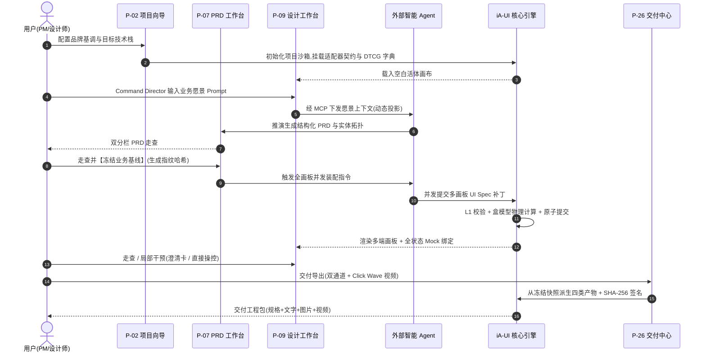
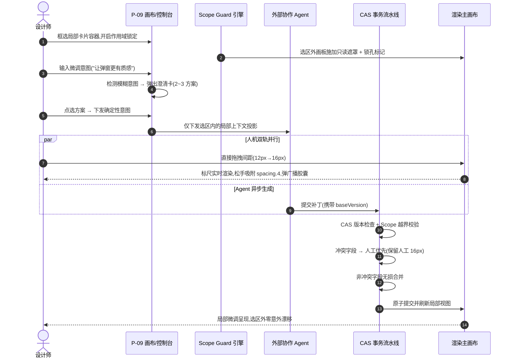
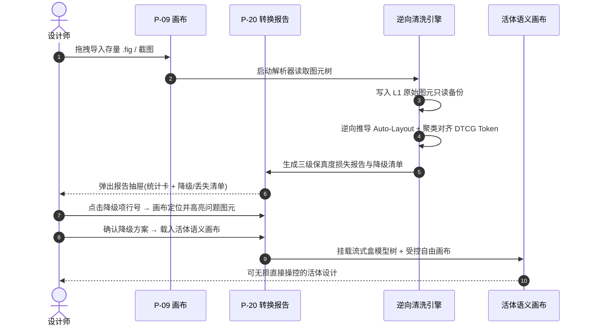
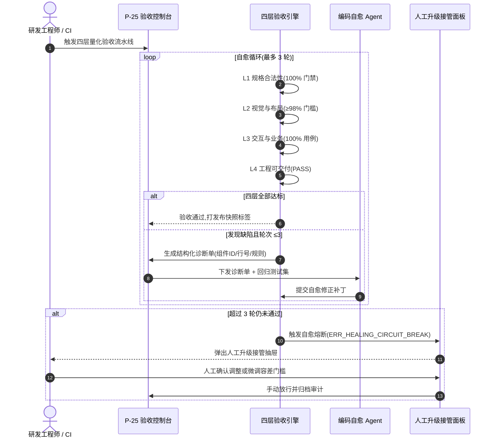
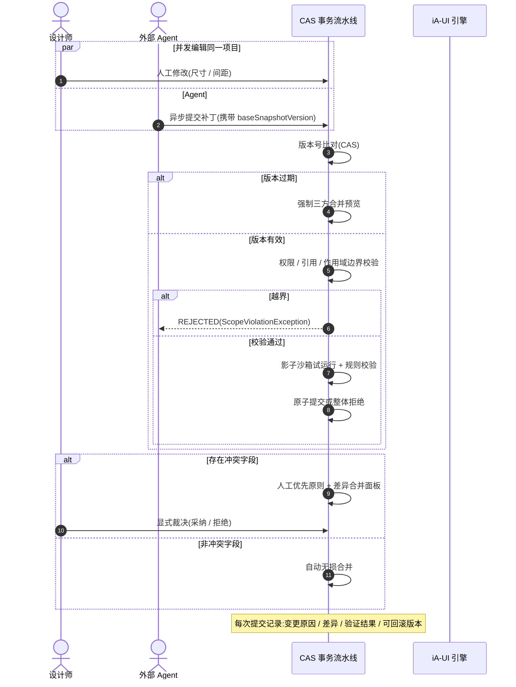

> **所属目录**：`_02_design_detail` | **文档类型**：全局基础与支撑规范
> **关联索引**：[00_页面关联关系树状图.md](./00_页面关联关系树状图.md) | **来源**：`design-detail.opencode.v0.0.2.md` (Lines 859–1085)

---

# 第 5 章 端到端关键交互流程(总体)

> **本章导读**:本章把页面级流程串成**跨页面旅程**(对应设计书 §2.3 场景与 §5 工作流),是从"全貌(第 1 章)"到"单页细节(第 6 章)"之间的**总体视角桥梁**:先看整条旅程如何串联各页面,再读第 6 章逐页落地。

## 5.1 场景 A:从 0 到 1 极速孵化(Quick Path / Deep Path)



```
P-02 新建项目
  → P-03 向导(起步方式)
      ├─ 快速单页:收窄向导 → 创建 → §4.1 P-09
      └─ 完整孵化:创建 → §6.2 P-07
P-07 PRD 工作台:输入想法 → Agent 推演结构化 PRD → 人工逐章审阅(章节重生成/补充)→ 冻结业务逻辑
  → §4.1 P-09 生成装配(令牌绑定 → 盒模型装配 → 跨端衍生 → 原型挂载 → 全状态 Mock)
  → 引擎确定性执行:校验补丁 / 冲突检测 / 原子提交 → 画布更新 + S-04 会话记录
  → 设计师走查(§4.3 P-11 预览 / Mock 场景切换 / §4.2 P-10 澄清局部干预)
  → §6.7 P-25 验证(四层门禁)→ 自愈 / 人工接管
  → §6.6 P-21 打快照 → §6.6 P-23 提交评审 → 批准 → 发布(冻结)
  → §6.7 P-26 交付(规格 + 文字 + 图片 + 视频)→ 通知研发
关键分支:
  - 中途发现 PRD 需求变更 → 解冻 → P-07 修改 → 画布黄色预警"是否更新 UI?" → 选"更新"重新装配受影响页
  - 单页生成超时(>20s)→ 自动中断回滚 → 提示精简需求重试
  - 交付完整度缺视频 → P-26 标红 → P-11 录屏补齐 → 重新交付
```

## 5.2 场景 B:人机双向精细调优(设计书 §2.3 场景 B / §5.2)



```
§4.1 P-09 画布:框选局部 → Cmd+Alt+L 锁定作用域(选区外磨砂 + 锁孔)
  → S-03 意图输入"让弹窗更有质感" → 检测模糊 → §4.2 P-10 澄清卡(2~3 方案)→ 点选
  → Agent 生成候选(引擎校验,越界写被 ScopeViolationException 拦截)→ 画布原子更新
  → 设计师直接拖拽微调:间距吸附 Token → 底部胶囊"是否一键广播全局?" → 选"应用全局/仅本次/忽略"
  → 确定性参数直达:输入"间距 16px" → 硬约束直接生效
  → 与 Agent 异步并发:人工改动与 Agent 补丁冲突 → 人工优先 + 差异合并面板 → 裁决
  → §6.6 P-21 对比版本 → §6.6 P-22 Diff 审阅 → 采纳/回退
  → 更新规格并通知研发(§6.7 P-26 增量交付)
关键分支:
  - Agent 补丁版本过期(baseSnapshotVersion 不符)→ 强制三方合并预览
  - 主组件修改 → 影响清单(全局同步/仅本次/拒绝并保留分叉)
```

## 5.3 场景 C:存量设计导入重构(设计书 §3.3 路径 B)



```
P-02 导入设计 / P-03 导入起步
  → §6.5 P-19 导入向导:选择文件 → 配置保真等级(L1/L2/L3)与目标技术栈 → 解析
  → §6.5 P-20 转换报告:统计卡(容器转换率/Token 归一化率/降级/丢失)→ 分栏清单 → 定位节点
  → 进入 §4.1 P-09:逐项审阅降级 / 丢失项 → 修正
  → 语义重构:绝对坐标 → 流式盒模型;散乱色值 → Token(裸色值扫描 + 对齐)
  → 组件映射:识别组件绑定注册表;缺失组件进入"待沉淀"列表
  → §6.7 P-25 验证:L2 视觉比对(与原图差异)→ 优化 → 通过
  → 交付(§6.7 P-26)
关键分支:
  - 解析严重损坏 → "回退至原始绝对布局草稿"保底
  - 无法识别的内联样式 → "待清洗样式池" + 一键对齐建议
```

## 5.4 场景 D:验证与交付自愈闭环(设计书 §5.3)



```
研发实现(基于 UI Spec 生成代码)
  → 受控浏览器渲染(Playwright)→ 视觉 / 规范比对
  → §6.7 P-25 结构化诊断:布局溢出 / 裸色值 / 状态缺失 / 文字截断 / 对比度 / 悬空路由
  → 外部 Agent 依据诊断自愈(≤3 轮,携带回归测试)
      ├─ 通过 → 交付 / 更新规格
      └─ 未达标 → 人工升级接管
  → 研发提交验证回执 → P-25 汇总(实现偏差定位)
```

## 5.5 场景 E:并发冲突处理(设计书 附录 A.4)



```
人工与外部 Agent 并发编辑同一项目
  → 版本号比对(CAS)
      ├─ 基于最新版本 → 补丁校验(权限/引用/作用域边界)→ 原子提交
      └─ 版本过期 → 强制三方合并
  → 冲突检测:
      ├─ 非冲突字段(人工改尺寸,Agent 改文案)→ 自动无损合并
      └─ 冲突字段(同属性)→ 人工优先 + 差异合并面板 → 显式裁决
  → 提交:临时版本应用 → 规格与依赖验证 → 原子提交或整体拒绝
  → 每次提交记录:变更原因 / 差异 / 验证结果 / 可回滚版本
```

---
