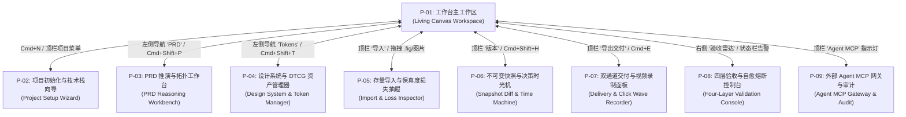
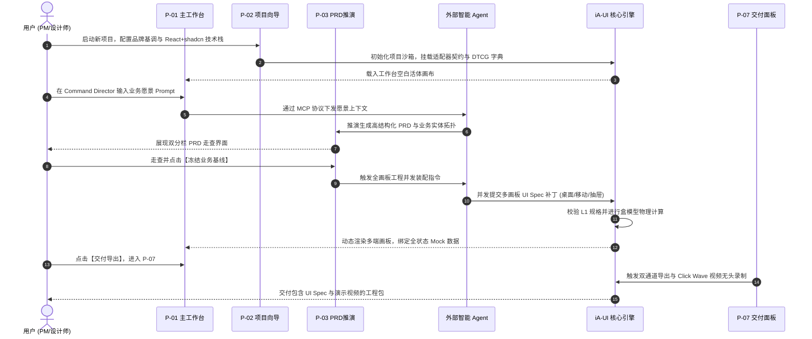
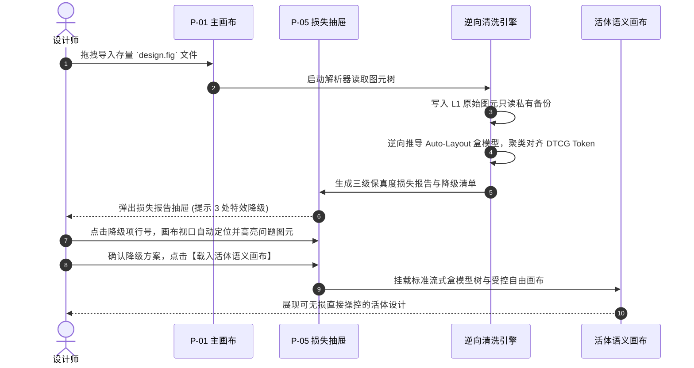
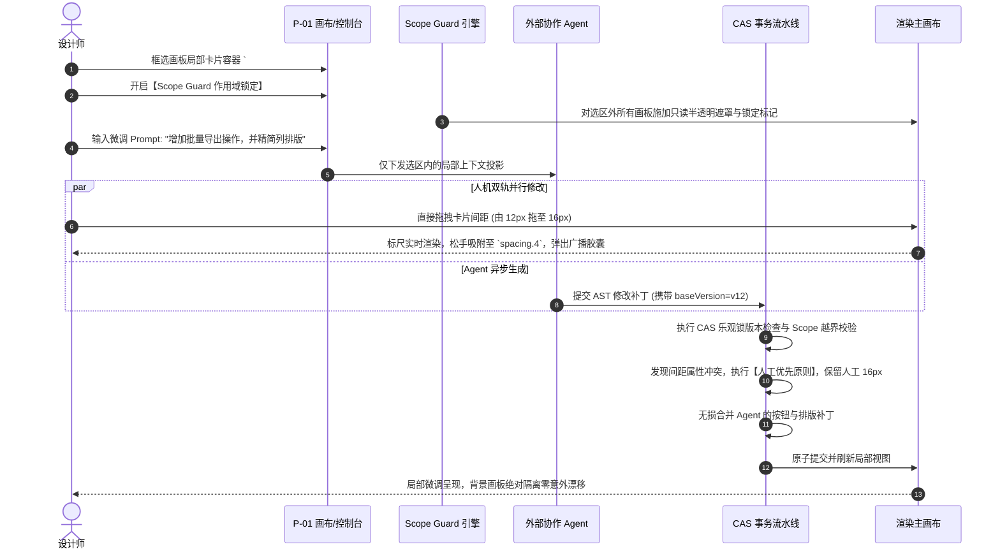
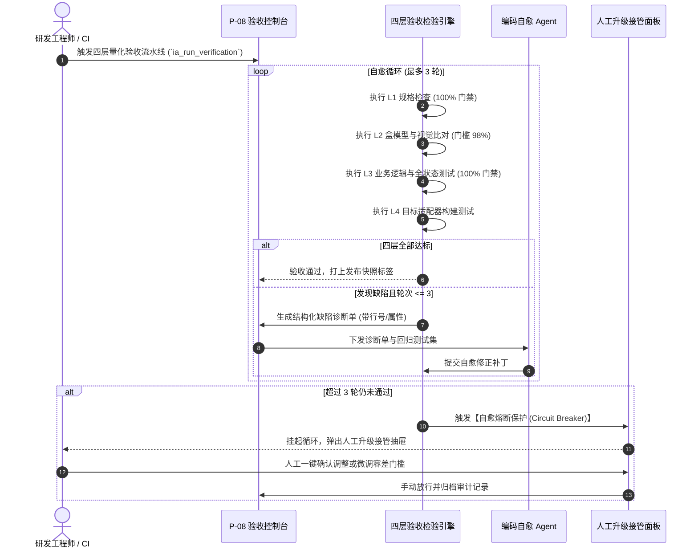
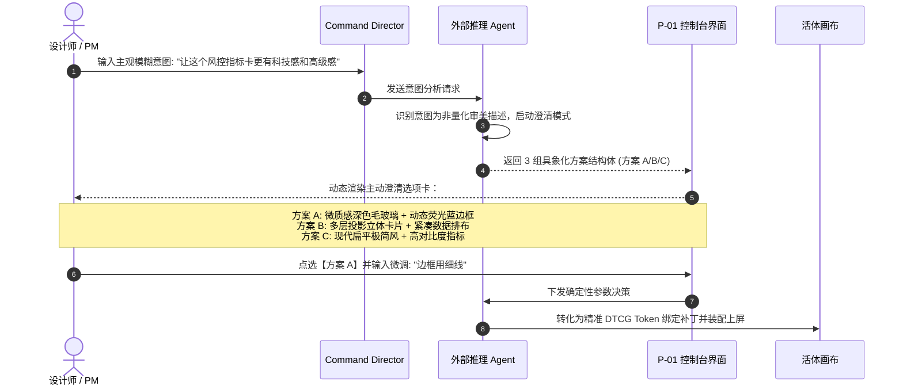

# iA-UI 产品功能与页面详细设计说明书 (Product Functional & UI Detail Design Specification)

- **产品名称**：iA-UI (Intelligent Agentic UI Workbench - 智能代理 UI 架构与设计工作台)
- **文档版本**：v0.0.1 (基于 `design.gemini.v0.0.4.md` 产品规格书的详细设计工程落地上线版)
- **文档类型**：系统详细设计与交互设计规范说明书 (Detailed System & UI/UX Design Specification)
- **编制日期**：2026-10-12
- **当前状态**：`DETAILED_DESIGN_FROZEN` (详细设计完成 / 待工程研发实施)
- **基线输入设计书**：`design.gemini.v0.0.4.md` (主基线) / `design.gemini.v0.0.4.merge.md` (全要素对照)
- **面向受众**：前端研发工程师、全栈架构师、UI/UX 设计师、外部 Agent 工具集成开发者、QA 测试工程师

---

## 目录索引 (Table of Contents)

1. [系统总体架构与页面拓扑路由 (Architecture & Page Routing)](#1-系统总体架构与页面拓扑路由)
   - 1.1 页面层次与导航拓扑图
   - 1.2 全局页面路由表与状态守卫
   - 1.3 核心数据总线与客户端状态存储模型
2. [页面级详细设计与交互规格 (Page-Level Detailed Specifications)](#2-页面级详细设计与交互规格)
   - 2.1 页面 P-01：工作台主工作区 (Workbench Living Canvas Workspace)
   - 2.2 页面 P-02：项目初始化向导与技术栈配置模态窗 (Project Setup & Stack Preference Wizard)
   - 2.3 页面 P-03：PRD 结构化推演与实体拓扑工作台 (PRD Reasoning & Topology Workbench)
   - 2.4 页面 P-04：设计系统与 DTCG 令牌资产管理器 (Design System & DTCG Token Manager)
   - 2.5 页面 P-05：存量资产导入与保真度损失报告抽屉 (Asset Import & Fidelity Loss Inspector)
   - 2.6 页面 P-06：不可变版本快照、全要素 Diff 与决策时光机 (Snapshot Diff & Time Machine)
   - 2.7 页面 P-07：双通道交付物导出与 Click Wave 视频录制面板 (Dual-Channel Delivery & Click Wave Recorder)
   - 2.8 页面 P-08：四层验收雷达与自愈熔断接管控制台 (Four-Layer Validation & Self-Healing Console)
   - 2.9 页面 P-09：外部 Agent MCP 接入网关与授权审计中枢 (Agent MCP Gateway & Audit Center)
3. [核心业务功能全量详细规格说明 (Core Functional Detailed Specifications)](#3-核心业务功能全量详细规格说明)
   - 3.1 `FEAT-001`：项目管理与外部 Agent MCP 安全接入
   - 3.2 `FEAT-002`：多模态需求推演与 PRD-UI 双向实体绑定
   - 3.3 `FEAT-003`：AI 原生设计自主装配引擎与动态上下文投影
   - 3.4 `FEAT-004`：活体语义画布与直接操控逆向意图提炼
   - 3.5 `FEAT-005`：作用域锁定 (Scope Guard) 与 CAS 事务并发修改流水线
   - 3.6 `FEAT-006`：设计系统、DTCG 令牌字典与组件库契约
   - 3.7 `FEAT-007`：受控自由画布与相对坐标可视化原语
   - 3.8 `FEAT-008`：声明式交互原型与四态业务 Mock 数据绑定
   - 3.9 `FEAT-009`：多终端自适应布局与一键跨端衍生
   - 3.10 `FEAT-010`：存量设计导入逆向清洗与三级保真度损失报告
   - 3.11 `FEAT-011`：不可变版本快照、全要素 Diff 树与时光机回滚
4. [全链路核心业务交互流程与时序规范 (End-to-End Interaction Flows)](#4-全链路核心业务交互流程与时序规范)
   - 4.1 流程 F-01：从 0 到 1 极速业务孵化全生命周期流 (0 to 1 Inception)
   - 4.2 流程 F-02：存量设计导入重构与降级确认流 (Design Migration)
   - 4.3 流程 F-03：人机双轨微调与 Scope Guard 事务隔离提炼流 (Dual-Track Refinement)
   - 4.4 流程 F-04：四层量化验收、自愈熔断与人工升级接管流 (Verification & Healing Loop)
   - 4.5 流程 F-05：模糊意图人机主动澄清选卡交互流 (Intent Clarification Loop)
5. [交互原语、动效标准与异常状态字典 (Interaction Primitives, Motion & Exceptions)](#5-交互原语动效标准与异常状态字典)
   - 5.1 直接操控手势与动态弹性标尺规范
   - 5.2 Click Wave 点击波纹动效与转场物理曲线
   - 5.3 全系统异常状态码、降级反馈与熔断兜底字典

---

## 1. 系统总体架构与页面拓扑路由 (Architecture & Page Routing)

### 1.1 页面层次与导航拓扑图

iA-UI 系统采用以 **“工作台主画布 (Living Canvas Workspace)”** 为核心枢纽的高聚合专业工程架构，辅以 8 个受控交互抽屉/模态子系统，实现全功能无缝切换与零上下文丢失：



### 1.2 全局页面路由表与状态守卫

平台基于 SPA 结构化路由与 URL 状态持久化契约，确保所有画板定位、选区高亮与模态状态可分享、可深链定位：

| 页面编号 | 路由路径 (Path Pattern) | 挂载形态 | 访问权限角色 | 路由参数与 Query 状态声明 |
| :--- | :--- | :--- | :--- | :--- |
| **P-01** | `/workspace/:projectId` | 主界面窗口 | 全部角色 | `view` (canvas/flow), `zoom`, `activePageId`, `selectedNodeId` |
| **P-02** | `/workspace/:projectId/setup` | 居中模态窗 | `ROLE_ADMIN`, `ROLE_DESIGN_LEAD` | `mode` (create/settings), `tab` (vibe/stack/mcp) |
| **P-03** | `/workspace/:projectId/prd` | 全屏切换/双分栏 | `ROLE_PRODUCT_MGR`, `ROLE_DESIGN_LEAD` | `docId`, `activeEntity`, `splitMode` (50:50/30:70) |
| **P-04** | `/workspace/:projectId/tokens` | 左侧扩展抽屉 (480px) | 全部角色 (编辑需 Lead 权限) | `category` (color/font/space/radius), `theme` (light/dark) |
| **P-05** | `/workspace/:projectId/import` | 底部弹出抽屉 (640px) | `ROLE_DESIGN_LEAD`, `ROLE_PRODUCT_MGR` | `importJobId`, `fidelityLevel` (L1/L2/L3) |
| **P-06** | `/workspace/:projectId/history` | 底部展开全宽面板 (520px) | 全部角色 | `baseSnapshot`, `targetSnapshot`, `diffMode` (split/onion) |
| **P-07** | `/workspace/:projectId/export` | 居中沉浸模态 (960px) | 全部角色 | `channel` (machine/human), `format` (spec/video/docs) |
| **P-08** | `/workspace/:projectId/validate` | 右侧扩展面板 (420px) | 全部角色 | `suiteLevel` (L1/L2/L3/L4), `autoHealRound` (1-3) |
| **P-09** | `/workspace/:projectId/mcp` | 右侧扩展面板 (400px) | `ROLE_ADMIN`, `ROLE_ENGINEER` | `sessionId`, `filter` (all/audit/calls) |

### 1.3 核心数据总线与客户端状态存储模型

客户端采用单向数据流与分层状态缓存机制：
1. **Document Tree Store (不可变文档树)**：基于 Immer 维护的 UI Spec 树，每一个修改由 CAS 事务引擎校验生成新的 Revision ID；
2. **Transactional Mutation Queue (事务流水线)**：存储当前正在执行的直接选区 Patch (Direct Scope) 与依赖扩散计算结果 (Propagation Scope)；
3. **Viewport & Interaction Store (视口与画布瞬态)**：记录视口平移 `(panX, panY)`、缩放比例、多选框选图元集、正在拖拽的边距手柄等（不污染文档历史）；
4. **Agent Context Bus (MCP 会话总线)**：双向通信通道，维持与外部 Agent 的 SSE / WebSocket 连接，传递当前投影上下文 (Context Projection) 与流式推理日志。

---
## 2. 页面级详细设计与交互规格 (Page-Level Detailed Specifications)

### 2.1 页面 P-01：工作台主工作区 (Workbench Living Canvas Workspace)

#### 2.1.1 界面布局与线框结构 (Wireframe)
工作台主工作区是整个 iA-UI 的核心中枢，采用高度专业的四分栏工业级工作台布局：
- 顶部：全局领航与控制栏 (Top Navigation Bar, 高度 48px)
- 左侧：意图大纲与资产树 (Intent Outline & Asset Tree, 宽度 280px，支持折叠)
- 中央：活体语义多维画布 (Living Semantic Infinite Canvas, 自适应宽高)
- 右侧：约束与生成控制台中枢 (Inspector & Command Director, 宽度 340px，支持折叠)
- 底部：状态流转与视口控制栏 (Status & Viewport Bar, 高度 32px)

```
┌──────────────────────────────────────────────────────────────────────────────────────────────────┐
│ [TOP] 📁 iA-UI / 跨境风控中台  [Enterprise Clean]  [React+Tailwind]  [Agent: IDLE 🟢]  [导出交付物]  [发布]│
├─────────────────┬──────────────────────────────────────────────────────────────┬─────────────────┤
│ [LEFT] 架构与意图│ [CENTER] 动态语义画布 (Living Semantic Canvas)                 │ [RIGHT] 属性/控制│
│ ├─ 📁 页面路由树 │                                                              │ ├─ 🎯 意图领航栏 │
│ │  ├─ 📄 看板总览│   ┌──────────────┐   ┌──────────────┐   ┌──────────────┐   │ │  [输入Prompt..]│
│ │  ├─ 📄 规则配置│   │  桌面端画板  │ ──▶│  交互抽屉    │ ──▶│  移动端画板  │   │ ├─ 🧩 盒模型排版 │
│ │  └─ 📄 告警列表│   │  (1440x900)  │   │  (Drawer)    │   │  (390x844)   │   │ │  W: fill H: hug│
│ ├─ 🌲 DOM语义树 │   └──────────────┘   └──────────────┘   └──────────────┘   │ │  Padding: 16 24│
│ │  └─ #root     │       ▲                                                      │ ├─ 🛡️ Scope Guard│
│ ├─ 🎨 Token 字典│       │                                                      │ │  [启用选区锁定]│
│ └─ 📦 组件资产库│   [直接操控: 实时渲染弹性外边距标尺，操作逆向提炼提示胶囊]   │ ├─ 🧪 业务 Mock  │
│                 │                                                              │ └─ 🚦 四层验收雷达│
├─────────────────┴──────────────────────────────────────────────────────────────┴─────────────────┤
│ [BOTTOM] 视图模式: [功能流向 | 平面画布] | 缩放: 100% | 选区: summary_card (ID: c_89f2) | 60 FPS   │
└──────────────────────────────────────────────────────────────────────────────────────────────────┘
```

#### 2.1.2 界面分区与功能元素明细表

| 界面区域 | 组件/元素名称 | 控件类型 | 状态定义与触发行为 | 关联后端/底层逻辑 |
| :--- | :--- | :--- | :--- | :--- |
| **顶部顶栏** | 项目切换与设置 | 下拉菜单 / 按钮 | 点击展开最近项目列表或弹出 P-02 设置向导 | `ProjectStore.switchProject` |
| **顶部顶栏** | 品牌风格徽章 | 下拉选择器 | 展示当前风格基调 (`Enterprise Clean`)，切换触发全局 Token 主题重构 | `TokenStore.setVibeTheme` |
| **顶部顶栏** | 技术栈偏好标签 | 只读徽章 | 显示当前绑定适配器 (`react_tailwind_shadcn`) | `AdapterManifest.current` |
| **顶部顶栏** | Agent MCP 状态灯 | 状态指示指示灯 | 🟢 闲置 (IDLE), 🟡 推理中 (THINKING), 🔴 错误断开 (ERROR)；点击呼出 P-09 网关面板 | `McpGateway.connectionState` |
| **顶部顶栏** | 交付物导出按钮 | 主按钮 (`primary`) | 快捷键 `Cmd+E`，点击呼出 P-07 导出面板 | `DeliveryExporter.open` |
| **顶部顶栏** | 冻结发布快照按钮 | 次级按钮 | 触发四层合规预检，通过后呼出版本打标输入框 | `SnapshotEngine.create` |
| **左侧导航** | 页面与画板树 | 树形视图 (TreeView) | 支持拖拽调序、重命名、右键克隆/删除画板；点击平滑滚动并聚焦画板 | `PageTree.selectPage` |
| **左侧导航** | 实体拓扑树 | 列表项 | 列出 PRD 推演绑定的业务实体（如 `Order`, `Rule`），悬浮高亮画板中对应节点 | `EntityBinding.highlight` |
| **左侧导航** | DTCG Token 快速列表 | 分组折叠面板 | 点击颜色或字体 Token 快速查看定义并一键拖拽赋予画板图元 | `TokenStore.applyToken` |
| **中央画布** | 画板容器 (Board) | 视口渲染容器 | 支持鼠标滚轮平移缩放、右键平移；视口剔除优化渲染 | `CanvasEngine.render` |
| **中央画布** | 弹性标尺手柄 | 交互辅助线 | 选中节点时边缘悬停显示 8 处拖拽点及弹性外边距虚线标注 (像素值) | `LayoutSolver.computeMetrics` |
| **中央画布** | 逆向意图提炼浮条 | 悬浮卡片 (Floating Pill) | 在直接操控拖拽松手后弹出：“检测到间距调整为 16px，是否一键广播至全局？” | `MutationPipeline.proposeBroadcast` |
| **中央画布** | 交互连接箭头 | 矢量曲率连线 | 连接源触发组件与目标画板/抽屉，点击连线编辑 Action 原语属性 | `ActionStore.selectAction` |
| **右侧控制** | Command Director | 命令行输入框 | 意图领航主输入框，支持自然语言 Prompt、回车触发外部 Agent 推演 | `AgentContextBus.dispatchPrompt` |
| **右侧控制** | 澄清方案卡片区 | 选项卡容器 | 当 Agent 检测到模糊需求时，在此动态渲染 2~3 个具象化卡片 (A/B/C) 供点选 | `AgentContextBus.onClarify` |
| **右侧控制** | Scope Guard 锁定开关 | 切换开关 (Switch) | 开启后锁定选区外所有画板为只读状态，防止 Agent 跨区篡改 | `ScopeGuard.setLocked` |
| **右侧控制** | 盒模型排版面板 | 属性组 | 显式配置 `hug`/`fill`/`fixed`、Padding (上右下左)、Gap、对齐方式 | `NodeStore.updateLayout` |
| **右侧控制** | DTCG Token 拾取器 | 语义选择器 | 严格限制拾取系统定义 Token，禁止直接输入未注册 Hex 散乱色值 | `NodeStore.bindToken` |
| **右侧控制** | 全状态 Mock 切换器 | 单选分段器 (Segment) | 一键在 `Normal` / `Empty` / `Error` / `Overflow` 之间切换当前组件展示 | `MockEngine.setScenario` |
| **右侧控制** | 四层验收雷达徽章 | 质量仪表盘 | 展示当前 L1~L4 达标率；点击展开 P-08 详细诊断抽屉 | `ValidationEngine.getSummary` |
| **底部栏** | 视图模式切换 | 分段控制器 | 切换“业务功能流拓扑图” (流程图连线排布) 与“无限平面视图” (自由空间) | `CanvasEngine.setViewMode` |
| **底部栏** | 帧率与视口诊断 | 只读文字 | 实时监测画布帧率 (保持 60fps)，超负载时显示性能降级预警 | `PerformanceMonitor.fps` |

---

### 2.2 页面 P-02：项目初始化向导与技术栈配置模态窗 (Project Setup & Stack Preference Wizard)

#### 2.2.1 界面布局与线框结构 (Wireframe)
P-02 为 680px 宽度的标准向导模态框，用于在项目创建或设置修改时确定产品基调与技术栈适配契约：

```
┌─────────────────────────────────────────────────────────────┐
│ 🚀 项目工程环境与技术栈配置向导                            [✕]│
├─────────────────────────────────────────────────────────────┤
│ 步骤 1: 基础属性    步骤 2: 目标终端与技术栈   步骤 3: Agent 授权 │
├─────────────────────────────────────────────────────────────┤
│ 项目名称: [ 跨境实时风控中台                    ] (必填, <=50字)│
│                                                             │
│ 品牌风格基调 (Brand Vibe):                                  │
│ ◉ Enterprise Clean (稳健中后台，低饱和蓝灰，高密度信息架构) │
│ ○ Modern Vibrant   (现代活力消费级，高明度渐变，大圆角留白) │
│ ○ Fintech Precise  (严谨金融级，深色高对比，紧凑数据展示)   │
│ ○ 自定义基调描述:  [ 输入自定义风格 Prompt...               ] │
│                                                             │
│ 目标运行终端 (Target Platforms):                            │
│ [✔] Desktop 桌面端 (1440px)    [✔] Mobile 移动端 (390px)     │
│ [ ] Tablet 平板端 (768px)                                   │
│                                                             │
│ 默认下游代码技术栈 (Code Stack Preference):                 │
│ ┌─────────────────────────────────────────────────────────┐ │
│ │ ◉ React + Tailwind CSS + shadcn/ui                      │ │
│ │   (Radix 普适原子组件契约，默认推荐，支持自愈闭环)     │ │
│ │ ○ Vue 3 + Tailwind CSS + Ant Design Vue                 │ │
│ │ ○ React Native + NativeWind (移动端混合应用)            │ │
│ └─────────────────────────────────────────────────────────┘ │
│                                                             │
│ MCP 访问控制与密钥授权:                                     │
│ Agent MCP Key: [ ia_sec_9f81a7b2...-uuidv4 ] [重新生成] [复制]│
│ 授权有效时限:   [ 30 天   ▼ ]  写入权限范围: [ 当前项目受限写入 ▼ ]│
├─────────────────────────────────────────────────────────────┤
│ [ 取消 ]                                    [ 保存并进入工作台 ]│
└─────────────────────────────────────────────────────────────┘
```

#### 2.2.2 控件交互逻辑与表单验证契约
1. **项目名称校验**：长度限制 1-50 字符，禁止包含系统敏感保留字符（如 `/`, `\`, `..`），重名时自动追加 `_1` 后缀；
2. **技术栈切换联动**：选中 `React + Tailwind + shadcn/ui` 后，系统底层自动导入并激活 `@ia-ui/adapter-react-shadcn` 规范字典；若切换为 Vue 3，自动将现有画板的组件映射表转换为 AntD Vue 对应契约并出具兼容性提示；
3. **MCP Key 颁发与吊销**：每次点击“重新生成”，旧密钥立即进入 500ms 吊销倒计时，所有正在通过旧 Key 进行调用的外部 Agent 立即被网关拦截并返回 `401 Unauthorized`。

---

### 2.3 页面 P-03：PRD 结构化推演与实体拓扑工作台 (PRD Reasoning & Topology Workbench)

#### 2.3.1 界面布局与线框结构 (Wireframe)
P-03 是面向产品经理与架构师的沉浸式业务推演工作台，支持 Markdown 结构化 PRD 与画板预览双分栏无缝联动：

```
┌──────────────────────────────────────────────────────────────────────────────────────────────────┐
│ [PRD 架构推演工作台]  文档: 跨境风控系统_PRD_v1.0  [AI 推演拓扑]  [冻结业务基线]  [返回画布 P-01]  │
├────────────────────────┬─────────────────────────────────────┬───────────────────────────────────┤
│ [PRD 章节大纲]         │ [Markdown 结构化语义编辑器]         │ [关联画板与实体预览]               │
│ 1. 业务目标与价值      │ ## 3. 核心功能规格与实体状态机      │                                   │
│ 2. 用户角色画像        │                                     │ 关联实体: `RiskRule`              │
│ 3. 功能清单与状态机    │ ### 3.1 规则配置表单 (`FEAT-002`)   │ 绑定画板: [桌面端-规则配置页 1440] │
│    ├─ 规则配置 (P-01)  │ - **实体名称**：`RiskRule`          │ ┌───────────────────────────────┐ │
│    └─ 拦截大盘 (P-02)  │ - **核心字段**：                    │ │ [规则名称: _______________]   │ │
│ 4. 页面路由拓扑        │   - `ruleId`: UUID (主键)           │ │ [拦截阈值: [  90  ] ]         │ │
│ 5. 四层验收指标        │   - `riskLevel`: HIGH/MID/LOW       │ │ [触发动作: [ 立即阻断 ▼ ] ]   │ │
│                        │   - `action`: BLOCK/ALERT           │ │ [ 保存规则按钮 (Action-01) ]  │ │
│ [双向绑定指示灯]       │                                     │ └───────────────────────────────┘ │
│ 🟢 12 实体已 100% 绑定 │ [⚠️ 画布按钮已删除，PRD 缺少触点!]   │ [点击画板定位至画布] [同步至 UI]   │
└────────────────────────┴─────────────────────────────────────┴───────────────────────────────────┘
```

#### 2.3.2 PRD-UI 双向联动与冲突感知交互
1. **PRD 实体到 UI 节点单向锚定**：在 Markdown 编辑器中声明字段格式 `@entity:Order.status` 时，系统自动在关联画板中生成带有 Data Binding 标记的展示组件；
2. **UI 变更反向预警**：当设计师在 P-01 画布中删除了带有 `@action:SubmitOrder` 的核心按钮时，P-03 编辑器对应段落行号旁立即亮起黄色警告徽章：“该段落绑定的触点组件已在画布中被移除”；
3. **业务基线冻结契约**：点击“冻结业务基线”，PRD 进入只读锁定状态，生成业务校验指纹哈希，后续所有 UI 生成与四层验收以此基线作为 L3 逻辑测试的唯一事实真理。

---

### 2.4 页面 P-04：设计系统与 DTCG 令牌资产管理器 (Design System & DTCG Token Manager)

#### 2.4.1 界面布局与线框结构 (Wireframe)
P-04 采用可折叠的左侧滑出式抽屉 (宽度 480px) 或全屏独立视图，提供符合 W3C DTCG (Design Tokens Community Group) 标准的集中式治理体系：

```
┌────────────────────────────────────────────────────────┐
│ 🎨 设计系统与 DTCG 令牌字典 (Design Tokens)         [✕]│
├────────────────────────────────────────────────────────┤
│ [主题轴切换: ◉ Light  ○ Dark  ○ High Contrast]         │
│ 搜索令牌: [ 🔍 输入 token key, 如 color.primary...   ] │
├──────────┬─────────────────────────────────────────────┤
│ 分类导航 │ 令牌键名与取值定义 (DTCG JSON 标准)         │
├──────────┼─────────────────────────────────────────────┤
│ ◉ 颜色   │ color.primary.default                       │
│ ○ 字阶   │   值: hsl(222.2, 47.4%, 11.2%)   [拾色器]   │
│ ○ 间距   │   别名: {color.brand.600}                   │
│ ○ 圆角   │   描述: 全局核心主色，用于主要操作与高亮      │
│ ○ 阴影   │ color.background.canvas                     │
│          │   值: hsl(0, 0%, 100%)                      │
│          │ ─────────────────────────────────────────── │
│          │ spacing.4 (间距 16px)                       │
│          │   值: 1rem (16px)                           │
│          │ radius.md (标准圆角)                        │
│          │   值: 0.375rem (6px)                        │
├──────────┴─────────────────────────────────────────────┤
│ [严格模式: 禁止画布裸色写入 (Strict Mode: ON 🟢)]      │
│ [ 导入 DTCG tokens.json ]      [ 导出为 Tailwind 配置 ] │
└────────────────────────────────────────────────────────┘
```

#### 2.4.2 交互与治理规则
1. **严格禁止裸色写入 (Zero Raw Values)**：开启严格模式后，画布中任何手动输入的十六进制颜色（如 `#2563EB`）将被阻断，系统弹出建议：“未在 DTCG 字典中找到匹配值，推荐自动绑定至 `color.primary.600`”；
2. **多主题轴联动计算**：切换至 `Dark` 主题轴时，中央画布中所有绑定的图元在 16ms 内无刷新同步重绘，呈现暗色系下的高对比度表现；
3. **Token 修改依赖分析**：修改 `spacing.4` 数值时，抽屉底部弹出“波及影响分析”：“当前项目中 42 个容器正在引用该令牌，保存将触发这 42 个节点的流式重新计算，是否继续？”。
### 2.5 页面 P-05：存量资产导入与保真度损失报告抽屉 (Asset Import & Fidelity Loss Inspector)

#### 2.5.1 界面布局与线框结构 (Wireframe)
P-05 是从底部滑出的大型分析抽屉 (高度 580px)，在用户导入 Figma `.fig` 文件、JSON 图层树或产品高清截图后自动呈现：

```
┌──────────────────────────────────────────────────────────────────────────────────────────────────┐
│ 📥 存量设计语义重构与保真度损失报告 (Fidelity Loss Inspector)                              [✕]│
├──────────────────────────────────────────────────────────────────────────────────────────────────┤
│ 导入源: `dashboard_v2.fig` (解析完成, 耗时 2.4s) | 综合重构健康分: 94.2 / 100 🟢               │
├──────────────────────────────────────┬───────────────────────────────────────────────────────────┤
│ 转换层级概览与指标统计               │ 损失与降级明细清单 (点击行号自动在画布中定位图元)         │
├──────────────────────────────────────┼───────────────────────────────────────────────────────────┤
│ 🟢 L1: 数据与图元提取                │ [全部 (14)]  [⚠️ 降级处理 (11)]  [❌ 丢弃项 (3)]         │
│   • 图层与文本还原率: 100.0%         │ ───────────────────────────────────────────────────────── │
│   • 原始备份: `backup_raw_fig_01`    │ ⚠️ [图层 #header_glow] 包含复杂着色器模糊滤镜             │
│                                      │    系统行为: 安全降级为独立 SVG 矢量图元，保留原始渲染    │
│ 🟢 L2: 流式弹性盒模型重构            │ ⚠️ [图层 #btn_label] 字体 'MyCustomSerif' 系统未安装       │
│   • Auto-Layout 容器转换率: 95.8%    │    系统行为: 降级对齐至项目令牌 `font.sans.default`       │
│   • 绝对坐标残留图元: 12 个          │ ❌ [图层 #anim_particle] 包含私有第三方动效插件数据       │
│                                      │    系统行为: 转换为静态矢量图，丢弃私有二进制运行态       │
│ 🟡 L3: 设计令牌归一化率              │ ⚠️ [图层 #card_bg] 散乱色值 `#1e293b`                     │
│   • 成功对齐 DTCG Token: 88.5%       │    系统行为: 智能推荐并绑定至 `color.slate.800` (置信度99%)│
├──────────────────────────────────────┴───────────────────────────────────────────────────────────┤
│ [ 放弃并清除 ]               [ 导出详细损失 JSON 报告 ]             [ 确认降级并载入活体语义画布 ]│
└──────────────────────────────────────────────────────────────────────────────────────────────────┘
```

#### 2.5.2 交互逻辑与降级裁决说明
1. **三级保真度量化体系**：
   - **L1 读取提取**：保证 100% 原始数据零丢失，底层写入私有快照，用户随时可调出原稿比对；
   - **L2 语义转换**：逆向盒模型算法计算弹性约束（Padding、Gap），无法转换的图元移入 `controlled_canvas` 节点，不阻塞流程；
   - **L3 双向往返**：保留图层稳定 ID，支持逆向导出保持结构不乱；
2. **图元一键定位与手动干预**：点击抽屉中的任一条降级记录，主画布视口在 200ms 内平滑平移至该图元，并高亮闪烁品红色外边框，方便设计师人工二次微调。

---

### 2.6 页面 P-06：不可变版本快照、全要素 Diff 与决策时光机 (Snapshot Diff & Time Machine)

#### 2.6.1 界面布局与线框结构 (Wireframe)
P-06 占据底部全宽或全屏覆盖，提供不可篡改的设计版本溯源与全要素可视化对比：

```
┌──────────────────────────────────────────────────────────────────────────────────────────────────┐
│ 🕰️ 设计决策时光机与全要素 Diff (Decision Time Machine)                                     [✕]│
├──────────────────────────────────────────────────────────────────────────────────────────────────┤
│ 当前基准: [ v0.0.3-hotfix (2026-10-12 18:30 by AI Agent) ] ──对比──▶ [ 当前画布最新工作草稿 ]     │
│ 对比视图模式: [ ◉ 左右分屏对比 (Side-by-Side)   ○ 洋葱皮叠加高亮 (Onion Skin, 透明度 50%) ]      │
├───────────────────────────────┬──────────────────────────────────────────────────────────────────┤
│ 历史快照版本轴                │ 全要素变更差异树 (基于稳定语义 ID 递归比对)                      │
├───────────────────────────────┼──────────────────────────────────────────────────────────────────┤
│ 🔘 刚刚: 当前未保存草稿 (8变动)│ 📦 页面: `page.dashboard.overview`                               │
│ ⚪ v0.0.3-hotfix (修复溢出)    │   🔄 节点: `#kpi_card_group`                                     │
│ ⚪ v0.0.3 (PRD 拓扑冻结)      │      - layout.gap: `12px` ──▶ `16px` (绑定至 `spacing.4`)        │
│ ⚪ v0.0.2 (初始多画板装配)    │   ➕ 节点: `#export_button` (新增实例，绑定 `Action:ExportReport`) │
│ ⚪ v0.0.1 (项目创建)          │   🗑️ 节点: `#deprecated_banner` (已删除)                         │
│                               │ 🎨 Token 字典: 变更 1 项 (`color.primary.hover` 调整明度)         │
│                               │ 🧭 交互路由: 新增 1 条 (`#export_button` ──▶ 打开抽屉 `#drawer_01`)│
├───────────────────────────────┴──────────────────────────────────────────────────────────────────┤
│ [ 导出 Diff 补丁包 (Patch JSON) ]         [ 以该历史版本创建新分支 ]      [ ⚠️ 一键回滚到该历史版本 ]│
└──────────────────────────────────────────────────────────────────────────────────────────────────┘
```

#### 2.6.2 交互逻辑与版本安全契约
1. **洋葱皮叠加高亮 (Onion Skin)**：在此模式下，旧版本渲染为半透明红色底图，新版本渲染为半透明绿色顶图，视觉位移差异以高亮色差瞬间呈现；
2. **回滚操作不可篡改**：点击“一键回滚”并不会物理删除后续提交，而是生成一条带有 `ROLLBACK_TO_V0.0.3` 明确语义标签的新快照，审计链绝对连贯；
3. **补丁导出与重放**：支持将两次快照之间的语义变更导出为标准 JSON Patch 文件，供外部 Agent 在其他分支中批量重放。

---

### 2.7 页面 P-07：双通道交付物导出与 Click Wave 视频录制面板 (Dual-Channel Delivery & Click Wave Recorder)

#### 2.7.1 界面布局与线框结构 (Wireframe)
P-07 为 960px 宽度的沉浸式交付物打包配置中心，严格落地双通道（机器+人类）交付标准：

```
┌──────────────────────────────────────────────────────────────────────────────────────────────────┐
│ 📦 生产级双通道交付物打包导出中枢 (Dual-Channel Delivery Center)                            [✕]│
├──────────────────────────────────────────────────────────────────────────────────────────────────┤
│ [ 选项卡: ◉ 通道 A: 面向 Vibecoding 机器规格   ○ 通道 B: 面向人类评审全媒体交付包 ]              │
├──────────────────────────────────────────────────────────────────────────────────────────────────┤
│ 通道 A: 机器可读生产工程包配置 (Machine-Readable Stream)                                         │
│   [✔] 强类型 UI Spec 抽象语法树 (`ui-spec.json`, 符合 Draft 2020-12 强模式约束)                 │
│   [✔] W3C DTCG 标准令牌字典 (`tokens.json` & `tailwind.theme.js`)                              │
│   [✔] 动作路由拓扑与全场景 Mock 数据包 (`interaction-mock-bundle.json`)                          │
│   [✔] 目标组件库适配器映射文件 (`component-mapping.manifest.json`)                              │
│   SHA-256 完整性签名: `e3b0c44298fc1c149afbf4c8996fb92427ae41e4649b934ca495991b7852b855`        │
├──────────────────────────────────────────────────────────────────────────────────────────────────┤
│ 通道 B: 人类可视化全媒体交付包配置 (Human-Readable Visual Stream)                                │
│   [✔] 结构化设计说明书 (`DESIGN_SPEC.md`, 包含业务拓扑、组件字段表、异常边界说明)                │
│   [✔] 1:1 高清切图标注图 (全画板 PNG 4K + 关键图标矢量 SVG，标注内边距与 Token 名)             │
│   [✔] 自动化交互演示视频 (`interaction_preview.mp4`, 1080p 60fps)                               │
│       ├─ 动效标准: 严格启用 Click Wave 点击扩散波纹 (半径 24px, 透明度 0.4->0, 持续 250ms)        │
│       ├─ 缓动曲线: 页面路由转场采用 Ease-in-out (`cubic-bezier(0.4, 0, 0.2, 1)`)                 │
│       └─ 走查路径: [ 自动走查全部主业务闭环流程 (时长约 45s) ▼ ]                                 │
├──────────────────────────────────────────────────────────────────────────────────────────────────┤
│ 输出目录: `./ia-ui-output/dist-20261012/`                                                        │
│ [ 本地预览交付包 ]                   [ 复制 MCP 消费链接 ]              [ 立即打包并生成交付包 ]│
└──────────────────────────────────────────────────────────────────────────────────────────────────┘
```

#### 2.7.2 视频生成与点击波纹渲染规则
1. **Click Wave 物理扩散引擎**：无头录屏容器（基于 Playwright）模拟执行预置业务用例，在所有点击动作发生时注入 CSS Keyframes 动效波纹，确保人类看样机时有极致清晰的触感视觉感知；
2. **交付包签名契约**：生成的 ZIP 压缩包附带签名证书文件，外部开发团队运行 `ia-cli verify` 校验哈希一致后方可投入流水线编译。

---

### 2.8 页面 P-08：四层验收雷达与自愈熔断接管控制台 (Four-Layer Validation & Self-Healing Console)

#### 2.8.1 界面布局与线框结构 (Wireframe)
P-08 是工作台右侧滑出的 420px 质量治理抽屉，承载平台核心的 L1~L4 量化检验与有限自愈熔断机制：

```
┌────────────────────────────────────────────────────────┐
│ 🚦 四层量化验收雷达与自愈控制台                     [✕]│
├────────────────────────────────────────────────────────┤
│ 综合健康度: 97.4% (通过门禁) | 自愈轮次: [ 2 / 3 轮 ]  │
├────────────────────────────────────────────────────────┤
│ 🟢 L1: 规格合法性 (Spec Validity)          100% 强制通过│
│   • JSON Schema 语法与类型校验: PASS                   │
│   • 节点稳定 ID 闭包完整性: PASS                       │
│   • 动作路由 404 悬空检查: PASS                        │
│ ────────────────────────────────────────────────────── │
│ 🟡 L2: 视觉与排版 (Visual & Layout)         98.2% (门槛98)│
│   • 盒模型外溢检查: 发现 1 处微小溢出 (已定位)         │
│   • 响应式断点弹性收缩: PASS                           │
│   • WCAG 2.1 AA 色彩对比度: 99.1%                      │
│ ────────────────────────────────────────────────────── │
│ 🟢 L3: 交互与业务逻辑 (Logic & States)      100% PASS   │
│   • 状态机触发与路由闭环: 100% (14/14 用例)            │
│   • 表单输入边界校验: PASS                             │
│   • Normal/Empty/Error/Overflow 全覆盖: PASS           │
│ ────────────────────────────────────────────────────── │
│ 🟢 L4: 工程可交付性 (Readiness)            PASS        │
│   • 下游适配器代码静态检查: 0 报错                     │
│   • DTCG 令牌合规率: 100% (无内联裸数值)               │
├────────────────────────────────────────────────────────┤
│ ⚠️ 当前未决缺陷诊断 (Diagnostics Ticket #D-891)         │
│ 缺陷组件: `#table_column_action` (操作列)              │
│ 问题描述: 在 768px 断点下，按钮文本发生 6px 溢出       │
│ 建议自愈策略: 修改父容器 sizing 为 hug，或隐藏次级按钮 │
├────────────────────────────────────────────────────────┤
│ [ 自愈重试 (轮次 3/3) ]        [ 触发人工升级接管并微调 ]│
└────────────────────────────────────────────────────────┘
```

#### 2.8.2 自愈熔断与人工接管交互机制
1. **3 次重试硬上限**：如果编码 Agent 在第 3 轮自愈后仍未使 L1~L4 指标达到通过门槛，系统立即自动挂起自愈循环，禁止无休止消耗 Token；
2. **人工接管面板呼出**：挂起后自动将问题组件居中并以红色线框闪烁，在右侧面板呈现“人工接管建议选项”：一键将尺寸策略由 `fixed` 改为 `hug`，或调整断点规则，人工点击后即刻通过。

---

### 2.9 页面 P-09：外部 Agent MCP 接入网关、连接配置与授权审计中枢 (Agent MCP Gateway, Config & Audit Center)

#### 2.9.1 页面定位与核心问题解答：Agent 怎么知道要连接到哪里？
在现代 Agent 研发协同中，外部智能体（如 Cursor、Claude Code、Windsurf 等）通过 **标准 MCP (Model Context Protocol)** 协议与设计工作台双向通信。
外部 Agent 连接到 iA-UI 有两种标准接入拓扑：
1. **本地开发模式 (Local Stdio / Native CLI)**：工作台启动本地 MCP 守护子进程，Agent 直接通过本机的 Stdio 管道与工作台握手，零网络端口暴露；
2. **远程/团队协同模式 (Remote SSE / WebSocket Server)**：工作台内置或独立部署轻量级 MCP 网关服务（默认监听 `http://127.0.0.1:8765/mcp/sse`），外部 Agent 在其客户端配置文件中配置端点 URL 与 Bearer Token。

**P-09 界面核心提供了一键配置导出、连接向导、环境变量注入与握手健康自检面板**，使用户和 Agent 无需猜测连接地址与密钥。

#### 2.9.2 界面布局与线框结构 (Wireframe)
P-09 采用 640px 宽度的专业网关配置面板（支持右侧抽屉展开或全屏模态），包含【连接配置向导 (Connect Config)】、【活跃客户端列表 (Active Clients)】与【安全审计流水 (Audit Logs)】三大选项卡：

```
┌──────────────────────────────────────────────────────────────────────────────────────────────────┐
│ 🛡️ 外部 Agent MCP 接入网关、连接配置与授权审计中枢                                          [✕]│
├──────────────────────────────────────────────────────────────────────────────────────────────────┤
│ 网关服务状态: 🟢 RUNNING (本地守护进程启动) | 本地监听端点: http://127.0.0.1:8765/mcp/sse         │
├──────────────────────────────────────────────────────────────────────────────────────────────────┤
│ [选项卡: ◉ 1. Agent 连接配置与客户端注入   ○ 2. 已连接活跃客户端 (2)   ○ 3. 实时调用审计流水 ]    │
├──────────────────────────────────────────────────────────────────────────────────────────────────┤
│ 接入模式选择:  ◉ 本地推荐模式 (Local Stdio via CLI)     ○ 远程网络模式 (Remote HTTP/SSE)          │
│                                                                                                  │
│ 1️⃣ 选择你的外部 Agent 客户端:                                                                    │
│ [ ◉ Cursor IDE ]  [ ○ Claude Code (CLI) ]  [ ○ Windsurf ]  [ ○ 自定义通用 MCP 客户端 ]           │
│                                                                                                  │
│ 2️⃣ 客户端配置文件路径与一键注入:                                                                 │
│ 配置文件路径: `~/.cursor/mcp.json`                                                               │
│ [ ⚡ 一键自动写入配置到 Cursor ]    [ 📋 复制 JSON 代码块 ]    [ 🔄 重新生成 Project Token ]      │
│                                                                                                  │
│ 3️⃣ 配置文件标准片段预览 (MCP Client Config Snippet):                                             │
│ ┌──────────────────────────────────────────────────────────────────────────────────────────────┐ │
│ │ {                                                                                            │ │
│ │   "mcpServers": {                                                                            │ │
│ │     "ia-ui-workbench": {                                                                     │ │
│ │       "command": "ia-cli",                                                                   │ │
│ │       "args": ["mcp-server", "--project", "proj_prod_analytics_01"],                        │ │
│ │       "env": {                                                                               │ │
│ │         "IA_UI_ENDPOINT": "http://127.0.0.1:8765",                                           │ │
│ │         "IA_UI_MCP_KEY": "ia_sec_9f81a7b2-38e1-4c12-87a1-89e498fc7231",                     │ │
│ │         "IA_UI_ACTIVE_PAGE": "page.dashboard.overview"                                       │ │
│ │       }                                                                                      │ │
│ │     }                                                                                        │ │
│ │   }                                                                                          │ │
│ │ }                                                                                            │ │
│ └──────────────────────────────────────────────────────────────────────────────────────────────┘ │
│                                                                                                  │
│ 4️⃣ 连接握手自检 (Handshake Diagnostics):                                                         │
│ [ 🩺 测试 MCP 握手连通性 ] ──▶ 检查结果: 🟢 端点可达，已成功暴露 6 项核心设计工具 (ia_get_spec等)│
├──────────────────────────────────────────────────────────────────────────────────────────────────┤
│ 实时审计简报: Cursor 刚刚调用 `ia_get_spec` (12ms) | 违规拦截: 0 次 | 权限策略: 仅当前选区可写   │
├──────────────────────────────────────────────────────────────────────────────────────────────────┤
│ [ 导出完整连接文档 (.md) ]             [ 吊销当前凭证并重置 ]             [ 立即断开所有客户端 ] │
└──────────────────────────────────────────────────────────────────────────────────────────────────┘
```

#### 2.9.3 详细交互流程与 Agent 握手规则
1. **Agent “如何知道连到哪里”的确定性三步工作流**：
   - **第一步（用户侧一键分发）**：用户在 P-09 界面点击 `[⚡ 一键自动写入配置到 Cursor]`，系统直接通过本地 Bridge 将上述 `mcpServers` JSON 片段写入用户本机的 `~/.cursor/mcp.json`（或 Claude Code 的 `claude_desktop_config.json`）；
   - **第二步（Agent 启动自感知）**：当 Cursor / Claude Code 启动或重新加载窗口时，外部 Agent 自动解析该 JSON 配置文件，读取 `command: "ia-cli"` 及 `IA_UI_ENDPOINT` 与 `IA_UI_MCP_KEY`，在后台与 iA-UI 进程完成 MCP `initialize` 握手；
   - **第三步（工具自动暴露）**：iA-UI 网关响应 Agent 的 `tools/list` 请求，动态向外部 Agent 暴露 `ia_get_spec`、`ia_mutate_ast`、`ia_run_verification` 等工具定义，Agent 在其聊天界面直接可用；
2. **多项目切换与动态环境绑定**：
   - 当用户在画布切换了不同画板时，网关通过 MCP `notifications/resources/updated` 向 Agent 广播上下文变更，外部 Agent 始终自动感知当前选中的画板 ID；
3. **安全审计与越权拦截**：
   - 外部 Agent 每次提交补丁，网关严格比对 `IA_UI_MCP_KEY` 的有效性及 Scope Guard 选区边界，任何未授权调用在 1ms 内抛出错误并记录红字流水。
## 3. 核心业务功能全量详细规格说明 (Core Functional Detailed Specifications)

### 3.1 `FEAT-001`：项目管理与外部 Agent MCP 安全接入

#### 3.1.1 功能目标与触发条件
- **业务目标**：建立隔离的设计工程沙箱，配置品牌基调与下游技术栈契约，通过标准 MCP (Model Context Protocol) 协议供 Cursor、Claude Code 等外部智能体进行安全受控调度。
- **触发条件**：新建项目、克隆工程或组织管理员调整集成凭证。

#### 3.1.2 详细业务规则与处理逻辑
1. **工程元数据初始化**：
   - 生成全局唯一的 `projectId` (格式：`proj_[a-z0-9]{8}`)；
   - 必须显式绑定一套初始设计系统与适配器契约清单（如 `@ia-ui/adapter-react-tailwind-shadcn`）；
2. **MCP 网关授权与细粒度访问控制**：
   - 外部 Agent 接入采用 Bearer Token 机制认证，Token 格式为 `ia_mcp_[uuidv4]`；
   - 权限控制模型执行“最小权限原则”：默认只允许查询规格 (`ia_get_spec`) 与修改当前用户选中的临时会话范围 (`ia_mutate_ast`)；
   - 禁止外部 Agent 在未声明事务的情况下直接执行全局写操作。

#### 3.1.3 异常流与降级策略
- **Token 失效/越权**：返回标准 MCP Error Code `-32001 (Unauthorized Access)`，网关向前端总线广播红色告警并在状态栏标黄；
- **网络中断重连**：客户端断开后维持 5 分钟会话租约，重连时支持状态断点续传。

---

### 3.2 `FEAT-002`：多模态需求推演与 PRD-UI 双向实体绑定

#### 3.2.1 功能目标与输入规范
- **业务目标**：支持自然语言描述、草图、竞品截图及既有 PRD 文档，驱动外部 Agent 生成高结构化 PRD，并使 PRD 实体与画布 UI 节点形成动态双向可追溯绑定。
- **输入格式**：支持纯文本、Markdown 文档导入、PNG/JPG/WEBP 图片（单张不超过 20MB）。

#### 3.2.2 详细业务规则与处理逻辑
1. **结构化 PRD 规范格式**：
   - Agent 推演的 PRD 必须包含标准的六元组：【业务目标】、【角色画像】、【功能实体与状态机】、【页面拓扑路由】、【动作原语】与【验收指标】；
2. **双向锚定绑定契约 (Bidirectional Anchor Binding)**：
   - **实体绑定**：PRD 中声明的业务实体（如 `@entity:User.avatar`）与 UI 节点的 `dataBinding` 属性通过语义 ID 双向关联；
   - **触点同步**：PRD 中的业务操作（如 `@action:SubmitOrder`）与 UI 按钮的 `actionBinding` 严格绑定；
3. **变更冲突检测与反向预警**：
   - 若 PRD 实体字段被修改，画布对应绑定节点上浮动黄色“待同步”徽标；
   - 若画布中删除了绑有核心 Action 的按钮，系统阻断 PRD 基线冻结，并弹出冲突提醒。

---

### 3.3 `FEAT-003`：AI 原生设计自主装配引擎与动态上下文投影

#### 3.3.1 功能目标与装配机制
- **业务目标**：接收高阶设计意图后，调度 UI Synthesis 引擎，并发完成从 Token 映射、流式盒模型装配、响应式排版到交互原型挂载的全链路生成。

#### 3.3.2 动态上下文投影 (Context Projection)
为避免无差别喂入数万个节点导致 Agent 上下文爆炸与幻觉，系统实施三层动态投影过滤机制：
1. **作用域图元投影**：仅提取当前激活画板及其直接关联的交互弹窗/抽屉节点；
2. **Token 索引投影**：仅提供与当前组件相关的 Token 键值别名表（限制在 50 条以内）；
3. **组件库元数据投影**：仅提供已注册组件的 Props 与 Variants 契约（如 Button 的 `size`, `variant`）。

#### 3.3.3 真实组件优先铁律 (Real Components Only)
- Agent 装配时严禁凭空捏造无意义的散乱像素图元，必须强制优先检索当前项目组件注册表（Component Registry）；
- 如果所需组件在库中缺失，Agent 必须以标准容器 (Container) 组合原生文本与矢量图元，并打上 `custom_composite` 复合组件标记。

---

### 3.4 `FEAT-004`：活体语义画布与直接操控逆向意图提炼

#### 3.4.1 功能目标与物理盒模型引擎
- **业务目标**：提供无歧义、实时处于流式盒模型计算状态的专业设计空间，将人类在画布上的可视化拖拽与微调逆向转换为高阶语义规则。

#### 3.4.2 实时盒模型计算法则
- 画布中所有流式容器强制运行 Flexbox 弹性排版计算器，主轴与交叉轴对齐、Padding、Gap 实时响应；
- **尺寸模式严格约束**：
  - `hug`：外壁贴合直接子元素所占尺寸总和；
  - `fill`：拉伸填满父级剩余可用空间；
  - `fixed`：固定指定像素宽/高。

#### 3.4.3 直接操控逆向意图提炼机制 (Direct Manipulation Reverse Extraction)
1. **手势感知与标尺反馈**：用户按住图层手柄拖拽尺寸或间距时，界面以 60fps 实时渲染蓝色外边距辅助线与弹性数值胶囊；
2. **Token 吸附与逆向提炼**：松手时自动吸附至最近的 DTCG Token（例如拖拽到 15.6px 时自动吸附至 `spacing.4` = 16px）；
3. **全局意图广播向导**：若该组件在工程中有超过 1 个实例，系统弹出操作胶囊，询问：“检测到这是通用卡片间距，是否一键广播更新其他 8 处引用？”。

---

### 3.5 `FEAT-005`：作用域锁定 (Scope Guard) 与 CAS 事务并发修改流水线

#### 3.5.1 作用域锁定 (Scope Guard) 机制
- 当设计师在画布中框选某画板或局部容器并开启锁定后，该选区外所有画板被施加 `lockStatus = scope_locked` 保护；
- 外部 Agent 提交的修改 Patch 若触碰锁定区外的节点，引擎直接抛出 `ScopeViolationException` 并阻断提交。

#### 3.5.2 CAS 乐观锁并发提交流水线 (Transactional Pipeline)
修改提交流水线执行以下严密步骤：
1. **影响范围预测**：计算直接修改范围 (`Direct Scope`) 与波及扩散范围 (`Propagation Scope`)；
2. **版本一致性检验 (CAS)**：检查目标节点的 `baseSnapshotVersion` 是否与画布当前主干版本一致；若不一致触发三方比对；
3. **影子沙箱试运行 (Staging Sandbox)**：在隔离的内存 Shadow Tree 中应用补丁，进行 L1~L2 预检；
4. **人工绝对优先原则 (Human Primacy Rule)**：若人工手动修改与 Agent 异步补丁发生同一属性冲突，绝对保留人工设置；非冲突属性则无损合并。

---

### 3.6 `FEAT-006`：设计系统、DTCG 令牌字典与组件库契约

#### 3.6.1 令牌标准与存储结构
- 全量颜色、字号、字重、行高、圆角、间距、投影统一遵循 W3C DTCG 规范存储；
- 严禁在持久化数据中出现未注册的独立裸 Hex 数值，所有视觉样式必须绑定为 `tokens.<group>.<key>` 引用。

#### 3.6.2 代码组件逆向解析与映射
- 支持导入前端工程的 Storybook `custom-elements.json` 或 TypeScript Interface 定义文件；
- 自动解析组件的 Props、Variants 与 Slots，并在画布中生成对应的可视化可配置属性面板。
### 3.7 `FEAT-007`：受控自由画布与相对坐标可视化原语

#### 3.7.1 功能目标与应用场景
- **业务目标**：解决数据可视化图表、地理大屏、复杂图形重叠等传统流式排版无法表达的场景，提供受控相对坐标绘图原语。

#### 3.7.2 详细设计与约束契约
1. **外壁流式、内部自由**：
   - `controlled_canvas` 节点本身在外部遵循父容器的 Flexbox 排版（遵守 Padding、Gap 与拉伸约束）；
   - 其内部直接子节点允许使用相对像素坐标系 `(x, y, zIndex)` 进行绝对定位与重叠绘制；
2. **硬边界溢出裁剪 (Hard Clipping)**：
   - 内部图元的坐标范围严禁超出外壁容器范围，强制执行 `overflow: hidden`；
   - 任何越界部分在画布中渲染为半透明红色斑马纹告警，并在 L2 验收阶段出具警告。

---

### 3.8 `FEAT-008`：声明式交互原型与四态业务 Mock 数据绑定

#### 3.8.1 声明式交互动作原语
系统支持四种标准原子交互动作原语：
- `Navigate(targetPageId, transitionType)`：画板路由跳转（Push / Replace / Back）；
- `OpenModal(modalNodeId) / CloseModal`：抽屉或居中弹窗呼出与关闭；
- `ToggleState(targetNodeId, stateName)`：组件局部展开、收起或 Tab 切换；
- `MockSubmit(apiPath, mockResponseScenario)`：模拟异步接口提交与状态反馈。

#### 3.8.2 全场景 Mock 覆盖标准 (The Four-State Standard)
任何列表、卡片或数据展示组件，必须同时具备四种独立数据状态的配置与实时预览能力：
1. **Normal (正常态)**：标准业务假数据；
2. **Empty (空数据态)**：零数据状态，必须配置引导插画与新建按钮；
3. **Error (异常错误态)**：网络异常或鉴权失败，展示错误提示与重试触点；
4. **Overflow (超长文本溢出态)**：系统自动填充 3 倍长度的多语言极端字符串，验证文字截断 (`truncate_single_line` / `auto_expand_vertical`) 与容器弹性伸缩表现。

#### 3.8.3 表单校验契约与 RBAC 权限守卫
- 表单输入组件支持绑定标准校验规则字典（`required`, `regex`, `minLen`, `maxLen`），联动高亮关联的错误反馈文本节点；
- 节点支持挂载 RBAC 权限表达式（如 `auth.hasRole('risk_admin')`），画布顶部提供角色视角切换器，支持一键走查多角色下的界面展示差异。

---

### 3.9 `FEAT-009`：多终端自适应布局与一键跨端衍生

#### 3.9.1 逻辑同构与独立布局树
- 桌面端 (1440px)、平板端 (768px) 与移动端 (390px) 画板共享相同的业务实体路由、字段绑定与 Mock 数据源；
- 但各端拥有完全独立的流式盒模型树与断点排版配置，保证针对各自视口的极致体验。

#### 3.9.2 一键跨端衍生转化规则 (Cross-Platform Derivation Engine)
从桌面端一键衍生移动端画板时，系统自动执行下述规则转换：
1. **触控热区扩张**：所有可点击图元与按钮，最小物理点击面积强制调整为 `>= 44x44pt`；
2. **横向流向重构为纵向堆叠**：桌面端水平分布的网格卡片自动重构为垂直滚动列表；
3. **表格转卡片流**：宽表组件自动重构为带有折叠详情的移动端卡片；
4. **导航抽屉化**：顶部水平导航栏自动重构为汉堡按钮驱动的滑动抽屉。

---

### 3.10 `FEAT-010`：存量设计导入逆向清洗与三级保真度损失报告

#### 3.10.1 存量解析与转换流水线
- 解析 Figma `.fig`、Sketch 文件或高精度截图标注；
- 逆向分析图元几何拓扑，自动识别分组并推导弹性 Flexbox 约束（Padding, Margin, Gap）；
- 散乱色值通过颜色聚类算法与项目已有的 DTCG Token 库进行近邻匹配。

#### 3.10.2 三级保真度量化报告 (Fidelity Loss Report)
转换完成后强制出具损失报告：
- **L1 图层还原度**：文本内容、矢量锚点 100% 无损留存；
- **L2 Auto-Layout 转换率**：报告成功转换为流式容器的百分比（达标门槛为 `>= 95%`），剩余无法识别项安全归入 `controlled_canvas`；
- **L3 Token 归一化率**：报告成功绑定至系统 Token 的属性比例。

---

### 3.11 `FEAT-011`：不可变版本快照、全要素 Diff 树与时光机回滚

#### 3.11.1 快照不可变性与哈希签名
- 每次用户手动保存、冻结基线或 Agent 自愈通过后，系统持久化一份包含全量 UI Spec 抽象语法树与页面缩略图的只读快照；
- 快照计算并附带 SHA-256 校验和，禁止任何物理修改与篡改。

#### 3.11.2 稳定语义 ID 驱动的全要素 Diff
- 比对算法基于全局唯一的语义 ID（如 `node.dashboard.kpi_group`），精确识别出结构增删、盒模型数值变动、Token 别名替换与路由变更；
- 支持在 P-06 界面以“左右分屏”与“洋葱皮叠加”两种模式可视化呈现差异。
## 4. 全链路核心业务交互流程与时序规范 (End-to-End Interaction Flows)

### 4.1 流程 F-01：从 0 到 1 极速业务孵化全生命周期流 (0 to 1 Inception)



---

### 4.2 流程 F-02：存量设计导入重构与降级确认流 (Design Migration)



---

### 4.3 流程 F-03：人机双轨微调与 Scope Guard 事务隔离提炼流 (Dual-Track Refinement)



---

### 4.4 流程 F-04：四层量化验收、自愈熔断与人工升级接管流 (Verification & Healing Loop)



---

### 4.5 流程 F-05：模糊意图人机主动澄清选卡交互流 (Intent Clarification Loop)



---

## 5. 交互原语、动效标准与异常状态字典 (Interaction Primitives, Motion & Exceptions)

### 5.1 直接操控手势与动态弹性标尺规范
1. **视口导航手势**：
   - 滚轮滚动：垂直平移；`Shift` + 滚轮：水平平移；`Cmd/Ctrl` + 滚轮：以光标为中心平滑缩放视口 (范围 10% ~ 1600%)；
   - 空格键 + 鼠标左键拖拽：自由平移整个画布视口；
2. **弹性标尺与辅助线反馈**：
   - 鼠标悬停在流式容器边缘时，显示青色外边框手柄；
   - 拖拽内边距手柄时，主画布实时以虚线箭头呈现 Padding 范围，并在中心显示半透明数值胶囊；
   - 拖动松手时触发触感吸附动效（物理阻尼弹性振动），并在 16ms 内完成约束重算。

### 5.2 Click Wave 点击波纹动效与转场物理曲线
1. **Click Wave 动效参数规范**：
   - 触发条件：在交互演示原型走查与交付视频录制过程中，所有鼠标左键点击事件强制注入 Click Wave；
   - 几何形态：以点击事件发生坐标 `(clientX, clientY)` 为圆心，向外扩散的正圆波纹；
   - 扩散半径：从 `0px` 匀速扩散至 `24px`；
   - 透明度变化：从初始 `0.40` 线性衰减至 `0.00`；
   - 持续时长：严格保持 `250ms`，采用 `ease-out` 转场；
2. **画板路由与弹窗物理转场**：
   - 页面切换转场：统一采用 CSS 标准缓动曲线 `cubic-bezier(0.4, 0, 0.2, 1)`，持续 `300ms`；
   - 抽屉滑出转场：从屏幕边缘滑入，持续 `240ms`，采用 `cubic-bezier(0, 0, 0.2, 1)`（Deceleration Curve）。

### 5.3 全系统异常状态码、降级反馈与熔断兜底字典

| 异常错误码 | 异常场景描述 | 触发源 | 界面表现形式 | 核心底层降级与自愈策略 |
| :--- | :--- | :--- | :--- | :--- |
| `ERR_MCP_UNAUTHORIZED` | 外部 Agent 密钥失效或被管理员吊销 | MCP 网关 | 顶栏 Agent 状态灯变红，弹出告警通知条 | 阻断所有远程写操作，返回 `401 Unauthorized` |
| `ERR_SCOPE_VIOLATION` | Agent Patch 试图修改 Scope Guard 锁定区外的节点 | 事务流水线 | 控制台流式日志标红，弹出黄色防漂移气泡 | 强制中止事务，回滚影子沙箱，保持主画布绝对干净 |
| `ERR_CAS_CONFLICT` | 并发提交时基础版本号滞后 (脏写冲突) | CAS 引擎 | 弹出三方合并差异面板 (Diff Modal) | 触发【人工优先】规则：保留人工修改，合并非冲突变更 |
| `ERR_SCHEMA_INVALID` | 提交的 UI Spec 未通过强类型 JSON Schema 校验 | L1 检验器 | 阻断补丁上屏，控制台高亮 Schema 错误字段 | 输出结构化校验诊断，要求 Agent 重新根据规则修正 |
| `ERR_TOKEN_UNREGISTERED` | 画布写入未在 DTCG 字典中注册的散乱颜色 | 令牌管理器 | 拾色器外壁闪烁黄色警示，阻止直接保存 | 自动寻找色差最近邻 Token 并向用户提示一键对齐建议 |
| `ERR_HEALING_CIRCUIT_BREAK` | 自动化自愈重试达到 3 轮上限仍未达标 | 验收雷达 | 弹出【人工升级接管】居中模态抽屉 | 立即挂起自愈循环，保护 Token 配额，转交人工干预 |
| `ERR_IMPORT_SHADER_UNSUPPORTED`| 导入既有设计包含私有着色器或复杂特效 | 导入转换器 | P-05 损失报告中标记为黄色 Warning 项 | 安全降级为静态 SVG 矢量图元，保留原始渲染外观 |
| `ERR_CANVAS_OVERFLOW` | 受控画布内部自由图元超出外壁边界 | 受控画布 | 超出部分渲染为红色半透明斑马纹 | 外壁强制施加 `overflow: hidden`，出具排版警告 |

---

*文档版本：v0.0.1 · 详细设计工程落地上线版 · iA-UI (Intelligent Agentic UI Workbench)*
