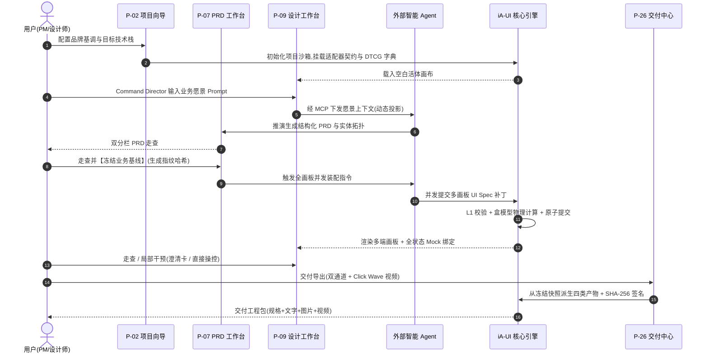
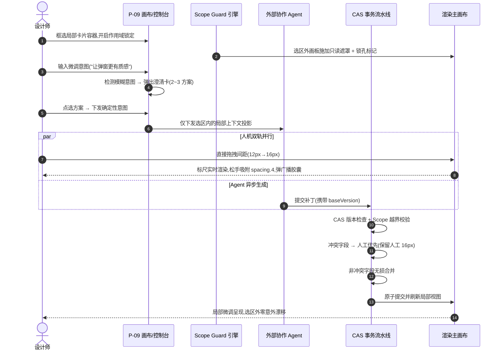
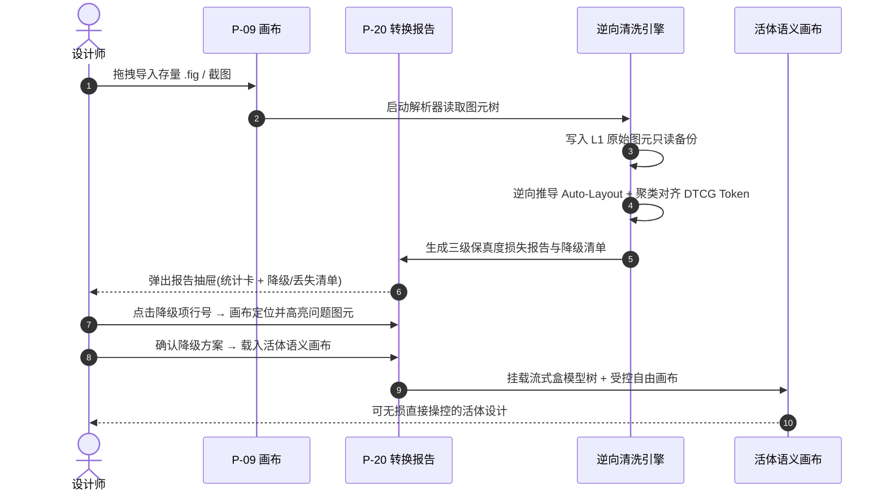
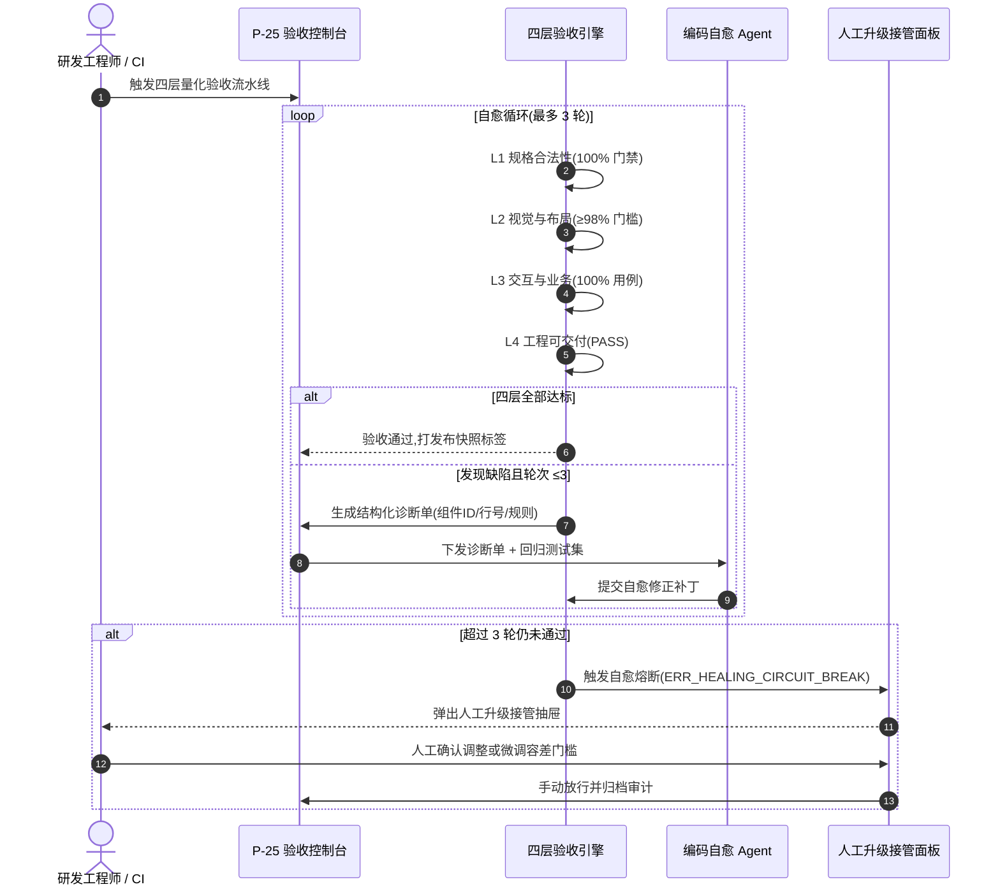
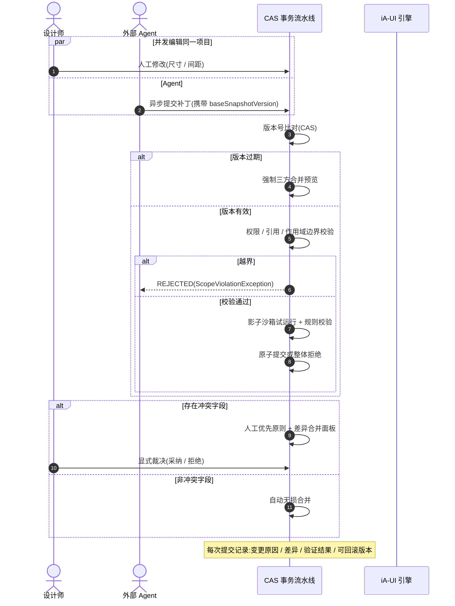

# iA-UI 详细设计说明书 (v0.0.2)

> **文档定位**:详细设计说明书,在《iA-UI 产品设计书 v0.0.4》(`design.opencode.v0.0.4.md`)基础上,对产品**所有功能 / 页面**做落地级详细设计,并给出每个功能 / 页面的**交互流程说明**。面向 UI/UX 设计、前端研发、Agent 工具链与测试同学,回答"每个页面长什么样、有哪些区域与组件、处于什么状态、用户如何一步步操作、边界与异常如何处理"。
>
> **版本链**:`design.opencode.v0.0.4.md`(产品设计书)→ **`design-detail.opencode.v0.0.1.md` → `design-detail.opencode.v0.0.2.md`(本详细设计书,补全优化版)**。
>
> **阅读指引**:第 2 章是信息架构与页面清单(先看这张图);第 3 章是全局交互规范(所有页面共用的框架、原语、反馈、**UI 操作设计语言 UIOL(§3.7,产品交互中枢)**、异常码字典);第 4 章是每个页面的详细设计 + 交互流程(核心章节,按功能域分组);第 5–6 章是端到端流程(含时序图)与状态机;第 7 章给出与产品设计书的映射与验收要点。
>
> **标注约定**:
> - 页面以 `P-XX` 编号,功能域以产品设计书 §4.1–§4.11 与附录 A 契约为准;
> - 交互流程用 `①→②→③` 步骤化描述,含正常流、分支与异常;
> - 涉及产品设计书条款时标注 `(设计书 §4.x)` 或 `(设计书 附录 A.x)` 以便对照;
> - **补全项**以 **(补全)** 标注,来源为对 `design-detail.gemini.v0.0.1.md` 的对照吸收(见 §1.2)。

---

## 1. 概述

### 1.1 文档目的与范围

本说明书把产品设计书中的**能力描述**翻译为**可实施的设计规格**:

- **页面级详细设计**:每一个界面(页面 / 浮层 / 面板)的定位、布局结构、区域组成、关键组件、可见状态(加载 / 空 / 错误 / 权限不足);
- **交互流程说明**:每个功能 / 页面的触发入口、用户操作路径、系统响应、分支条件、异常与恢复路径;
- **状态机与规则汇总**:生成、补丁、版本、Agent 连接等生命周期状态的流转与 UI 呈现;
- **端到端旅程**:跨页面的关键用户旅程(从 0 到 1、人机精调、导入重构、验证自愈、并发冲突)。

范围边界(与设计书一致):
- 只设计**产品自身 UI 与交互**,不设计外部 Agent 内部逻辑;外部 Agent 在本说明书内表现为"外部协作方,通过 MCP 调起产品能力并在产品 UI 中以会话 / 任务形式呈现"。
- 交互原型指**类 PPT 演示交互**(非真实前后端联动),设计书 §4.8。
- 平台 UI 自身的令牌 / 无障碍 / 多语言规范与设计书 §3.2、§7 一致。

### 1.2 来源与版本链

| 项 | 内容 |
|---|---|
| 上游(产品设计书) | `design.opencode.v0.0.4.md`(标准产品设计书结构) |
| 对照吸收(详细设计) | `design-detail.gemini.v0.0.1.md` —— 吸收其实施级细节(路由表 / 客户端状态存储 / MCP 连接拓扑 / 异常码字典 / 量化门槛 / 动效参数 / 时序图),逐项补全优化 |
| 本版 | `design-detail.opencode.v0.0.1.md` → **`v0.0.2`(补全优化版)** |
| 后续 | 实施阶段依据本说明书拆分页面级开发任务 |

**v0.0.2 补全优化清单**(对照 `design-detail.gemini.v0.0.1.md`):

| # | 补全 / 优化项 | 落点章节 | 说明 |
|---|---|---|---|
| 1 | 全站路由表与状态守卫(含 URL 状态持久化) | §2.4 | 每个页面给出具体路径、挂载形态、角色守卫、Query 状态声明 |
| 2 | 客户端状态存储模型(四类 Store) | §2.5 | Document Tree / Mutation Queue / Viewport / Agent Context Bus |
| 3 | 视口导航手势集(滚轮 / 空格 / 缩放范围) | §3.2.2 | 滚轮平移、`Cmd+滚轮` 缩放 10%~1600% 等 |
| 4 | 全系统异常状态码字典(ERR_*) | §3.6 | 错误码 / 触发源 / 界面表现 / 降级自愈策略 |
| 5 | 外部 Agent MCP 连接拓扑与配置注入细节 | P-06 | Local Stdio / Remote SSE 两种拓扑、`mcpServers` 配置片段、一键写入、握手自检、工具清单、Token 格式 |
| 6 | PRD-UI 绑定语法约定与基线指纹 | P-07 | `@entity:` / `@action:` 锚定语法、冻结基线哈希指纹 |
| 7 | 动态上下文投影三层过滤机制 | P-09 | 作用域图元 / Token 索引(≤50)/ 组件库元数据投影 |
| 8 | 四层验收量化门槛与自愈熔断细节 | P-25 | L1 100% / L2 ≥98% / L3 100% / L4 PASS;自愈 ≤3 轮硬上限 |
| 9 | 交付包完整性签名与产物结构 | P-26 | SHA-256 签名、ZIP 结构与 `verify` 校验 |
| 10 | 端到端流程补充 Mermaid 时序图 | §5 | 场景 A~E 各配 sequenceDiagram |
| 11 | 动效参数精确化 | §7.3 | Click Wave 半径/透明度/时长、转场曲线与时长、吸附阈值 |
| 12 | **UI 操作设计语言(UIOL)成章** | §3.7 | 四个端点 / 指令流⇄文档树二象性 / 三种语法 / 四层原语 / 三个编译器 / MCP 工具集(融合版设计书 §3.4 + 附录 A.6) |

### 1.3 与产品设计书 v0.0.4 的章节映射

| 本说明书章节 | 对应产品设计书章节 |
|---|---|
| §4.1 入口与项目管理域 | §4.1 项目管理与配置 |
| §4.2 需求与 PRD 域 | §4.2 需求输入与 PRD、§3.1 设计对象(PRD 文档) |
| §4.3 设计工作台域 | §4.3 设计生成、§4.4 设计工作台、§4.5 局部修改与人机协同 |
| §4.4 沉淀域 | §4.6 组件库与设计系统、§4.7 设计资产 |
| §4.5 配置域 | §4.8 交互原型与 Mock、§4.9 多终端设计 |
| §4.6 输入域 | §4.10 设计导入 |
| §4.7 治理域 | §4.11 版本与团队协作 |
| §4.8 验证与交付域 | §5.3 验证与交付闭环、§6 交付物设计 |
| §4.9 平台管理域 | §7 安全与权限(平台管理员) |
| §3 全局交互规范 | §3.2 设计语言、§4.4 工作台、§5 安全与权限 |
| §6 状态机 | §3.1 设计对象、附录 A.4 增量修改与冲突治理 |

### 1.4 阅读约定与图例

**ASCII 布局图例**:

```
┌─────────┐ 边框 = 页面 / 容器边界
│ A | B   │ 竖线 = 区域分隔
├────┬────┤ 横线 = 页眉 / 页脚 / 区域边界
[A]       │ 中括号 = 功能区块
⋯⋯        │ 省略号 = 可折叠 / 可滚动内容
(浮层)     │ 圆括号 = 浮层 / 弹窗 / 抽屉
```

**流程符号**:

```
入口 ─▶ ① 动作 ─▶ ② 动作 ─▶ 出口
         ├─ 条件 A ─▶ 分支
         └─ 条件 B ─▶ 分支
```

**状态与反馈**:
- 状态:Loading(加载中)、Empty(空态)、Error(错误态)、Disabled(禁用)、Permission(权限不足);
- 反馈:Toast(轻提示)、Confirm(二次确认)、Snackbar(底部通知条)、Badge(角标)。

### 1.5 总体设计原则

1. **单一事实来源**:画布、结构面板、属性面板、Agent 会话、交付物均消费同一份语义文档树(设计书 §3.3);任意视图改动即时同步其余视图。
2. **三支柱布局**:意图中枢(左)→ 语义画布(中)→ 约束控制台(右),贯穿工作台(设计书 §4.4)。
3. **确定性反馈优先**:一切修改经"校验 → 预览 → 确认(必要时)→ 原子提交"路径,禁止静默写入(设计书 附录 A.4)。
4. **人类优先**:人工操作与 Agent 并发时人工胜出;模糊意图必须主动澄清(2~3 方案),不猜(设计书 §4.5)。
5. **双通道可交付**:任何设计状态都可一键产出 UI Spec + 文字 + 图片 + 视频,四要素齐备才允许"交付"(设计书 §6)。
6. **作用域即 UI**:锁定、传播、全局影响在界面上以遮罩 / 光效 / 警示胶囊显式呈现,避免"改了哪不知道"。

---

## 2. 信息架构与页面清单

### 2.1 全站信息架构

```
iA-UI(Web 端)
│
├─ [认证] P-01 登录页
│
├─ [工作区入口] P-02 项目工作台(首页)
│     ├─ 项目卡片 / 最近使用 / 模板入口 / 全局搜索
│     ├─ P-03 项目创建向导
│     └─ P-04 模板与新手引导
│
├─ [项目级主框架](登录后统一骨架)
│     ├─ 顶部全局导航栏(S-05):项目名 | 品牌基调 | 终端切换 | 全局搜索 | Agent 状态 | 交付
│     ├─ 左侧意图与架构中枢:意图编排树 · 实体拓扑 · 需求追踪 · 设计系统资产 · 变更审计
│     ├─ 中央语义画布区(S-02):功能流视图 / 无限平面视图 双视图同构 · 多端画板 · 预览
│     ├─ 右侧约束与生成控制台(S-03):意图输入 · 方案澄清 · 作用域 · 令牌盘 · 无障碍 · 四层验收
│     ├─ 顶部 Agent 会话抽屉(S-04):外部 Agent 会话 · 任务进度 · 审阅与回滚
│     └─ 底部状态栏(S-06):视图切换 · 缩放 · 选区 · 帧率
│
├─ [项目管理域] P-05 项目设置页
│     └─ P-06 外部 Agent 连接管理(凭证 / 作用域 / 有效期 / 撤销)
│
├─ [需求域] P-07 PRD 工作台(宏观深思)
│     ├─ 沉浸式 Markdown 分栏 · 章节重生成 · PRD⇄画板双向绑定
│     └─ P-08 需求追踪视图
│
├─ [沉淀域]
│     ├─ P-12 组件库管理页(注册表 / 适配器契约 / 状态穷举)
│     ├─ P-13 设计令牌与主题页(DTCG 令牌 / 主题轴)
│     ├─ P-14 组件逆向注册向导(Storybook / TS Props)
│     └─ P-15 资产库管理页(字体 / 图标 / 图片 / SVG)
│
├─ [配置域]
│     ├─ P-16 交互原型编辑器(动作原语 / 触发器 / 转场)
│     ├─ P-17 Mock 数据配置面板(Normal/Empty/Error/Overflow)
│     └─ P-18 多终端管理页(并排比较 / 一键跨端衍生)
│
├─ [输入域]
│     ├─ P-19 设计导入向导(.fig / 截图 / SVG / 组件元数据)
│     └─ P-20 转换报告页(L1/L2/L3 · 保真度损失)
│
├─ [治理域]
│     ├─ P-21 版本历史页(时间轴 · 快照)
│     ├─ P-22 Diff 比对视图(分屏 / 洋葱皮)
│     ├─ P-23 生命周期与发布页(草稿→评审→批准→发布→废弃)
│     └─ P-24 团队管理页(成员 / 审批队列 / 审计)
│
├─ [验证与交付域]
│     ├─ P-25 验证与诊断视图(L1~L4 · 结构化诊断 · 自愈)
│     └─ P-26 交付中心(UI Spec + 文字 + 图片 + 视频)
│
└─ [平台管理域] P-27 平台管理后台(组织 / 成员 / 凭证 / 计费 / 审计)
```

### 2.2 页面清单总表

| 页面 ID | 页面名称 | 功能域 | 主要角色 | 入口 |
|---|---|---|---|---|
| P-01 | 登录页 | 认证 | 全部 | 未登录跳转 |
| P-02 | 项目工作台(首页) | 项目 | 全部 | 登录后落地页 |
| P-03 | 项目创建向导 | 项目 | 设计师 / 设计负责人 / 产品经理 | P-02"新建项目" |
| P-04 | 模板与新手引导 | 项目 | 新用户 | P-02 模板入口 / 首次登录 |
| P-05 | 项目设置页 | 项目 | 设计负责人 / 平台管理员 | 全局导航"项目设置" |
| P-06 | 外部 Agent 连接管理 | 项目 | 设计负责人 / 平台管理员 | P-05 页签 |
| P-07 | PRD 工作台 | 需求 | 产品经理 / 设计师 | 全局导航"PRD" / 意图树节点 |
| P-08 | 需求追踪视图 | 需求 | 产品经理 / 设计师 / 评审者 | P-07 页签 / 意图树 |
| P-09 | 设计工作台主界面 | 工作台 | 设计师 / 产品经理 / 设计负责人 | 打开项目后落地 |
| P-10 | 方案澄清卡片(浮层) | 工作台 | 设计师 | P-09 模糊意图触发 |
| P-11 | 预览模式 | 工作台 | 设计师 / 产品经理 / 评审者 | P-09 顶部"预览" |
| P-12 | 组件库管理页 | 沉淀 | 设计负责人 / 设计师 | 左侧"设计系统资产" |
| P-13 | 设计令牌与主题页 | 沉淀 | 设计负责人 | P-12 页签 |
| P-14 | 组件逆向注册向导 | 沉淀 | 设计负责人 / 设计师 | P-12"注册组件" |
| P-15 | 资产库管理页 | 沉淀 | 设计师 / 设计负责人 | 左侧"资源面板"展开 |
| P-16 | 交互原型编辑器 | 配置 | 设计师 / 产品经理 | P-09 顶部"原型模式" |
| P-17 | Mock 数据配置面板 | 配置 | 设计师 / 产品经理 | P-09 属性面板 / 画布顶部切换器 |
| P-18 | 多终端管理页 | 配置 | 设计师 / 设计负责人 | P-09 顶部"终端" |
| P-19 | 设计导入向导 | 输入 | 设计师 / 产品经理 | P-02 导入入口 / P-09 |
| P-20 | 转换报告页 | 输入 | 设计师 | P-19 完成后自动弹出 |
| P-21 | 版本历史页 | 治理 | 设计师 / 设计负责人 / 评审者 | P-09 顶部"版本" |
| P-22 | Diff 比对视图 | 治理 | 设计师 / 设计负责人 / 评审者 | P-21 选择两快照 |
| P-23 | 生命周期与发布页 | 治理 | 设计负责人 | P-21 页签 / 审批中心 |
| P-24 | 团队管理页 | 治理 | 设计负责人 / 平台管理员 | 全局导航"团队" |
| P-25 | 验证与诊断视图 | 验证 | 设计师 / 研发 / 编码 Agent | P-09"验证" / 交付前强制 |
| P-26 | 交付中心 | 交付 | 设计师 / 设计负责人 | 全局导航"交付" |
| P-27 | 平台管理后台 | 平台 | 平台管理员 | 全局导航"管理后台" |

### 2.3 路由与导航结构

**主导航(顶部全局导航栏,登录后恒定可见,设计书 §4.4)**:

```
[项目名 ▾] [品牌基调] [终端:桌面/平板/移动] [全局搜索] [Agent 状态] [版本] [验证] [交付 ▾]
```

**次级导航**:
- 工作台内部:左侧意图树(功能域维度)、底部状态栏(视图 / 缩放切换);
- 项目管理:项目设置页内页签(基本信息 / 品牌基调 / 终端与代码 / 设计系统基石 / 团队 / 外部 Agent)。

**页面跳转矩阵(关键)**:

| 从 \ 到 | 入口动作 |
|---|---|
| P-02 → P-03 | 点"新建项目" |
| P-02 → P-09 | 点项目卡片 / 最近使用项 |
| P-03 → P-09 | 向导完成(快速模式直接进入画布) |
| P-09 → P-07 | 全局导航"PRD" |
| P-09 → P-11 | 顶部"预览" |
| P-09 → P-21 | 顶部"版本" |
| P-09 → P-26 | 顶部"交付" |
| P-19 → P-20 | 导入完成自动弹出 |
| P-21 → P-22 | 勾选两个快照后"对比" |
| P-25 → P-09 | 诊断项"定位到画布" |

### 2.4 全站路由表与状态守卫 (补全)

> 平台采用 SPA 结构化路由 + **URL 状态持久化**:画板定位、选区高亮、模态状态均可通过 URL 分享与深链定位,刷新 / 分享后恢复原视图。路由守卫按角色与项目权限拦截。

| 页面 | 路由路径(Path Pattern) | 挂载形态 | 访问角色 | 路由参数与 Query 状态声明 |
|---|---|---|---|---|
| P-01 登录 | `/login` | 全屏 | 全部(未登录) | `redirect`(登录后回跳) |
| P-02 项目工作台 | `/workspace` | 主界面 | 全部 | `tab`(recent/all/starred) |
| P-03 项目创建向导 | `/workspace/setup` | 居中模态(680px) | 设计师 / 设计负责人 / 产品经理 | `mode`(create)、`templateId` |
| P-04 模板 | `/workspace/templates` | 主界面 | 全部 | `category` |
| P-05 项目设置 | `/workspace/:projectId/settings` | 主界面 + 页签 | 设计负责人 / 平台管理员 | `tab`(basic/vibe/stack/designsys/team/mcp) |
| P-06 Agent 连接 | `/workspace/:projectId/mcp` | 右侧抽屉(640px)/ 全屏 | 设计负责人 / 平台管理员 / 工程师 | `tab`(config/clients/audit) |
| P-07 PRD 工作台 | `/workspace/:projectId/prd` | 全屏 / 双分栏 | 产品经理 / 设计负责人 / 设计师 | `docId`、`activeEntity`、`splitMode`(50:50/30:70) |
| P-08 需求追踪 | `/workspace/:projectId/trace` | 全屏 | 产品经理 / 设计师 / 评审者 | `reqId`、`view`(chain/matrix) |
| P-09 设计工作台 | `/workspace/:projectId` | 主界面窗口 | 全部角色 | `view`(flow/canvas)、`zoom`、`activePageId`、`selectedNodeId`、`terminal`(desktop/tablet/mobile) |
| P-10 方案澄清 | `/workspace/:projectId`(浮层) | 浮层(URL 无独立路径) | 设计师 | 随 P-09 状态 |
| P-11 预览 | `/workspace/:projectId/preview` | 全屏沉浸 | 设计师 / 产品经理 / 评审者 | `pageId`、`mockScenario`、`device` |
| P-12 组件库 | `/workspace/:projectId/components` | 主界面 + 页签 | 设计负责人 / 设计师 | `category`、`source`、`state` |
| P-13 令牌 | `/workspace/:projectId/tokens` | 左侧扩展抽屉(480px)/ 全屏 | 全部(编辑需负责人) | `category`(color/font/space/radius/shadow)、`theme`(light/dark/hc) |
| P-14 逆向注册 | `/workspace/:projectId/components/register` | 居中向导 | 设计负责人 / 设计师 | `source`(ce.json/ts/npm) |
| P-15 资产库 | `/workspace/:projectId/assets` | 左侧扩展面板 | 设计师 / 设计负责人 | `type`、`license` |
| P-16 原型编辑器 | `/workspace/:projectId/prototype` | 画布叠加模式 | 设计师 / 产品经理 | `mode`(connect/select) |
| P-17 Mock 配置 | `/workspace/:projectId`(属性面板) | 面板内嵌 | 设计师 / 产品经理 | 随选中节点 |
| P-18 多终端 | `/workspace/:projectId/terminals` | 主界面 + 页签 | 设计师 / 设计负责人 | `compare`(on/off) |
| P-19 导入向导 | `/workspace/:projectId/import` | 底部抽屉(640px) | 设计负责人 / 产品经理 | `importJobId`、`fidelityLevel`(L1/L2/L3) |
| P-20 转换报告 | `/workspace/:projectId/import/:jobId/report` | 底部抽屉(580px) | 设计师 | `focusLayerId` |
| P-21 版本历史 | `/workspace/:projectId/history` | 底部全宽面板(520px) | 全部角色 | `branch`、`authorFilter` |
| P-22 Diff 比对 | `/workspace/:projectId/history/diff` | 全屏 / 分栏 | 设计师 / 设计负责人 / 评审者 | `baseSnapshot`、`targetSnapshot`、`diffMode`(split/onion) |
| P-23 生命周期 | `/workspace/:projectId/release` | 主界面 + 页签 | 设计负责人 / 评审者 | `stage` |
| P-24 团队管理 | `/workspace/:projectId/team` | 主界面 + 页签 | 设计负责人 / 平台管理员 | `tab`(members/roles/approvals/audit) |
| P-25 验证诊断 | `/workspace/:projectId/validate` | 右侧扩展面板(420px) | 全部角色 | `suiteLevel`(L1~L4)、`autoHealRound`(1-3) |
| P-26 交付中心 | `/workspace/:projectId/export` | 居中模态(960px) | 设计师 / 设计负责人 | `channel`(machine/human)、`format`(spec/video/docs) |
| P-27 管理后台 | `/admin` | 主界面 + 侧边管理导航 | 平台管理员 | `tab`(org/members/mcp/billing/audit/status) |

**状态守卫规则**:
- 未登录 → 任意路由重定向 `/login?redirect=<原路由>`;
- 角色不足 → 渲染 403 页面 + "申请权限"入口(§3.3 Permission);
- 项目冻结(已发布 / 已归档)→ 进入只读守卫,编辑类路由(如原型模式)重定向至只读视图并提示;
- 路由参数校验失败(如 `selectedNodeId` 不存在)→ 自动回退并清理无效参数,不白屏。

### 2.5 客户端状态存储模型 (补全)

> 客户端采用**单向数据流 + 分层状态缓存**,保证画布 / 结构树 / 属性面板 / Agent 会话 / 交付物消费同一份数据且互不污染瞬态。

| Store | 职责 | 关键字段 / 行为 |
|---|---|---|
| Document Tree Store(不可变文档树) | 基于 Immer 维护 UI Spec 树(设计书 附录 A.1) | 每次修改由 CAS 事务引擎校验并生成新 `RevisionId`;是画布 / 面板 / 交付共用的单一事实来源 |
| Transactional Mutation Queue(事务流水线) | 存储进行中的直接选区补丁(Direct Scope)与依赖扩散结果(Propagation Scope) | 未提交补丁可预览 / 撤销;提交走原子流水线(设计书 附录 A.4) |
| Viewport & Interaction Store(视口与画布瞬态) | 视口平移 `(panX, panY)`、缩放、多选框选图元集、正在拖拽的边距手柄 | 纯瞬态,**不写入文档历史**;刷新即还原默认视口 |
| Agent Context Bus(MCP 会话总线) | 与外部 Agent 的双向通道(SSE / WebSocket) | 传递动态上下文投影 + 流式推理日志 + `notifications/resources/updated` 画板变更广播 |
| Snapshot & Branch Store(版本与分支) | 快照索引、分支线、Diff 选区 | 回滚生成新提交,不改写历史(设计书 §4.11) |

**数据流规则**:用户操作 / Agent 补丁 → 指令 → 事务引擎(校验 / 合并 / 审计)→ 更新 Document Tree → 各视图 Store 响应式刷新。视口与交互瞬态永不反向写回文档树。

---

## 3. 全局交互规范

> 本章定义所有页面共用的框架与交互原语。第 4 章各页面不再重复这些通则,只描述页面特有内容与差异。

### 3.1 全局框架(登录后统一骨架)

```
┌────────────────────────────────────────────────────────────────────────────┐
│ S-05 顶部全局导航栏(恒定)                                                   │
├───────────────────┬──────────────────────────────────────────┬─────────────┤
│ 左侧意图与架构中枢 │ 中央工作区(随页面切换)                     │ 右侧上下文  │
│ (功能域树 · 需求追踪│ · 设计工作台(画布)                        │ 面板(按页面 │
│  · 资产 · 审计)    │ · PRD / 组件库 / 版本 / 交付 等子页面       │ 显示)       │
├───────────────────┴──────────────────────────────────────────┴─────────────┤
│ S-06 底部状态栏(工作台内):视图 | 缩放 | 选区 | 帧率 | 提示胶囊              │
└────────────────────────────────────────────────────────────────────────────┘
```

**规则**:
- 顶部导航在登录后所有页面恒定;未登录仅 P-01。
- 左侧意图树、右侧上下文面板在工作台(P-09)内恒显;进入 P-07/P-12/P-21 等子页面时,右侧面板切换为对应页面上下文。
- 全局快捷键在所有页面生效(见 §3.2.3),冲突时页面内快捷键优先并提示。
- **所有交互底层都收敛于 §3.7 UI 操作设计语言(UIOL)**:手势 / Agent 指令产出指令流,画布与面板消费同一文档树;任何视图改动即时经事务引擎同步到其余视图。

### 3.2 通用交互原语

#### 3.2.1 选择与多选(画布 / 列表通用)

| 交互 | 行为 | 反馈 |
|---|---|---|
| 单击节点 / 行 | 单选;同步高亮画布 ↔ 结构树 ↔ 属性面板 | 选中描边(主题色) + 弹性外边距虚线标尺 |
| Shift / Cmd+单击 | 增选 | 多选区合并高亮 |
| 框选(画布空白拖拽) | 矩形框选 | 半透明选区框;命中项逐个高亮 |
| 空白处单击 | 取消选择 | 高亮消失 |
| Esc | 取消选择 / 关闭浮层(逐层) | 视上下文 |

#### 3.2.2 拖拽与直接操控(设计书 §4.4 / §4.5)

| 手势 | 语义 | 系统行为 |
|---|---|---|
| 拖拽节点边缘 | 调整尺寸 | 60fps 实时渲染蓝色外边距辅助线 + 弹性数值胶囊;松手吸附至最近 Token(如 16px→`gap-4`) |
| 拖拽两节点间距 | 修改 Gap | 标尺显示像素值,松手吸附 Token;若该组件被多画板复用 → 底部胶囊提示"是否一键广播全局?" |
| 拖拽移动节点 | 移动 / 改变层级 | 实时投影;命中循环嵌套时红色碰撞提示并弹回原位 |
| 双击文本 | 行内编辑 | 焦点进入文本编辑,失焦提交并校验截断策略 |
| 拖入资源(资产面板→画布) | 新建图元 | 以资源为内容创建节点,自动绑定令牌 |

> 所有拖拽不直接写文档树;松手后进入"指令 → 校验 → 提交"流水线(设计书 附录 A.4)。其底层即 §3.7 UIOL 的**手势编译器**:拖拽间距 → `set_gap(16)` → 吸附 Token;拖拽尺寸 → `set_sizing(fixed)`;删除 → `delete_node` —— 每次手势都是一条可审计、可回放、可广播的语义指令。

#### 3.2.2b 视口导航手势 (补全)

| 手势 | 行为 |
|---|---|
| 滚轮 | 垂直平移视口 |
| Shift + 滚轮 | 水平平移视口 |
| Cmd/Ctrl + 滚轮 | 以光标为中心平滑缩放视口(**范围 10% ~ 1600%**) |
| 空格 + 鼠标左键拖拽 | 自由平移整个画布视口(抓手模式) |
| 双击空白 | 复位视口到默认缩放 / 位置 |
| 缩放 > 200% | 自动显示标尺与坐标网格(无障碍辅助) |

**弹性标尺反馈**(拖拽内边距 / 间距手柄时):
- 悬停流式容器边缘 → 显示青色外边框手柄;
- 拖拽内边距手柄 → 实时虚线箭头呈现 Padding 范围 + 中心半透明数值胶囊;
- 松手 → 触感吸附动效(物理阻尼弹性),16ms 内完成盒模型约束重算。

#### 3.2.3 快捷键

| 快捷键 | 功能 |
|---|---|
| Cmd/Ctrl+Z / +Shift+Z | 撤销 / 重做(指令级,含 Agent 提交可回滚) |
| Cmd/Ctrl+C / V / D | 复制 / 粘贴 / 复制到原位(同画板) |
| Delete / Backspace | 删除选中节点(二次确认,若被 PRD 引用则升级预警) |
| Cmd/Ctrl+F | 全局搜索(跨画板定位节点 / 组件 / 令牌 / 需求) |
| Cmd/Ctrl+Enter | 提交当前意图指令(控制台) |
| V / H / T | 切换选择 / 抓手 / 文本工具 |
| Cmd/Ctrl+1/2/3 | 切换桌面 / 平板 / 移动画板 |
| P | 进入预览模式 |
| Cmd/Ctrl+Alt+L | 锁定 / 解锁作用域(Scope Guard) |
| Cmd/Ctrl+S | 手动打快照(命名,非自动) |

#### 3.2.4 右键上下文菜单

按选中对象类型差异化:

| 对象 | 菜单项 |
|---|---|
| 画布节点 | 复制 / 粘贴 / 删除 / 重命名 / 锁定作用域 / 绑定令牌 / 添加动作 / 设为组件 / 定位到 PRD 需求 |
| 页面(结构树) | 新建页面 / 复制页面 / 重命名 / 删除 / 导出页面规格 |
| 组件(注册表) | 编辑契约 / 状态穷举预览 / 替换映射 / 标记废弃 |
| 资产 | 预览 / 重命名 / 替换引用 / 删除 / 授权信息 |
| 版本快照 | 查看 Diff / 回滚到此处 / 从此处新建分支 / 复制快照 |

### 3.3 通用反馈与状态组件

#### 3.3.1 反馈组件规范

| 组件 | 触发场景 | 样式与行为 | 时延 |
|---|---|---|---|
| Toast | 轻量成功 / 失败 / 信息 | 右上角堆叠;成功绿色 / 错误红色 / 信息中性;自动消失 | 3s / 5s(错误可手动关) |
| Confirm | 删除 / 发布 / 回滚 / 撤销授权 / 全局同步 | 居中模态,主按钮危险色;带影响范围说明 | 等待用户 |
| Snackbar(底部胶囊) | 需用户决策的即时提示(如广播向导) | 底部状态栏上方;附"应用全局 / 仅本次 / 忽略"操作 | 常驻至决策 |
| Badge | Agent 在线状态 / 待审批数 / 未同步数 | 导航与树节点角标 | 常驻 |
| 进度条 / 骨架 | 生成 / 导入 / 导出 / 验证 | 画布骨架动效;控制台进度条 + 日志流 | 随任务 |

#### 3.3.2 页面状态模板

| 状态 | 呈现 | 恢复路径 |
|---|---|---|
| Loading | 骨架屏(结构先于数据)或居中转圈;工作台画布用骨架动效 | 加载完成自动替换 |
| Empty | 插画 + 主文案 + 引导按钮(如"新建项目""导入设计") | 引导按钮 |
| Error | 居中错误插画 + 错误码 + 重试按钮;MCP 相关附带 `503` 等码(设计书 §4.1) | 重试 / 返回 |
| Permission | 403 页 + 申请权限按钮;操作按钮置灰带提示 | 申请 → 审批 |
| Partial(部分降级) | 黄色警示胶囊说明降级项 + 可定位入口(设计书 §4.10) | 点击定位 |

### 3.4 权限与作用域在界面上的呈现(设计书 §7 / §4.5)

| 状态 | UI 呈现 |
|---|---|
| 可编辑 | 正常高亮,可选中可拖拽 |
| 作用域锁定(选区外) | 轻度磨砂遮罩 + 半透明锁孔图标;悬停提示"已锁定,修改前请解除作用域";Agent 越界 Patch 被拒时在会话中显示 `ScopeViolationException` |
| 选区内(作用域模式) | 绿色光效描边 + 状态栏"作用域:XX 节点" |
| 权限不足 | 控件置灰 + 锁图标 + 悬停提示所需角色;只读角色浏览画布可缩放不可编辑 |
| 依赖传播(主组件 / 全局令牌) | 弹影响清单面板,标注"直接修改 / 依赖传播 / 全局影响"三层,用户选"全局同步 / 仅本次 / 拒绝并保留分叉"(设计书 附录 A.4) |

### 3.5 无障碍与多语言(设计书 §4.4 补强 / §4.8)

- **对比度守卫**:属性面板对选中节点实时提示对比度是否达 WCAG 2.1 AA;画布以图标标记不达标项,点击可一键换达标令牌。
- **焦点与语义**:画布节点对应 ARIA 语义缺省提示;键盘可完整操作(快捷键体系);焦点顺序可配置并在预览中走查。
- **多语言**:界面文案资源化;Mock Overflow 场景自动注入多语言超长文本;支持 RTL 镜像预览(设计书 §4.8)。
- **画布缩放**:Cmd/Ctrl +/- 缩放;放大 200% 时自动显示标尺与坐标网格,保证弱视用户可读。

### 3.6 全系统异常状态码字典 (补全)

> 统一的错误码契约:前端据此渲染界面表现,Agent / MCP 据此解析与自愈;所有码在审计日志中留痕。对应底层降级策略与设计书 §7.2、附录 A.4 一致。

| 错误码 | 异常场景 | 触发源 | 界面表现 | 降级 / 自愈策略 |
|---|---|---|---|---|
| `ERR_MCP_UNAUTHORIZED` | Agent 密钥失效或被吊销 | MCP 网关 | 顶栏 Agent 状态灯变红 + 告警通知条 | 阻断所有远程写操作,返回 `401 Unauthorized`;凭证可重新生成 |
| `ERR_SCOPE_VIOLATION` | Agent Patch 触碰 Scope Guard 锁定区外节点 | 事务流水线 | 控制台流式日志标红 + 黄色防漂移气泡 | 中止事务、回滚影子沙箱,主画布保持干净(设计书 附录 A.4) |
| `ERR_CAS_CONFLICT` | 并发提交基础版本号滞后(脏写) | CAS 引擎 | 弹出三方合并差异面板 | 人工优先:保留人工修改,合并非冲突变更 |
| `ERR_SCHEMA_INVALID` | 提交 UI Spec 未通过强类型 JSON Schema 校验 | L1 检验器 | 阻断补丁上屏,高亮 Schema 错误字段 | 输出结构化校验诊断,要求 Agent 按规则修正(设计书 附录 A.1) |
| `ERR_TOKEN_UNREGISTERED` | 写入未在 DTCG 字典注册的裸色值 | 令牌管理器 | 拾色器外壁黄色警示,阻止保存 | 自动寻色差最近邻 Token,一键对齐建议(设计书 §4.6) |
| `ERR_HEALING_CIRCUIT_BREAK` | 自愈重试达 3 轮上限仍未达标 | 验收雷达 | 弹出"人工升级接管"居中模态 | 挂起自愈循环,保护 Token 配额,转人工(设计书 §5.3) |
| `ERR_IMPORT_SHADER_UNSUPPORTED` | 导入文件含私有着色器 / 复杂特效 | 导入转换器 | P-20 报告标黄 Warning 项 | 安全降级为静态 SVG 矢量图元,保留原始渲染外观(设计书 §4.10) |
| `ERR_CANVAS_OVERFLOW` | 受控画布内部图元超出外壁边界 | 受控画布 | 超出部分红色半透明斑马纹 | 外壁强制 `overflow: hidden` + L2 排版警告(设计书 §4.7) |
| `ERR_PROJECT_FROZEN` | 对已发布 / 冻结基线执行编辑 | 生命周期守卫 | 编辑操作置灰 + "已冻结"提示 | 强制进入草稿分支,不直接改冻结基线(设计书 §4.11) |
| `ERR_GENERATION_TIMEOUT` | 单画板生成超时(>20s) | 生成引擎 | 自动中断 + 回滚影子状态 + 提示精简 / 重试 | 保留原设计,可降级生成(设计书 §4.3) |

### 3.7 UI 操作设计语言 (UIOL)—— 产品交互中枢 (补全)

> **来源**:融合版设计书 §3.4(核心机制)+ 附录 A.6(写入侧指令工具集)。本说明书将其落为**交互层事实标准**:画布手势、外部 Agent 指令、画布渲染、交付导出四个端点只通过这一套语言交互,是"单一事实来源"的物理载体。

#### 3.7.1 设计立场:一套语言,四个端点

| 端点 | 角色 | 语言形态 |
|---|---|---|
| 外部 Agent | 把自然语言"编译"为构建 / 修改 UI 的指令 | 指令流(Command Stream) |
| Web 画笔(鼠标直接操控) | 把手势"编译"为构建 / 修改 UI 的指令 | 指令流(Command Stream) |
| Web 画布 | 把语言"渲染"为可视 UI 与元素 | 文档树投影(Document Projection) |
| 消费方(vibecoding / 人 / 验证) | 读取、导出、校验、回放 | 文档树序列化(UI Spec) |

**设计原则(详细设计落地的硬约束)**:
- Agent **不直接触碰画布内部状态**:只提交指令流,经事务引擎校验后原子生效;
- 画笔 **不产生绝对像素**:每次拖拽 / 改值逆向提炼为语义指令(见 §3.7.5-C);
- 画布 **只消费文档树**:任何视图(画布 / 结构树 / 属性面板 / 预览)都是文档树的投影;
- 导出 **只序列化文档树**:UI Spec / 文字 / 图片 / 视频均由同一文档树派生(设计书 §6)。

#### 3.7.2 语言的二象性:指令流 ⇄ 文档树

```
 Agent(自然语言)──▶┌───────────────────────┐◀── Web 画笔(鼠标手势)
                    │  UIOL 指令流 (Ops)     │
    NL → 指令        └──────────┬────────────┘     手势 → 指令
                                ▼
                     ┌──────────────────────┐
                     │  文档树 Document Tree │ ◀── 单一事实来源 (SSoT)
                     │  (可渲染 / 可序列化)  │
                     └──┬───────────────┬───┘
             [渲染器]    ▼               ▼    [序列化器]
                  Web 画布画面        UI Spec / 参考代码 / 演示视频 / 验证
```

- **指令流(Command Stream,时间 / 变更)**:有顺序的变更操作 `create_node` / `update_node` / `delete_node` / `move` / `bind_token` / `unbind` / `apply_style` / `add_action` / `set_mock` …。它是 Agent 与画笔的**产出**,也是可审计、可回滚、可并发合并(CAS 补丁)的**输入**。
- **文档树(Document Tree,空间 / 状态)**:指令流执行后的最终状态,是画布、导出、验证、交付共用的唯一事实来源。
- **关系**:同一语义、两种观察角度("动词+宾语" vs "名词结构");指令流经事务引擎(§6.2、设计书 附录 A.4)原子应用到文档树。

#### 3.7.3 一个语言族,三种语法(无损互译)

| 形态 | 使用者 | 说明 | 示例 |
|---|---|---|---|
| 文档形态 Document Form(JSON) | 存储 / 校验 / 导出 / 消费 | UI Spec 声明式文档树,强类型 JSON Schema | `{"type":"container","layout":{...}}` |
| 指令形态 Command Form | Agent / 画笔 / MCP 工具 | 动词化操作,工具入参 Schema | `create_node(page,{type,layout})` |
| 文本形态 DSL Text Form | 人工审阅 / Diff / 版本 | 类结构化文本中间表达,可读可 diff | `container[row gap-4] > text[truncate]` |

- 三形态由**无损互译器(Bijective Translator)** 保证同一语义往返一致 —— "确定性契约"的落地(设计书 附录 A.1/A.2);
- **UI 呈现**:版本 Diff(P-22)与 Agent 变更记录(S-04)以 DSL 文本形态展示,便于人类审阅;JSON 形态用于规格校验与导出;指令形态用于 MCP 与撤销重做。

#### 3.7.4 原语集:四层模型的语言化

| 层 | 语言原语 | 典型指令示例 | 校验规则(UI 拦截点) |
|---|---|---|---|
| 意图与逻辑层 | Entity / Route / State / Action / Mock | `bind_entity order.status`、`add_action click→navigate` | 路由无悬空引用(画布黄色虚线告警) |
| 规范与约束层 | Token / ComponentContract / Breakpoint | `bind_token color.primary` | 禁止裸色值(拾色器拦截 + 最近邻建议) |
| 结构与流式层 | Box(direction/padding/gap/align/sizing) | `set_sizing fill`、`set_gap 16→snap token` | `hug`/`fill`/`fixed` 显式声明(属性面板强制) |
| 表现与图元层 | Text / Image / Vector / Container / ControlledCanvas | `set_text_overflow truncate` | 文本必声明截断策略(属性面板必填) |

#### 3.7.5 三个编译器(闭环的翻译器)

- **[A] 自然语言编译器(NL → 指令)**:外部 Agent 经 MCP 写工具把自然语言翻译为**受控指令序列**。产品不推理,只提供三样东西:工具 Schema(合法指令空间,§3.7.6)、动态上下文投影(局部上下文,见 P-09)、L1 结构校验(翻译结果门禁)。Agent 的"自由"被约束在合法指令空间内,越界指令在事务引擎被拦截(`ERR_SCOPE_VIOLATION`)。
- **[B] 文档渲染器(文档 → 画面)**:画布把文档树解析为流式盒模型并渲染;同一文档树投影为导出 Spec、参考代码、演示视频 —— **展示只是文档树的不同投影**。
- **[C] 手势编译器(手势 → 指令)**:Web 画笔把鼠标拖拽逆向提炼为语义指令 —— 拖拽间距 → `set_gap(16)` → 吸附 Token `gap-4`;拖拽尺寸 → `set_sizing(fixed)`;删除组件 → `delete_node`;并支持将一次手势广播为全局规则(底部胶囊"是否一键广播全局?")。**画笔不是"画像素",而是"发指令"**,人的操作天然成为机器可理解、可复用的指令。

#### 3.7.6 MCP 工具集(UIOL 指令形态的 MCP 载体)

**读取与验证侧工具**:

| 工具接口 | 输入参数 | 职责 |
|---|---|---|
| `ia_get_spec` | `(pageId, scopeNodeId?)` | 获取指定页面或选区局部的标准强类型 UI Spec 树 |
| `ia_get_component_schema` | `(componentName)` | 获取组件 Props / 变体 / 插槽契约 |
| `ia_get_assets` | `(assetIds[])` | 获取工程引用资产元数据清单 |
| `ia_submit_code_bundle` | `(commitId, files)` | 提交编码 Agent 生成的前端工程代码包 |
| `ia_run_verification` | `(commitId, suiteLevel)` | 触发受控环境四层验证流水线 |
| `ia_get_diagnostics` | `(commitId)` | 获取结构化诊断清单 |

**写入侧指令工具集**(所有写入返回"指令已入事务流"确认,实际生效经事务引擎校验后原子提交,拒绝返回结构化错误码):

| 工具接口 | 输入参数 | 职责 |
|---|---|---|
| `ia_create_node` | `(pageId, parentId, node, baseVersion)` | 创建语义节点(受作用域约束) |
| `ia_update_node` | `(nodeId, patch, baseVersion)` | 受限属性更新(CAS 乐观锁) |
| `ia_delete_node` | `(nodeId, baseVersion)` | 删除节点(受作用域约束 + 引用检测) |
| `ia_move_node` | `(nodeId, newParentId, index, baseVersion)` | 调整节点层级 / 顺序 |
| `ia_bind_token` | `(nodeId, tokenKey)` | 绑定语义令牌(禁止裸色值) |
| `ia_add_action` | `(nodeId, action)` | 添加声明式交互动作(路由防悬空) |
| `ia_set_mock` | `(nodeId, mockDatasetId, state)` | 绑定全状态 Mock |
| `ia_commit_batch` | `(ops, intent)` | 批量指令一次提交(统一范围声明 / 审计 / 回滚单元) |

#### 3.7.7 为什么这套语言解决"AI 改一处、乱整体" + UI 落地映射

| 机制 | 说明 | 详细设计中的 UI 落点 |
|---|---|---|
| 指令受控 | Agent / 画笔只能发合法指令;Scope Guard 在**指令层**拦截越界写 | §3.4 作用域锁定呈现;`ERR_SCOPE_VIOLATION` |
| 状态单一 | 文档树是唯一状态,无"画布状态 / 数据状态"分叉 | §2.5 Document Tree Store |
| 变更可回放 | 指令流可审计、可回滚、可 diff,决策时光机由此成立 | §3.2.3 撤销重做;P-21/P-22 |
| 消费一致 | 画布 / Spec / 代码 / 视频由同一文档树派生 | P-09 多视图;P-26 交付 |
| 手势即指令 | 直接操控 → 指令 → 可复用 / 可广播 | §3.2.2 拖拽逆向提炼;P-09 广播胶囊 |

**进化与扩展**:语义化版本(Spec Version)与迁移路径(设计书 附录 A.1);自定义组件 / 动作 / Mock 通过受控扩展点(适配器契约)接入,不破坏核心校验(设计书 附录 A.3)。

---

## 4. 页面详细设计与交互流程

> 本章是核心章节。每个页面按统一模板展开:**页面定位 → 可达角色 / 入口出口 → 页面布局 → 区域明细 → 页面状态 → 交互流程 → 边界与异常 → 关联规则**。

### 4.1 入口与项目管理域

#### P-01 登录页

**页面定位**:平台唯一认证入口;登录后进入 P-02 项目工作台。
**可达角色**:全部(未登录)。
**入口 / 出口**:未登录任意访问均重定向至此;登录成功 → P-02。

**页面布局**:

```
┌──────────────────────────────────────────────────────┐
│  左:品牌区(产品名 · 一句价值主张 · 登录插图)            │
│  右:登录卡                                             │
│     [账号输入] [密码输入] [记住我]                     │
│     [登录(主按钮)]                                     │
│     [使用 Volc SSO 登录] [SSO 组织入口]                │
│     忘记密码 · 隐私条款 · 服务协议                      │
└──────────────────────────────────────────────────────┘
```

**区域明细**:

| 区域 | 组成 | 说明 |
|---|---|---|
| 品牌区 | Logo、口号、插画 | 展示产品定位"AI 原生语义设计平台" |
| 登录卡 | 账号/密码、SSO、协议 | SSO 为主通道;账号密码为备选 |

**页面状态**:提交中(按钮 loading 防重复提交);错误(表单级错误提示,不暴露凭证细节)。

**交互流程**:

```
① 用户访问任意受保护页面 → 未登录 → 重定向至 P-01
② 输入账号 / 密码(或点击 SSO)
   ├─ SSO:跳转 SSO 授权 → 回跳携带票据 → 平台校验 → 建立会话
   └─ 账号密码:前端校验非空 → 提交 → 校验通过建立会话
③ 校验失败 → 表单错误提示(区分"账号或密码错误"与"网络异常"),不锁定账号(防爆破由服务端频控)
④ 登录成功 → 依据角色写入会话 → 跳转 P-02(若有待办角标如待审批数,在 P-02 提示)
⑤ 登录态失效(过期 / 凭证吊销)→ 任意操作被拦截 → 弹"会话已过期"→ 重新登录并回到原页面
```

**边界与异常**:
- SSO 回跳失败(票据无效 / 过期)→ 错误提示 + 重试入口;
- 平台初始化中(首次部署 / 维护)→ 显示维护页(503),不进入登录卡;
- 登录后无任何项目权限 → 仍进入 P-02,展示空态 + 引导(见 P-02)。

**关联规则**:设计书 §7.1 角色体系、§7.2 凭证保护(凭证不落日志)。

---

#### P-02 项目工作台(首页)

**页面定位**:登录后落地页,管理项目列表与最近使用,聚合模板、导入与新手引导入口。
**可达角色**:全部;不同角色看到不同操作按钮与数据范围。
**入口 / 出口**:登录后落地;出口 → P-03(新建)、P-09(打开项目)、P-19(导入)、P-04(模板)。

**页面布局**:

```
┌──────────────────────────────────────────────────────────────┐
│ 顶部全局导航(S-05)                                            │
├──────────────────────────────────────────────────────────────┤
│ 欢迎区:您好,{name} ·  [新建项目] [导入设计] [从模板起步]       │
│ ┌─ 搜索 / 筛选:项目名 · 状态(草稿/评审/发布)· 我创建的 / 共享 │
│ ├─ 最近使用(横向卡片 ×4)                                      │
│ ├─ 项目列表(卡片网格 / 表格切换)                              │
│ │  卡片:缩略图 | 项目名 | 状态徽标 | 成员 | 更新时间 | [⋯]     │
│ └─ (空态)插画 + "创建你的第一个项目"                          │
├──────────────────────────────────────────────────────────────┤
│ 底部状态栏(S-06,隐藏于非工作台)                                │
└──────────────────────────────────────────────────────────────┘
```

**区域明细**:

| 区域 | 组成 | 说明 |
|---|---|---|
| 欢迎区 | 招呼语、新建 / 导入 / 模板按钮 | 三路径入口(设计书 §2.3 场景 A/B) |
| 最近使用 | 最近 4 个项目的横向卡片 | 点击直接进入画布 |
| 项目列表 | 卡片网格 / 表格、筛选、排序 | 卡片展示状态徽标(草稿 / 评审 / 已发布 / 已废弃)与成员头像 |
| 项目卡片菜单(⋯) | 打开 / 重命名 / 复制 / 设置 / 归档 / 删除 | 删除需二次确认 |

**页面状态**:
- Loading:骨架卡片;
- Empty:无项目 → 插画 + "创建第一个项目 / 从模板开始 / 导入设计"三引导;
- Error:拉取失败 → 重试;
- Permission:仅被共享成员身份访问时提示不可见的项目不展示(而非报错)。

**交互流程**:

```
① 登录成功 → 拉取"我的项目 + 与我共享"列表(按最近更新时间排序)
② 新建项目 → P-03 向导
③ 打开项目 → 校验角色与状态 → 进入 P-09 设计工作台
   ├─ 项目处于"已发布/冻结" → 进入只读视图,顶部提示"此版本已冻结,编辑将新建草稿分支"
   └─ 项目被归档 → 提示"已归档,仅可查看;可申请恢复"
④ 搜索 / 筛选 → 即时过滤;全局搜索可跨项目定位节点 / 组件 / 令牌 / 需求(结果点击跳到对应项目画布)
⑤ 项目卡片 ⋯ → 重命名 / 复制(深拷贝,含页面与资产引用)/ 删除(二次确认,删除前提示关联 PRD 与版本数)/ 归档
⑥ 从模板起步 → P-04
⑦ 导入设计 → P-19
```

**边界与异常**:
- 项目名重复:自动追加数字后缀(设计书 §4.1);
- 网络断开:列表展示离线缓存 + "断网"徽标;MCP 服务不可用时进入 503 提示(设计书 §4.1);
- 复制大项目:后台任务 + 进度提示,完成后 Toast。

**关联规则**:设计书 §4.1 项目管理与配置、§3.1 设计对象(Project)。

---

#### P-03 项目创建向导

**页面定位**:创建项目并完成初始化配置;支持三种起步方式(快速 / 模板 / 导入)。
**可达角色**:设计师 / 设计负责人 / 产品经理。
**入口 / 出口**:P-02"新建项目";出口 → P-09(进入画布)。

**页面布局**(分步向导,步骤条 + 内容区 + 上一步/下一步):

```
┌────────────────────────────────────────────────────────────┐
│ 步骤条:① 起步方式 → ② 项目信息 → ③ 品牌与终端 → ④ 代码偏好 → ⑤ 完成 │
├────────────────────────────────────────────────────────────┤
│ ① 起步方式:                                                  │
│   [快速生成单页] [从 0 到 1 完整孵化] [从模板起步] [导入既有设计] │
│ ② 项目信息:项目名(必填)· 产品业务类型 · 团队 · 项目描述        │
│ ③ 品牌与终端:品牌视觉关键词(枚举或自定义)· 目标终端(多选)      │
│    桌面1440 / 平板768 / 移动390                                │
│ ④ 代码偏好:React+Tailwind+shadcn / Vue3+Tailwind / RN ·       │
│    设计系统基石(按代码偏好联动)                                │
│ ⑤ 完成:摘要卡片 + [创建并进入工作台]                          │
└────────────────────────────────────────────────────────────┘
```

**区域明细**:

| 步骤 | 字段 | 规则 |
|---|---|---|
| 起步方式 | 快速 / 完整 / 模板 / 导入 | 快速=单画板(设计书 §3.3 路径 A);完整=含 PRD 推演(路径 C);导入=跳转 P-19 |
| 项目信息 | 项目名(必填,1–50 字符)、业务类型、团队、描述 | 项目名重复自动加后缀 |
| 品牌与终端 | 品牌基调枚举(`Enterprise Clean` / `Modern Vibrant` / `Fintech Precise` / 自定义)、终端多选 | 默认 desktop+mobile;设计书 §4.1 |
| 代码偏好 | 技术栈单选 | 联动组件库适配器清单(设计书 §4.6、附录 A.4) |
| 完成 | 摘要 + 创建按钮 | 创建后按起步方式分流 |

**页面状态**:分步校验(必填项红框 + 行内错误);提交中 Loading;创建失败 Error(可重试)。

**交互流程**:

```
① 选择起步方式
   ├─ 快速单页 → 跳过 PRD 步骤,向导收窄为"项目信息 + 品牌 + 代码偏好"(最少 3 步)
   ├─ 完整孵化 → 全步骤,创建后引导进入 P-07 PRD 推演
   ├─ 从模板起步 → 跳 P-04 选择模板,带回模板配置
   └─ 导入既有设计 → 跳 P-19,导入完成后按 L1/L2/L3 结果创建项目
② 逐步填写并校验(可"上一步"回改,保留已填值)
③ 代码偏好改变 → 设计系统基石选项联动刷新;若项目已有组件映射则提示迁移(设计书 §4.6)
④ 点"创建并进入工作台" → 创建项目 → 依据起步方式:
   ├─ 快速 → 直接进入 P-09,弹出意图输入引导胶囊("描述这个页面,例如:暗黑模式 API 密钥管理页")
   ├─ 完整 → 进入 P-07 PRD 工作台(或询问"先推演 PRD 还是直接生成?")
   └─ 模板 / 导入 → 进入 P-09 并加载模板 / 导入结果
```

**边界与异常**:
- 创建失败(名称冲突 / 配额不足)→ 行内或 Toast 报错,保留表单;
- 中途退出向导 → 弹确认"放弃创建?";已填写内容丢弃(不落草稿)。

**关联规则**:设计书 §4.1 项目配置、§3.3 三条工作流入口(Quick / Import / Deep)。

---

#### P-04 模板与新手引导

**页面定位**:新用户与复用的起步入口,提供模板库与示例工程;新手 10 分钟内跑通"输入 → 生成 → 交付"最小闭环。
**可达角色**:全部。
**入口 / 出口**:P-02"从模板起步" / 首次登录自动引导;出口 → P-03 或 P-09。

**页面布局**:

```
┌────────────────────────────────────────────────────────────┐
│ 引导横幅:首次使用 → 步骤化引导(3 步:输入→生成→交付)          │
│ 模板库:分类(登录/看板/表格CRUD/电商/设置页/仪表盘…)            │
│ 卡片:模板缩略图 | 名称 | 终端支持 | 技术栈 | [使用此模板]      │
│ 示例工程:登录 · 看板 · 表格 CRUD(一键克隆)                    │
└────────────────────────────────────────────────────────────┘
```

**区域明细**:

| 区域 | 组成 | 说明 |
|---|---|---|
| 引导横幅 | 首次登录引导条 | 可跳过;含"导入既有设计"快捷入口(设计书 §5.2 补全) |
| 模板库 | 分类筛选、模板卡片 | 模板即预置项目(含令牌、组件、页面、Mock) |
| 示例工程 | 精选示例 | 克隆后成为可编辑项目 |

**交互流程**:

```
① 选择模板 → 预览详情(缩略图 / 终端 / 技术栈 / 包含页面)
② 点"使用此模板" → 走 P-03 向导(预填模板配置) → 创建 → P-09
③ 首次用户引导:分步 Tooltip 高亮(意图输入 → 生成按钮 → 预览 → 交付),完成可关闭
④ 跳过引导 → 不再自动弹出(设置中可重开)
```

**边界与异常**:
- 模板与技术栈不匹配 → 模板卡上角标提示"需 React 技术栈",点击自动切换或禁用;
- 模板加载失败 → Toast + 重试。

**关联规则**:设计书 §5.2 新手引导与模板起步、§4.1 模板起步。

---

#### P-05 项目设置页

**页面定位**:项目的品牌、终端、代码偏好、设计系统基石、团队与 Agent 连接的集中配置。
**可达角色**:设计负责人 / 平台管理员(编辑);设计师(只读部分)。
**入口 / 出口**:全局导航"项目设置";出口 → P-06(页签)、P-09。

**页面布局**(页签式):

```
┌──────────────────────────────────────────────────────────────┐
│ 页签:基本信息 | 品牌基调 | 终端与代码 | 设计系统基石 | 团队 | 外部 Agent │
├──────────────────────────────────────────────────────────────┤
│ 基本信息:项目名 · 业务类型 · 描述 · 归档/删除(危险区)          │
│ 品牌基调:品牌关键词 · 品牌色(令牌绑定)· 预览卡                 │
│ 终端与代码:终端多选 · 技术栈单选 · 组件库适配器清单(只读)       │
│ 设计系统基石:预置开源(绑定/解绑)· 团队私有系统绑定             │
│ 团队:成员列表 · 角色 · 邀请                                    │
│ 外部 Agent:→ P-06 内嵌                                          │
└──────────────────────────────────────────────────────────────┘
```

**区域明细**:

| 页签 | 关键控件 | 规则 |
|---|---|---|
| 基本信息 | 名称、类型、描述、归档、删除 | 删除需二次确认 + 影响说明(版本 / PRD / 关联资产) |
| 品牌基调 | 关键词、品牌色令牌选择器 | 修改触发"品牌基调变更"确认:影响全画板令牌,需二次确认(设计书 附录 A.4 全局影响) |
| 终端与代码 | 终端多选、技术栈单选 | 更换技术栈 → 弹"迁移差异报告"预览(组件 / 令牌映射、不兼容项) |
| 设计系统基石 | 预置库绑定、私有库绑定 | 解绑预置库 → 列出受影响组件并给出替代建议 |
| 团队 | 成员、角色、邀请链接 | 角色见设计书 §7.1 |
| 外部 Agent | 凭证、作用域、有效期、撤销(见 P-06) | 最小权限原则 |

**交互流程**:

```
① 修改任意配置 → 行内即时校验
② 保存 → 按变更类别分流确认:
   ├─ 项目名/描述 → 直接保存 Toast
   ├─ 品牌基调 / 终端 / 技术栈(影响全局)→ 弹影响范围确认(直接/传播/全局三层清单)
   └─ 设计系统基石解绑 → 弹受影响组件清单 + 替代建议
③ 技术栈切换确认后 → 生成迁移差异报告(可点击进入 P-13 令牌页查看映射)
④ 归档 → 项目在 P-02 标记"已归档";删除 → 二次确认 + 输入项目名确认
```

**边界与异常**:
- 保存冲突(他人已改)→ 字段级合并面板 + "人工优先"裁决(设计书 附录 A.4);
- 权限不足页签 → 置灰 + 锁图标 + 悬停提示所需角色。

**关联规则**:设计书 §4.1、§4.6 组件库更换迁移路径、§7.1 权限。

---

#### P-06 外部 Agent 连接管理(Agent MCP 网关)

**页面定位**:管理可接入的外部 Agent(MCP 凭证、授权作用域、有效期、撤销),并解决"Agent 如何知道连到哪里"的确定性接入问题(补全)。
**可达角色**:设计负责人 / 平台管理员 / 工程师。
**入口 / 出口**:P-05 页签;亦可从工作台 Agent 会话抽屉(S-04)"连接管理"进入。

**接入拓扑(补全)** —— 外部 Agent 与 iA-UI 的两种标准 MCP 接入方式:

| 模式 | 说明 | 适用 |
|---|---|---|
| **本地开发模式(Local Stdio / Native CLI)** | 工作台启动本地 MCP 守护子进程,Agent 经本机 Stdio 管道握手,零网络端口暴露 | 单人本机开发(Cursor / Claude Code) |
| **远程 / 团队协同模式(Remote SSE / WebSocket)** | 内置或独立部署轻量 MCP 网关(默认 `http://127.0.0.1:8765/mcp/sse`),Agent 配置端点 URL + Bearer Token | 团队协同 / CI |

**页面布局**:

```
┌────────────────────────────────────────────────────────────┐
│ 网关服务状态:🟢 RUNNING | 本地端点 http://127.0.0.1:8765/mcp/sse │
├────────────────────────────────────────────────────────────┤
│ 选项卡:① 连接配置与客户端注入 | ② 已连接客户端 | ③ 调用审计流水 │
├────────────────────────────────────────────────────────────┤
│ ① 接入模式:本地推荐(Local Stdio)| 远程(Remote SSE)            │
│   选择 Agent 客户端:Cursor / Claude Code / Windsurf / 自定义  │
│   配置文件路径:~/.cursor/mcp.json                             │
│   [⚡ 一键写入配置] [📋 复制 JSON 片段] [🔄 重新生成 Project Token] │
│   配置片段预览(mcpServers JSON)                              │
│   [🩺 测试 MCP 握手连通性] → 结果:端点可达,暴露 6 项设计工具    │
│   授权:授权项目(多选)· 可写范围(页面/节点/令牌)· 操作白名单 · 有效期 │
├────────────────────────────────────────────────────────────┤
│ ② 客户端列表:名称 | 状态(在线/离线/调试中)| 会话 | 最后心跳      │
│   操作:编辑 / 吊销 / 查看审计                                 │
│ ③ 审计流水:实时调用记录(工具·耗时·结果·拦截)· 违规拦截计数       │
└────────────────────────────────────────────────────────────┘
```

**配置片段标准(补全)** —— 一键注入到客户端配置文件的内容:

```json
{
  "mcpServers": {
    "ia-ui-workbench": {
      "command": "ia-cli",
      "args": ["mcp-server", "--project", "proj_xxxx1234"],
      "env": {
        "IA_UI_ENDPOINT": "http://127.0.0.1:8765",
        "IA_UI_MCP_KEY": "ia_mcp_xxxxxxxx-xxxx-xxxx-xxxx-xxxxxxxxxxxx",
        "IA_UI_ACTIVE_PAGE": "page.dashboard.overview"
      }
    }
  }
}
```

**区域明细**:

| 区域 | 组成 | 说明 |
|---|---|---|
| 网关状态 | 服务状态灯、监听端点 | 默认 `http://127.0.0.1:8765/mcp/sse` |
| 连接配置向导 | 接入模式、客户端选择、配置文件路径、一键写入 / 复制片段 | 凭证格式 `ia_mcp_[uuidv4]`(Bearer Token 认证) |
| 握手自检 | 连通性测试 | 校验端点可达 + 工具清单暴露(`ia_get_spec` / `ia_mutate_ast` / `ia_run_verification` 等) |
| 客户端列表 | 在线 / 离线 / 调试中 + 会话 | 多项目切换时网关广播上下文变更(`notifications/resources/updated`) |
| 审计流水 | 调用记录、拦截计数 | 越权调用 1ms 内拦截并红字留痕 |
| 授权区 | 项目 / 可写范围 / 白名单 / 有效期 | 最小权限原则:默认仅查询 + 当前选区临时写 |

**交互流程**:

```
① 新建连接 → 选择接入模式与客户端类型
② 配置授权(项目 / 可写范围 / 白名单 / 有效期)→ 生成凭证 `ia_mcp_[uuidv4]`(仅展示一次)
③ 一键写入配置(本地模式):把 mcpServers 片段写入 ~/.cursor/mcp.json / claude_desktop_config.json
   ├─ 写入成功 → 提示重启客户端使其生效
   └─ 权限不足(写系统目录失败)→ 降级为"复制 JSON 片段"手动粘贴
④ Agent 启动 → 自动解析配置 → MCP initialize 握手 → 网关响应 tools/list → 暴露设计工具 → 状态变"在线"
⑤ 握手自检:点"测试 MCP 握手连通性" → 校验端点可达 + 工具暴露清单(🟢/🔴)
⑥ 编辑 → 修改作用域 / 白名单 / 有效期 → 保存(即时生效)
⑦ 吊销 → 二次确认 → 网关 500ms 内硬拦截;正在执行的调用立即中止(设计书 §4.1)
⑧ 多项目切换:画布切换画板 → 网关向 Agent 广播当前画板上下文(IA_UI_ACTIVE_PAGE 动态更新)
⑨ 审计:按时间 / 工具 / 结果过滤;越权拦截红字计数
⑩ 凭证过期 / 吊销 → 列表状态"已失效",重新生成(旧凭证作废,返回 401)
```

**边界与异常**:
- 凭证丢失(仅显示一次)→ 只能重新生成,旧凭证即失效;
- 越权调用 → `ERR_MCP_UNAUTHORIZED` / `ERR_SCOPE_VIOLATION`(见 §3.6),审计红字留痕,不静默;
- 网络断开 → 客户端会话租约 5 分钟,重连支持状态断点续传;
- Agent 离线 → 状态灯灰 + 最后心跳;重连成功 Toast;
- 一键写入失败 → 降级为复制片段 + 手动粘贴指引。

**关联规则**:设计书 §2.2 外部 Agent、§7.2 授权要素与凭证保护、附录 A.6 MCP 工具契约。

---

### 4.2 需求与 PRD 域

#### P-07 PRD 工作台(宏观深思)

**页面定位**:沉浸式结构化 PRD 编辑工作台;支持多模态输入、人工编辑、按章节重新生成、多轮补充;PRD 与画板双向绑定(设计书 §4.2)。
**可达角色**:产品经理 / 设计师(编辑);评审者(只读 + 评论)。
**入口 / 出口**:全局导航"PRD" / 完整孵化向导;出口 → P-09(生成)、P-08(追踪)。

**页面布局**(沉浸式分栏):

```
┌──────────────────────────────────────────────────────────────┐
│ 顶部:返回 | PRD 名称 | 状态(草稿/评审中/已冻结) | [章节重生成] [冻结业务逻辑] │
├────────────────┬──────────────────────────────────┬──────────┤
│ 左:章节树       │ 中:章节编辑区(Markdown 分栏)      │ 右:关联画板│
│ · 产品目标      │ 所见即所得 + 源码切换             │ 预览缩略图 │
│ · 用户画像      │ 每章节可独立"重新生成/多轮补充"    │ + 绑定状态 │
│ · 功能清单      │ 业务实体字段 ↔ 画布组件绑定高亮    │ (待同步)   │
│ · 页面拓扑      │                                   │           │
│ · 实体状态机    │                                   │           │
│ · 验收标准      │                                   │           │
├────────────────┴──────────────────────────────────┴──────────┤
│ 底部:需求追踪入口(→ P-08) · 变更预警胶囊区                    │
└──────────────────────────────────────────────────────────────┘
```

**区域明细**:

| 区域 | 组成 | 说明 |
|---|---|---|
| 章节树 | 产品目标 / 用户画像 / 功能清单 / 页面拓扑 / 实体状态机 / 验收标准 | 结构化模板约束(设计书 §4.2 规则 1) |
| 章节编辑区 | Markdown 分栏编辑、章节重生成、多轮补充 | 超大 PRD(>5 万字)自动章节分块投影 |
| 关联画板预览 | 页面缩略图 + 绑定状态徽标 | "业务逻辑已变更,是否更新 UI?"黄色预警胶囊(设计书 §4.2 规则 3) |
| 冻结区 | "冻结业务逻辑"主按钮 | 冻结后进入生成阶段,冻结前可反复推敲 |

**PRD-UI 绑定语法约定(补全)** —— 在 Markdown 章节中以锚定语法声明绑定,系统自动解析:

| 锚定语法 | 含义 | 系统行为 |
|---|---|---|
| `@entity:Order.status` | 声明业务实体字段 | 在关联画板自动生成带 Data Binding 标记的展示组件,双向绑定语义 ID |
| `@action:SubmitOrder` | 声明业务操作触点 | 与画布按钮的 actionBinding 严格绑定;删除画布按钮 → 章节行号旁亮黄色警告"该段落绑定的触点组件已在画布中被移除" |
| `@acceptance:...` | 声明验收指标 | 自动转换为验证规则(进入 L3 验收) |
| `@page:order-list` | 声明页面拓扑节点 | 与画板路由绑定,支撑页面拓扑章节 |

**冻结基线指纹(补全)**:点击"冻结业务基线"后,PRD 进入只读锁定状态并生成**业务校验指纹哈希(SHA-256)**;后续 UI 生成与四层验收以此基线作为 L3 逻辑测试的唯一事实真源(设计书 §4.2 规则 2)。解冻需二次确认,解冻后旧指纹失效并生成新指纹。

**页面状态**:Loading(章节骨架);Empty(空 PRD 引导"描述你的产品想法");Error(重试);超大 PRD 分块提示。

**交互流程**:

```
① 进入 PRD 工作台:
   ├─ 完整孵化:空 PRD → 顶部意图输入框 → 提交 → 外部 Agent 推演生成结构化 PRD(控制台流式日志)
   ├─ 导入 PRD 文本:粘贴 Markdown → 结构化解析 → 章节树填充(HTML 转义清洗,设计书 §4.2)
   └─ 快速模式:直接跳过 PRD,从 P-09 意图输入开始(设计书 §3.3 路径 A)
② 逐章审阅 / 编辑:
   ├─ 人工编辑:直接改,保存即时生效
   ├─ 章节重生成:选中章节 → "重新生成" → 澄清(必要时)→ 替换该章节(其余不动)
   └─ 多轮补充:追加新需求 → 章节追加
③ 绑定与预警:
   ├─ PRD 业务实体字段(如 order.status)绑定画布组件 Data Binding(属性面板可见映射)
   ├─ 修改 PRD 章节 → 画布对应区域出现黄色预警胶囊"业务逻辑已变更,是否更新 UI?" → 点击 → 跳转 P-09 定位并选择"更新 / 忽略"
   └─ 画布删除被 PRD 引用的核心按钮 → P-09 提示"该操作将导致功能点 FEAT-xxx 缺少触发触点,是否继续?"
④ 冻结业务逻辑 → 二次确认("冻结后 PRD 将作为生成依据;后续变更需解冻")→ 状态变"已冻结"
⑤ 冻结后 → 引导进入生成:单页 → P-09;整套 → 批量生成队列(进度 + 逐页装配日志)
⑥ 评审者:只读 + 行内评论(评论挂载到章节 / 段落)
```

**边界与异常**:
- 恶意 Markdown(脚本)→ HTML 转义清洗后才渲染(设计书 §4.2);
- 生成 PRD 超时(长思考)→ 任务可后台继续,工作台可先做其他编辑;完成后 Toast + 自动刷新;
- 冻结后画布生成进行中又改 PRD → 需解冻,生成队列暂停并提示"PRD 已变更,是否重新规划?"。

**关联规则**:设计书 §4.2 需求输入与 PRD、附录 A.9 需求追踪模型、§5.1 从零开始设计。

---

#### P-08 需求追踪视图

**页面定位**:从需求到交付结果的全链路双向追踪(需求 → PRD 章节 → 页面 → 组件 → 交互动作 → 验证规则 → 测试用例 → 交付结果)。
**可达角色**:产品经理 / 设计师 / 评审者(只读)。
**入口 / 出口**:P-07 底部入口 / 意图树"需求追踪链";出口 → 各关联页面。

**页面布局**:

```
┌──────────────────────────────────────────────────────────────┐
│ 顶部:追踪范围筛选(项目 / 状态 / 关键字) · 视图切换(链路/矩阵)  │
├──────────────────────────────────────────────────────────────┤
│ 链路视图:                                                      │
│ 需求 FEAT-001 ─▶ PRD 章节 ─▶ 页面 ─▶ 组件 ─▶ 交互动作 ─▶ 验证规则 │
│   (状态徽标)      (章节)      (页面)   (节点)   (动作)   ─▶ 测试用例 │
│                                                      └─▶ 交付结果 │
│ 每个节点可点击 → 定位到对应页面 / 画布节点                      │
├──────────────────────────────────────────────────────────────┤
│ 矩阵视图:需求 × 覆盖项 表格,空单元格 = 未覆盖(红色高亮)        │
└──────────────────────────────────────────────────────────────┘
```

**区域明细**:

| 区域 | 组成 | 说明 |
|---|---|---|
| 链路视图 | 需求 → … → 交付结果 节点链 | 支持正向追溯与反向定位(设计书 附录 A.9) |
| 矩阵视图 | 需求 × 覆盖维度表格 | 未覆盖项高亮,点击跳到补齐入口 |
| 覆盖统计 | 覆盖率进度条 | 设计书 §8 验收口径支撑 |

**交互流程**:

```
① 进入视图 → 默认展示全部需求链路,按未覆盖优先排序
② 点击链路任一节点 → 跳转并高亮:
   ├─ PRD 章节 → P-07 定位章节
   ├─ 页面/组件 → P-09 定位节点
   ├─ 验证规则 → P-25 验证配置
   └─ 交付结果 → P-26 交付中心对应产物
③ 新增需求 → 自动建立链路骨架(下游节点空 → 矩阵视图标红)
④ 覆盖补齐引导:点击红色未覆盖项 → 弹出可执行操作(生成页面 / 添加动作 / 配置验证规则)
⑤ 筛选"仅看未覆盖" → 聚焦缺口;导出追踪报告(CSV/Markdown)
```

**边界与异常**:
- 需求删除 → 级联确认(该需求下游页面 / 验证规则受影响范围列出);
- 链路断裂(页面被删)→ 断点红色虚线 + 一键修复引导。

**关联规则**:设计书 §4.2 需求追踪、附录 A.9。

---

### 4.3 设计工作台域(核心)

#### P-09 设计工作台主界面

**页面定位**:产品的中枢(三支柱架构:意图中枢 + 语义画布 + 约束控制台);人类直接编辑与外部 Agent 调用结果的统一呈现空间(设计书 §4.4)。
**可达角色**:设计师 / 设计负责人 / 产品经理(编辑);评审者(只读);研发(只读 + 验证)。
**入口 / 出口**:打开项目后落地;出口 → P-07 / P-11 / P-16 / P-21 / P-25 / P-26 等。

**页面布局**(三支柱 + 顶底栏):

```
┌──────────────────────────────────────────────────────────────────────────┐
│ S-05 顶部全局导航栏                                                       │
├──────────────────┬───────────────────────────────────────────┬───────────┤
│ 左:意图与架构中枢  │ 中:S-02 活体语义画布                      │ 右:S-03 约束 │
│ · 意图编排树       │   [视图切换:功能流视图 ⇄ 无限平面视图]     │ 与生成控制台 │
│ · 实体拓扑大纲     │   多端画板区(桌面/平板/移动)               │ · 意图输入   │
│ · 需求追踪链       │   画板 = 流式盒模型实时计算                 │ · 方案澄清   │
│ · 设计系统资产     │   选区内绿色光效/选区外磨砂锁定遮罩         │ · 作用域     │
│ · 变更决策审计     │   Mock 场景切换器(顶部胶囊)                │ · 令牌盘     │
│                   │                                            │ · 无障碍检查 │
│ S-01 结构面板(可  │                                            │ · 四层验收雷达│
│ 折叠:页面/图层/资源)│                                           │            │
├──────────────────┴───────────────────────────────────────────┴───────────┤
│ S-06 底部状态栏:视图 | 缩放 | 选区:summary_card | 帧率 | 提示胶囊(广播/锁定)  │
│ S-04 Agent 会话抽屉(顶部按钮唤起,浮于画布上方)                             │
└──────────────────────────────────────────────────────────────────────────┘
```

**区域明细(子面板)**:

**S-01 设计结构面板(左侧底部,可折叠)**
- 页面列表(按终端分组)、图层 / 语义节点树、资源面板;
- 与画布 / 属性面板三向同步高亮;右键菜单见 §3.2.4。

**S-02 活体语义画布(中央)**
- **双视图同构**:业务功能流视图(以功能流 / 路由组织页面)与无限平面视图(自由排布)一键平滑切换,同一文档树(设计书 §4.4);
- 流式盒模型实时计算(`hug`/`fill`/`fixed` 实时表现)、直接操控逆向提炼(拖拽间距吸附 Token 并提示广播,设计书 §4.5);
- Mock 场景切换器:Normal / Empty / Error / Loading / Overflow 一键切换(设计书 §4.8);
- 作用域模式:选区内绿色光效,选区外磨砂遮罩 + 锁孔图标(设计书 §4.5);
- 受控自由画布(图表 / 大屏):内部相对坐标 `(x, y, zIndex)`,越界红斑马纹告警(设计书 §4.7)。

**S-03 约束与生成控制台(右侧)**
- **意图领航输入(Command Director)**:自然语言指令输入框(回车 / Cmd+Enter 提交给外部 Agent);
- **方案主动澄清**:模糊意图时 2~3 张方案卡片(见 P-10);
- **作用域锁定(Scope Guard)**:开启后锁定选区外节点;显示锁定节点数;
- **DTCG 令牌盘**:颜色 / 字号 / 间距 / 圆角 / 阴影调色盘,双击绑定选中节点,严禁裸色值;
- **无障碍检查**:对比度 / 焦点 / ARIA 提示(设计书 §4.4);
- **四层验收雷达**:L1 规格 → L2 视觉 → L3 交互 → L4 工程,实时进度与门禁状态(设计书 附录 A.6)。

**S-04 外部 Agent 会话抽屉(顶部唤起)**
- 连接状态(在线 / 离线 / 调试中)、任务列表与进度、流式日志;
- 每次 Agent 修改 = 一条可审阅变更记录(差异预览 + 影响范围 + 回滚)。

**S-05 顶部全局导航栏**
- 项目名 ▾(项目切换 / 设置)、品牌基调、终端切换(桌面/平板/移动)、全局搜索、Agent 状态、版本、验证、交付 ▾。

**S-06 底部状态栏**
- 视图切换、缩放比率、选区节点名、帧率、上下文提示胶囊(广播 / 作用域 / 同步提示)。

**动态上下文投影三层过滤机制(补全)** —— 生成 / 局部优化时,引擎只向外部 Agent 注入切片上下文,避免全量塞入:

| 层 | 投影内容 | 约束 |
|---|---|---|
| ① 作用域图元投影 | 当前激活画板 + 直接关联的交互弹窗 / 抽屉节点 | 仅当前作用域,禁止全工程注入 |
| ② Token 索引投影 | 与当前组件相关的 Token 键值别名表 | 限制 ≤50 条,防上下文爆炸 |
| ③ 组件库元数据投影 | 已注册组件的 Props / Variants / Slots 契约 | 只给真实组件契约(设计书 §4.6) |

> 每次生成任务记录投影 Token 消耗与预估费用,超预算时给出精简建议或降级策略(设计书 §4.3 补全)。

**界面关键控件 × 状态 × 底层逻辑明细(补全)** —— 以工作台主界面为例,供前端实施对照:

| 界面区域 | 控件 | 类型 | 状态定义与触发行为 | 关联底层逻辑 |
|---|---|---|---|---|
| 顶栏 | 项目切换与设置 | 下拉菜单 / 按钮 | 点击展开最近项目或弹出 P-05 设置 | `ProjectStore.switchProject` |
| 顶栏 | 品牌风格徽章 | 下拉选择器 | 展示当前基调;切换触发全局 Token 主题重构(二次确认) | `TokenStore.setVibeTheme` |
| 顶栏 | 技术栈标签 | 只读徽章 | 显示绑定适配器(`react_tailwind_shadcn` 等) | `AdapterManifest.current` |
| 顶栏 | Agent MCP 状态灯 | 状态指示灯 | 🟢 IDLE / 🟡 THINKING / 🔴 ERROR;点击呼出 P-06 网关面板 | `McpGateway.connectionState` |
| 顶栏 | 交付物导出 | 主按钮(Cmd+E) | 点击呼出 P-26 交付面板 | `DeliveryExporter.open` |
| 左栏 | 页面 / 画板树 | TreeView | 拖拽调序、重命名、右键克隆 / 删除;点击平滑聚焦画板 | `PageTree.selectPage` |
| 左栏 | 实体拓扑树 | 列表项 | 列出 PRD 绑定实体;悬浮高亮画布对应节点 | `EntityBinding.highlight` |
| 中栏 | 画板容器 | 视口渲染容器 | 滚轮 / 空格平移、`Cmd+滚轮` 缩放(10%~1600%);视口剔除优化 | `CanvasEngine.render` |
| 中栏 | 弹性标尺手柄 | 交互辅助线 | 悬停显示 8 处拖拽点 + 弹性外边距虚线标注(像素值) | `LayoutSolver.computeMetrics` |
| 中栏 | 逆向意图提炼浮条 | 悬浮胶囊 | 松手后弹出"检测到间距调整为 16px,是否一键广播全局?" | `MutationPipeline.proposeBroadcast` |
| 中栏 | 交互连接箭头 | 矢量曲率连线 | 连接源触发组件与目标画板 / 抽屉;点击连线编辑动作原语 | `ActionStore.selectAction` |
| 右栏 | Command Director | 命令行输入框 | 自然语言 Prompt,回车 / Cmd+Enter 触发外部 Agent 推演 | `AgentContextBus.dispatchPrompt` |
| 右栏 | 澄清方案卡片区 | 选项卡容器 | Agent 检测到模糊需求时动态渲染 2~3 张方案卡(A/B/C) | `AgentContextBus.onClarify` |
| 右栏 | Scope Guard 开关 | Switch | 开启后锁定选区外画板为只读;Agent 越界写被拒 | `ScopeGuard.setLocked` |
| 右栏 | 盒模型排版面板 | 属性组 | 显式配置 `hug`/`fill`/`fixed`、Padding、Gap、对齐 | `NodeStore.updateLayout` |
| 右栏 | DTCG Token 拾取器 | 语义选择器 | 严格限制拾取注册 Token,禁止裸 Hex | `NodeStore.bindToken` |
| 右栏 | 全状态 Mock 切换器 | Segment | 一键切换 Normal / Empty / Error / Overflow | `MockEngine.setScenario` |
| 右栏 | 四层验收雷达 | 质量仪表盘 | 展示 L1~L4 达标率;点击展开 P-25 诊断抽屉 | `ValidationEngine.getSummary` |
| 底部 | 视图模式切换 | 分段控制器 | 功能流拓扑视图 ⇄ 无限平面视图 | `CanvasEngine.setViewMode` |
| 底部 | 帧率与视口诊断 | 只读文字 | 实时监测 60fps;超负载显示性能降级预警 | `PerformanceMonitor.fps` |

**页面状态**:
- 打开项目 Loading:画布骨架 + 结构树骨架;
- 画板为空 Empty:引导"描述这个页面,或从模板 / 导入开始";
- 大工程性能:节点数超阈值 → 惰性渲染提示(仅渲染可视区);
- 权限:只读角色隐藏编辑控件,显示只读徽标。

**交互流程(工作台总流程)**:

```
① 打开项目 → 加载文档树 → 渲染画布与结构树 → 进入编辑态
② 生成 / 编辑来源(两条路径共享同一数据,可随时切换,设计书 §4.3):
   ├─ 人类直接编辑:画布拖拽(S-02)/ 属性面板(S-03)/ 结构树(S-01)
   └─ Agent 驱动:意图输入(S-03)→ 外部 Agent 经 MCP 调起 → 生成任务 → 引擎校验 → 画布原子更新 + S-04 会话记录
③ 直接操控:
   ├─ 拖拽间距 → 标尺显示像素 → 松手吸附 Token → 若组件被多画板复用 → 底部胶囊"是否一键广播全局?"
   ├─ 调整尺寸 → `hug`/`fill`/`fixed` 语义实时变化;输入确定性参数(如"间距 16px")→ 硬约束直达,不交 Agent 猜测(设计书 §4.5)
   └─ 每次编辑 → 撤销 / 重做栈(指令级)
④ 作用域锁定:
   ├─ 选中局部 → Cmd+Alt+L 或右侧"锁定作用域" → 选区外磨砂 + 锁孔
   ├─ Agent 补丁包含选区外写 → 拒绝 + S-04 显示 ScopeViolationException
   └─ 主组件 / 全局令牌修改 → 影响清单弹层(直接/传播/全局)→ 选"全局同步/仅本次/拒绝并保留分叉"(设计书 附录 A.4)
⑤ Mock 场景切换:顶部切换器 → 画布数据状态即时切换(Normal/Empty/Error/Loading/Overflow)
⑥ 终端切换:S-05 切换桌面/平板/移动 → 画板切换(业务数据与路由共享,布局独立)
⑦ 预览:S-05"预览" → P-11
⑧ 验证:S-05"验证" → P-25;交付:S-05"交付" → P-26
⑨ 手动保存快照:Cmd+S → 命名 → 生成不可变快照(进入 P-21)
⑩ 全局搜索:Cmd+F → 跨画板定位节点 / 组件 / 令牌 / 需求 → 点击跳转并高亮
```

**边界与异常**:
- 生成超时(单画板 >20s)→ 自动中断 + 回滚影子状态 + 提示精简需求或重试(设计书 §4.3);
- 循环嵌套依赖(拖拽引发)→ 红色碰撞提示 + 弹回原位(设计书 §4.4);
- 并发编辑:人工与 Agent 同一属性冲突 → 人工优先,差异合并面板呈现(设计书 附录 A.4);
- 未保存改动离开 → 若未提交(有未决指令)弹确认。

**关联规则**:设计书 §4.3 / §4.4 / §4.5 / §4.7 / §4.8、附录 A.1 / A.3 / A.4。

---

#### P-10 方案澄清卡片(浮层)

**页面定位**:模糊意图时主动澄清,不猜不直接执行(设计书 §4.5 规则 4、§5.2 澄清规范)。
**可达角色**:设计师 / 产品经理。
**入口 / 出口**:P-09 意图输入模糊诉求(如"让卡片更有高级感")触发;出口 → 执行选定方案。

**页面布局**(浮于控制台上方的卡片组):

```
┌────────────────────────────────────────────────┐
│ "让卡片更有高级感"  →  检测到模糊意图             │
│ ┌──────────┐ ┌──────────┐ ┌──────────┐          │
│ │ 方案 A    │ │ 方案 B    │ │ 方案 C    │          │
│ │ 毛玻璃+细框│ │ 深浅投影   │ │ 极简留白   │          │
│ │ [预览]    │ │ [预览]    │ │ [预览]    │          │
│ │ [选用]    │ │ [选用]    │ │ [选用]    │          │
│ └──────────┘ └──────────┘ └──────────┘          │
│ 附:影响范围(将作用于 X 个画板 / Y 个组件)         │
└────────────────────────────────────────────────┘
```

**区域明细**:

| 区域 | 组成 | 说明 |
|---|---|---|
| 意图回显 | 原始诉求 + "检测到模糊意图"标记 | 说明为何弹出 |
| 方案卡片 | 2~3 张具象化方案 + 预览图 + 选用按钮 | 预览为临时渲染(影子状态),不写文档树 |
| 影响范围条 | 将影响画板 / 组件数 | 透明展示传播范围 |

**交互流程**:

```
① 用户提交模糊意图 → 系统判定"无确定性参数可映射" → 弹出澄清卡片(不直接执行)
② 用户预览任一方案 → 画布影子渲染(可对比)
③ 用户点"选用" → 该方案作为意图提交 → 进入生成流水线
④ 用户点"都不要" → 允许改写意图或输入确定性参数(如"间距改为 24px,圆角 12px")
⑤ 关闭卡片 → 不执行,意图框保留原文供改写
```

**边界与异常**:
- 网络 / Agent 不可用:卡片仍可预览本地预置方案,执行时提示 Agent 离线;
- 三方案均不满意 → 提供"自定义参数"入口直达硬约束输入(设计书 §4.5 规则 3)。

**关联规则**:设计书 §4.5、§5.2 澄清交互规范。

---

#### P-11 预览模式

**页面定位**:可操作的类 PPT 演示交互预览(点击 / 悬停 / 状态切换 / 转场),用于走查与评审(设计书 §4.8)。
**可达角色**:设计师 / 产品经理 / 评审者。
**入口 / 出口**:P-09 顶部"预览";出口 → 返回编辑 / 导出视频。

**页面布局**(全屏沉浸预览):

```
┌────────────────────────────────────────────────┐
│ 预览顶栏:返回编辑 | 设备模拟 | Mock 场景 | 路由面包屑 | 录屏导出 |
├────────────────────────────────────────────────┤
│                可点击原型画布                     │
│  (点击 → 页面跳转 / 弹窗 / 状态切换)             │
│  (悬停 → 高亮 / Tooltip)                        │
├────────────────────────────────────────────────┤
│ 底部:演示脚本走查条(关键路径步骤,逐段播放)        │
└────────────────────────────────────────────────┘
```

**区域明细**:

| 区域 | 组成 | 说明 |
|---|---|---|
| 预览顶栏 | 设备模拟(桌面/平板/移动/自定义)、Mock 场景切换 | 与 P-09 场景切换器联动 |
| 原型画布 | 动作触发交互(设计书 §4.8 动作原语) | Navigate / Modal / Toggle / Tab / MockSubmit |
| 路由面包屑 | 当前页面路径与来源 | 便于走查流程分支(设计书 §2.1 产品经理走查) |
| 演示脚本走查条 | 关键路径自动播放(逐段高亮点击点) | 评审与录屏素材来源 |

**交互流程**:

```
① 进入预览 → 以当前文档树渲染可交互原型(读态,不落盘)
② 设备模拟:切换视口 → 原型按断点重排(独立布局)
③ Mock 场景切换:Normal/Empty/Error/Loading → 对应数据状态呈现
④ 交互走查:
   ├─ 点击带 Navigate 的节点 → 页面切换(真实缓动转场,Ease-in-out)
   ├─ 点击 OpenModal 节点 → 弹窗开合
   ├─ 点击 ToggleState / SwitchTab → 局部状态切换
   └─ MockSubmit → 模拟提交(Loading → 200 成功跳转 / 500 错误 Toast)
⑤ 演示脚本走查:点播放 → 逐段高亮点击点并自动执行(每步可暂停/上一步)
⑥ 悬空路由:黄色虚线断裂告警(点击提示"未配置跳转目标")(设计书 §4.8)
⑦ 退出预览 → 返回编辑;或"录屏导出"→ P-26 生成演示视频(含 Click Wave)
```

**边界与异常**:
- 原型仅演示交互,不调用真实后端(设计书 §4.8);
- 无任何动作配置的页面 → 走查条提示"本页无交互动作,仅静态展示";
- 大画板性能:预览懒渲染,帧率低于阈值降级为静态截图模式并提示。

**关联规则**:设计书 §4.8 交互原型、§6.2 演示视频。

---

### 4.4 沉淀域(组件 / 令牌 / 资产)

#### P-12 组件库管理页

**页面定位**:组件注册表管理 —— 预置开源设计系统、团队私有组件库、组件适配器契约与状态穷举(设计书 §4.6)。
**可达角色**:设计负责人(管理 / 审核);设计师(浏览 / 使用)。
**入口 / 出口**:左侧"设计系统资产"→ 组件库;出口 → P-13(令牌)、P-14(逆向注册)、P-09(插入画布)。

**页面布局**(页签:组件库 | 令牌 | 资产 | 逆向注册):

```
┌────────────────────────────────────────────────────────────┐
│ 页签:组件库 | 令牌 | 资产 | 逆向注册                         │
├────────────────────────────────────────────────────────────┤
│ 组件库页签:                                                    │
│ 搜索 / 分类(按钮/输入/卡片/导航/反馈…) / 来源(预置/团队私有)   │
│ 组件卡片:名称 | 来源徽标 | 状态(使用中/未使用/待审核/废弃)      │
│   [插入画布] [状态穷举预览] [编辑契约] [替换映射]              │
│ 顶栏操作:[注册组件(→P-14)] [导入适配器] [待沉淀组件列表]       │
├────────────────────────────────────────────────────────────┤
│ 契约抽屉(选中组件):身份(来源库/版本/导出路径) · 属性 Schema ·   │
│  插槽 · 事件映射 · 主题映射 · 能力限制 · 版本兼容策略          │
└────────────────────────────────────────────────────────────┘
```

**区域明细**:

| 区域 | 组成 | 说明 |
|---|---|---|
| 组件列表 | 搜索 / 分类 / 来源筛选、状态徽标 | 预置 Tailwind / shadcn / Ant Design / Material 等 |
| 组件卡片操作 | 插入画布 / 状态穷举预览 / 编辑契约 / 替换映射 | 状态穷举=全部 Variants 预览(设计书 §4.6) |
| 契约抽屉 | 适配器七要素(设计书 附录 A.3) | 只读展示 + 可编辑(负责人) |
| 待沉淀组件 | Agent 拼装但未入库的组件列表 | 缺真实组件时产生的"野组件"标记,引导沉淀(设计书 §4.6) |
| 库迁移入口 | 更换组件库 / 设计系统 | 生成迁移差异报告(设计书 §4.6 规则 5) |

**页面状态**:Empty(无组件 → 引导预置库 / 导入);Loading(卡片骨架);审核态(待审核组件角标)。

**交互流程**:

```
① 浏览 / 搜索组件(按来源、分类、状态)
② 插入画布:点"插入" → 跳转 P-09 并拖入节点,自动绑定令牌与契约
③ 状态穷举预览:打开组件全部 Variants(Default/Hover/Pressed/Loading/Disabled/Empty)走查(设计书 §4.8 状态枚举)
④ 编辑契约(仅负责人):改属性 Schema / 插槽 / 事件映射 → 校验 → 保存 → 影响所有引用画板(依赖传播清单确认)
⑤ 替换映射:当前组件与目标工程不匹配 → 选择替代组件 → 生成降级建议 → 应用(设计书 §4.6)
⑥ 注册组件 → P-14 逆向注册向导
⑦ 库迁移:更换设计系统 → 弹"迁移差异报告"(组件映射 / 令牌映射 / 不兼容项 / 降级建议)→ 选"一键对齐"或"保留分叉"
⑧ 待沉淀组件:从列表确认沉淀 → 进入 P-14 注册流程(或标记不再使用)
```

**边界与异常**:
- 组件被删除 / 废弃 → 引用检测,列出受影响画板并给处理策略(阻断 / 级联 / 改挂)(设计书 附录 A.1 引用生命周期);
- 适配器契约不完整(缺属性 Schema)→ 该组件标记"不可用于生成",防止 Agent 误用。

**关联规则**:设计书 §4.6、附录 A.3 组件适配器契约、附录 A.1 引用生命周期。

---

#### P-13 设计令牌与主题页

**页面定位**:DTCG 设计令牌管理(颜色 / 字体 / 字号 / 间距 / 圆角 / 阴影)与多主题轴切换(设计书 §4.6)。
**可达角色**:设计负责人(编辑);设计师(只读引用)。
**入口 / 出口**:P-12 页签 / 工作台令牌盘;出口 → 各画板。

**页面布局**:

```
┌────────────────────────────────────────────────────────────┐
│ 页签:令牌 | 主题                                             │
├────────────────────────────────────────────────────────────┤
│ 令牌页签:                                                     │
│ 类型 Tab:颜色/字体/字号/间距/圆角/阴影                        │
│ 令牌列表:名称 | 值 | 引用数 | 对比度守卫 | 状态                │
│   [编辑] [新增] [批量导入] [全局替换]                         │
│ 顶部:主题轴切换(Light/Dark/High Contrast)| 裸色值扫描结果      │
├────────────────────────────────────────────────────────────┤
│ 主题页签:主题轴管理 · 令牌轴值覆盖 · 预览卡                    │
└────────────────────────────────────────────────────────────┘
```

**区域明细**:

| 区域 | 组成 | 说明 |
|---|---|---|
| 令牌列表 | 分类 Tab、值、引用数、对比度 | 引用数 = 使用该令牌的画板 / 节点数 |
| 裸色值扫描 | 扫描结果列表(硬编码 `#FFFFFF` 等) | 严禁裸色值入库;提供一键对齐建议(设计书 §4.6) |
| 主题轴 | Light / Dark / High Contrast | 一键切换,画板实时预览 |
| 全局替换 | 令牌 A → 令牌 B | 影响全局,需二次确认 + 影响清单(设计书 附录 A.4) |

**页面状态**:Empty(无令牌 → 引导从预置库导入);扫描中(进度)。

**交互流程**:

```
① 浏览令牌(按类型 / 搜索 / 引用数排序)
② 编辑令牌值 → 行内校验(对比度、格式)→ 保存
   ├─ 普通修改 → 直接保存
   └─ 影响全局(引用数大 / 主令牌)→ 弹影响清单,选"全局同步/仅本次/拒绝并保留分叉"
③ 新增令牌 → 命名规范校验(语义化,如 color.background.card)→ 保存
④ 裸色值扫描 → 列出硬编码颜色 → 逐个"对齐到令牌"或"加入待清洗样式池"(设计书 §4.6)
⑤ 主题轴切换 → 全画板实时预览(Dark 对比度守卫自动复检)
⑥ 全局替换 → 二次确认 + 影响范围 → 执行
⑦ 批量导入(设计系统 JSON)→ 预览差异 → 确认合并(冲突项人工裁决)
```

**边界与异常**:
- 删除被引用令牌 → 检测引用,给处理策略(阻断 / 级联替换 / 改挂)(设计书 附录 A.1);
- 对比度不达标令牌 → 红色警告 + 推荐达标近似值;
- 迁移技术栈(设计书 §4.6)→ 令牌映射到目标 CSS 变量,差异报告呈现。

**关联规则**:设计书 §4.6、§3.2 DTCG 令牌、附录 A.1。

---

#### P-14 组件逆向注册向导

**页面定位**:导入前端组件元数据(Storybook `custom-elements.json` / TS Props 定义),自动生成画布主组件(设计书 §4.6 规则 3)。
**可达角色**:设计负责人 / 设计师。
**入口 / 出口**:P-12"注册组件" / P-12"待沉淀组件";出口 → 组件库列表。

**页面布局**(分步向导):

```
┌────────────────────────────────────────────────────────────┐
│ 步骤:① 选择来源 → ② 上传文件 → ③ 解析预览 → ④ 契约映射 → ⑤ 完成 │
├────────────────────────────────────────────────────────────┤
│ ① 来源:custom-elements.json / TS Props / 从 npm 包导入      │
│ ② 上传:拖拽 / 选择文件                                      │
│ ③ 解析预览:识别到的组件列表 · 属性 / 变体 / 插槽 / 事件        │
│ ④ 契约映射:组件名 → 画布主组件;事件 → 原型动作;令牌映射       │
│ ⑤ 完成:注册摘要 · [插入示例画板]                             │
└────────────────────────────────────────────────────────────┘
```

**区域明细**:

| 步骤 | 内容 | 规则 |
|---|---|---|
| 来源选择 | 三类来源 | TS Props 需选择入口文件与框架版本 |
| 解析预览 | 组件清单、属性 Schema、变体、插槽、事件 | 解析失败项单独列出 |
| 契约映射 | 名称映射、事件→动作、令牌绑定 | 映射冲突提示人工确认 |
| 完成 | 注册摘要 | 注册后进入组件库,可被生成引擎复用 |

**交互流程**:

```
① 选择来源 → 上传文件 → 解析(进度)
② 解析成功 → 组件清单预览;解析失败项 → 黄色降级清单(原因 + 建议)
③ 逐组件确认映射(名称 / 变体 / 事件 / 令牌)
④ 冲突(组件名已存在)→ 提示"覆盖 / 另存为变体 / 跳过"
⑤ 完成注册 → 返回 P-12,新组件显示"已注册";可选"插入示例画板"验证渲染
⑥ 随后运行生成 → 该组件进入"真实组件优先复用"池(设计书 §4.6)
```

**边界与异常**:
- 文件损坏 / 格式不支持 → 明确提示 + 转换建议(设计书 §4.10 格式清单);
- 映射属性与令牌不匹配 → 进入"待清洗样式池",给出对齐建议。

**关联规则**:设计书 §4.6、附录 A.3。

---

#### P-15 资产库管理页

**页面定位**:上传与管理字体 / 图标 / 图片 / SVG 等设计素材,治理授权与引用(设计书 §4.7)。
**可达角色**:设计师 / 设计负责人。
**入口 / 出口**:S-01 资源面板展开 / 左侧"设计系统资产"→ 资产;出口 → 画布拖入。

**页面布局**:

```
┌────────────────────────────────────────────────────────────┐
│ 顶部:拖拽上传区(批量) · 类型筛选 · 搜索 · 授权状态筛选        │
├────────────────────────────────────────────────────────────┤
│ 资产网格:缩略图 | 名称 | 类型 | 授权徽标 | 引用数 | 状态      │
│   (字体:预览"Abc 中文字体";图标:SVG 预览;图片:缩略图)        │
│ 列表行操作:预览 / 重命名 / 替换引用 / 删除 / 授权信息          │
├────────────────────────────────────────────────────────────┤
│ 详情抽屉:元数据(名称/用途/授权/版本)· 引用位置列表 · 缺失检查  │
└────────────────────────────────────────────────────────────┘
```

**区域明细**:

| 区域 | 组成 | 说明 |
|---|---|---|
| 上传区 | 拖拽 / 批量导入 | 格式校验(字体 woff2/ttf/otf;图标 SVG 规范化) |
| 资产网格 | 缩略图、类型、授权、引用数 | 授权状态:已授权 / 待补声明 / 需校验 |
| 详情抽屉 | 元数据、引用位置、缺失检查 | AI 优先使用私有资产(设计书 §4.7) |
| 替换引用 | 全局替换为另一资产 | 引用生命周期治理(设计书 附录 A.1) |

**页面状态**:Loading(网格骨架);Empty(空资产 → 引导上传);上传中(逐项进度 + 失败项)。

**交互流程**:

```
① 拖拽上传 → 格式与安全校验(畸形文件 / SVG 注入拦截,设计书 §4.7)→ 成功入库
   ├─ 字体:需补版权声明(必填)否则标记"待补声明"
   └─ 图标:SVG 规范化 + 语义别名检索(生成检索别名)
② 编辑元数据(名称 / 用途 / 授权 / 版本)→ 保存
③ 拖入画布:资产 → S-02 画布 → 创建图元(自动引用资产 ID,非拷贝)
④ 替换引用:资产 A → B → 列出引用位置 → 确认全局替换(或保留分叉)
⑤ 删除资产:引用检测 → 若有引用 → 弹处理策略(阻断 / 级联替换 / 改挂)→ 确认后执行(设计书 附录 A.1)
⑥ 缺失检查:断链资源(字体 / 网络图)→ 标黄 + 自动启用预置降级资源 + 提示一键全局替换(设计书 §4.7)
```

**边界与异常**:
- 私有字体 / 网络图片断裂 → 降级资源顶替,画布不出现空白;
- 导入外部项目字面量颜色 → 先检测 / 归一化 / 报告,不拒绝整个项目(设计书 §4.7 导入容忍);
- 上传超大文件 → 压缩提示;SVG 含脚本 → 拦截并报安全原因。

**关联规则**:设计书 §4.7 设计资产、附录 A.1 引用生命周期。

---

### 4.5 配置域(交互原型 / Mock / 多终端)

#### P-16 交互原型编辑器

**页面定位**:声明式动作配置(动作原语 + 触发器 + 转场),把画板连成可演示原型(设计书 §4.8)。
**可达角色**:设计师 / 产品经理。
**入口 / 出口**:P-09 顶部"原型模式";出口 → P-11 预览。

**页面布局**(画布叠加连线模式 + 属性面板切换):

```
┌────────────────────────────────────────────────────────────┐
│ 原型模式顶栏:动作工具(连线/选中)· 触发器筛选 · [播放预览]      │
├────────────────────────────────────────────────────────────┤
│ 画布:节点上出现动作锚点(▷)                                  │
│  点击节点 → 拖出连线到目标(页面/弹窗/状态)                    │
│  悬空连线 → 黄色虚线断裂告警                                  │
├────────────────────────────────────────────────────────────┤
│ 右:动作属性面板(选中连线时):                                 │
│ 触发器:点击/悬停/聚焦/定时                                   │
│ 动作:Navigate(Push/Replace/Back)· OpenModal/CloseModal ·     │
│      ToggleState · SwitchTab · MockSubmit                    │
│ 转场:即时/渐隐/推入推出 · 时长 · 缓动                         │
└────────────────────────────────────────────────────────────┘
```

**区域明细**:

| 区域 | 组成 | 说明 |
|---|---|---|
| 动作锚点 | 节点右上角 ▷ 拖拽连线 | 类 Figma / Penpot 原型连接(设计书 §4.8) |
| 动作属性面板 | 触发器 / 动作类型 / 目标 / 转场 | 动作原语集见设计书 §4.8 |
| 悬空路由检测 | 未配置目标的连线 | 黄色虚线 + 点击提示补齐 |
| RBAC / 异步映射 | 提交按钮关联 OpenAPI 路径、权限表达式 | 设计书 §4.8 规则 5 |

**交互流程**:

```
① 进入原型模式 → 画布节点显示动作锚点
② 拖出连线:锚点 → 目标(页面 / 弹窗 / 状态切换)
   ├─ 目标为页面 → 默认 Navigate Push;可在属性面板改 Replace / Back
   ├─ 目标为弹窗 → OpenModal;反向为 CloseModal
   └─ 目标为状态 → ToggleState(展开/收起等)
③ 设置触发器与转场(即时 / 渐隐 / 推入推出 + 时长 + 缓动)
④ MockSubmit 配置:关联 OpenAPI 路径 → 模拟 Loading → 200 成功跳转 / 500 错误 Toast(设计书 §4.8)
⑤ RBAC 权限表达式绑定:如 `auth.role == 'admin'` → 画布可一键切换视角走查
⑥ 悬空路由 → 黄色虚线;点击 → 提示"未配置跳转目标,是否删除或补齐?"
⑦ 播放预览 → P-11;导出视频 → P-26
```

**边界与异常**:
- 动作目标被删除 → 连线变悬空并预警,提供"改挂到新页面 / 删除动作";
- 转场时长非法(>2s)→ 校验拦截并提示合理范围;
- 原型仅演示交互,不做真实数据请求(设计书 §4.8)。

**关联规则**:设计书 §4.8、§6.2 演示视频。

---

#### P-17 Mock 数据配置面板

**页面定位**:为页面 / 组件配置全状态 Mock 数据(Normal / Empty / Error / Loading / Overflow)与表单校验契约(设计书 §4.8)。
**可达角色**:设计师 / 产品经理。
**入口 / 出口**:P-09 属性面板"数据"页签 / 画布顶部 Mock 场景切换器;出口 → 画布状态切换。

**页面布局**(右侧属性面板数据页签 / 独立抽屉):

```
┌────────────────────────────────────────────────────────────┐
│ 属性面板 · 数据页签:                                          │
│ 绑定实体:order.status(来自 PRD,只读映射)                    │
│ 场景 Tab:Normal | Empty | Error | Loading | Overflow        │
│ 当前场景数据:字段行(键=值) [编辑] [多语言] [RTL]             │
│ 表单校验(选中表单组件时):                                     │
│   字段 | required | pattern | min/max | 自定义 | error节点ID  │
│ 异步映射:Loading 骨架 · 200 跳转 · 500 Toast · RBAC 表达式    │
├────────────────────────────────────────────────────────────┤
│ 画布顶部切换器:正常态 / 空数据态 / 错误态 / 溢出测试(快捷)     │
└────────────────────────────────────────────────────────────┘
```

**区域明细**:

| 区域 | 组成 | 说明 |
|---|---|---|
| 场景 Tab | 五状态数据编辑 | Empty 必须配友好插画 + 操作引导(设计书 §4.8 规则 3) |
| Overflow | 自动注入 3 倍长度多语言文本 | 溢出测试内建(设计书 §4.8 补全) |
| 表单校验 | required / pattern / min/max / 自定义 | 校验失败联动 `errorFeedbackNodeId` 高亮 |
| 异步映射 | Loading / 200 / 500 / RBAC | 设计书 §4.8 规则 5 |
| 多语言 | 文案资源、日期数字格式、RTL | 设计书 §4.8 补全 |

**交互流程**:

```
① 选中节点 → 属性面板"数据"页签
② 若节点绑定了 PRD 实体字段 → 显示映射(只读),可取消绑定
③ 编辑各场景数据:
   ├─ Normal:填写业务假数据
   ├─ Empty:配置空态插画 + 引导文案(必填提示)
   ├─ Error:配置错误文案与重试按钮
   └─ Overflow:一键"自动注入超长多语言文本"或手填
④ 表单组件:逐字段配置校验规则与错误提示节点
⑤ 提交按钮:配置异步映射(Loading 遮罩 / 成功跳转 / 500 Toast)与 RBAC 表达式
⑥ 画布顶部切换器一键切换场景 → 画布即时呈现对应状态
⑦ 多语言:为文案资源添加多语言条目;RTL 开关预览镜像布局
```

**边界与异常**:
- Empty 场景缺插画 → 校验提示"空态必须包含插画与操作引导";
- Overflow 文本注入后布局溢出 → 触发 L2 验证告警(设计书 §5.3);
- 校验规则冲突(required + 默认空值)→ 行内警告。

**关联规则**:设计书 §4.8 Mock 数据契约、§5.3 验证闭环、附录 A.1 Mock 数据契约。

---

#### P-18 多终端管理页

**页面定位**:Desktop / Tablet / Mobile 独立画板管理、一键跨端衍生与并排比较(设计书 §4.9)。
**可达角色**:设计师 / 设计负责人。
**入口 / 出口**:P-09 顶部"终端";出口 → 各终端画板。

**页面布局**:

```
┌────────────────────────────────────────────────────────────┐
│ 顶部:终端页签(桌面1440/平板768/移动390)| 视口手柄 | [一键跨端衍生] │
├────────────────────────────────────────────────────────────┤
│ 并排比较视图:                                                  │
│ ┌────────────┐ ┌────────────┐ ┌────────────┐                │
│ │ 桌面端画板  │ │ 平板端画板  │ │ 移动端画板  │                │
│ │ (独立布局树)│ │ (独立布局树)│ │ (独立布局树)│                │
│ │ 未适配标记 ▼│ │            │ │ 未适配标记 ▼│                │
│ └────────────┘ └────────────┘ └────────────┘                │
│ 底部:未适配清单(每项:组件 · 问题 · 一键适配入口)               │
└────────────────────────────────────────────────────────────┘
```

**区域明细**:

| 区域 | 组成 | 说明 |
|---|---|---|
| 终端页签 / 视口手柄 | 视口切换与推拉预览 | 实时预览断点自适应(设计书 §4.9) |
| 并排画板 | 三端独立布局树 | 共享业务数据与路由(逻辑同构) |
| 未适配清单 | 未完成适配组件列表 | 高亮 + 可操作入口(设计书 §4.9 规则 3) |
| 一键跨端衍生 | 桌面 → 移动衍生按钮 | 强制移动规范(见交互流程) |
| 平台语义差异 | 鼠标/键盘/触控、安全区、软键盘、系统字体、返回手势、焦点顺序 | 设计书 §4.9 补全 |

**交互流程**:

```
① 进入多终端页 → 并排展示已存在画板;缺失端显示"待生成"占位
② 一键跨端衍生(以桌面为源,生成移动端):
   ├─ 触发 → 外部 Agent 依据移动端规范调用生成 → 引擎执行 → 生成移动画板
   ├─ 强制适配:触控热区 ≥44x44pt、水平导航→抽屉、表格→卡片流(设计书 §4.9)
   └─ 完成后 → 自动标出"适配差异"供审阅(差异列表 + 画布标记)
③ 手动编辑某端画板 → 布局独立,业务数据 / 路由共享(改数据一端生效,改布局仅该端)
④ 并排比较 → 未适配清单实时更新;点清单项 → 定位画板组件 + 一键适配入口
⑤ 视口手柄推拉 → 实时预览断点行为;移动端 <320px → 极端最小屏警告(设计书 §4.9 补全)
⑥ 平台差异检查:切到触控视角 → 检查热区 / 安全区 / 返回手势;键盘视角 → 焦点顺序
```

**边界与异常**:
- 衍生任务超时 → 保留桌面源,移动端标记"生成失败,可重试或手动设计";
- 某端缺少组件(如移动端未适配图表)→ 未适配清单标红 + 建议(降级为卡片流或移除);
- 业务数据变更 → 各端同步刷新(同一 Mock 源),布局不变。

**关联规则**:设计书 §4.9 多终端设计、§3.1 设计对象(Page / 视口尺寸)。

---

### 4.6 输入域(设计导入)

#### P-19 设计导入向导

**页面定位**:导入既有设计文件 / 截图 / 组件元数据,按保真分级转换(设计书 §4.10)。
**可达角色**:设计师 / 产品经理。
**入口 / 出口**:P-02"导入设计" / P-03 导入起步 / P-09 顶部导入;出口 → P-20 转换报告。

**页面布局**(分步向导):

```
┌────────────────────────────────────────────────────────────┐
│ 步骤:① 选择文件 → ② 配置导入选项 → ③ 解析进度 → ④ 转换 → ⑤ 报告 │
├────────────────────────────────────────────────────────────┤
│ ① 文件:拖拽 / 选择;支持 .fig / SVG / PNG/JPG/WEBP 截图 /     │
│    custom-elements.json / TS Props;不支持格式 → 明确提示     │
│ ② 配置:保真等级(L1/L2/L3)· 目标项目 · 目标技术栈             │
│ ③ 解析进度:步骤明细(图层解析→盒模型逆向→令牌归一→组件识别)    │
│ ④ 转换执行(后台任务,可离开)                                 │
│ ⑤ 完成 → 自动弹出 P-20 转换报告                              │
└────────────────────────────────────────────────────────────┘
```

**区域明细**:

| 区域 | 组成 | 说明 |
|---|---|---|
| 文件选择 | 拖拽区、格式白名单 | 不支持格式给转换建议(设计书 §4.10 格式清单) |
| 配置区 | 保真等级、目标项目、目标技术栈 | L1 结构保留 / L2 语义重构 / L3 工程映射(设计书 §4.10) |
| 解析进度 | 分阶段进度条 + 日志 | 截图 / 草图走逆向语义推导(设计书 §4.10) |
| 保底选项 | 解析严重损坏时"回退至原始绝对布局草稿" | 设计书 §4.10 边界 |

**交互流程**:

```
① 拖入文件 → 格式校验
   ├─ 支持格式 → 解析配置页
   └─ 不支持格式 → 明确提示 + 建议(如转 SVG 或截图)
② 选择保真等级与目标项目 / 技术栈
   ├─ L1:仅结构保留(图层/文本/图片/基础矢量,无法解析保留为原始资产)
   ├─ L2:语义重构(布局→流式盒模型;组件与令牌识别;记录无法转换节点)
   └─ L3:工程映射(组件/样式/交互映射目标工程,验证渲染差异)
③ 开始解析 → 进度(图层→盒模型→令牌→组件)→ 可后台执行
④ 解析严重损坏 → 提供"回退至原始绝对布局草稿"保底选项
⑤ 转换完成 → 自动弹出 P-20 转换报告;可先进入画布查看结果
⑥ 导入到已有项目 → 新页面 / 覆盖提示;导入为新项目 → 走 P-03 补充配置
```

**边界与异常**:
- 文件过大 → 提示压缩 / 分批导入;
- 恶意文件(脚本 / 畸形结构)→ 安全校验拦截(设计书 §7.2 越权防护);
- 部分图元无法转换 → 记录降级清单,不中断整体导入(设计书 §4.10 导入容忍)。

**关联规则**:设计书 §4.10 设计导入、§7.3 非设计功能转包(文件解析)。

---

#### P-20 转换报告页

**页面定位**:导入完成后的保真度损失报告,可定位到具体节点(设计书 §4.10)。
**可达角色**:设计师 / 设计负责人。
**入口 / 出口**:P-19 完成后自动弹出 / 导入历史;出口 → P-09 定位节点。

**页面布局**(抽屉 / 全页双形态):

```
┌────────────────────────────────────────────────────────────┐
│ 头部:转换统计卡                                              │
│  - 容器 Auto-Layout 转换率(如 96%)                          │
│  - Token 归一化率(匹配 DTCG 字典比例)                        │
│  - 组件识别数 · 降级项数 · 丢失项数                           │
├────────────────────────────────────────────────────────────┤
│ 分栏清单:                                                     │
│ 保留 ✓ | 转换 ✓ | 降级 ⚠ | 丢失 ✗                            │
│ 每项:图层 ID / 名称 / 原因 / 建议 · [定位到画布]              │
├────────────────────────────────────────────────────────────┤
│ 操作:[进入画布审阅] [导出报告] [重新导入]                     │
└────────────────────────────────────────────────────────────┘
```

**区域明细**:

| 区域 | 组成 | 说明 |
|---|---|---|
| 统计卡 | 转换率 / 归一化率 / 降级 / 丢失 | L1/L2/L3 各等级达标定义见设计书 §4.10 |
| 分栏清单 | 保留 / 转换 / 降级 / 丢失 | 降级项标注安全降级方式(SVG 等)与图层 ID |
| 定位操作 | 每项"定位到画布" | 跳转 P-09 并高亮对应节点 |
| 报告导出 | Markdown / JSON | 可归档 |

**交互流程**:

```
① 导入完成 → 自动弹出报告(统计卡 + 分栏清单)
② 审阅分栏:
   ├─ 降级项(⚠)→ 查看原因(如未知着色器→SVG 降级)→ "定位到画布"核对
   ├─ 丢失项(✗)→ 查看原因与建议
   └─ 转换项(✓)→ 可展开查看转换后的盒模型 / 令牌映射
③ 问题严重(如容器转换率 < 阈值)→ 顶部提示"建议检查关键页面后再继续"
④ 进入画布审阅 → 逐项确认;确认后可"忽略提示"或"重新导入"
⑤ 导出报告归档;重导 → 回到 P-19
```

**边界与异常**:
- 转换率过低 → 提供"回退至原始绝对布局草稿"保底(设计书 §4.10);
- 报告与画布节点失联(已删除)→ 定位按钮置灰 + 提示"节点已删除"。

**关联规则**:设计书 §4.10 转换报告规格、§6 交付物(报告类)。

---

### 4.7 治理域(版本 / Diff / 生命周期 / 团队)

#### P-21 版本历史页

**页面定位**:不可变快照时间轴管理,支持对比与回滚(设计书 §4.11)。
**可达角色**:设计师 / 设计负责人 / 评审者。
**入口 / 出口**:P-09 顶部"版本";出口 → P-22(Diff)、P-23(生命周期)。

**页面布局**:

```
┌────────────────────────────────────────────────────────────┐
│ 顶部:版本范围(全部/草稿/已发布)| 作者筛选(人/Agent)| 分支视图开关  │
├────────────────────────────────────────────────────────────┤
│ 时间轴列表:                                                    │
│ 快照卡:版本号(v0.1.0)| 作者(头像+人/Agent 徽标)| 时间 |         │
│   意图说明 | 变更节点数 | 关联 PRD 节点 | 状态徽标             │
│   操作:[对比] [回滚] [从此分支] [复制] [发布→P-23]              │
│ 分支线:主分支 / 派生分支可视化                                  │
├────────────────────────────────────────────────────────────┤
│ 快捷 Diff 区:勾选两个快照 → [对比](→ P-22)                     │
└────────────────────────────────────────────────────────────┘
```

**区域明细**:

| 区域 | 组成 | 说明 |
|---|---|---|
| 时间轴 | 快照卡 + 分支线 | 每条记录作者(人或 Agent)、意图说明、影响范围、关联 PRD 节点(设计书 §4.11) |
| 操作 | 对比 / 回滚 / 从此分支 / 复制 / 发布 | 回滚生成新的回滚记录(审计连贯,设计书 §4.11) |
| 快捷 Diff | 双快照勾选 | 跳转 P-22 |
| 生命周期入口 | 状态徽标 + 发布操作 | 草稿 → 评审 → 批准 → 发布 → 废弃(设计书 §4.11) |

**页面状态**:Empty(无快照 → 引导"手动保存 Cmd+S 或等待自动快照");Loading(骨架)。

**交互流程**:

```
① 浏览时间轴(按作者 / 状态 / 分支筛选)
② 查看快照详情 → 展开意图说明 / 变更节点数 / 关联 PRD 节点
③ 对比:勾选两个快照 → P-22
④ 回滚:
   ├─ 点击"回滚" → 二次确认("将恢复至 vX,当前工作区将被替换")
   ├─ 执行 → 生成一条新的回滚提交记录(审计连贯)
   └─ 可选"回滚后立即进入画布审阅"
⑤ 从此分支:以该快照为基线创建新设计分支(当前工作区保存为另一分支)
⑥ 复制快照 → 生成可编辑副本
⑦ 发布 → P-23(冻结基线 + 审批)
⑧ 手动打快照(Cmd+S)→ 命名 → 生成;自动快照策略在设置中配置
```

**边界与异常**:
- 回滚对象被锁定(已发布冻结)→ 提示"需先创建草稿分支";
- 快照与 PRD 关联断开 → 显示"关联 PRD 已删除";
- 分支冲突(两分支同改一节点)→ 进入并发裁决面板(设计书 附录 A.4)。

**关联规则**:设计书 §4.11 版本快照、§6.3 单一快照派生。

---

#### P-22 Diff 比对视图

**页面定位**:基于稳定语义 ID 的全要素对比,分屏 / 洋葱皮双重呈现(设计书 §4.11)。
**可达角色**:设计师 / 设计负责人 / 评审者。
**入口 / 出口**:P-21"对比";出口 → P-09(应用差异)。

**页面布局**:

```
┌────────────────────────────────────────────────────────────┐
│ 顶部:对比对象(A: vX ⇄ B: vY)| 呈现模式:分屏 | 洋葱皮 | 差异列表 │
├────────────────────────────────────────────────────────────┤
│ 分屏模式:                                                     │
│ ┌────────────┐ ┌────────────┐                                │
│ │ 快照 A     │ │ 快照 B     │                                │
│ │ (变更处红框)│ │ (变更处绿框)│                                │
│ └────────────┘ └────────────┘                                │
│ 洋葱皮模式:叠放 + 变更区域高亮                                  │
├────────────────────────────────────────────────────────────┤
│ 差异列表(按类型 Tab):节点新增/删除 | 盒模型约束 | 令牌替换 | 动作路由 │
│ 每项:[定位] [采纳为 A→B] [回退为 B→A]                          │
└────────────────────────────────────────────────────────────┘
```

**区域明细**:

| 区域 | 组成 | 说明 |
|---|---|---|
| 呈现模式 | 分屏 Side-by-Side / 洋葱皮 Onion Skin | 设计书 §4.11 双重对比 |
| 差异列表 | 类型 Tab、逐项差异 | 基于稳定语义 ID 递归对比(设计书 §4.11) |
| 采纳操作 | 单向应用差异 | 将某差异从 A 应用到 B(或反向) |
| 筛选 | 忽略空白 / 忽略令牌值微差 | 减少噪声 |
| 补丁导出 | 导出 JSON Patch(补全) | 供外部 Agent 在其他分支 / 项目批量重放 |

**洋葱皮呈现规范(补全)**:旧版本渲染为半透明红色底图,新版本渲染为半透明绿色顶图,视觉位移差异以色差高亮瞬间呈现;透明度可调(默认 50%)。

**交互流程**:

```
① 选定两个快照 → 进入比对(差异自动高亮)
② 切换分屏 / 洋葱皮:
   ├─ 分屏:左右并排,变更处红/绿框 + 连线
   └─ 洋葱皮:旧版红底 + 新版绿顶叠放,变更区域半透明高亮,可调透明度
③ 差异列表逐项查看(新增 / 删除 / 盒模型 / 令牌 / 动作路由)
④ 单差异采纳:点击差异 → 选择"采纳(以 B 为准)"或"回退(以 A 为准)" → 生成待提交变更
⑤ 批量采纳(相同类型差异)→ 二次确认影响范围
⑥ 应用到画布 → 回到 P-09,变更进入撤销栈(可回滚)
⑦ 导出:差异报告(Markdown / JSON)+ JSON Patch 补丁包(供 Agent 在分支批量重放)
```

**边界与异常**:
- 稳定 ID 失效(节点被重建)→ 标记为"无法匹配,按新增 / 删除处理";
- 大量差异(>N 条)→ 分页 + 类型聚合,避免卡顿;
- 采纳差异引发依赖断裂(如令牌被删)→ 拦截 + 建议替代令牌。

**关联规则**:设计书 §4.11 全要素 Diff、附录 A.2 稳定语义 ID。

---

#### P-23 生命周期与发布页

**页面定位**:版本生命周期治理(草稿 → 评审 → 批准 → 发布 → 废弃)与发布流水线(设计书 §4.11、§4.13)。
**可达角色**:设计负责人(审批 / 发布);设计师(提交评审);评审者(审批)。
**入口 / 出口**:P-21 页签 / 审批中心;出口 → 各版本。

**页面布局**:

```
┌────────────────────────────────────────────────────────────┐
│ 顶部:阶段过滤(草稿/评审中/已批准/已发布/已废弃)                │
├────────────────────────────────────────────────────────────┤
│ 发布流水线视图:                                                │
│ 待评审 → 待批准 → 已批准(待发布)→ 已发布(冻结基线)→ 已废弃      │
│ 每阶段卡片:版本号 | 提交人 | 时间 | 操作                        │
├────────────────────────────────────────────────────────────┤
│ 审批中心:待我审批列表(评审者视角)                               │
│ 每条:版本 | 提交人 | 变更摘要 | [批准] [驳回+理由]              │
├────────────────────────────────────────────────────────────┤
│ 发布配置:基线冻结开关 · 消费方通知(webhook/MCP 订阅)           │
└────────────────────────────────────────────────────────────┘
```

**区域明细**:

| 区域 | 组成 | 说明 |
|---|---|---|
| 流水线视图 | 五阶段卡片 | 草稿 → 评审 → 批准 → 发布 → 废弃(设计书 §4.11) |
| 审批中心 | 待审批列表 | 设计负责人审批主组件上架与版本发布(设计书 §4.13) |
| 发布配置 | 冻结基线、消费方通知 | 发布需冻结基线;删除与发布二次确认(设计书 §4.11) |
| 变更广播 | webhook / MCP 订阅 | 发布后通知研发侧消费方(设计书 §4.13 补全) |

**交互流程**:

```
① 提交评审:设计师将当前快照提交评审(附带意图说明 / 变更摘要)
   → 状态"评审中" → 通知评审者
② 评审:评审者只读查看 + 评论;批准 → "已批准";驳回 → 填理由 → 退回提交人(可带修改意见)
③ 批准后 → 进入"待发布"
④ 发布(设计负责人):二次确认 → 冻结基线(不可再直接改)→ 状态"已发布"
   ├─ 同时触发消费方通知(webhook / MCP 订阅)
   └─ 可选生成交付物(→ P-26)
⑤ 废弃:二次确认 → 状态"已废弃"(仍可查看,不可编辑 / 不可再发布)
⑥ 删除(仅草稿 / 已废弃):二次确认 + 输入版本号确认
⑦ 撤销审批 / 撤销发布:回退到上一阶段(审计记录)
```

**边界与异常**:
- 已发布版本被编辑 → 强制进入"草稿分支"而非直接改(设计书 §4.11 冻结基线);
- 审批超时未处理 → 提醒;审批流可配置(单人 / 多人会签);
- 发布时交付物不完整(缺视频)→ 发布被拦截,引导去 P-26 补齐(设计书 §6.3 交付完整度)。

**关联规则**:设计书 §4.11 生命周期、§4.13 团队协作与发布治理、§6.3 交付触发。

---

#### P-24 团队管理页

**页面定位**:项目 / 团队级成员、角色、待审批队列与审计(设计书 §4.13、§7.1)。
**可达角色**:设计负责人 / 平台管理员。
**入口 / 出口**:全局导航"团队";出口 → 成员详情 / 审计。

**页面布局**(页签:成员 | 角色 | 审批队列 | 审计):

```
┌────────────────────────────────────────────────────────────┐
│ 页签:成员 | 角色 | 审批队列 | 审计                           │
├────────────────────────────────────────────────────────────┤
│ 成员:成员列表(头像/姓名/邮箱/角色/状态)                      │
│   [邀请成员] [调整角色] [移除]                               │
│ 角色:角色说明卡(平台管理员/设计负责人/设计师/产品经理/评审者/   │
│   开发者/外部Agent)(设计书 §7.1)                             │
│ 审批队列:待我审批列表(→ P-23)                                │
│ 审计:操作日志(操作者·时间·范围·结果) · 导出                   │
└────────────────────────────────────────────────────────────┘
```

**区域明细**:

| 区域 | 组成 | 说明 |
|---|---|---|
| 成员管理 | 邀请、角色调整、移除 | 角色决定页面权限(见 P-09 等只读 / 可编辑差异) |
| 角色说明 | 七类角色卡片 | 设计书 §7.1 |
| 审批队列 | 待审批聚合 | 与 P-23 打通 |
| 审计日志 | 全量操作记录 | 含外部 Agent 操作;仅管理员可见明细(设计书 §4.14 边界) |

**交互流程**:

```
① 邀请成员 → 输入邮箱 / 选择角色 → 发送邀请(链接 / 邮件)
② 成员接受 → 状态"已加入";按角色进入对应工作台视图
③ 调整角色 → 二次确认(降权提示);即时生效
④ 移除成员 → 二次确认;其外部 Agent 授权一并吊销
⑤ 审批队列 → 进入 P-23 审批
⑥ 审计 → 按时间 / 操作者 / 范围筛选;导出 CSV;外部 Agent 操作带 Agent 徽标
```

**边界与异常**:
- 移除最后一名设计负责人 → 拦截 + 提示先交接;
- 成员角色降权导致其打开中的画布失去编辑权 → 下次操作触发权限提示;
- 审计明细脱敏:度量面板不暴露单用户 / 单 Agent 敏感明细(设计书 §4.14)。

**关联规则**:设计书 §4.13、§7.1 角色与权限、§7.2 审计记录。

---

### 4.8 验证与交付域

#### P-25 验证与诊断视图

**页面定位**:四层验证(L1 规格 → L2 视觉 → L3 交互 → L4 工程)与结构化诊断、自愈闭环(设计书 §5.3、附录 A.6)。
**可达角色**:设计师 / 研发 / 编码 Agent(只读诊断 + 提交验证报告)。
**入口 / 出口**:P-09"验证" / 交付前强制门禁;出口 → P-09 定位、P-26 交付。

**页面布局**:

```
┌────────────────────────────────────────────────────────────┐
│ 顶部:验证目标(版本快照)| [运行验证] [仅看失败] | 自愈状态       │
├────────────────────────────────────────────────────────────┤
│ 四层雷达:L1 规格合法性 | L2 视觉与布局 | L3 交互与业务 | L4 工程 │
│   每层:通过数 / 失败数 / 门禁开关 / 进度                       │
├────────────────────────────────────────────────────────────┤
│ 结构化诊断列表(按层 Tab):                                     │
│ 每条:规则 | 组件 ID | 位置/行号 | 描述 | 建议                  │
│   [定位到画布] [自动修复(自愈)] [忽略]                         │
│ 常见问题:布局溢出 / 裸色值 / 状态缺失 / 文字截断 / 悬空路由 / 对比度 │
├────────────────────────────────────────────────────────────┤
│ 底部:验证摘要卡(通过率)| [生成交付物 → P-26]                   │
└────────────────────────────────────────────────────────────┘
```

**区域明细**:

| 区域 | 组成 | 说明 |
|---|---|---|
| 四层雷达 | L1~L4 进度与门禁 | 验证分层见设计书 附录 A.6 |
| 诊断列表 | 规则 / 组件 ID / 位置 / 描述 / 建议 | 结构化输出供 Agent 解析修复(设计书 §5.3) |
| 自愈 | 自动修复按钮(≤3 轮) | 依据诊断自愈;未达标 → 人工升级接管(设计书 §5.3) |
| 验证回执 | 研发 / 编码 Agent 提交验证报告 | 形成"设计 → 实现 → 验证 → 优化"闭环 |
| 对比度守卫 | 嵌套于 L2 | WCAG 2.1 AA(设计书 §3 补全) |

**量化门禁与自愈熔断规则(补全)** —— 每层给出达标阈值,作为"通过 / 未通过"的唯一裁决:

| 层 | 检查要点示例 | 达标门槛 |
|---|---|---|
| L1 规格合法性 | JSON Schema 类型校验 · 节点稳定 ID 闭包完整性 · 动作路由悬空检查 | **100% 强制通过**(任一失败阻断上屏) |
| L2 视觉与布局 | 盒模型外溢 · 响应式断点弹性收缩 · WCAG 对比度 | **≥ 98%**(未达标项可定位) |
| L3 交互与业务 | 状态机触发与路由闭环 · 表单边界校验 · Normal/Empty/Error/Overflow 全覆盖 | **100% 用例通过** |
| L4 工程可交付 | 下游适配器代码静态检查 · DTCG 令牌合规率(无裸数值) | **PASS / 0 报错** |

**自愈熔断**:编码 Agent 依据结构化诊断单 + 回归测试集自愈,**硬上限 3 轮**;第 3 轮仍未达门槛 → 触发 `ERR_HEALING_CIRCUIT_BREAK`,自动挂起自愈循环(保护 Token 配额),弹出人工升级接管抽屉:问题组件居中 + 红色线框闪烁 + 建议操作(如"尺寸策略 fixed → hug"),人工确认后即刻通过并归档审计。

**交互流程**:

```
① 进入验证 → 选择验证目标(当前工作区 / 某快照)→ 运行验证
② 分层执行:L1 规格合法性 → L2 视觉与布局(受控浏览器渲染比对)→ L3 交互与业务 → L4 工程可交付
③ 结果呈现:四层雷达 + 诊断列表(按失败优先排序)
④ 逐条处理:
   ├─ 定位到画布 → P-09 高亮节点
   ├─ 自动修复 → 引擎 / Agent 依据诊断生成修复补丁 → 校验 → 应用(≤3 轮)
   ├─ 忽略(需理由)→ 进入忽略清单(可恢复)
   └─ 人工接管:自愈未达标 → 升级为人工修复,提示问题汇总
⑤ 自愈闭环:修复 → 重跑验证 → 通过率提升;多轮后仍未达阈值 → 提示人工升级
⑥ 通过(门禁全绿)→ 解锁交付;未通过 → 阻止交付并提示剩余失败项
⑦ 研发侧:通过 MCP 提交验证回执 → 在此汇总(实现偏差定位,设计书 §5.3)
```

**边界与异常**:
- 验证任务超时 / 渲染服务不可用 → 提示重试 / 降级为静态比对;
- L3 通过不代表 L4 可交付(视觉一致 ≠ 工程可交付,设计书 附录 A.6);
- 自愈循环达到上限(>3 轮)→ 强制人工升级,不无限重试(设计书 §5.3)。

**关联规则**:设计书 §5.3 验证与交付闭环、附录 A.6 验证分层、§8 验收标准。

---

#### P-26 交付中心

**页面定位**:双通道交付 —— UI Spec(机器)+ 文字 / 图片 / 视频(人类),均由同一快照派生(设计书 §6)。
**可达角色**:设计师 / 设计负责人。
**入口 / 出口**:全局导航"交付";出口 → 下载产物、通知研发。

**页面布局**:

```
┌────────────────────────────────────────────────────────────┐
│ 顶部:交付源(快照 vX)| 交付范围(全量/增量/按页面)| [开始交付]    │
├────────────────────────────────────────────────────────────┤
│ 双通道产物卡:                                                  │
│ 面向 vibecoding:                                              │
│   UI Spec(JSON Schema) | DTCG 令牌 | 动作路由 | Mock 契约     │
│   接入:MCP | CLI | 文件导出(附版本号+SHA-256)                  │
│ 面向人类:                                                      │
│   设计说明(Markdown)| 标注图(PNG/SVG)| 演示视频(Click Wave)    │
├────────────────────────────────────────────────────────────┤
│ 交付完整度检查:规格 ✓ 文字 ✓ 图片 ✓ 视频(含点击动效)✓          │
│ 未达标项 → 标红 + [补齐] 入口                                  │
├────────────────────────────────────────────────────────────┤
│ 通知与历史:通知研发(webhook/MCP)| 交付历史列表                  │
└────────────────────────────────────────────────────────────┘
```

**区域明细**:

| 区域 | 组成 | 说明 |
|---|---|---|
| 交付源 / 范围 | 快照选择、全量 / 增量、按页面 | 增量交付 = Diff 报告 + 增量规格(设计书 §6.3 补全) |
| 机器产物 | Spec / 令牌 / 动作路由 / Mock | 含规格版本与兼容规则(设计书 §6.1) |
| 人类产物 | 文字 / 图片 / 视频 | 演示视频含 Click Wave(设计书 §6.2) |
| 完整度检查 | 四要素门禁 | 未达标阻止正式交付(设计书 §6.3) |
| 通知 | webhook / MCP 订阅 | 发布 / 规格更新后通知研发(设计书 §4.13) |

**交付包结构与完整性签名(补全)** —— 打包产物标准(便于研发 CI 消费与校验):

```
./ia-ui-output/dist-<date>/
├── ui-spec.json                 # 强类型 UI Spec(JSON Schema Draft 2020-12)
├── tokens.json                  # W3C DTCG 令牌字典
├── tailwind.theme.js            # 令牌 → 目标框架 CSS 变量映射
├── interaction-mock-bundle.json # 动作路由拓扑 + 全场景 Mock 数据包
├── component-mapping.manifest.json  # 目标组件库适配器映射
├── DESIGN_SPEC.md               # 结构化设计说明书(业务拓扑/字段表/异常边界)
├── design-preview-4k.png / *.svg  # 1:1 高清切图标注图
├── interaction_preview.mp4      # 1080p 60fps 演示视频(Click Wave 已注入)
└── sha256.sig                   # 交付包完整性签名(所有产物哈希)
```

- 交付包附带 **SHA-256 完整性签名**;研发侧运行 `ia-cli verify` 校验哈希一致后方可投入流水线编译(设计书 §6.1);
- 导出 UI Spec 附**规格版本号 + SHA-256 校验和**,确保编码 Agent 解析无格式分歧(设计书 §6.1);
- 视频录制:无头录屏容器(Playwright)模拟执行预置业务用例,所有点击注入 Click Wave 波纹(设计书 §6.2)。

**交互流程**:

```
① 选择交付源快照与范围(全量 / 增量 / 指定页面)
② 点"开始交付" → 后台生成四类产物(进度)
   ├─ UI Spec:从快照序列化(单一快照派生,保证一致性,设计书 §6.3)
   ├─ 文字:Markdown 设计说明(页面拓扑 / 业务逻辑 / 用户旅程 / 异常 / 验收)
   ├─ 图片:全景图 + 标注图
   └─ 视频:关键路径录制(Click Wave 波纹 / 悬停高亮 / 缓动转场)
③ 交付完整度检查:
   ├─ 四要素齐备 → 显示 ✓
   └─ 缺失 → 标红 + "补齐"入口(如视频未录 → 引导到 P-11 录屏)
④ 交付产物预览:逐项预览(规格 JSON 可展开;视频可播放)
⑤ 通知研发:webhook / MCP 订阅(选择消费方)→ 发送交付通知(附产物链接)
⑥ 交付历史:每次交付留档(版本 + 时间 + 产物校验和)
```

**边界与异常**:
- 交付源快照被废弃 / 删除 → 提示选择其他快照;
- 视频生成超时 / 失败 → 保留其余产物,标记"视频待补",不阻塞其余交付但阻塞正式发布;
- 增量交付无变更 → 提示"自上次交付无变更,可跳过";
- 导出规格 SHA-256 校验(设计书 §6.1)保证解析无分歧。

**关联规则**:设计书 §6 交付物设计、§6.3 交付触发与版本一致性、§8 交付完整度。

---

### 4.9 平台管理域

#### P-27 平台管理后台

**页面定位**:平台级治理 —— 组织 / 成员 / 外部 Agent 凭证 / 计费 / 审计(设计书 §7)。
**可达角色**:平台管理员。
**入口 / 出口**:全局导航"管理后台"(仅管理员可见);出口 → 各管理子页。

**页面布局**(侧边管理导航):

```
┌────────────────────────────────────────────────────────────┐
│ 管理侧边栏:组织 | 成员 | Agent 凭证 | 套餐与计费 | 审计 | 系统状态 │
├────────────────────────────────────────────────────────────┤
│ 组织:组织信息 · 团队列表 · 默认角色                          │
│ 成员:全组织成员 · 角色 · 启用/停用 · 移除                    │
│ Agent 凭证:跨项目凭证总览 · 吊销(即时生效)                   │
│ 套餐与计费:套餐状态 · 用量 · 账单 · 配额                     │
│ 审计:全量操作日志(含 Agent)· 导出 · 规则配置                │
│ 系统状态:MCP 服务 · 渲染服务 · 存储 · 健康度                 │
└────────────────────────────────────────────────────────────┘
```

**区域明细**:

| 区域 | 组成 | 说明 |
|---|---|---|
| 组织 / 成员 | 组织、团队、角色、状态 | 角色体系见设计书 §7.1 |
| Agent 凭证 | 凭证总览、即时吊销 | 吊销 500ms 内硬拦截(设计书 §4.1) |
| 套餐与计费 | 状态、用量、账单、配额 | 计费 / 用量属非设计功能转包(设计书 §7.3) |
| 审计 | 操作日志、规则配置 | 关键操作全量审计(设计书 §7.2) |
| 系统状态 | 服务健康度 | 非设计能力转包状态(设计书 §7.3) |

**交互流程**:

```
① 进入管理后台 → 组织概览(成员数 / 项目数 / 套餐状态)
② 成员管理 → 启用 / 停用 / 调整角色 / 移除(危险操作二次确认)
③ Agent 凭证:跨项目总览 → 定位项目 → 查看作用域 → 吊销(二次确认,即时生效)
④ 套餐与计费:查看用量 / 账单;配额预警(超量黄色提醒)
⑤ 审计:按时间 / 操作者 / 操作类型筛选;导出;关键操作(修改 / 导出 / Agent 操作 / 市场交易)全量记录(设计书 §7.2)
⑥ 系统状态:服务健康度看板;异常服务红色告警 + 处置指引
```

**边界与异常**:
- 管理员自身被降权 / 移除 → 当前会话权限即时回收;
- 计费服务不可用 → 展示缓存 + 断网提示,不阻塞设计主流程;
- 凭证吊销竞态(正在执行的任务)→ 任务立即中止并审计记录。

**关联规则**:设计书 §7 安全与权限、§7.3 非设计功能转包。

---

## 5. 端到端关键交互流程

> 本章把第 4 章的页面级流程串成跨页面旅程,对应设计书 §2.3 场景与 §5 工作流。

### 5.1 场景 A:从 0 到 1 极速孵化(Quick Path / Deep Path)



```
P-02 新建项目
  → P-03 向导(起步方式)
      ├─ 快速单页:收窄向导 → 创建 → P-09
      └─ 完整孵化:创建 → P-07
P-07 PRD 工作台:输入想法 → Agent 推演结构化 PRD → 人工逐章审阅(章节重生成/补充)→ 冻结业务逻辑
  → P-09 生成装配(令牌绑定 → 盒模型装配 → 跨端衍生 → 原型挂载 → 全状态 Mock)
  → 引擎确定性执行:校验补丁 / 冲突检测 / 原子提交 → 画布更新 + S-04 会话记录
  → 设计师走查(预览 P-11 / Mock 场景切换 / 局部干预 P-10 澄清)
  → P-25 验证(四层门禁)→ 自愈 / 人工接管
  → P-21 打快照 → P-23 提交评审 → 批准 → 发布(冻结)
  → P-26 交付(规格 + 文字 + 图片 + 视频)→ 通知研发
关键分支:
  - 中途发现 PRD 需求变更 → 解冻 → P-07 修改 → 画布黄色预警"是否更新 UI?" → 选"更新"重新装配受影响页
  - 单页生成超时(>20s)→ 自动中断回滚 → 提示精简需求重试
  - 交付完整度缺视频 → P-26 标红 → P-11 录屏补齐 → 重新交付
```

### 5.2 场景 B:人机双向精细调优(设计书 §2.3 场景 B / §5.2)



```
P-09 画布:框选局部 → Cmd+Alt+L 锁定作用域(选区外磨砂 + 锁孔)
  → S-03 意图输入"让弹窗更有质感" → 检测模糊 → P-10 澄清卡(2~3 方案)→ 点选
  → Agent 生成候选(引擎校验,越界写被 ScopeViolationException 拦截)→ 画布原子更新
  → 设计师直接拖拽微调:间距吸附 Token → 底部胶囊"是否一键广播全局?" → 选"应用全局/仅本次/忽略"
  → 确定性参数直达:输入"间距 16px" → 硬约束直接生效
  → 与 Agent 异步并发:人工改动与 Agent 补丁冲突 → 人工优先 + 差异合并面板 → 裁决
  → P-21 对比版本 → P-22 Diff 审阅 → 采纳/回退
  → 更新规格并通知研发(P-26 增量交付)
关键分支:
  - Agent 补丁版本过期(baseSnapshotVersion 不符)→ 强制三方合并预览
  - 主组件修改 → 影响清单(全局同步/仅本次/拒绝并保留分叉)
```

### 5.3 场景 C:存量设计导入重构(设计书 §3.3 路径 B)



```
P-02 导入设计 / P-03 导入起步
  → P-19 导入向导:选择文件 → 配置保真等级(L1/L2/L3)与目标技术栈 → 解析
  → P-20 转换报告:统计卡(容器转换率/Token 归一化率/降级/丢失)→ 分栏清单 → 定位节点
  → 进入 P-09:逐项审阅降级 / 丢失项 → 修正
  → 语义重构:绝对坐标 → 流式盒模型;散乱色值 → Token(裸色值扫描 + 对齐)
  → 组件映射:识别组件绑定注册表;缺失组件进入"待沉淀"列表
  → P-25 验证:L2 视觉比对(与原图差异)→ 优化 → 通过
  → 交付(P-26)
关键分支:
  - 解析严重损坏 → "回退至原始绝对布局草稿"保底
  - 无法识别的内联样式 → "待清洗样式池" + 一键对齐建议
```

### 5.4 场景 D:验证与交付自愈闭环(设计书 §5.3)



```
研发实现(基于 UI Spec 生成代码)
  → 受控浏览器渲染(Playwright)→ 视觉 / 规范比对
  → P-25 结构化诊断:布局溢出 / 裸色值 / 状态缺失 / 文字截断 / 对比度 / 悬空路由
  → 外部 Agent 依据诊断自愈(≤3 轮,携带回归测试)
      ├─ 通过 → 交付 / 更新规格
      └─ 未达标 → 人工升级接管
  → 研发提交验证回执 → P-25 汇总(实现偏差定位)
```

### 5.5 场景 E:并发冲突处理(设计书 附录 A.4)



```
人工与外部 Agent 并发编辑同一项目
  → 版本号比对(CAS)
      ├─ 基于最新版本 → 补丁校验(权限/引用/作用域边界)→ 原子提交
      └─ 版本过期 → 强制三方合并
  → 冲突检测:
      ├─ 非冲突字段(人工改尺寸,Agent 改文案)→ 自动无损合并
      └─ 冲突字段(同属性)→ 人工优先 + 差异合并面板 → 显式裁决
  → 提交:临时版本应用 → 规格与依赖验证 → 原子提交或整体拒绝
  → 每次提交记录:变更原因 / 差异 / 验证结果 / 可回滚版本
```

---

## 6. 状态机汇总

### 6.1 生成任务状态机(Agent 驱动生成 / 跨端衍生 / 导入转换共用)

```
PENDING(排队) → RUNNING(执行中,控制台流式日志)
    ├─ SUCCESS(成功:补丁校验通过 → 原子提交 → 画布更新)
    ├─ FAILED(失败:超时/校验未过/越权 → 回滚影子状态 → 可重试)
    ├─ CANCELLED(用户取消 / 管理员中断)
    └─ BLOCKED(前置缺失:Agent 离线 / 作用域冲突 → 提示修复后重试)
SUCCESS → REVIEWED(设计师审阅 S-04)→ REVERTED(回滚) / ACCEPTED(采纳)
UI 呈现:顶部 Agent 状态灯 · S-04 任务列表 · 画布骨架动效
```

### 6.2 补丁提交与冲突状态机(设计书 附录 A.4)

```
AGENT_PATCH → 版本校验
  ├─ 过期(STALE)→ 三方合并预览 → MERGED(合并提交)/ CONFLICT(冲突)
  ├─ 有效 → 权限/引用/作用域校验
  │     ├─ 越界(SCOPE_VIOLATION)→ REJECTED(拒绝,返回错误码)
  │     └─ 通过 → SHADOW(影子沙箱试运行)→ 规则校验
  │           ├─ 失败 → REJECTED
  │           └─ 通过 → COMMITTED(原子提交,审计记录)
CONFLICT → 人工优先裁决 → MERGED / REJECTED
UI 呈现:S-04 会话记录差异 · 差异合并面板 · 冲突 Toast
```

### 6.3 版本生命周期状态机(设计书 §4.11)

```
DRAFT(草稿)→ SUBMITTED(已提交评审)→ REVIEWING(评审中)
  → APPROVED(已批准)→ PUBLISHED(已发布,冻结基线)
  → DEPRECATED(已废弃)
分支:REVIEWING → REJECTED(驳回,回 DRAFT,附理由)
     PUBLISHED → 强制编辑 → 新 DRAFT 分支(原冻结不动)
     回滚 → 生成新回滚提交记录(不修改历史)
UI 呈现:快照卡状态徽标 · 流水线视图(P-23)
```

### 6.4 外部 Agent 连接状态机(设计书 §7.2)

```
PENDING(凭证已发,待握手)→ ONLINE(在线)
  ├─ OFFLINE(离线,心跳超时)→ 可重连
  ├─ DEBUGGING(调试中)
  └─ REVOKED(吊销,即时生效,500ms 内硬拦截)
过期(EXPIRED)→ 可重新生成(旧凭证作废)
UI 呈现:导航 Agent 状态灯 · P-06 连接列表状态徽标
```

### 6.5 导入任务状态机(设计书 §4.10)

```
UPLOADING(上传)→ PARSING(解析)→ CONVERTING(转换,L1/L2/L3)
  ├─ SUCCESS → REPORT_READY(P-20 报告)→ REVIEWED(审阅)→ 进入画布
  ├─ PARTIAL(部分降级)→ 报告标注降级项 → 审阅 → 进入画布(带警示)
  └─ FAILED(严重损坏)→ 提供"回退至原始绝对布局草稿"保底
UI 呈现:P-19 分阶段进度 · P-20 统计卡与分栏清单
```

---

## 7. 页面 × 功能 × 验收映射速查

### 7.1 页面 → 设计书功能映射

| 页面 | 设计书 §4 功能 | 附录契约 |
|---|---|---|
| P-01 / P-02 / P-03 / P-04 / P-05 / P-06 | §4.1 项目管理与配置 | A.6 MCP 工具契约 |
| P-07 / P-08 | §4.2 需求输入与 PRD | A.9 需求追踪模型 |
| P-09 / P-10 / P-11 | §4.3 生成、§4.4 工作台、§4.5 人机协同 | A.1/A.2/A.3/A.4 |
| P-12 / P-13 / P-14 | §4.6 组件库与设计系统 | A.3 组件适配器契约 |
| P-15 | §4.7 设计资产 | A.1 引用生命周期 |
| P-16 / P-17 | §4.8 交互原型与 Mock | A.1 Mock 数据契约 |
| P-18 | §4.9 多终端设计 | — |
| P-19 / P-20 | §4.10 设计导入 | A.8 导入导出契约 |
| P-21 / P-22 / P-23 / P-24 | §4.11 版本与团队协作 | A.4 冲突治理 |
| P-25 | §5.3 验证闭环 | A.6 验证分层 |
| P-26 | §6 交付物设计 | A.1 规格版本化 |
| P-27 | §7 安全与权限 | — |

> **横切中枢**:全部页面 / 功能共享 §3.7 UI 操作设计语言(UIOL) —— 指令流 ⇄ 文档树 ⇄ 三种语法 ⇄ 三个编译器;MCP 工具集(§3.7.6)是外部 Agent 读写 UIOL 的标准载体(设计书 融合版 §3.4、附录 A.6)。

### 7.2 关键验收口径在页面上的落点(设计书 §8)

| 指标 | 页面落点 |
|---|---|
| 规格校验通过率 ≥99% | P-09 提交流水线校验;P-25 L1 |
| 越界修改率 0 | P-09 Scope Guard;S-04 ScopeViolationException |
| 冲突裁决成功率 ≥95% | P-09 差异合并面板;§5.5 流程 |
| 代码还原度 | P-25 L2 视觉比对 / L4 工程 |
| 一次通过率 ≥70% | P-25 首次验证结果统计 |
| 交付完整度 100% | P-26 四要素门禁 |
| 兼容性测试 | P-06 / P-26 MCP 读写、校验、失败重试、越权 |
| 人工返工率逐版本下降 | P-25 诊断分布 + P-26 交付历史 |

### 7.3 全局动效与反馈速查

> 参数为实施级精确值(补全),交付视频与画布交互共用同一动效语言。

| 场景 | 动效 / 反馈 | 规格(精确参数) |
|---|---|---|
| 拖拽调整 | 蓝色外边距辅助线 + 数值胶囊 | 60fps 实时渲染 |
| 松手吸附 | Snap-to-Grid 弹性反馈 | 自动对齐最近 Token(如 15.6px → `spacing.4` = 16px);16ms 内完成约束重算 |
| 演示视频点击 | Click Wave 波纹 | 圆心=点击坐标;半径 0→24px 匀速扩散;透明度 0.40→0.00 线性衰减;时长 250ms;`ease-out` |
| 页面切换(视频 / 预览) | Ease-in-out 缓动转场 | `cubic-bezier(0.4, 0, 0.2, 1)`;时长 300ms |
| 抽屉滑出 | Deceleration 缓动 | `cubic-bezier(0, 0, 0.2, 1)`;时长 240ms |
| 视口缩放 | 光标中心平滑缩放 | 范围 10%~1600%;`Cmd+滚轮` |
| 作用域锁定 | 选区外磨砂 + 锁孔;选区内绿色光效 | 半透明遮罩;锁定/解锁即时 |
| 越界 / 循环嵌套 | 红色碰撞提示 + 弹回原位 | 即时,含碰撞标记 |
| 受控画布越界 | 半透明红色斑马纹 | 超出外壁时;L2 出具警告 |
| 悬空路由 | 黄色虚线断裂告警 | 连线模式常显 |
| 帧率守卫 | 帧率实时监测 | 目标 60fps;超负载显示性能降级预警 |

---

## 附录 A:详细设计清单速览(供实施拆分)

| 交付物 | 说明 |
|---|---|
| 页面清单 | P-01 ~ P-27(27 个页面 / 浮层),见 §2.2 |
| 路由与状态 | 全站路由表 + 状态守卫 + 客户端状态存储,见 §2.4 / §2.5 |
| 全局规范 | 框架、原语、反馈、权限呈现、无障碍、异常码字典(ERR_*),见 §3 |
| **UI 操作设计语言** | **四个端点 / 指令流⇄文档树 / 三种语法 / 四层原语 / 三个编译器 / MCP 工具集,见 §3.7** |
| 页面详细设计 | 每个页面:布局 / 区域 / 状态 / 流程 / 异常 / 关联,见 §4 |
| 端到端流程 | 5 个关键旅程(A~E,含 Mermaid 时序图),见 §5 |
| 状态机 | 5 类状态机(生成 / 补丁 / 版本 / Agent / 导入),见 §6 |
| 验收映射 | 指标 → 页面落点,见 §7.2;量化门禁见 P-25 |
| 动效规范 | 精确动效参数,见 §7.3 |

---

*文档版本:v0.0.2 · 详细设计说明书(补全优化版) · 依据 `design.opencode.v0.0.4.md` 展开页面级设计与交互流程说明,对照 `design-detail.gemini.v0.0.1.md` 补全路由 / 状态存储 / MCP 连接 / 异常码 / 量化门禁 / 动效参数 / 时序图,并纳入融合版设计书 §3.4 + 附录 A.6 的 UI 操作设计语言(UIOL)作为交互中枢*

