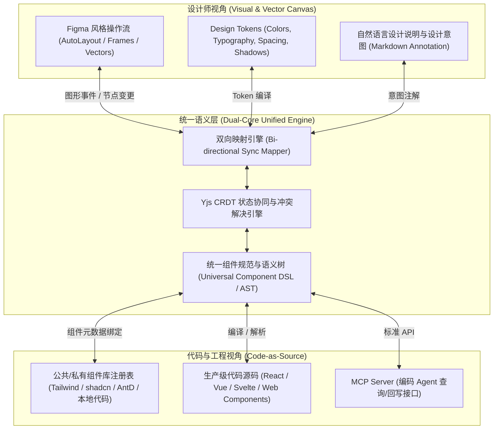
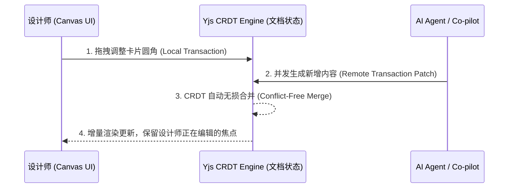

# AI UI 设计与组件平台架构设计说明书 (v0.0.1)

## 1. 产品定位与核心目标

### 1.1 产品定位
面向专业设计师的高效 AI 原生 UI 设计与组件工作台。
- **操作体验与操作语言**：深度对齐 Figma（Frame、Auto-Layout、Constraints、Components、Variants、Tokens），为专业设计师提供极致流畅的设计提效环境。
- **双轨核心价值**：打破传统设计图与工程代码的鸿沟，同时满足：
  1. **面向设计师**：基于纯矢量画布 + 丰富视觉属性 + 自然语言设计意图阐述，提供无缝对齐 Figma 手感的专业图形界面。
  2. **面向代码与研发**：基于 **Code-as-Source（代码即源）** 与标准化 **Component DSL**，保证设计直接映射生产级代码，杜绝不可落地的无效像素。

### 1.2 核心用户角色与协同模型
- **专业设计师 (Designer)**：使用 Figma 风格的图形界面进行视觉排版、组件变体管理、设计令牌维护，通过 AI 快速扩展设计创意与批量适配多端。
- **前端工程师 / 编码 Agent (Developer & AI Agent)**：基于双向同步的 DSL/AST 消费设计数据，直接提取可用代码或通过标准 MCP 协议联动工作区。
- **双模沟通代理 (AI Co-pilot)**：作为设计意图的协同者，既理解图形层级与色彩光影，又理解前端组件规范与交互状态。

---

## 2. “双轨双核”架构：矢量设计与代码源的统一

为了同时满足“设计师的图形自由度”与“工程代码的严格约束”，平台设计 **Dual-Engine Core (双轨引擎架构)**：

### 2.1 矢量画布与 Code-as-Source 的映射机制
1. **统一数据结构 (Universal DSL)**：
   * 画布底层的每个节点不是单纯的无语义 `Rect/Group`，而是携带语义的 `Component Node`（或由 Auto-Layout 驱动的标准 `Frame Node`）。
   * 每个 Frame 映射为标准 CSS 盒模型（Flexbox / Grid），自动布局参数对齐 CSS 规则。
2. **渐进式矢量支持 (Vector & Primitive Escape Hatch)**：
   * 允许设计师绘制纯矢量图形（Vector/Path/Icon/SVG），平台将其转译为内联 SVG 或图标资产组件，保留矢量图层的同时赋予其代码引用。
3. **双向无损同步 (Bi-directional Round-trip)**：
   * **Visual to Code**：设计师在画布上微调尺寸、间距、圆角与变体，即时同步至 DSL 并更新关联代码 AST。
   * **Code to Visual**：外部引入或修改组件代码（如调整 Props 定义），画布自动刷新组件在图层树与属性面板中的展示。

---

## 3. 设计工作流：实时模式 vs 长思考模式

针对设计师不同阶段的工作习惯，平台解耦为两种差异化明显的交互工作流：

| 维度 | 实时生成模式 (Instant Mode) | 长思考设计模式 (Deep Reasoning Mode) |
| :--- | :--- | :--- |
| **工作流定位** | 快速构思、局部微调、组件探索与即时反馈 | 宏观架构规划、复杂业务分析、系统级 PRD 与多页面推演 |
| **界面呈现** | **画布居中，侧边浮动 Chat/微调面板**（对齐 Figma AI / Copilot 体验） | **类写作沉浸式文档工作台**（对齐 Notion / Craft，左右分栏：PRD 构思区 + 概念推导架构图） |
| **核心产物** | 直接在画布上生成/变异具体的 Page、Frame 或 Component 变体 | 系统的产品文档（PRD）、信息架构树（IA）、用户路径图、页面清单与验收清单 |
| **确认时机** | 用户逐轮 Prompt $\rightarrow$ 秒级渲染 UI 效果并即时确认/回滚 | 在写作模式下反复推敲打磨 PRD，最终确认后再**一键批量转化为整套设计项目与页面** |
| **沟通重点** | 细节调整（如：“把搜索栏改成分段筛选，主色改用 brand-500”） | 业务深度推导（如：“分析 B2B 审批流的 4 种异常状态并设计互斥分支”） |

---

## 4. 人机协同：局部修改与人机沟通道（解决模型幻觉）

针对自然语言难以精确描述细节以及大模型易产生幻觉的问题，平台放弃单向的“操作记录反向生成纯文字 Prompt”，转为**“选区意图提取 + 确定性参数约束 + 人机主动沟通弥合”**的工作机制：

### 4.1 局部修改的三层架构
1. **硬性选区边界锁定 (Scope Guard)**：
   * 用户在画布上框选目标组件或 Frame。
   * 系统冻结选区外部的所有节点，AI 只获得对该选区子树的修改权限，彻底消除“改一处乱整体”的幻觉失控。
2. **确定性参数 + 模糊语义混合注入**：
   * 若用户手动改动了间距、颜色或组件属性，这些操作作为**确定性硬约束（Deterministic Constraints）**直接写入 Patch，不交由 AI 二次猜测。
   * 用户的复杂意图（如“优化该卡片的信息层次与空状态展示”）作为提示词输入。
3. **AI 主动沟通与选项弥合 (Co-pilot Clarification)**：
   * 当用户需求存在歧义（例如：“让这里看起来更高级”或“增加更多操作”），AI 不直接擅自修改节点，而是在侧边栏向设计师发起结构化沟通：
     - 提供 2~3 种设计方向策略（如方案 A：紧凑列表；方案 B：卡片式分块）；
     - 显示受影响的变体或属性清单；
     - 待设计师确认后，精确应用局部结构补丁。

---

## 5. 组件生态：全网公开与本地私有组件库深度集成

平台杜绝 AI 凭空绘制“不可落地的野组件”，核心遵循**“使用真实组件拼装界面”**：

### 5.1 组件注册表架构 (Universal Component Registry)
1. **主流开源设计系统预置与扩展**：
   * 开箱即用支持：**Tailwind CSS、shadcn/ui、Ant Design、Material UI、Chakra UI、Radix UI** 等业界主流组件库。
   * 建立统一的组件元数据索引（Props、Slots、Variants、States、CSS 变量映射）。
2. **私有/企业本地组件库无缝导入**：
   * 支持通过 npm 包、Git 仓库或 Storybook 元数据（`custom-elements.json` / Storybook CSF）一键导入团队现有组件。
   * 平台提取组件的 Props 规范与示例代码，自动转化为画布中的“可拖拽主组件（Master Components）”。
3. **AI 组装边界约束**：
   * 在生成或修改设计时，系统强制引导大模型检索并复用注册表中的标准组件；
   * 仅在确实缺乏合适组件时，才允许基于基础 Auto-Layout Frame 拼接，并标记为“待抽象的新组件”。

---

## 6. 画布功能与 Figma 级操作语言

为专业设计师提供极致熟悉的图形设计语言与快捷体验：

### 6.1 画布基础与布局体系
* **核心概念完全对齐 Figma**：
  * **Frame & Group**：支持嵌套容器与逻辑成组。
  * **Auto-Layout（自动布局）**：支持 Direction（横/纵向、换行）、Spacing、Padding、Alignment、Resizing（Fixed / Hug / Fill）。
  * **Constraints（约束条件）**：支持 Left/Right/Center/Scale 等缩放响应约束。
  * **Components & Variants**：主组件（Master Component）与实例（Instance），支持变体属性切换与样式覆盖（Overrides）。
* **两种工作台视图**：
  * **画布模式 (Infinite Canvas)**：无限画布，支持缩放、对齐、标尺、参考线、多画板平铺与跨页面连线。
  * **堆叠/功能流模式 (Workflow Stack Mode)**：以页面路由或业务链路为轴心，展示主从关联与流程关系，聚焦功能切换。

### 6.2 设计令牌体系 (Design Tokens)
* 全面兼容 **W3C Design Tokens Community Group (DTCG)** 规范。
* 支持颜色（Color）、文字样式（Typography）、间距（Spacing）、圆角（Radius）、阴影（Elevation）等 Token 变量管理与主题（Dark/Light Mode）无缝切换。

---

## 7. 交互原型：声明式轻量动作模型

不引入过于复杂的全功能有限状态机运行引擎，**收敛并聚焦于最高频的声明式交互（Declarative Actions）**：

### 7.1 核心动作集 (Action Primitives)
平台原生支持以下轻量可执行行为：
1. **Navigate**：页面跳转（支持 Push、Replace、Back）。
2. **OpenModal / CloseModal**：弹出对话框、侧边抽屉（Drawer）、浮动弹层（Popover），可配置遮罩与点击空白处关闭。
3. **ToggleState**：切换指定组件的变体/状态（Default / Hover / Pressed / Disabled / Loading / Active）。
4. **SwitchTab**：标签页、分段控制器的视图索引切换。
5. **MockSubmit**：模拟表单提交，触发预设假数据加载、成功提示（Toast/Alert）或失败异常状态展示。

### 7.2 交互触发器与转场
* 触发器：`OnClick`、`OnHover`、`OnFocus`、`OnTimeout`（定时器）。
* 转场动画：Instant（即时）、Dissolve（渐隐）、Slide In/Out（推入推出），可配置缓动曲线与时间。

---

## 8. 多端独立模版体系 (MPA / Separate Layouts)

### 8.1 架构设计
根据设计师的实际产出习惯，多端适配不采用简单强硬的 CSS 媒体查询压缩，而是采用**“逻辑统一、布局独立”的多端独立模版架构**：
* **目标终端支持**：Web (Desktop/Tablet)、Mobile (iOS / Android Native)、Desktop (Windows / macOS Client)。
* **同构数据共享**：同一项目下的跨端页面共享同一套业务语义、数据模型和组件映射规则。
* **独立画板与专属规范**：
  - 各端拥有独立画布画板（Frame），适配平台专属规范（如 iOS 的 Navigation Bar / Home Indicator、Android 的 Material Top App Bar）；
  - 支持“一键衍生多端画板”：选择已设计好的 Desktop 页面，AI 自动根据移动端交互范式重构布局并生成对应的 Mobile 画板。

---

## 9. 状态协同与版本管理：Yjs CRDT 架构

为了彻底解决“用户手动编辑”与“AI Agent 流式生成/并发修改”之间的冲突，平台在底层全面引入 **Yjs (CRDT)**：

* **细粒度属性级并发控制**：即便 AI 正在大范围更新某页面的文案与图片，设计师依然能同时微调该页面某组件的边距，两者互不覆盖、自动合并。
* **版本快照与差异回溯 (Time Travel)**：基于 CRDT 事务日志记录，支持按操作者（用户/AI）过滤查看版本差异，并支持无损回滚。

---

## 10. Agent 接入、MCP 服务与自动化视觉走查

### 10.1 研发闭环：标准 MCP (Model Context Protocol)
平台对外提供结构化 MCP Server，使外部编码 Agent（如 Cursor、Claude Code、Antigravity）能够直接与设计工作台深度交互：
* `get_project_tree`：读取项目结构、页面列表及跨页面流程。
* `get_page_dsl`：以紧凑结构化 DSL 导出指定页面/组件，避免一次性消耗过大上下文。
* `get_design_tokens`：获取标准化 W3C Design Tokens。
* `patch_component`：允许外部编码 Agent 根据代码实现反向优化或修复设计稿属性。

### 10.2 自动化视觉走查 (Visual Diff & Verification)
* 配合 **Playwright** 提供受控无头浏览器沙箱，实现代码渲染结果与设计稿的像素级比对（Pixelmatch / SSIM）。
* 自动检测常见工程违规：布局溢出（Layout Overflow）、未遵循组件库 Token（Hardcoded Hex Colors）、缺失的交互状态（Missing Empty/Loading State），并输出交互式走查报告反馈给设计与研发。

---

## 11. 开源项目技术选型与借鉴

| 领域模块 | 推荐借鉴的开源项目 | 核心吸收与借鉴点 |
| :--- | :--- | :--- |
| **画布与图形引擎** | **Penpot** | 借鉴其 SVG 渲染体系、Figma 级别的 Auto-Layout 算法与图层树交互。 |
| **可编程节点与 MCP** | **OpenPencil** | 借鉴其结构化节点读写、设计文档差异比对及 MCP 协议集成。 |
| **组件生态与隔离** | **Storybook** | 借鉴组件元数据提取、变体管理、隔离预览及交互测试体系。 |
| **协同与冲突解决** | **Yjs** | 统一数据模型底层，解决用户手动操作与 AI 异步流式生成间的并发冲突。 |
| **设计规范与令牌** | **DTCG Spec / Style Dictionary** | 标准化 Design Token 数据结构，实现设计向 CSS/Tailwind 变量的直接编译。 |
| **自动化与视觉测试** | **Playwright** | 页面自动化渲染、关键路径截图比对及视觉走查。 |
