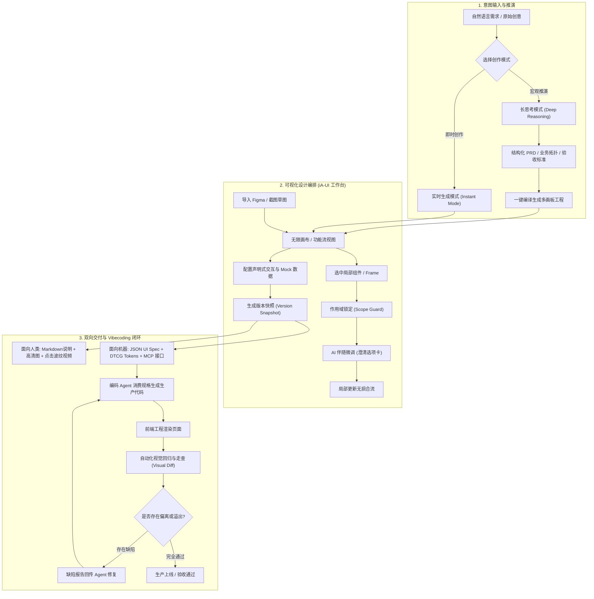
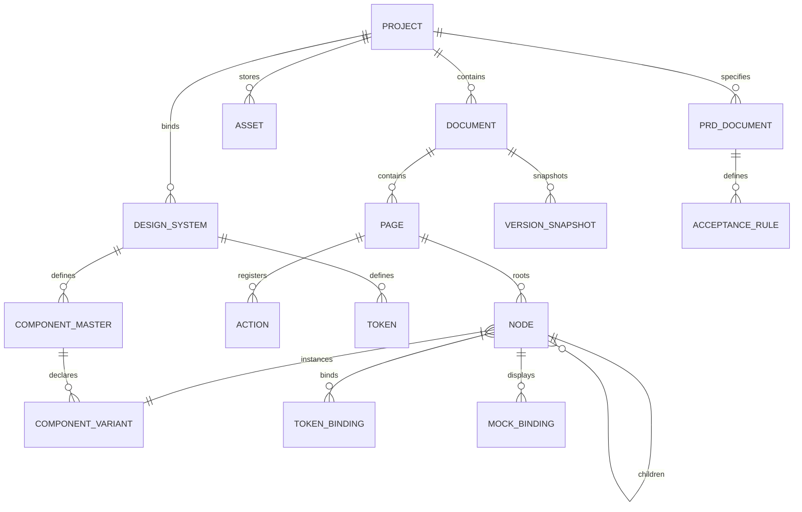

# iA-UI 产品功能与体验设计说明书 (v0.0.2 完整产品形态版)

> **文档定位**：本文档为 **iA-UI (Intelligent Agentic UI Workbench)** 的完整产品形态功能架构、系统交互与业务闭环设计说明书。
> 本设计以“完整、成熟的产品终局形态”为出发点展开全景推演，覆盖产品定位、用户体验、信息架构、端到端业务流、双模输入、Agent 上下文投影、组件与资产系统、声明式原型、版本控制、验证闭环与商业化生态。
> 本文档不绑定底层具体的代码工程选型，专注于建立严密、可验证、无二义性的产品功能与系统规则。

---

## 1. 产品战略定位与核心目标

### 1.1 业务卡位：连接“文字想法”与“前后端开发”的桥梁
在数字化产品的产研流水线中，“自然语言需求”到“前后端工程实现”之间存在明显的断层：
- **传统专业设计工具（Figma、Penpot 等）**：产出的是静态、非结构化的图形像素，研发人员或下游 AI 编码工具必须费力猜测布局规律、组件关系与交互状态；
- **AI 代码生成工具（v0、Lovable、Bolt 等）**：跳过了专业设计编排与系统化设计系统沉淀，专业设计师无法进行精细化图形干预，生成的代码架构往往难以长效维护。

**iA-UI 的核心定位**：
> **介于“自然语言产品想法”与“前后端代码落地”之间的 AI 原生可视化 UI 设计工作台。**

```
┌────────────────────────────────────────────────────────────────────────┐
│                        产研协作全生命周期流向                           │
└────────────────────────────────────────────────────────────────────────┘
 [ 自然语言想法 / PRD ]
          │
          ▼ (Agent 协同规划与编排)
 ┌──────────────────────────────────────────────────────────────────────┐
 │                     iA-UI 核心工作台                                  │
 │  - 专业设计师可视化编排 (贴近 Figma 操作手感 + 针对 AI 优化的设计语言)  │
 │  - 纯矢量画布 + 语义化规范模型 (双轨统一架构)                         │
 │  - 视觉样式 + 声明式交互 + 状态覆盖 + Mock 数据                      │
 │  - Agent 适配层 (解耦外部 Agent，动态视窗投影投喂 UI 上下文)           │
 └──────────────────────────────────────────────────────────────────────┘
          │
          ├───▶ [ 人类可视交付物 ] : Markdown 说明、全景高清标注、交互演示视频(带点击动效)
          └───▶ [ Vibecoding 交付物 ] : 机器可读标准 UI Spec (流式盒模型/Token/动效/路由)
          ▲
          └───◀ [ 闭环反向验证 ] : Playwright 级视觉比对与合规检查报告 (反馈修复)
```

### 1.2 核心目标与价值闭环
1. **高效设计 (Efficient Design)**：
   - 彻底解放设计师的机械劳动，由 Agent 接管繁重的组件检索、流式拼装、跨端排版衍生与多状态生成。
2. **可视化掌控 (Visual Precision)**：
   - 保留专业设计师熟悉、流畅的图形化设计手感，赋予其对画板、图层树、组件变体与属性面板的完全掌控力，杜绝“纯靠自然语言抽卡”的失控感。
3. **面向 Vibecoding 的生产级交付 (Vibecoding-Ready)**：
   - 产出的不仅是给人看的静态图形，而是 **Vibecoding 工具（Cursor, Claude Code, Windsurf 等）100% 能够理解、可直接消费的生产级 UI 规格**，并形成“设计 → 规格 → 代码实现 → 视觉比对 → 反馈修复”的完整闭环。
4. **设计资产商业生态 (Marketplace Moat)**：
   - 赋能设计师将其沉淀的高质量组件系统、页面模板转化为自带工程规格的数字资产，在社区内有偿分发与流通，建立产品商业护城河。

### 1.3 AI 在流程中的准则与定位
- **决策者与执行者解耦**：设计师始终是最高设计决策者，AI 是超级助理与执行者；
- **消除幻觉与防止越界**：AI 的任何生成与修改必须置于严格的“设计系统规则”与“选区保护范围”约束下，严禁破坏上下文之外的节点；
- **组件拼装优先于盲目重绘**：AI 优先从已注册的标准组件库中检索并组装，仅在缺失时才进行底层图元搭建。

---

## 2. 针对 AI / Agent 重构的 UI 设计语言规范

传统设计工具的设计语言面向平面图形渲染，允许任意图层重叠、绝对坐标拖拽、打组（Group）与硬编码十六进制色值（Hex），这会导致 AI 解析出的前端代码结构极为脆弱。iA-UI 对底层设计语言进行了语义化与标准化重塑：

```
┌────────────────────────────────────────────────────────────────────────┐
│                   iA-UI 针对 AI 优化的设计语言体系                     │
├──────────────────┬─────────────────────────────────────────────────────┤
│ 1. 结构与容器     │ 淘汰无约束的自由 Group，全面推行 Fluid Auto-Layout  │
│   (Container)    │ 严格映射流式盒模型（Direction, Gap, Padding,        │
│                  │ Alignment, Resizing: Hug/Fill/Fixed）。            │
├──────────────────┼─────────────────────────────────────────────────────┤
│ 2. 资产与图元     │ 矢量图元统一封装为 Semantic Primitive 或 Icon Token│
│   (Primitives)   │ 拒绝无语义散乱路径，保持稳定语义标识与 SVG 映射。   │
├──────────────────┼─────────────────────────────────────────────────────┤
│ 3. 变量与令牌     │ 全面遵循 W3C DTCG 标准 Design Tokens                │
│   (Design Tokens)│ 色彩阶梯、字阶、间距、圆角、阴影全局语义化绑定。    │
├──────────────────┼─────────────────────────────────────────────────────┤
│ 4. 组件与变体     │ 严格对齐组件标准（属性 Props, 变体 Variants, 插槽） │
│   (Component)    │ 主组件（Master）与实例（Instance）分离，支持状态覆盖│
├──────────────────┼─────────────────────────────────────────────────────┤
│ 5. 交互行为       │ 声明式动作原语 (Declarative Action Primitives)      │
│   (Interaction)  │ 跳转、浮层、Tab 切换、状态变异、模拟提交。          │
└──────────────────┴─────────────────────────────────────────────────────┘
```

### 2.1 双轨引擎统一模型 (Visual & Vector Canvas <-> Unified DSL)
平台在底层维持“视觉画布”与“结构化语义规格”的双向强一致性映射：
- **无损双向转换**：设计师在画布上的图形拖拽、间距调整即时反映至 UI Spec 语义树；下游通过 API 或 Agent 写入的属性补丁即时渲染至矢量画布；
- **逃生舱机制 (Escape Hatch)**：支持贝塞尔曲线、自定义复杂图形与布尔运算，但此类自由矢量均被打包为独立语义图元（Semantic Vector Primitive），以 SVG 资产形式注入规格，不破坏整体盒模型。

---

## 3. 全生命周期端到端业务流程与用户旅程

### 3.1 核心用户角色画像
- **专业 UI/UX 设计师**：希望告别机械的切图、适配、补全多状态工作，专注于高价值的视觉风格、品牌意图和动效表达；
- **全栈工程师 / Vibecoding 开发者**：使用 Cursor/Claude Code 等工具，痛恨根据截图盲猜 CSS，需要机器可读的盒模型、动态 Token 与交互跳转路由；
- **产品经理 (PM)**：通过自然语言快速表达产品想法，推敲结构化 PRD 与业务分支，一键生成高保真设计画板供客户评审；
- **设计资产创作者**：制作并上架符合工程标准的高品质设计资产，获取持续分成收益。

### 3.2 业务全景流向图


### 3.3 典型工作流程 A：从零开始的产品设计 (0 to 1)
1. **需求输入**：用户进入“长思考模式”，输入自然语言产品愿景；
2. **结构化推演**：Agent 生成结构化 PRD，拆解业务实体、页面拓扑、异常分支及验收指标，用户在线审阅并调整；
3. **批量编译**：确认 PRD 后，系统调用预设的设计系统（如 Tailwind + shadcn/ui）自动编排生成全套页面画板；
4. **视觉精修与交互**：切换至画布视图，设计师微调局部元素，挂载声明式交互（跳转、弹窗）并注入 Mock 数据；
5. **双向交付**：生成 UI Spec 与带点击波纹的演示视频，交付下游研发。

### 3.4 典型工作流程 B：存量设计导入与持续迭代 (Iterative)
1. **资产导入**：上传团队现有的 `.fig` 文件或产品运行截图；
2. **结构化还原**：系统将其解析为语义 Frame、标准图元与 Token 绑定，标出不兼容项；
3. **局部优化**：设计师框选需改版的区域（如购物车结算流程），触发 Scope Guard 锁定；
4. **人机澄清与修改**：输入修改意图，Agent 弹出方案选项卡，确认后仅重绘选区，背景画板 100% 保持稳定；
5. **版本比对**：通过版本 Diff 检查图层级与属性级变更，确认后提交新版本。

### 3.5 典型工作流程 C：下游 Vibecoding 消费与反向验证闭环
1. **规格消费**：下游编码 Agent（如 Cursor）通过 MCP 查询当前页面的紧凑 UI Spec；
2. **生产级代码生成**：编码 Agent 根据流式盒模型和 Token 直接映射为 React/Vue 前端组件；
3. **自动化比对**：系统调起受控无头浏览器渲染代码产物，与 iA-UI 画布进行像素级与结构级自动化比对；
4. **闭环修复**：若发现间距偏差、文字溢出或遗漏 Loading 态，系统生成诊断报告精准回传给编码 Agent 进行针对性修复。

---

## 4. 核心工作台界面布局与信息架构

工作台深度继承设计师熟悉的专业操作心智，由五大功能区组成标准界面结构：

```
┌──────────────────────────────────────────────────────────────────────────────────┐
│ [顶部全局栏] 项目名 | 模式切换(实时/长思考) | 视图(画布/流) | 撤销/重做 | 历史版本 | 导出交付物 │
├──────────────┬───────────────────────────────────────────────────┬───────────────┤
│ [左侧导航面板] │ [中央核心视口区]                                   │ [右侧属性检查] │
│ ├─ 页面列表   │                                                   │ ├─ 流式布局   │
│ ├─ 图层树     │               无限矢量画布 (Infinite Canvas)       │ │  (AutoLayout│
│ ├─ 组件资产库 │                        或                         │ ├─ 样式令牌   │
│ ├─ 设计令牌   │          沉浸式长思考编辑器 (Deep Reasoning)        │ │  (Tokens)   │
│ └─ 市场资产   │                                                   │ ├─ 组件变体   │
│              │                                                   │ ├─ 交互动作   │
│              │                                                   │ └─ Mock 数据  │
│              ├───────────────────────────────────────────────────┴───────────────┤
│              │ [底部状态/流转栏] 选区信息 | 缩放比率 | 视口快捷对齐 | 协同光标状态   │
└──────────────┴───────────────────────────────────────────────────────────────────┘
               │ 悬浮 / 侧边呼出：【AI 伴随协同面板 (Co-pilot Panel)】               │
```

### 4.1 全景分区功能规范
1. **顶部全局操作栏 (Top Header)**：
   - 项目元信息、终端模式切换（Desktop / Mobile / Tablet）、双模切换（实时生成 / 长思考）、双视图切换（无限画布 / 功能流视图）、全局撤销/重做、版本快照中心、一键导出交付物。
2. **左侧资源与结构面板 (Left Sidebar)**：
   - **页面管理 (Pages)**：支持多页面增删改、跨端独立画板并排管理；
   - **图层大纲树 (Layer Tree)**：显示语义节点层级、锁定状态、隐藏状态及选区标识；
   - **组件与资产库 (Assets & Components)**：包含系统标准组件、私有导入组件、图标库与字体库；
   - **设计系统变量 (Design Tokens)**：色板层级、字体规范、投影与圆角字典。
3. **中央核心视口区 (Main Viewport)**：
   - 具备无限画布与沉浸式 PRD 编辑双重形态，支持无极平移缩放、高保真矢量渲染与磁吸参考线。
4. **右侧属性检查器 (Right Inspector)**：
   - **Auto-Layout 布局引擎**：流向（横向/纵向/换行）、Padding、Gap、对齐、尺寸约束（Hug / Fill / Fixed）；
   - **外观与令牌绑定**：Fill、Stroke、Radius、Shadow，强制支持一键绑定 DTCG Token；
   - **组件与变体面板**：Props 传参设置、Master 组件变体切换、Slot 插槽替换；
   - **交互与 Mock 面板**：声明式动作挂载（Action）、假数据源选择。
5. **AI 伴随协同面板 (Co-pilot Floating Drawer)**：
   - 支持停靠右侧或自由浮动，承载 Prompt 输入框、动态选区感知指示器、方案选项澄清卡片及实时修改 Diff 预览。

### 4.2 两种工作台主视图模式
- **画布模式 (Infinite Canvas)**：
  - 页面与画板在二维无限空间平铺，适合全局视觉对比、设计走查、自由编排与多端响应式画板并排查看。
- **堆叠 / 功能流模式 (Workflow Stack Mode)**：
  - 以用户业务旅程或应用路由为主轴，画板之间通过连线展示跳转逻辑与主从关系；
  - 设计师点击流程节点或交互按钮，视口平滑聚焦对应工作页面，专注梳理交互链路闭环。

### 4.3 元素专属设计子工作台
不仅支持整页编排，系统针对基础图元提供**“同构独立设计子工作台”**：
- **图标与矢量工作台 (Icon/Vector Workbench)**：支持布尔运算、贝塞尔锚点精修、SVG 代码直接互转与 24x24 网格对齐；
- **组件原子工作台 (Component Master Workbench)**：隔离设计单一主组件，直观调试 Default、Hover、Active、Disabled、Loading 变体矩阵，并定义 Props 传参类型；
- **色彩与字体工作台 (Token Studio)**：色相明度阶梯生成器（50~950）、WCAG 2.1 无障碍色彩对比度自动检查、多端字阶比例标尺。

---

## 5. 双模设计输入工作流：实时生成 vs 长思考写作

针对设计师在不同创作阶段的心智特点，平台提供两种界面形态完全解耦的输入工作台：

```
┌────────────────────────────────────────────────────────────────────────┐
│                        模式 A：实时生成模式 (Instant Mode)              │
│                                                                        │
│   [ 画布视图居中 ]                                                     │
│   ┌───────────────────────────────────┐  ┌───────────────────────────┐ │
│   │                                   │  │ 侧边浮动 Agent 交互面板   │ │
│   │     画布页面 / 选区实时渲染       │  │ > 用户逐轮输入 Prompt     │ │
│   │                                   │  │ > 动态上下文切片投喂      │ │
│   │     (毫秒级反馈，即改即看)         │  │ > 差异高亮与确认/撤销     │ │
│   └───────────────────────────────────┘  └───────────────────────────┘ │
└────────────────────────────────────────────────────────────────────────┘

┌────────────────────────────────────────────────────────────────────────┐
│                      模式 B：长思考模式 (Deep Reasoning Mode)          │
│                                                                        │
│   [ 沉浸式写作视图居中（类 Notion / 结构化编辑器）]                     │
│   ┌───────────────────────────────┐  ┌───────────────────────────────┐ │
│   │ 左侧：产品思考与 PRD 推演区    │  │ 右侧：架构思维导图与业务链路  │ │
│   │ > 深度业务背景推导            │  │ > 页面流转拓扑图              │ │
│   │ > 异常状态与边界枚举          │  │ > 状态机分支走向              │ │
│   │ > 页面清单与组件选型方案      │  │ > 验收标准检查单              │ │
│   └───────────────────────────────┘  └───────────────────────────────┘ │
│   [ 底部操作栏 ]：推敲打磨成熟 ──▶ 【一键批量转化为整套设计项目与画板】  │
└────────────────────────────────────────────────────────────────────────┘
```

### 5.1 实时生成模式 (Instant Mode)
- **定位**：面向**微观视觉效果**与快速尝试；
- **交互特征**：画布居中，AI 伴随面板停靠侧边；用户框选局部图层后输入自然语言微调，Agent 执行毫秒级增量补丁应用；支持逐轮预览、即时撤销与高亮对比。

### 5.2 长思考写作模式 (Deep Reasoning Mode)
- **定位**：面向**宏观业务架构**与系统化推演；
- **交互特征**：沉浸式双栏结构化文档工作台；
  - **左栏（需求推演区）**：Agent 作为资深产品与交互专家，引导用户层层推敲产品目标、用户画像、功能清单与异常分支；
  - **右栏（架构与拓扑区）**：实时自动同步生成信息架构树（IA）、页面流转拓扑图与组件复用选型表；
- **批量编译机制**：当 PRD 打磨完善后，点击底部“一键生成”，系统根据结构化文档中的页面清单与设计系统规则，自动在画布中并行批量派生全套设计画板。

### 5.3 PRD 与 UI 画板的映射驱动机制
- PRD 不是孤立的文本，而是 UI 画板的上级抽象事实来源：
  - PRD **页面清单** ──▶ 映射为画布中的 **Page / Frame** 集合；
  - PRD **业务功能与交互要求** ──▶ 映射为组件属性与 **Declarative Action** 路由；
  - PRD **设计约束** ──▶ 映射为 **Design Tokens** 引用字典；
  - PRD **验收指标** ──▶ 映射为自动化走查的 **Acceptance Rules**。
- **变更追溯联动**：当用户在后续重新编辑 PRD 章节时，系统自动高亮标注受影响的页面与组件，提示设计师确认同步更新。

---

## 6. Agent 适配层与上下文传递机制

为避免设计平台深陷于底层大模型的 Prompt 工程、上下文截断与记忆管理，平台采用**“直连成熟 Agent 生态 + 统一适配层”**的策略：**本平台不直接对接裸模型（LLM API），而是对接具备独立思考与工具调用能力的 Agent。**

```
┌──────────────────────────────────────────────────────────────────────────┐
│                           iA-UI 产品工作台                               │
│  [ 画布 / 选区 ]      [ 属性面板 / 动作 ]      [ 设计系统 / Tokens ]       │
└─────────────────────────────────┬────────────────────────────────────────┘
                                  │ 触发 Agent 动作 / 查询
                                  ▼
┌──────────────────────────────────────────────────────────────────────────┐
│                   iA-UI Agent 适配层 (Agent Adapter Layer)               │
│                                                                          │
│  1. 契约解耦适配器 (Adapter Provider)                                   │
│     - 插件化接入：Anthropic Claude Agent / OpenAI Agent / 自建 MCP Agent  │
│     - 标准双向协议：Task Ingest ──▶ Tool Execution ──▶ Patch Apply       │
│                                                                          │
│  2. 动态上下文视窗投影 (Context Window Projector)                        │
│     - 拒绝盲目全量投喂；按设计语义投喂紧凑切片：                         │
│       • Scope Tree (选区子树 DSL)                                        │
│       • Global Design Tokens (当前生效的主题/色板/间距变量)              │
│       • Usable Components Registry (当前可复用的标准组件 Props/变体索引) │
│       • Surrounding Layout Constraints (父级盒模型与相邻兄弟节点约束)    │
│                                                                          │
│  3. Agent 结构化工具集 (Agent Tools Provider)                            │
│     - query_component_spec (按需查询组件详情)                            │
│     - apply_ui_patch (输出针对稳定 ID 的局部修改补丁)                    │
│     - ask_designer_clarification (发起方案选择题，弥合模糊意图)         │
└─────────────────────────────────┬────────────────────────────────────────┘
                                  │ 标准工具调用 / 结构化通信
                                  ▼
┌──────────────────────────────────────────────────────────────────────────┐
│                  外部接入的 Agent (Claude Agent / 自建 Agent)             │
│  - 拥有独立的记忆管理 (Memory)、规划与推理 (Planning)、多轮决策能力      │
└──────────────────────────────────────────────────────────────────────────┘
```

### 6.1 架构解耦：Agent 适配层 (Agent Adapter)
- **解耦外部绑定**：平台通过标准协议（MCP 或双向 JSON-RPC）向外暴露设计操作能力；平台不干涉 Agent 内部的推理循环、记忆持久化或子代理编排；
- **热插拔接入**：企业可自由配置接入 Claude Agent、OpenAI Agent、本地部署的开源 Agent 或企业私有微调 Agent。

### 6.2 动态上下文视窗投影 (Context Window Projector)
盲目向模型塞入全画板所有图层会导致巨额 Token 开销与严重幻觉。适配层在触发 Agent 时执行动态切片投影：
1. **焦点选区子树切片 (Target Scope Subtree)**：仅提取当前选中图层的语义 DSL，附带全局稳定 ID、Auto-Layout 规则与当前变体状态；
2. **只读环境约束上下文 (Surrounding Read-only Context)**：提供父容器的流向、对齐规则、可用剩余宽高，以及前后相邻兄弟节点的尺寸约束，**赋予只读权限，严禁越界修改**；
3. **活动设计系统投影 (Active Design System)**：仅注入当前项目生效的 W3C DTCG Token 字典及可用标准组件元数据索引；
4. **关联需求切片 (Intent / PRD Slice)**：若处于 PRD 驱动流，附带对应功能模块的验收规则与设计要求。

### 6.3 双向意图传递：操作行为逆向生成 Prompt (Canvas Edit to Prompt)
意图传递不仅是“自然语言到设计”，平台支持**“图形编辑逆向提炼为自然语言 Prompt”**：
- 当设计师在画布上手动执行了一连串微调（例如：将卡片内边距从 12 改为 20、替换按钮主色为 `brand-600`、增加标签组件）；
- 系统捕获编辑事件流并进行语义压缩，自动提炼生成一句精准的自然语言修改描述（如：“将用户卡片内边距调整为 20px，主按钮切换为 brand-600 并新增状态标签”）；
- 设计师可一键将该 Prompt 批量应用至项目中其他类似画板，或沉淀至设计版本日志中。

### 6.4 局部修改保护 (Scope Guard) 与人机澄清 (Co-pilot Clarification)
- **选区硬隔离 (Scope Guard)**：
  - 选中目标组件后，外部画板全部置于只读保护锁定；
  - Agent 回写的 JSON Patch 必须经过适配层作用域校验，任何针对未选中节点的写入操作直接被底层拦截报错；
- **主动澄清卡片 (Co-pilot Clarification)**：
  - 当设计师输入“让界面更大气”、“优化这个列表”等模糊、非量化诉求时，Agent **严禁直接盲目重绘**；
  - Agent 调用 `propose_clarification` 工具，在侧边栏向设计师发起结构化方案选项卡（如：方案 A-沉浸大图流；方案 B-紧凑仪表盘式），待设计师确认后执行确定性更新。

---

## 7. 全景功能模块详设

### 7.1 项目管理与全局配置
- **项目生命周期**：支持项目的创建、重命名、分组、归档、复制与软删除；
- **项目级设计规范配置**：
  - 绑定默认设计系统（如 Tailwind, shadcn/ui, Ant Design）；
  - 配置主视觉基调、默认终端类型、默认语言环境与字体栈；
  - 设置技术侧代码生成目标偏好（React, Vue, Svelte, Tailwind CSS 规范）。

### 7.2 Figma 与已有设计导入
- **多格式文件导入支持**：
  - 原生支持 `.fig` 文件导入解析，完整提取 Pages, Frames, Components, Vector Paths, Text, Auto-Layout 规则与 Local Styles；
  - 支持上传界面截图、手绘草图作为视觉生成参考依据；
- **语义化映射与清洗**：
  - 自动识别导入设计稿中的无约束 Group，智能推荐转换为 Fluid Auto-Layout；
  - 将硬编码 Hex 色值智能匹配并对齐至项目中的 W3C DTCG Token 阶梯；
- **兼容性报告与降级提示**：
  - 导入完成后出具诊断清单，对暂不支持的复杂渐变网格、私有插件节点进行高亮标注，并保留原始无损图元供人工微调。

### 7.3 私有字体、图标与多媒体设计资产库
- **企业私有字体管理**：支持上传 `.woff2`、`.ttf`、`.otf` 格式字体，提供在线预览、版权授权证书登记、网页端安全分发；
- **矢量图标库管理**：
  - 支持批量上传 SVG 图标，自动清洗冗余代码，规范化为 24x24 视口与单色/多色语义图元；
  - 支持图标按分类（通用、系统、业务）检索与别名标签打标；
- **多媒体资产安全**：
  - 上传文件自动进行 SVG 脚本注入（XXE/XSS）防护检测与图片文件格式合规校验；
  - 设计工程中自动监控资产断裂与缺失状态，提供一键替换修复引导。

### 7.4 全网公开组件库集成与本地私有组件映射
- **公开主流组件库开箱即用**：
  - 原生预置 **Tailwind CSS、shadcn/ui、Ant Design、Material UI、Radix UI** 标准设计组件元数据；
  - 提取完整属性（Props）、变体（Variants）、插槽（Slots）与状态（States）索引字典；
- **本地私有组件库逆向解析**：
  - 支持通过导入组件元数据文件（如 Storybook `custom-elements.json` 或标准组件类型定义），将团队自建的前端组件自动转化为画布中的主组件（Master Component）；
- **AI 组装底线**：Agent 在生成界面时强制从注册表中优先检索已有组件进行拼装，严格杜绝生成不可落地的前端野组件。

### 7.5 设计师有偿发布与资产交易市场 (Marketplace)
- **商业化数字资产包形态**：
  - 设计师可将高水准组件库、整套页面模板、专业设计系统打包上架；
  - 资产包核心竞争力：售卖的不是死图，而是**“自带标准 UI Spec + 交互动作路由 + 动态 Mock 数据 + 代码映射规约”的工程级资产包**；
- **版权保护与授权体系**：
  - 资产发布引入不可篡改的数字签名水印；
  - 针对团队购买提供席位授权（Seats Licensing）与私有版本更新订阅；
  - 提供资产市场交易结算、评价与创作者收益分成。

### 7.6 声明式轻量交互动作模型 (Declarative Actions)
收敛交互复杂度，放弃臃肿沉重的全功能低代码运行时，聚焦最实用的原型体验：
- **声明式动作原语**：
  - `Navigate(target_page, mode)`：页面跳转（Push, Replace, Back）；
  - `OpenModal(target_frame, mask)` / `CloseModal()`：浮层弹窗、抽屉打开与关闭；
  - `ToggleState(target_component, state)`：切换组件状态变体（Hover, Active, Loading, Disabled）；
  - `SwitchTab(tab_group, target_index)`：分段器与标签页切换；
  - `MockSubmit(form_id, target_mock_response)`：模拟表单提交，触发成功/失败假数据状态；
- **触发器与转场参数**：
  - 触发事件：OnClick, OnHover, OnFocus, OnTimeout；
  - 动画转场：Instant, Dissolve, Slide In/Out，支持配置贝塞尔缓动曲线与持续时长（Duration）。

### 7.7 纯数据 Mock 体系与场景化模拟
- **纯视觉数据驱动**：完全脱离真实后端接口联调，纯粹服务于界面状态展示；
- **状态数据集配置**：
  - 为组件绑定静态数据、列表数组、分页结构与表单假数据；
  - 支持一键切换**正常态 (Normal)**、**空数据态 (Empty State)**、**网络错误态 (Error State)** 与 **超长文本溢出态 (Overflow Test)**；
- **可复现走查场景**：允许将特定的假数据组合保存为“演示场景场景包”，供走查与录屏重复调阅。

### 7.8 多端独立模版体系 (MPA / Separate Layouts)
针对不同终端的人机工程学差异，采用“逻辑统一、布局独立”的模版架构：
- **终端覆盖范围**：Web (Desktop/Tablet)、Mobile (iOS / Android)、Desktop Client (Windows / macOS)；
- **同构共享与独立排版**：
  - 跨端画板共享同一套业务字段、信息架构与交互动作逻辑；
  - 画布上设立各自独立的排版画板（如桌面端采用侧边导航，移动端采用底部 Tab 栏与 Safe Area 避让）；
- **一键跨端自适应衍生**：
  - 支持基于 Desktop 画板，Agent 依照移动端人机交互规范（最小触控热区 44x44pt、手势习惯）一键衍生生成 Mobile 画板，并清晰标出未完成适配的项目。

### 7.9 设计版本管理与节点级差异比对 (Version Snapshots & Visual Diff)
- **不可变版本快照 (Version Snapshots)**：
  - 每次重大生成、批量推演或人工阶段性评审，均可保存为命名版本快照；
  - 记录版本发布者、时间戳、变更说明与影响范围；
- **节点级与图层级 Diff 引擎**：
  - 基于全局稳定 ID，对比两个版本之间的属性增量（位置、尺寸、Token 绑定、组件变体、交互动作）；
  - 提供直观的**视觉分屏对比 (Side-by-Side)** 与**洋葱皮重叠高亮 (Overlay Diff)**；
- **无损回滚与时光机 (Time Travel)**：
  - 支持任意回退至历史快照版本，或从指定历史版本分支派生新设计方案；
  - 局部修改防冲突拦截，防止并发编辑时覆盖最新改动。

---

## 8. 全链路双向交付物与实现验证闭环

```
                   ┌─────────────────────────────────────────┐
                   │        单一语义事实来源 (UI Spec)       │
                   └────────────────────┬────────────────────┘
                                        │
             ┌──────────────────────────┴──────────────────────────┐
             ▼                                                     ▼
 【面向人类可视的设计交付】                             【面向 Vibecoding 的机器规格】
 1. Markdown 结构化设计说明书                           1. 标准 JSON Schema UI Spec
 2. 高清全景与标注图 (PNG/SVG)                          2. W3C DTCG Design Tokens
 3. 交互走查视频 (带点击扩散波纹)                       3. 声明式动作路由与状态图
                                                        4. 结构化 Mock 数据集
                                                        5. 外部 Agent 标准 MCP 接口
                                                                   │
                                                                   ▼
                                                       [ 编码 Agent 生成生产级代码 ]
                                                                   │
                                                                   ▼
 ┌─────────────────────────────────────────────────────────────────┴───────────────────┐
 │                      自动化视觉走查与闭环修复 (Visual Verification)                 │
 │  - 受控浏览器无头渲染代码产物 ──▶ 与 UI Spec 像素级/结构级自动化比对                │
 │  - 自动检测：布局溢出、裸 Hex 违规、缺失 Loading/Empty 态、文字截断                 │
 │  - 输出结构化走查报告 ──▶ 回传编码 Agent 进行闭环修复                              │
 └─────────────────────────────────────────────────────────────────────────────────────┘
```

### 8.1 面向 Vibecoding 工具的标准化 UI 规格 (UI Spec)
为下游编码 Agent（Cursor, Claude Code, Windsurf 等）提供 100% 严谨无二义性的机器可读规格（JSON Schema 校验）：
1. **流式布局树 (Layout Tree)**：严格声明盒模型 Direction, Padding, Gap, Alignment 及尺寸策略（`hug` / `fill` / `fixed`）；
2. **样式与设计令牌绑定 (Tokens)**：所有视觉属性全部映射为 Token 变量（如 `var(--color-primary-500)`），消除不可维护的硬编码像素；
3. **声明式交互与路由 (Interactions)**：结构化定义 Trigger, Action, Target 及转场过渡贝塞尔曲线；
4. **Mock 数据结构与边界 (Mock Schema)**：提供正常、空态、长文本等数据集定义；
5. **验收规则断言 (Acceptance Criteria)**：标明组件防溢出规则、文字截断规则与视觉对比阈值。

### 8.2 面向人类可视的综合设计说明书
1. **Markdown 结构化设计说明**：自动提炼生成，包含产品背景、页面流转图、组件清单、变体说明与设计意图注解；
2. **高保真视觉资产**：支持批量导出多端高保真位图（PNG/WEBP）与无损矢量图（SVG），自带精确标注尺寸与图层属性。

### 8.3 交互走查演示视频 (关键细节：Click Wave 点击动效波纹)
动态验收是产品交付的灵魂，系统支持自动化或半自动化录制交互演示视频：
- **核心细节要求**：**视频中鼠标每次点击必须显示半透明扩散波纹动效 (Click Wave)**；
- **鼠标悬停 (Hover)** 触发组件高光反馈；
- **页面与浮层切换** 展现真实的缓动转场，为客户与产品决策者提供身临其境的验收视频。

### 8.4 自动化视觉走查与设计实现验证闭环 (Visual Verification)
构建 Vibecoding 闭环的关键在于“代码是否真正还原了设计”：
- **受控自动化渲染**：利用受控浏览器环境渲染编码 Agent 生成的代码产物；
- **四大核心违规检查**：
  1. **布局溢出 (Layout Overflow)**：文本未折行撑破容器、出现非预期的横向滚动条；
  2. **规范违规 (Token Violation)**：前端代码中出现未绑定的裸 Hex 颜色或硬编码数值；
  3. **状态缺失 (Missing States)**：漏写 Loading 骨架屏、Disabled 置灰态或 Empty 空状态；
  4. **视觉与位置偏差**：基于视觉比对算法计算结构化还原度；
- **闭环诊断报告输出**：将违规点精准定位至组件稳定 ID 与 CSS 属性，生成机器可读的诊断报告直接回传给编码 Agent，驱动其自动迭代修改代码。

---

## 9. 产品领域实体模型 (Domain Entity Model)

### 9.1 核心业务实体关系图


### 9.2 核心业务实体定义表
| 实体名称 | 业务含义与核心属性 | 关键关联关系 |
| :--- | :--- | :--- |
| **Project** | 设计项目根容器：名称、风格基调、目标终端列表、默认代码偏好、创建时间。 | 包含 Document、绑定 DesignSystem、管理 PRD。 |
| **Document** | 设计文档集合：页面清单、全局图层树索引、稳定 ID 映射字典。 | 隶属于 Project，包含多个 Page。 |
| **Page** | 单一页面画板：页面名称、目标终端视口尺寸、路由路径、背景色。 | 包含根节点 Node Tree，承载页面级 Action。 |
| **Node** | 矢量或流式图层节点：稳定 ID、名称、类型（Frame/Text/Vector/Instance）、盒模型约束、可见性。 | 递归包含子 Node，绑定 Token 与 Component。 |
| **DesignSystem** | 设计系统规范：系统名称、版本号、W3C DTCG Token 字典集、组件注册表。 | 被 Project 引用，包含 Token 与 ComponentMaster。 |
| **Token** | 设计令牌原子：Token Key、类别（Color/Font/Spacing/Radius/Shadow）、当前值、主题轴。 | 隶属于 DesignSystem，被 Node 引用绑定。 |
| **ComponentMaster** | 主组件定义：组件名称、标签分类、Props 属性定义表、Slots 插槽定义。 | 包含多个 ComponentVariant。 |
| **ComponentVariant** | 组件变体与状态：变体属性组合（size=sm, state=hover）、重写样式规则。 | 属于 ComponentMaster，被 Node 实例引用。 |
| **Action** | 声明式交互动作：Trigger 类型、动作类型（Navigate/Modal/Toggle/Submit）、目标节点、动画缓动。 | 绑定在 Node 触发器，指向目标 Page/Node。 |
| **MockDataset** | 业务假数据源：数据集名称、数据类型（Object/List/Paging）、正常态/空态/错误态 JSON。 | 绑定在 Node 进行列表渲染或内容填充。 |
| **VersionSnapshot** | 不可变历史版本：版本号、发布者、变更说明、全量规格快照、关联 PRD 版本。 | 隶属于 Document，支持比对与回滚。 |
| **PRDDocument** | 结构化产品需求文档：需求章节、业务实体、功能清单、异常规则。 | 关联 Project，其验收标准生成 AcceptanceRule。 |

---

## 10. 边界条件、异常流与容错机制

为保证系统在复杂生产环境下的稳健性，必须定义全流程的失败路径与异常容错规范：

### 10.1 AI 生成超时、中断与不合规输出降级
- **超时与网络中断**：若外部 Agent 在设定的时间阈值内未响应，画布状态自动回滚至生成前的上一版本，保留用户输入的 Prompt 并提供“一键重试”与“切换模型档位”选项；
- **格式畸形与 Schema 校验失败**：若 Agent 返回的 JSON Patch 存在语法错误或不符合标准 UI Spec，系统拦截写入操作，将错误日志记录并提示 Agent 重新生成，坚决杜绝脏数据污染画布；
- **审美偏离与幻觉重绘**：在实时模式中，生成结果必须提供“即时撤销 (Undo)”悬浮胶囊，设计师点击后可在 100ms 内瞬间还原至前序状态。

### 10.2 设计导入不兼容与断裂资产处理
- **Figma 复杂图元导入降级**：遇到私有插件节点、未知字体或复杂着色器效果时，系统将其标记为“警告图层”，转换为静态图片或扁平矢量图元，并明确高亮通知设计师；
- **字体与资源缺失检查**：若导入工程引用了本地未安装的字体或已失效的外部图床，系统弹出“资产修复抽屉”，提供系统内置标准替代字体（如 Inter / 思源黑体）推荐与批量替换功能。

### 10.3 作用域越界写拦截与并发冲突解决
- **越界写硬拦截 (Scope Guard Violation)**：底层运行时在应用 Patch 时核对目标节点的父级链条。若检测到尝试修改未锁定的外部节点，操作被直接抛弃并向审计日志发出警告；
- **并发编辑冲突**：当设计师手动拖拽节点，恰逢后台 AI 流式回写同一图层时，遵循**“人工显式交互优先”**原则，保留设计师的鼠标数值，将 AI 属性合并至未冲突字段。

### 10.4 规格导出预检阻断机制
在导出面向 Vibecoding 的 UI Spec 或触发自动化验证前，系统执行自动化静态检查（Linter）：
- 检查是否存在未绑定的裸十六进制颜色（裸 Hex）；
- 检查是否存在未指定 Auto-Layout 的自由绝对定位孤立图层；
- 检查交互动作的目标页面是否存在空引用（404 目标）；
- 若存在严重违背项，系统弹出阻断拦截报告，提供“一键自动修复为邻近 Token”辅助向导。

---

## 11. 安全合规、权限与商业化机制

### 11.1 多角色权限访问控制体系 (RBAC)
系统设立严密的角色权限体系，确保企业资产安全：
- **组织/平台管理员 (Admin)**：管理团队组织、成员席位、外部 Agent 接入网关、账单结算与全局安全审计；
- **设计负责人 (Lead Designer)**：主导项目创建、发布设计系统规范、审核组件库上架、冻结发布版本；
- **设计师 (Designer)**：日常画板编排、AI 伴随设计、PRD 编辑、交互配置与设计资产发布；
- **评审者 / 客户 (Viewer/Reviewer)**：只读查看画布、发表评审图层批注、播放交互演示视频、审批版本（无编辑权）；
- **开发工程师 (Developer)**：读取机器 UI Spec、通过 MCP 协议拉取设计上下文、下载工程代码包、上传实现验证报告；
- **Agent (系统受限身份)**：依特定任务被授予临时选区写权限，所有行为附带操作者签名并记入防篡改审计日志。

### 11.2 资产防爬、数字水印与授权追踪
- **敏感凭证防泄漏**：外部 Agent 的 API Key 严禁写入设计工程文件或客户端缓存，统一置于服务端密钥保险箱；
- **市场资产版权保护**：
  - 在市场展示与未授权预览的设计画板中，嵌入不可感知的隐形数字盲水印与防抓取渲染技术；
  - 购买团队享有特定范围授权，导出的规格包内置团队授权签名，追溯非法二次分发。

### 11.3 商业化变现与交易分成机制
- **创作者经济 (Creator Economy)**：优秀设计师可为组件包、行业模板设定单次购买费或团队年度订阅费；
- **平台分成与结算**：平台提供资金托管、自动开票与分成结算流水，形成健康的创作者生态良性循环。

---

## 12. 业界参考与优秀实践总索引表

| 核心功能模块 | 业界参考/借鉴对象 | 核心借鉴思想与产品原型特征 |
| :--- | :--- | :--- |
| **Agent 解耦与协议对接** | **Anthropic MCP / OpenPencil** | 借鉴基于标准工具协议（MCP）向 Agent 暴露紧凑查询与补丁写入工具，实现模型无关性。 |
| **选区索引与动态视窗投影** | **Cursor / v0** | 借鉴代码编辑器的局部代码选区上下文（Context Indexing），拒绝整图盲投喂，避免模型幻觉。 |
| **画布手感与流式盒模型** | **Figma** | 深度贴合 Auto-Layout、组件变体（Variants）、实例覆盖（Overrides）与画板操作习惯。 |
| **组织架构与权限管理** | **Penpot** | 借鉴开源设计工具的团队、项目、文件层级划分及多角色协同权限控制。 |
| **设计系统与变量标准** | **W3C DTCG Spec** | 遵循标准设计令牌组织格式，消除硬编码像素，支撑动态主题切换与工程映射。 |
| **组件隔离与元数据规范** | **Storybook** | 借鉴组件隔离展示、Props/Variants 元数据提取及状态可测试性理念。 |
| **轻量业务状态模拟** | **MSW (Mock Service Worker)** | 借鉴数据驱动思想，纯视觉模拟空数据、网络失败与表单提交等多样化界面状态。 |
| **自动化走查与验证闭环** | **Playwright** | 借鉴浏览器自动化截屏、像素级比对与回归测试报告机制，驱动代码生成闭环修复。 |
| **长思考结构化推演** | **Notion / Craft** | 借鉴沉浸式文档双栏编辑、大纲拓扑导航与结构化业务逻辑推演体验。 |
| **模糊意图人机澄清卡片** | **Antigravity / Cursor** | 借鉴遇到非量化需求时主动发起选项卡、弥合人机理解分歧的人机交互范式。 |
| **工程级资产交易生态** | **Figma Community / Unreal Marketplace**| 借鉴工业级数字资产分发模式，售卖自带工程规格与交互动作的生产级资产包。 |

---

*文档版本：v0.0.2 · 完整产品形态说明书 · iA-UI (Intelligent Agentic UI Workbench)*
