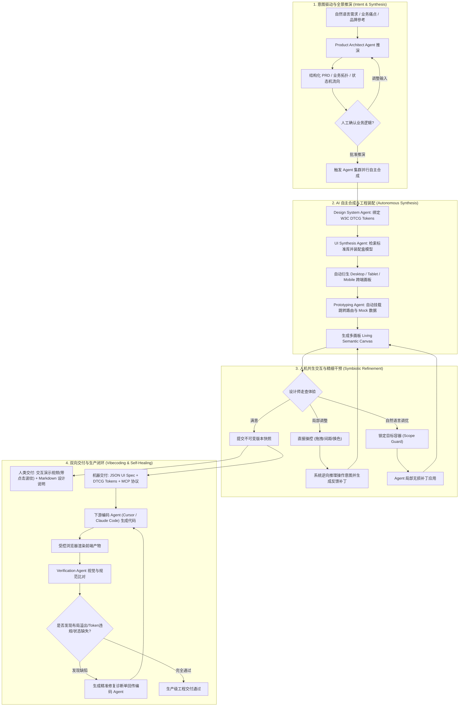
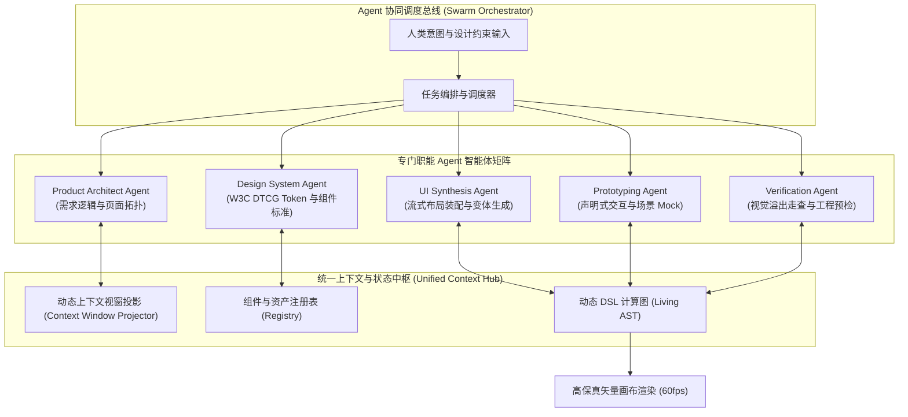
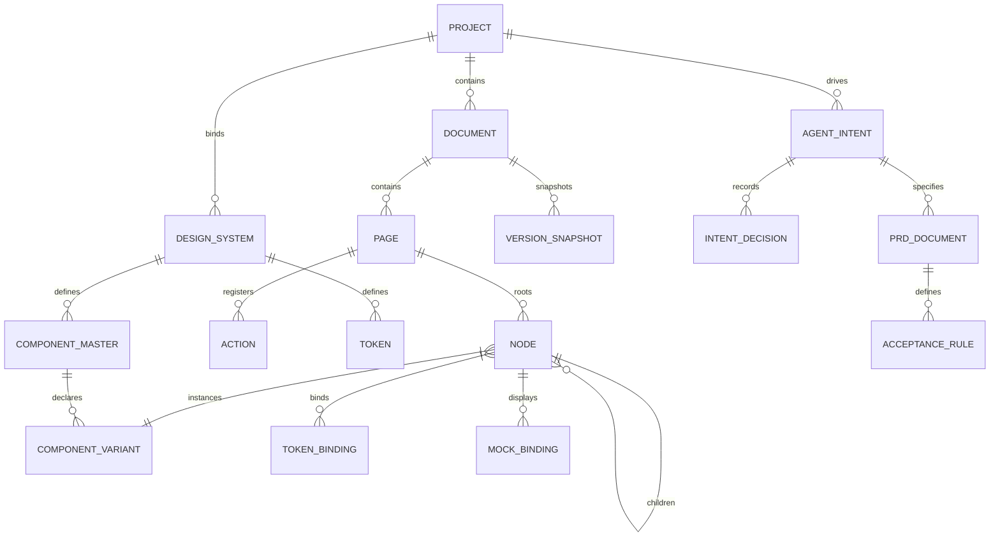

# iA-UI 产品功能与体验设计说明书 (v0.0.3 AI 驱动原生重构版)

> **文档定位**：本文档为 **iA-UI (Intelligent Agentic UI Workbench)** 的完整产品形态、系统架构与人机交互设计说明书。
> **版本核心演进 (v0.0.3)**：全面重构底层设计思想——**从传统的“类 Figma 画布叠加 AI 功能 (AI-Added / Copilot 补丁模式)”彻底跃迁为“AI 原生驱动 (AI-Native / Agent-Centric Engine)”**。
> 本平台将 AI (Agent) 作为第一公民与核心驱动引擎，人机关系从“人类手动绘制、AI 旁边辅助”重构为“**人类意图领航与审美裁决，Agent 集群自主推演、组装与进化，双向精准干预与生产级工程闭环**”。
> 本文档不绑定具体底层工程选型，专注于建立严密、可验证、无二义性的产品功能架构与系统运行规则。

---

## 1. 产品战略定位与核心设计思想重构

### 1.1 从“工具叠加 AI”到“AI 驱动原生”的思想跃迁

在 v0.0.2 及业界现有设计工具中，普遍存在一种**“功能叠加型思维”**：
- **传统叠加模式 (Figma + AI Plugins / Copilot)**：
  - 软件本质依然是一个平面图形编辑器，核心操作路径依赖人类设计师通过鼠标进行点、线、面、图层、数值的手工堆叠；
  - AI 被视作“挂在右侧/右下角的对话窗口”或“辅助微调插件”，人与 AI 割裂，AI 处于被动唤起、单次补丁填坑的状态；
  - 这种模式无法解决设计资产与下游生产代码的语义断层，也未能释放 Agent 的自主推理与系统化构建能力。

- **iA-UI 的 AI 驱动原生模式 (AI-Native / Agent-Centric Workbench)**：
  - **AI 是核心生产引擎 (AI as Core Engine)**：界面的架构推演、流式布局拼装、设计系统对齐、跨端衍生与状态穷举，由 Agent 集群自主完成；
  - **人类是领航者与裁决者 (Human as Pilot & Art Director)**：人类设计师彻底摆脱低价值的机械画图与参数填写，聚焦于“定义产品意图、把控品牌风格基调、裁决关键方案分支、高精度直观干预”；
  - **直接操控即意图反馈 (Direct Manipulation as Feedback)**：人类在画布上的任何可视化拖拽与修正，不再是传统的图形像素移动，而是向 AI 注入高阶意图反馈与约束补丁，驱动 AI 动态自愈与演进；
  - **面向 Vibecoding 的生产级交付 (Native Vibecoding Handoff)**：产品产出天然就是严密可执行的结构化 UI 规格 (UI Spec)，无缝驱动 Cursor / Claude Code / Windsurf 等下游工具实现 100% 保真交付。

```
┌────────────────────────────────────────────────────────────────────────────────────────┐
│                        AI 叠加模式 vs AI 驱动模式的根本差异                           │
├────────────────────┬──────────────────────────────────┬────────────────────────────────┤
│ 维度               │ 传统叠加模式 (Figma + AI Copilot)│ iA-UI 原生驱动模式 (v0.0.3)    │
├────────────────────┼──────────────────────────────────┼────────────────────────────────┤
│ 1. 核心操作范式    │ 手动点选拖拽为主，AI 侧边栏召唤  │ 意图驱动为主，自主合成，人机交织│
│ 2. 工作流主轴      │ 图层树 ──▶ 属性面板 ──▶ 导出图片 │ 意图空间 ──▶ 语义推演 ──▶ 工程规格│
│ 3. AI 角色地位     │ 外挂助手 (Copilot)、单点提效插件 │ 核心工作台引擎 (Multi-Agent Swarm)│
│ 4. 人工干预本质    │ 机械式从零画图、逐像素调参       │ 意图设定、设计走查、局部微调即反馈│
│ 5. 画布本质        │ 静态非结构化像素/矢量容器        │ 具备自愈与约束求解能力的动态语义图│
│ 6. 下游交付        │ 静态红线标注图，开发盲猜实现     │ 生产级流式盒模型/Token/路由规格闭环│
└────────────────────┴──────────────────────────────────┴────────────────────────────────┘
```

### 1.2 产研协作全景架构：从意图到代码的自动化流水线

```
 [ 自然语言业务想法 / PRD / 品牌调性 ]
           │
           ▼
 ┌──────────────────────────────────────────────────────────────────────────────────────┐
 │                      iA-UI: AI 原生驱动的可视化设计工作台                            │
 │                                                                                      │
 │  ┌────────────────────────────────────────────────────────────────────────────────┐  │
 │  │                         内置 Multi-Agent 协同引擎 (Agent Swarm)                │  │
 │  │  • Product Architect Agent (业务实体/路由拓扑)                                 │  │
 │  │  • Design System Agent     (W3C DTCG Token/组件规范守护)                       │  │
 │  │  • UI Synthesis Agent      (流式盒模型装配/变体生成/跨端衍生)                  │  │
 │  │  • Prototyping Agent       (声明式动作原语/场景 Mock 注入)                     │  │
 │  │  • Verification Agent      (可访问性/溢出/工程规范预检)                        │  │
 │  └────────────────────────────────────────────────────────────────────────────────┘  │
 │                                         │                                            │
 │                                         ▼ 双向共生                                   │
 │  ┌────────────────────────────────────────────────────────────────────────────────┐  │
 │  │               人类设计师交互与裁决工作空间 (Living Semantic Canvas)            │  │
 │  │  - 意图流转轴 (Intent Stream) : 监控推理链、确认多方案澄清分支                 │  │
 │  │  - 动态语义画布 : 毫秒级可视化反馈，直接操控 (Direct Manipulation) 逆向回传     │  │
 │  │  - 约束控制台 (Constraint Inspector) : 设定品牌基调、规则权重与作用域锁定      │  │
 │  └────────────────────────────────────────────────────────────────────────────────┘  │
 └──────────────────────────────────────────────────────────────────────────────────────┘
           │
           ├───▶ [ 人类可视交付物 ] : 交互演示视频(含点击波纹动效)、Markdown 设计规范、高清标注
           └───▶ [ 机器规格交付物 ] : 紧凑 JSON Schema UI Spec (流式布局/DTCG Tokens/路由)
           ▲
           └───◀ [ 生产验证自愈闭环 ] : 受控环境渲染前端代码 ──▶ 视觉差异诊断 ──▶ Agent 闭环自愈
```

### 1.3 核心目标与价值主张
1. **意图直达生产 (From Intent to Production)**：产品经理或设计师仅需输入自然语言与核心约束，平台自动推演出包含业务逻辑、全状态覆盖、流式排版的高保真工程级设计系统。
2. **绝对可控的自愈画布 (Autonomous & Controllable Canvas)**：摒弃“纯黑盒抽卡”的失控，通过**动态作用域保护 (Scope Guard)** 与 **直接操控逆向提示 (Canvas Manipulation to Intent)**，确保人类在任何阶段都能以像素级精度接管并修正设计。
3. **消除设计与开发的虚假中介 (Zero-Loss Handoff)**：设计资产产出的每一个节点天然对齐前端工程规范（Flex/Grid 盒模型、W3C DTCG Token、状态机），使 Vibecoding 工具能够 100% 还原实现。
4. **数字资产飞轮 (Design Asset Flywheel)**：沉淀自带生产规格与交互路由的资产包，推动设计资产在创作者社区的高效流转。

---

## 2. AI 原生声明式设计语言 (AI-DDL: Declarative Design Language)

传统设计语言（如 Figma .fig 格式）是为图形光栅化渲染设计的，充满了无语义 Group、绝对坐标与硬编码 Hex。
iA-UI 构建了**AI 原生声明式设计语言 (AI-DDL)**，将设计抽象为**“意图-约束-语义-图元”四层模型**，天然适配 Agent 的理解、生成、推理与验证。

```
┌────────────────────────────────────────────────────────────────────────────────────────┐
│                        AI-DDL 四层统一架构模型                                         │
├────────────────────┬───────────────────────────────────────────────────────────────────┤
│ 1. 意图与逻辑层    │ 业务实体模型、功能路由关系、声明式交互原语 (Navigate, Modal, Tab) │
│    (Intent Layer)  │ 场景假数据 (Normal, Empty, Error, Overflow) 与状态机定义。        │
├────────────────────┼───────────────────────────────────────────────────────────────────┤
│ 2. 规范与约束层    │ W3C DTCG 标准设计令牌 (Design Tokens: Color, Spacing, Typography) │
│  (Constraint Layer)│ 组件属性约束契约 (Props Schema, Variant Matrix, Slot 规则)。      │
├────────────────────┼───────────────────────────────────────────────────────────────────┤
│ 3. 结构与流式层    │ 纯流式盒模型 (Fluid Box Model: Direction, Padding, Gap, Resizing) │
│    (Layout Layer)  │ 彻底淘汰无约束 Group，全量推行嵌套 Auto-Layout 容器。             │
├────────────────────┼───────────────────────────────────────────────────────────────────┤
│ 4. 表现与图元层    │ 语义化图元 (Semantic Text, Image, Container, Semantic Vector)    │
│  (Primitive Layer) │ 复杂自由曲线封装为独立语义资产 (SVG)，不破坏上层弹性流式盒模型。  │
└────────────────────┴───────────────────────────────────────────────────────────────────┘
```

### 2.1 针对 AI / Agent 优化的三大语言特性

1. **确定性与无二义性 (Deterministic Semantics)**：
   - 布局树中每一个容器的尺寸行为必须严格显式声明为 `hug`（包裹内容）、`fill`（撑满可用空间）或 `fixed`（固定尺寸），严禁出现依赖手工拖拽产生的非对齐像素；
   - 文本节点必须声明排版截断策略（`truncate` / `wrap` / `auto-expand`），杜绝下游前端实现时的文字溢出。

2. **全局稳定语义寻址 (Stable Semantic ID)**：
   - 每个画板、组件、容器及原子图元均拥有全局唯一且在跨轮生成中保持稳定的语义标识符（如 `page.checkout.summary_card.total_price`）；
   - Agent 生成局部补丁 (Patch) 时基于稳定 ID 进行精确定位，杜绝因随机哈希导致整树重绘与关联丢失。

3. **双向共生映射 (Bidirectional Synthesis)**：
   - **DSL ──▶ 可视化**：Agent 生成的 JSON UI Spec 毫秒级编译渲染为高保真矢量画布；
   - **可视化 ──▶ DSL**：设计师在画布上进行调整时，系统底层引擎即时更新约束图并生成对应的 DSL AST 变更。

---

## 3. 全生命周期端到端业务流程与用户旅程

### 3.1 核心用户与 Agent 角色分工

| 参与角色 | 核心职责与心智模型 | 与系统交互的核心触点 |
| :--- | :--- | :--- |
| **设计总监 / 资深设计师** | **艺术指导与意图决策**：定义品牌基调、把控交互节奏、审定组件库质量、处理边缘复杂场景。 | 意图流控制台、方案澄清选项卡、全局设计规范控制台、节点精修画布。 |
| **产品经理 (PM)** | **业务逻辑与需求验证**：输入自然语言想法、推敲 PRD、走查流程分支、验收原型演示。 | 宏观长思考工作台、功能流图、交互演示视频（含点击波纹）。 |
| **全栈研发 / Vibecoding 工程师** | **规格消费与工程实现**：获取高精准 UI Spec、执行组件对齐、运行自动化视觉验证。 | MCP 接口服务、JSON Schema 导出、自动化比对回归报告。 |
| **内置 Multi-Agent 集群** | **自主编排与落地执行**：需求拆解、全页面多状态装配、响应式衍生、合规检查。 | 底层 DSL 计算图、约束求解器、工具调用总线。 |

### 3.2 AI 驱动端到端业务流向全景图



### 3.3 典型场景 A：AI 驱动从 0 到 1 极速孵化
1. **意图输入**：用户输入产品愿景与偏好（例如：“打造一款极简敏捷开发看板，采用极光黑夜主题，主色调为深靛蓝”）；
2. **架构推演**：Product Architect Agent 自动推演需求边界，输出实体清单（工作区、看板、泳道、卡片）、页面清单（登录、看板主页、任务详情抽屉、统计弹窗）及各页面交互路由；
3. **自主装配**：UI Synthesis Agent 自动匹配注册的标准组件库（如 shadcn/ui），全自动并行装配出完整的全页面画板，自动包含正常态、空任务态、网络加载骨架态；
4. **意图领航**：设计师一眼看到完整产品全貌，在全局控制台上微调“圆角半径”由 `8px` 变更为 `12px`，整个工程千处组件瞬间协同联动；
5. **一键交付**：导出带点击波纹动效的演示视频与标准 UI Spec，交付下游研发。

### 3.4 典型场景 B：人机双向共生精细调优
1. **直接操控**：设计师在画布上发现详情页的侧边栏间距略显拥挤，手动将 Padding 从 16 拖拽扩大至 24；
2. **意图反哺**：系统捕获并分析此行为，主动提示：“检测到您扩大了详情抽屉的内边距，是否同步将项目设置抽屉及全局模态框统一对齐至 24px？”
3. **一键确认**：设计师点击“确认同步”，Agent 自动完成全局衍生画板的自愈更新，省去数十次枯燥的重复手工修改。

---

## 4. AI 原生驱动的工作台界面架构与信息布局

为了彻底颠覆“传统三栏画布 + 侧边贴个 AI 聊天框”的割裂体验，iA-UI v0.0.3 将工作台界面彻底重构为**“意图驱动与自主合成环境 (AI-Centric Synthesis Environment)”**：

```
┌──────────────────────────────────────────────────────────────────────────────────────────────────┐
│ [顶部全局领航栏] 项目名 | 品牌意图基调 | 终端视口切换 | 意图流状态指示器 (Agent Idle/Thinking) | 导出交付物 │
├─────────────────┬──────────────────────────────────────────────────────────────┬─────────────────┤
│ [意图与架构中枢]  │ [动态语义多维画布 (Living Semantic Canvas)]                    │ [约束与生成控制台]│
│                 │                                                              │                 │
│ ├─ 意图编排树   │                    无限动态画板区                            │ ├─ 意图修正输入 │
│ │  (Intent Tree)│   ┌──────────────┐   ┌──────────────┐   ┌──────────────┐   │ │  (Prompt /    │
│ │  • 需求推演   │   │  桌面端画板  │ ──▶│  抽屉浮层    │ ──▶│  移动端画板  │   │ │   Clarify)    │
│ │  • 路由流向   │   │  (Desktop)   │   │  (Drawer)    │   │  (Mobile)    │   │ ├─ 作用域锁定   │
│ │  • 页面矩阵   │   └──────────────┘   └──────────────┘   └──────────────┘   │ │  (Scope Guard)│
│ ├─ 动态图层语义 │       ▲                                                      │ ├─ 设计规范约束 │
│ │  (Semantic)   │       │                                                      │ │  (Token Binder│
│ ├─ 设计资产库   │   [直接操控选区: 实时高亮显示流式盒模型与当前激活 Agent 状态]  │ ├─ 状态机与Mock │
│ └─ 变更决策流   │                                                              │ └─ 走查预检雷达 │
├─────────────────┴──────────────────────────────────────────────────────────────┴─────────────────┤
│ [底部多维控制台] 业务流向视图 切换 无限画布视图 | 当前选区语义 ID | 渲染性能 60fps | 协同光标与版本快照 │
└──────────────────────────────────────────────────────────────────────────────────────────────────┘
```

### 4.1 四大核心功能区域详设

1. **左侧：意图与架构中枢 (Intent & Architecture Hub)**
   - **意图编排大纲 (Intent Tree)**：摒弃冷冰冰的散乱图层列表，以产品业务意图（“认证模块”、“核心看板”、“团队设置”）为骨架组织画板；
   - **动态语义节点映射**：实时展示当前选区的语义属性，标注各节点是由“Agent 自主合成”还是“人工介入锁定”；
   - **变更决策流 (Decision Stream)**：列出 Agent 每一轮演进的思考逻辑与决策分叉，支持一键审阅与回滚。

2. **中央：动态语义多维画布 (Living Semantic Canvas)**
   - **活体组件渲染引擎 (Living Components)**：画布中的组件不是死图，而是实时处于流式盒模型计算状态，任何尺寸变动即刻引发弹性重排；
   - **双视图同构流转**：
     - **业务功能流视图 (Workflow Flow View)**：以用户行为旅程连线呈现页面间的触发跳转与状态变异，点击连线即可调试交互；
     - **无限平面视图 (Infinite Canvas View)**：平铺所有终端画板（Desktop, Mobile, Tablet），用于宏观视觉对齐走查。
   - **直接操控 (Direct Manipulation)**：支持精准拖拽，但在拖拽时高亮显示内边距、外间距、对齐约束标尺，操作即时触发约束求解。

3. **右侧：约束与生成控制台 (Constraint & Synthesis Console)**
   - **意图领航输入框 (Intent Director)**：不再是泛泛的聊天窗口，而是带有选区上下文感知的命令控制台；
   - **方案主动澄清卡片 (Clarification Surface)**：当用户需求存在多种设计解法时，主动展开互斥选项卡片（如方案 A/B/C 缩略图与优缺点分析），辅助设计师快速裁决；
   - **设计系统约束绑定器 (Design Token Binder)**：直观映射 DTCG 令牌，支持一键锁定规范，防止 AI 产生违规散色；
   - **状态与边界切换器**：一键切换组件/页面的 Normal, Loading, Empty, Error, Overflow 状态进行全场景走查。

4. **顶部与底部：全局领航与验证状态栏**
   - 实时显示当前工程健康度（Token 覆盖率、盒模型合规率、可访问性得分）；
   - 一键呼出不可变版本时光机 (Time Travel)，支持任意历史快照秒级对比。

---

## 5. 多模意图输入与推演工作流

工作台支持针对不同创作情境的两种核心输入工作流，二者数据完全同构、状态实时互通：

```
┌────────────────────────────────────────────────────────────────────────────────────────┐
│                        模式 A：宏观架构深思模式 (Deep Reasoning Mode)                  │
│                                                                                        │
│  [ 场景：从 0 到 1 架构全新产品、推敲复杂业务逻辑 ]                                   │
│  1. 用户输入产品願景、业务模型、受众画像与核心功能述求                                │
│  2. Product Architect Agent 进行深度推演，输出结构化 PRD 与业务状态流向图             │
│  3. 人机共创审阅业务拓扑、边界异常分支与核心数据模型                                  │
│  4. 点击【全景编译】──▶ UI Synthesis Agent 集群全自动并行装配出完整多画板工程          │
└────────────────────────────────────────────────────────────────────────────────────────┘

┌────────────────────────────────────────────────────────────────────────────────────────┐
│                        模式 B：微观意图实时合成模式 (Instant Synthesis Mode)           │
│                                                                                        │
│  [ 场景：针对局部页面/组件的高频迭代、方案探索与微调 ]                                │
│  1. 设计师在画布中框选目标容器，系统瞬间触发【Scope Guard 作用域硬锁定】              │
│  2. 设计师通过自然语言或快捷动作提出调整意图（如：“重构个人信息卡片为紧凑两列排版”）  │
│  3. Agent 毫秒级生成多套候选方案卡片，设计师预览并点选                                │
│  4. 选区无损合流更新，背景画板绝对稳定不飘移                                          │
└────────────────────────────────────────────────────────────────────────────────────────┘
```

### 5.1 结构化 PRD 与画板的实时动态双向绑定
在传统模式下，PRD 与设计图是两张互不相干的皮。在 iA-UI 中，**PRD 是 UI 画板的显式形式化定义**：
- PRD 中的业务实体字段 ──▶ 严格绑定至画板组件的数据展示节点；
- PRD 中的操作流转描述 ──▶ 自动生成声明式路由与动作原语（`Navigate`, `OpenModal`）；
- PRD 中的验收指标 ──▶ 自动转换为自动化验证规则（如“支付按钮在余额不足时必须处于 Disabled 态”）；
- **联动感知更新**：当修改 PRD 章节时，画布对应区域泛起呼吸光圈，提示设计师“底层业务逻辑已变更，是否更新对应 UI？”。

### 5.2 操作逆向合成意图 (Manipulation to Intent Ingestion)
人类设计师的可视化操作具有高度专业性，平台具备**“图形微调逆向提炼为意图”**的能力：
- 设计师对画布进行连续微调（调整圆角、替换图标、优化排版对齐）；
- 意图提炼引擎分析 AST 差异，自动生成语义化改动记录（如：“将卡片标题字阶提升一级，并为主操作按钮增加 12px 呼吸留白”）；
- 设计师可一键将该操作意图“广播”给整个项目中的其他衍生画板或类似组件，实现全局一键自适应对齐。

---

## 6. AI 驱动架构与 Agent 智能体协同网络 (Multi-Agent Swarm)

iA-UI 的底层并非简单的 LLM 问答，而是构建了由多个专门职能 Agent 组成的**分布式协同集群 (Multi-Agent Swarm)**：



### 6.1 智能体矩阵职能详设

1. **Product Architect Agent (产品架构智能体)**：
   - 负责宏观业务推演，将用户的自然语言构想结构化为业务实体模型（Entities）、页面拓扑清单（Page Topology）与功能验收标准（Acceptance Criteria）。
2. **Design System Agent (设计系统智能体)**：
   - 担任团队的“设计系统守护者”；监控所有 Token 引用，执行 W3C DTCG 标准色彩阶梯与字阶计算；严禁未授权的裸 Hex 产生。
3. **UI Synthesis Agent (界面合成智能体)**：
   - 核心界面装配引擎；严格遵循流式盒模型（Auto-Layout），优先检索注册组件库并以属性覆盖形式进行装配，自动派生跨端（Web/Mobile）自适应布局。
4. **Prototyping Agent (交互与场景原型智能体)**：
   - 负责挂载轻量声明式动作原语（跳转、弹窗、状态变异），并根据业务实体自动构建包含 Normal、Empty、Error、Overflow 的全场景 Mock 数据集。
5. **Verification Agent (质量保证与验证智能体)**：
   - 运行静态与动态规则检查；走查文本截断、对比度合规（WCAG 2.1）、死链路由与断裂资产；输出自动化诊断报告驱动自愈。

### 6.2 动态上下文视窗投影机制 (Context Window Projector)
严禁将几十万节点的整个画板全量塞给模型。调度器根据当前任务动态执行切片投影：
1. **焦点选区 AST 切片 (Target Node Subtree)**：仅包含目标组件的属性、尺寸与子节点；
2. **环境只读约束切片 (Read-only Boundary Constraints)**：父级盒模型的流向、对齐规则、可用空间尺寸，赋予只读权限，**杜绝越界修改**；
3. **生效 Token 字典切片 (Active Token Slice)**：当前项目中生效的设计变量；
4. **可复用组件元数据索引 (Registered Components Index)**：可用组件的 Props 与变体清单。

### 6.3 作用域硬隔离 (Scope Guard)
- 当用户或系统对选区发起修改时，被锁定的节点树被打上写锁定标志，其余所有背景画板打上绝对只读隔离标志；
- Agent 输出的 JSON Patch 在应用前必须经过安全边界校验，若 Patch 包含任何非锁定节点的修改指令，系统直接丢弃该指令并向控制台报警。

---

## 7. 全景功能模块详设 (AI 原生增强版)

### 7.1 项目管理与设计规范中枢
- **项目创建与配置**：设定产品业务类型、品牌视觉关键词（如“企业级、稳重、深蓝”、“潮玩、高饱和、荧光”）；
- **设计系统基石绑定**：开箱预置并支持扩展顶级开源规范（Tailwind CSS, shadcn/ui, Ant Design, Material UI）；
- **技术栈代码偏好绑定**：预设下游代码生成的目标偏好（React + Tailwind, Vue 3, Svelte, React Native），确保生成的 UI Spec 结构最符合对应前端技术栈习惯。

### 7.2 AI 驱动的已有资产导入与语义重构
- **Figma 原生解析 (.fig 导入)**：
  - 提取 Frames, Components, Vector Paths, Text 及 Auto-Layout 规则；
  - **AI 语义重构引擎**：自动识别导入稿中混乱的手工绝对定位和自由 Group，利用盒模型逆向推导算法，自动重构为规范的嵌套 Fluid Auto-Layout；
  - **Token 归一化清洗**：自动扫描硬编码色值，使用色彩距离算法推荐映射到最接近的标准 Design Token。
- **截图与手绘草图逆向推导**：
  - 支持上传高保真网页截图或手绘线框图，视觉 Agent 自动识别其中的组件结构、文本内容与布局比例，将其转换为标准语义矢量画板。

### 7.3 私有资产与组件注册中心
- **企业字体与矢量图标库**：
  - 支持上传 `.woff2`、`.ttf`、`.otf` 格式字体，提供严格版权声明与防跨域网页分发；
  - SVG 图标库自动清洗冗余代码，规范化为 24x24 视口与单色/多色语义图元，支持语义别名检索（如搜索“购物车”自动匹配 `icon-shopping-cart`）。
- **前端代码组件逆向注册 (Code-to-Component)**：
  - 支持通过导入前端工程的组件定义文件（Storybook `custom-elements.json` 或 TypeScript Props 定义），系统自动生成画布中的主组件（Master Component）；
  - **AI 组装铁律**：Agent 生成界面时，强制优先从组件注册表中检索匹配组件进行组装，严禁凭空生成不可维护的临时野生组件。

### 7.4 声明式轻量交互模型 (Declarative Actions)
坚决摒弃臃肿复杂的低代码 JS 编写运行时，收敛为最精确的原型交互动作原语：
- **核心动作原语**：
  - `Navigate(target_page, mode)`：页面跳转（Push, Replace, Back）；
  - `OpenModal(target_frame, mask)` / `CloseModal()`：浮层弹窗、抽屉打开与关闭；
  - `ToggleState(target_component, state)`：切换组件状态变体（Hover, Active, Loading, Disabled）；
  - `SwitchTab(tab_group, target_index)`：分段器与标签页切换；
  - `MockSubmit(form_id, target_mock_response)`：模拟表单提交，触发成功/失败假数据状态。
- **转场动画参数**：Instant, Dissolve, Slide In/Out，支持精细配置贝塞尔缓动曲线与持续时长（Duration）。

### 7.5 全场景数据 Mock 体系
- **纯视觉数据驱动**：完全不依赖真实后端接口，专注呈现界面的全生命周期视觉态；
- **场景化一键切换**：
  - **正常数据态 (Normal)**：填充满载拟真业务数据；
  - **空数据态 (Empty State)**：展现插画与指引文案；
  - **网络失败/加载中态 (Error / Loading Skeleton)**：展示骨架屏与重试按钮；
  - **长文本溢出极限测试 (Overflow Test)**：自动注入 3 倍长度的多语言文本，走查界面弹性与换行表现。

### 7.6 多端独立画板体系 (MPA / Multi-Device Layouts)
- **业务逻辑同构，物理排版独立**：
  - Desktop, Tablet, Mobile 画板共享同一套业务数据字段与交互路由逻辑；
  - 画板彼此独立排版（Desktop 采用侧边栏导航，Mobile 采用底部 Tab 栏与 Safe Area 避让）；
- **AI 一键自适应衍生**：
  - 基于 Desktop 画板，Agent 依照移动端人机交互规范（最小触控热区 44x44pt、拇指热区规划）一键衍生生成 Mobile 画板，并清晰标出适配差异项供人工审阅。

### 7.7 不可变版本快照与决策时光机 (Time Travel & Snapshots)
- **不可变快照 (Immutable Version Snapshots)**：每次重大生成、推演或人工阶段性评审，均可保存为命名快照，记录作者、意图说明、影响范围与关联 PRD 节点；
- **全要素 Diff 引擎**：基于稳定语义 ID，对比两个版本之间的布局、Token 绑定、组件变体与交互动作增量；
- **分屏比对与洋葱皮重叠高亮**：提供视觉分屏 (Side-by-Side) 与洋葱皮重叠 (Overlay Diff)，让每一处改动毫发毕现。

### 7.8 商业化设计资产交易市场 (Marketplace)
- **工程级数字资产包形态**：
  - 设计师上架的不仅是静态设计图，而是**自带标准 UI Spec + 声明式交互动作 + 全场景 Mock 数据 + 代码映射规约**的工程级生产包；
- **资产确权与授权控制**：
  - 引入不可篡改的数字签名水印；支持个人购买、团队席位授权与私有版本更新订阅；
  - 平台提供安全的结算、分成与创作者主页展示。

---

## 8. 全链路双向交付物与实现验证闭环

```
                   ┌─────────────────────────────────────────┐
                   │    单一语义事实来源 (Single Source of   │
                   │           Truth: UI Spec)               │
                   └────────────────────┬────────────────────┘
                                        │
             ┌──────────────────────────┴──────────────────────────┐
             ▼                                                     ▼
 【面向人类可视的交付物】                                【面向 Vibecoding 的机器规格】
 1. 交互走查视频 (必须带 Click Wave 点击波纹动效)       1. 标准 JSON Schema UI Spec
 2. Markdown 结构化设计说明书                           2. W3C DTCG Design Tokens
 3. 高清矢量图与像素级标注 (PNG/SVG)                    3. 声明式动作路由与状态机
                                                        4. 全场景 Mock 数据集
                                                        5. 外部 Agent 标准 MCP 接口
                                                                   │
                                                                   ▼
                                                       [ 编码 Agent 生成生产级代码 ]
                                                                   │
                                                                   ▼
 ┌─────────────────────────────────────────────────────────────────┴───────────────────┐
 │                  自动化视觉走查与生产验证自愈闭环 (Self-Healing Loop)               │
 │  - 受控浏览器无头渲染代码产物 ──▶ 与 UI Spec 进行像素级/结构级自动化比对            │
 │  - 自动检测：布局溢出、裸 Hex 违规、缺失 Loading/Empty 态、文字截断                 │
 │  - 输出机器可读诊断清单 ──▶ 回传编码 Agent 进行针对性自愈修复                       │
 └─────────────────────────────────────────────────────────────────────────────────────┘
```

### 8.1 交付关键细节：带点击扩散波纹 (Click Wave) 的交互演示视频
- **核心体验细节要求**：**导出的交互走查视频中，鼠标每一次点击必须显示半透明扩散波纹动效 (Click Wave)**；
- 鼠标悬停 (Hover) 呈现真实高光，页面/抽屉切换呈现平滑贝塞尔缓动转场；
- 无论是提交给企业决策者评审，还是交付研发团队对齐交互节奏，视频均具备高度直观的可视化体验。

### 8.2 面向 Vibecoding 工具的标准 UI 规格 (UI Spec)
为 Cursor, Claude Code, Windsurf 等编码 Agent 提供严谨机器规格（遵循 JSON Schema）：
1. **Fluid Box Model Tree**：流向、Padding、Gap、Alignment、尺寸策略（hug/fill/fixed）；
2. **Design Tokens 字典**：全量视觉属性均映射为 CSS 变量引用（如 `var(--color-primary-600)`）；
3. **交互动作路由表**：触发器、动作类型、目标页面与动画时长；
4. **Mock 数据契约**：全状态（Normal/Empty/Error/Overflow）的数据结构定义。

### 8.3 自动化视觉走查与自愈修复闭环 (Self-Healing Verification)
1. **受控环境渲染**：系统在后台启动无头浏览器（Headless Browser），编译渲染下游生成的实际前端工程；
2. **四大合规性检查**：
   - **布局溢出 (Overflow Check)**：检测容器外滚动条、内容撑破视口；
   - **规范违规 (Token Lint)**：检测代码中是否存在未绑定的硬编码数值与散乱 Hex；
   - **状态完备性 (States Coverage)**：验证组件在空数据或异常时是否正确展示对应视图；
   - **视觉还原度 (Visual Diff)**：计算像素级与结构级匹配得分；
3. **自愈诊断报告输出**：若发现偏差，系统自动生成结构化 JSON 诊断单回传编码 Agent，指导其自动迭代修正代码，直至 100% 达标。

---

## 9. 产品领域实体模型 (Domain Entity Model)

### 9.1 领域实体关系图 (ER Diagram)


### 9.2 核心业务实体定义表

| 实体名称 | 业务含义与核心属性 | 关键关联关系 |
| :--- | :--- | :--- |
| **Project** | 设计项目根容器：名称、风格基调、目标终端列表、默认代码偏好、创建时间。 | 包含 Document、绑定 DesignSystem、驱动 AgentIntent。 |
| **AgentIntent** | AI 意图演进上下文：用户核心诉求、演进阶段、当前锁定的决策分支、上下文切片索引。 | 隶属于 Project，记录 IntentDecision，驱动 PRDDocument。 |
| **IntentDecision** | 关键设计决策记录：决策 ID、问题描述、候选方案 A/B/C、最终采纳方案、采纳理由。 | 隶属于 AgentIntent，为版本历史提供决策溯源。 |
| **Document** | 设计文档集合：页面清单、全局图层树索引、稳定 ID 映射字典。 | 隶属于 Project，包含多个 Page。 |
| **Page** | 单一页面画板：页面名称、目标终端视口尺寸、路由路径、背景色。 | 包含根节点 Node Tree，承载页面级 Action。 |
| **Node** | 语义图元与容器：稳定 ID、名称、类型（Container/Text/Vector/Instance）、盒模型约束、锁定标志。 | 递归包含子 Node，绑定 Token 与 Component。 |
| **DesignSystem** | 设计系统规范：系统名称、版本号、W3C DTCG Token 字典集、组件注册表。 | 被 Project 引用，包含 Token 与 ComponentMaster。 |
| **Token** | 设计令牌原子：Token Key、类别（Color/Font/Spacing/Radius/Shadow）、当前值、主题轴。 | 隶属于 DesignSystem，被 Node 引用绑定。 |
| **ComponentMaster**| 主组件定义：组件名称、标签分类、Props 属性定义表、Slots 插槽定义。 | 包含多个 ComponentVariant。 |
| **ComponentVariant**| 组件变体与状态：变体属性组合（size=sm, state=hover）、重写样式规则。 | 属于 ComponentMaster，被 Node 实例引用。 |
| **Action** | 声明式交互动作：Trigger 类型、动作类型（Navigate/Modal/Toggle/Submit）、目标节点、动画缓动。 | 绑定在 Node 触发器，指向目标 Page/Node。 |
| **MockDataset** | 业务假数据源：数据集名称、数据类型（Object/List/Paging）、正常态/空态/错误态 JSON。 | 绑定在 Node 进行列表渲染或内容填充。 |
| **VersionSnapshot**| 不可变历史版本：版本号、发布者、变更说明、全量规格快照、关联决策快照。 | 隶属于 Document，支持比对与回滚。 |
| **PRDDocument** | 结构化产品需求文档：需求章节、业务实体、功能清单、异常规则。 | 关联 AgentIntent，其验收标准生成 AcceptanceRule。 |

---

## 10. 边界条件、异常流与容错机制

1. **AI 响应中断与超时降级**：
   - 若 Agent 发生超时或网络异常，系统立即中止当前执行，并自动回滚画布至最近稳定版本；
   - 保留用户的 Prompt 与当前选区上下文，提供“一键重试”、“精简上下文重试”与“切换后备模型”选项。
2. **Schema 校验失败与脏数据拦截**：
   - Agent 输出的 DSL Patch 必须通过严密的 JSON Schema 静态校验与语义合法性检查；
   - 任何包含语法畸形、不存在的 Token Key 或损坏节点 ID 的补丁直接被底层引擎抛弃，严禁脏数据进入画布。
3. **作用域越界写硬拦截 (Scope Guard Violation)**：
   - 底层运行时在执行 Patch 时核对目标节点的父级链条；若尝试修改未处于锁定状态的外部节点，操作被直接抛弃并向控制台记录安全警告。
4. **并发人机冲突裁决**：
   - 当设计师正在画布上手动拖拽某节点，而后台 Agent 恰好回写同一节点时，遵循**“人工显式交互绝对优先”**原则，保留设计师的鼠标数值，将 AI 属性合并至未发生冲突的字段。
5. **规格导出预检阻断 (Export Gate)**：
   - 导出生产规格前执行自动化静态扫描；若发现硬编码裸 Hex、自由绝对定位未转流式盒模型或 404 悬空路由，系统强制弹出阻断警告，并提供“一键自动修复为邻近规范”的向导。

---

## 11. 安全合规、权限与商业化机制

1. **多角色权限访问控制体系 (RBAC)**：
   - **组织管理员 (Admin)**：管理团队组织、成员席位、Agent 网关凭证、账单结算；
   - **设计负责人 (Lead Designer)**：管理设计系统规范、审核组件上架、冻结发布版本；
   - **设计师 (Designer)**：意图领航、画布编排、人机协同、交互配置；
   - **客户/评审者 (Reviewer)**：只读查看看板、发表图层批注、播放交互演示视频；
   - **开发工程师 (Developer)**：拉取机器 UI Spec、调用 MCP 工具、获取代码包与上传走查报告；
   - **Agent 身份 (System Agent)**：系统受限操作者，按任务授予有限作用域权限，行为全量审计。
2. **资产防爬与水印追踪**：
   - 敏感 API Key 统一置于服务端密钥保险箱，严禁泄露至客户端；
   - 市场未购买资产在预览时采用服务端动态盲水印渲染，杜绝直接爬取矢量源码。
3. **创作者生态与结算**：
   - 优质设计资产包提供单次买断与席位订阅双模收费，平台提供合规支付、发票开具与自动结算。

---

## 12. 业界参考与优秀实践总索引表

| 核心功能模块 | 业界参考/借鉴对象 | 核心借鉴思想与产品特征 |
| :--- | :--- | :--- |
| **AI 原生操作范式** | **Cursor / Claude Code** | 颠覆传统手工编写，将 Agent 视为核心生成引擎，直接操控作为高阶意图反馈。 |
| **标准协议与工具暴露** | **Anthropic MCP / OpenPencil** | 基于模型上下文协议 (MCP) 暴露紧凑查询与补丁写入工具，实现模型解耦。 |
| **流式盒模型与组件规范** | **Figma Auto-Layout / CSS Flexbox** | 严格贯彻流式排版、组件变体、实例覆盖，彻底杜绝无语义绝对定位与自由打组。 |
| **设计系统与变量标准** | **W3C DTCG Specification** | 全量推行标准设计令牌，消除硬编码像素，支撑动态主题与工程自动化映射。 |
| **组件隔离与元数据规范** | **Storybook** | 提取 Props, Variants, Slots 元数据，组件隔离调试与状态穷举。 |
| **轻量业务状态模拟** | **MSW (Mock Service Worker)** | 纯视觉模拟正常、空态、错误、超长文本溢出等多样化业务场景。 |
| **自动化走查与验证闭环** | **Playwright** | 受控浏览器无头渲染、像素级比对与回归测试报告机制，驱动代码生成闭环自愈。 |
| **长思考宏观结构推演** | **Notion / Linear** | 沉浸式结构化大纲编辑、业务流向图与系统化逻辑推演体验。 |
| **模糊意图人机澄清** | **Antigravity / Cursor** | 遇到非量化需求时主动发起选项卡、弥合人机理解分歧的人机交互范式。 |
| **工程级资产交易生态** | **Unreal Engine Marketplace / Figma Community**| 售卖自带生产规格、交互动作路由与代码映射规约的工业级设计资产。 |

---

*文档版本：v0.0.3 · AI 原生驱动产品形态说明书 · iA-UI (Intelligent Agentic UI Workbench)*
