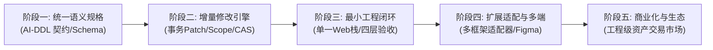
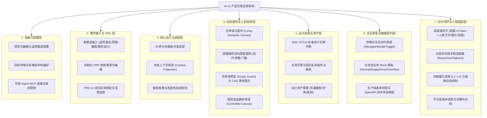
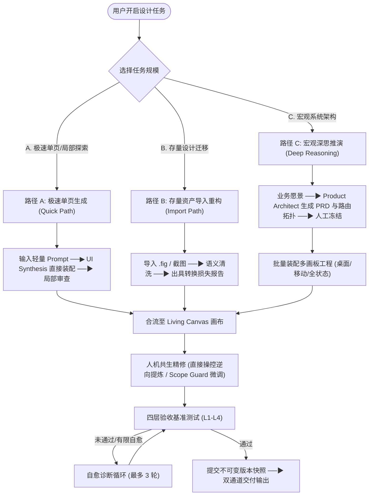
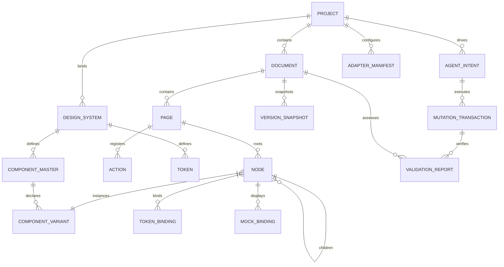
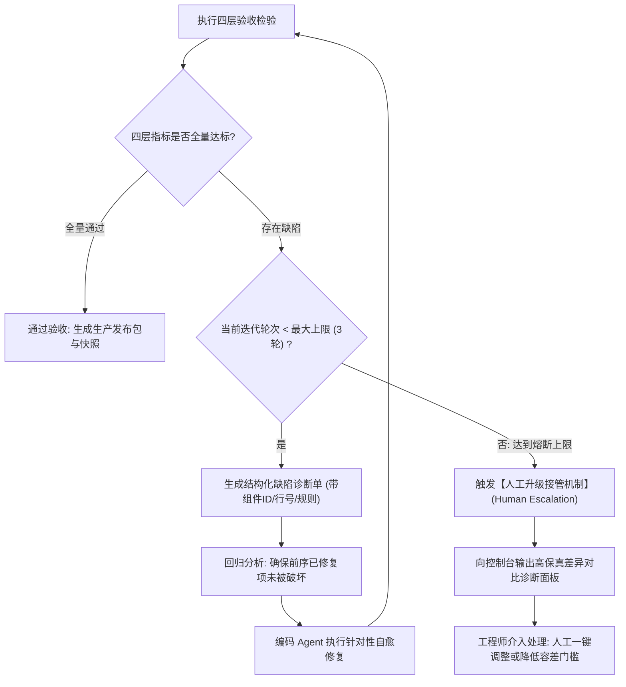

# iA-UI 产品设计说明书 (PRD: Intelligent Agentic UI Workbench)

- **产品名称**：iA-UI (Intelligent Agentic UI Workbench - 智能代理 UI 架构与设计工作台)
- **文档版本**：v0.0.4 (标准产品规格与工程闭环重构版)
- **文档类型**：产品需求与功能规格说明书 (PRD / Product Requirements Document)
- **编制日期**：2026-10-12
- **当前状态**：`REVIEWED` (已评审 / 待冻结)
- **产品负责人**：iA-UI 核心架构与产品团队
- **关联设计与工程规范**：`design.gemini.v0.0.3.analysis.md` (评审报告) / `_03_product_figma/` / 根目录 `DESIGN.md`

> [!NOTE]
> **版本演进核心说明 (v0.0.4)**：
> 本版本严格遵循标准产品设计书（PRD）规格进行重构，在继承 v0.0.3 确立的“AI 原生驱动 (AI-Native / Agent-Centric)”思想基石之上，全面吸收《v0.0.3 完整性、兼容性与创新性评审报告》中的深度工程洞察，完成**从“宏观愿景蓝图”向“工程可实施、标准可验证、质量可量化”的确定性系统跃迁**：
> 1. **结构重构为标准 PRD 体系**：确立产品概述、角色场景、功能架构全景、详细功能规格、交互体验规范、交付物标准、领域模型、验收标准 (DoD) 与非功能需求的标准 PRD 章节骨架；
> 2. **统一语义规格与演进契约**：明确 UI Spec (AI-DDL) 顶层结构契约、节点必填/可选字段、流式计算法则（hug/fill/fixed）、引用完整性闭包与版本迁移策略；
> 3. **事务级增量修改与依赖一致性引擎**：构建事务性修改流水线 (Transactional Mutation Pipeline)，严格区分直接修改 (Direct Scope)、依赖传播 (Propagation Scope) 与全局扩散 (Global Blast Radius)，引入 CAS 乐观锁防脏写；
> 4. **分层目标适配器矩阵 (Target Adapter Architecture)**：解耦抽象层级错位，将 Web/RN 平台、Tailwind/CSS 样式、React/Vue 框架与组件库分层适配，定义显式能力声明契约与优雅降级策略；
> 5. **受控自由布局原语与真实业务契约**：扩充复杂图表/大屏受控画布原语，强化表单业务校验、异步 OpenAPI 状态映射与 RBAC 权限显隐守卫；
> 6. **四层分级验收标准与自愈熔断机制**：彻底消除“100% 绝对保真”等非工程化表述，建立 L1 规格、L2 视觉、L3 业务逻辑、L4 生产工程的四层量化验收标准体系，引入 3 次自愈重试上限与人工升级接管机制；
> 7. **务实分阶段演进路线**：前置核心语义规格、增量引擎与单一技术栈最小闭环验证，收敛初期系统复杂度，将商业化资产市场合理后置。

---

## 1. 产品概述与战略定位

### 1.1 业务背景与行业痛点

在现代产研协作与 Vibecoding（以 Cursor、Claude Code、Windsurf 等为代表）时代，“自然语言需求”到“生产级前端代码”之间依然存在难以跨越的鸿沟：
- **传统设计工具 (Figma / Penpot)**：核心是“平面像素与矢量图元”，缺乏对组件状态机、流式盒模型约束、动态 Token 和业务逻辑的结构化表达；开发团队与 AI 编码工具必须花费大量精力猜测意图，还原度低、返工频繁；
- **纯代码生成工具 (v0 / Lovable / Bolt)**：跳过系统化设计编排，设计系统缺乏长效治理沉淀，设计师无法进行像素级与语义级的直观干预，生成的代码难以直接进入大型企业级工程长期维护；
- **设计沟通成本高昂**：设计成果缺少人类可直观阅读的完备形态（文字说明、图片标注、真实交互演示视频），产研评审与跨职能沟通成本高。

### 1.2 产品定位与一句话主张

> **产品定位**：**介于“自然语言产品意图”与“前后端工程实现”之间的 AI 原生可视化 UI 架构与设计工作台。**

产品秉承四大核心设计哲学：
1. **AI 是核心生产引擎，人类是领航者与艺术总监 (AI as Engine, Human as Director)**：Agent 负责架构推演、全状态装配、流式排版与跨端衍生；人类负责定义意图、把控风格基调、裁决方案分支与局部高精干预。
2. **直接操控即意图反馈 (Direct Manipulation as Feedback)**：人类在画布上的可视化拖拽与修正，不再是传统的绝对像素位移，而是向系统注入高阶约束与意图补丁，驱动系统动态自愈。
3. **单一事实来源与确定性契约 (Single Source of Truth & Deterministic Contracts)**：整个系统围绕严密、可机器验证的语义 UI Spec 运转，拒绝无二义性的中间状态。
4. **务实工程闭环与可量化验收 (Measurable Engineering Closed-Loop)**：不追求虚幻的“100% 无条件保真”，而是建立覆盖规格、视觉、逻辑与工程的四层可测量验收基准，确保产出物真实可落地。

### 1.3 核心业务价值

1. **意图到架构的极速转化**：从自然语言、PRD 文档、草图或截图出发，分钟级推演并装配完整多端、多状态工程级界面；
2. **面向 AI/Agent 消费的原生设计语言**：设计模型专为 AI 理解而构建，消除布局二义性，使下游编码 Agent 能够准确无误地消费并生成代码；
3. **人类高保真可视化阅读**：同时自动化产出 Markdown 规格说明、高清标注图以及带点击波纹动效的交互演示视频；
4. **全生命周期可控治理**：通过 Scope Guard 作用域锁定、事务级增量修改流水线与 CAS 乐观锁，确保局部修改不越界、不破坏全局布局；
5. **开放生态与确定性闭环**：通过标准 MCP 协议供外部 Agent 调度，配合自动化受控渲染与四层验收体系，实现“设计-生成-验证-自愈”工程闭环。

### 1.4 产品边界与明确非目标 (Non-Goals)

为确保工程落地聚焦，本产品明确定义以下职责边界：
- **不内置自研大语言模型推理集群**：模型推理与思考规划一律由外部 Agent（如 Cursor、Claude Code 等）或标准 LLM API 网关提供，平台专精于确定性设计引擎与数据规范；
- **不做黑盒端到端应用托管运维**：平台专注在“设计与交付”阶段，原型为类 PPT 的强保真交互与全状态 Mock 展示，不做真实生产后端数据库联调与微服务部署；
- **不替代下游工程开发脚手架**：平台生成标准机器可读规格与参考工程代码包，不作为全功能 Web IDE，最终代码由团队工程仓库与 Vibecoding 流程承接；
- **商业化资产交易市场阶段性后置**：在核心语义规格、修改引擎与单一技术栈闭环验证成熟前，不提前建设复杂的交易撮合系统（见演进路线）。

### 1.5 务实分阶段演进路线 (Pragmatic Phased Roadmap)

针对系统复杂度与 Agent 协同成本，平台采取“先打通确定性核心，再扩展生态”的五阶段演进策略：



| 阶段 | 阶段代号 | 核心目标与交付物 | 退出/验收准则 |
| :--- | :--- | :--- | :--- |
| **阶段一** | **统一语义规格** | 确立强类型 JSON Schema (UI Spec)，定义节点、Token、交互与 Mock 的数据字典与引用校验。 | 规格解析器 100% 通过语法校验与边界用例测试。 |
| **阶段二** | **增量修改引擎** | 实现稳定语义 ID、AST 补丁计算、事务提交（CAS 乐观锁）与依赖扩散隔离机制。 | 跨画板组件修改时依赖传播预测准确率 100%，无全局意外漂移。 |
| **阶段三** | **最小工程闭环** | 基于单一主流 Web 栈（React + Tailwind + shadcn/ui）实现 UI Spec 到生产代码的自动生成、受控渲染、四层验证与有限自愈。 | 样板项目完成从意图输入到前端代码编译运行通过，自愈闭环跑通。 |
| **阶段四** | **扩展适配与多端** | 扩展 Figma 语义转换（出具保真度损失报告）、跨前端框架适配器（Vue/Svelte/RN）及多端自适应布局。 | 支持 2 种以上主流框架适配与 Figma L2 语义重构。 |
| **阶段五** | **工程级资产生态** | 上架经过工程验证、自带 UI Spec 与测试套件的生产级资产包，开启商业化授权结算。 | 资产市场支持标准规范检测、加密签名与授权分发。 |

---

## 2. 目标用户角色与使用场景

### 2.1 参与者角色矩阵

```
┌────────────────────────────────────────────────────────────────────────────────────────┐
│                              参与者角色与系统职责边界                                  │
├────────────────────┬──────────────────────────────────┬────────────────────────────────┤
│ 角色标识 / 名称    │ 核心职责与业务目标               │ 主要系统触点与权限             │
├────────────────────┼──────────────────────────────────┼────────────────────────────────┤
│ `ROLE_DESIGN_LEAD` │ 艺术决策、全局规范裁决、复杂精修 │ 架构控制台、方案澄清卡、精修画布│
│ (设计总监/资深UI)  │ 维护企业级设计系统与 Token 字典  │ 版本冻结发布、主组件审核       │
├────────────────────┼──────────────────────────────────┼────────────────────────────────┤
│ `ROLE_PRODUCT_MGR` │ 业务逻辑验证、PRD 推演、原型走查 │ 宏观深思工作台、点击波纹演示   │
│ (产品经理 PM)      │ 确保需求实体、页面拓扑与验收闭环 │ PRD-UI 双向绑定器、方案评审    │
├────────────────────┼──────────────────────────────────┼────────────────────────────────┤
│ `ROLE_ENGINEER`    │ 消费 Spec 规格、代码生成、闭环回归│ MCP 接口、只读规格树、         │
│ (全栈开发/研发工程师)│ 维护组件库适配器映射契约         │ 四层验收诊断单、构建脚本集成   │
├────────────────────┼──────────────────────────────────┼────────────────────────────────┤
│ `ROLE_ADMIN`       │ 团队席位、Agent 网关配额、计费   │ 全局管理后台、系统审计日志     │
│ (组织管理员)       │ 安全合规审计、授权凭证管理       │ 凭证颁发与吊销                 │
├────────────────────┼──────────────────────────────────┼────────────────────────────────┤
│ `ROLE_SYS_AGENT`   │ 意图推理、组件装配、测试报告生成 │ 统一上下文总线、CAS 事务提交器 │
│ (外部智能协作 Agent)│ 依据诊断单执行针对性自愈修复     │ 受限临时 Scope 写入权限        │
└────────────────────┴──────────────────────────────────┴────────────────────────────────┘
```

### 2.2 外部 Agent 角色定位与人机分工契约

平台明确界定“智能推理”与“确定性执行”的责任边界（借鉴 MCP 协议与 OpenPencil 协议）：

| 职责范畴 | 责任承担方 | 具体职能说明 |
| :--- | :--- | :--- |
| **推理与决策** | **外部 Agent** (Cursor / Claude Code 等) | 理解用户模糊自然语言、规划设计步骤、推演方案 A/B/C 分支、依据诊断单决定修复策略。 |
| **确定性执行** | **iA-UI 核心引擎** (Workbench Runtime) | 规范合法性静态校验 (Schema Validator)、盒模型约束求解、CAS 事务提交、并发冲突裁决、画布渲染、快照记录。 |

> [!IMPORTANT]
> 若平台不严格封装确定性执行底座，外部 Agent 将承担过多隐性布局计算与状态维持工作，导致上下文爆炸与幻觉频发。iA-UI 引擎充当坚实的“数字物理引擎”，外部 Agent 则是驱动操作的“智能手脑”。

### 2.3 典型用户旅程与使用场景

#### 场景 A：从 0 到 1 极速业务孵化 (0 to 1 Inception)
- **触发**：PM 或设计师在命令控制台输入业务愿景（如“为跨境电商构建实时风控中台，含交易拦截与规则配置”）；
- **推演**：Agent 调用需求架构能力生成结构化 PRD 与页面拓扑路由图，人工走查冻结业务逻辑；
- **装配**：UI Synthesis 引擎并发合成桌面端看板、交互抽屉与移动端画板（全状态 Mock 绑定）；
- **交付**：导出紧凑 UI Spec 与带 Click Wave 点击波纹动效的演示视频，交付团队评审。

#### 场景 B：存量设计导入与标准化重构 (Design Migration)
- **触发**：团队上传既有 `.fig` 设计文件或历史产品截图；
- **转换**：系统逆向分析图元坐标，出具《导入保真度损失报告》，将散乱图层重构为标准流式盒模型并对齐 Tailwind Token；
- **确认**：设计师确认降级项，进入工作台无损维护。

#### 场景 C：人机双向精细微调与作用域保护 (Dual-Track Refinement)
- **触发**：设计师框选复杂表格局部区域，开启 Scope Guard（作用域硬锁定）；
- **协作**：设计师自然语言要求“增加批量导出功能，并优化操作列响应式展示”；
- **隔离**：Agent 仅针对选区生成 Patch 补丁，背景画板绝对隔离不受波及；设计师同时直接拖拽微调列宽，系统逆向提炼约束参数并广播全局。

#### 场景 D：工程闭环验证与自动修复 (Verification & Healing Loop)
- **触发**：前端开发或 CI 自动化流水线调用 MCP 接口拉取 UI Spec 生成前端工程代码；
- **检验**：受控渲染容器执行四层基准检验，发现移动端断点下存在 14px 文字溢出；
- **自愈**：系统生成结构化诊断单，编码 Agent 依据定位精准修复样式补丁，复测通过后打上发布快照。

---

## 3. 产品功能架构全景

### 3.1 功能架构全景图 (Functional Architecture)



### 3.2 核心业务流程与多尺度工作流矩阵

为避免“单页微调也要启动重型推演流程”的高昂成本，系统设立三条明确的工作流入口与退出准则：



#### 工作流准入与准出准则 (Entry & Exit Criteria)
1. **路径 A：极速单页生成 (Quick Path)**
   - **准入准则**：用户无需撰写完整 PRD，输入具体页面场景（如“生成暗黑模式 API 密钥管理页”）；
   - **执行策略**：跳过宏观业务拓扑推演，UI Synthesis Agent 直接在当前画布生成独立单画板；
   - **准出准则**：L1 规格校验通过，盒模型合规率 100%。
2. **路径 B：存量设计导入重构 (Import Path)**
   - **准入准则**：用户上传 `.fig` 文件或产品高清截图；
   - **执行策略**：执行绝对坐标逆向盒模型推导，出具《保真度损失报告》（原始未解析图元安全留存）；
   - **准出准则**：用户审阅并确认转换损失与降级提示。
3. **路径 C：从 0 到 1 宏观架构推演 (Deep Reasoning Path)**
   - **准入准则**：大型复杂系统从零孵化；
   - **执行策略**：引导推敲业务实体、功能清单与状态路由，生成结构化 PRD，经评审冻结后批量并发装配；
   - **准出准则**：通过四层综合验收基准，生成不可变命名版本快照。

---

## 4. 详细功能规格与业务规则

### 4.1 项目管理与外部 Agent 配置 (`FEAT-001`)

- **功能概述**：创建、维护设计项目工程环境，配置品牌风格、目标终端、下游框架偏好及外部 Agent 的 MCP 安全接入。
- **触发前置条件**：具备组织 `ROLE_ADMIN` 或 `ROLE_DESIGN_LEAD` 权限。
- **输入要素与配置项**：
  | 配置项 | 类型 | 必填 | 取值范围与说明 | 默认值 |
  | :--- | :--- | :---: | :--- | :--- |
  | `projectName` | 文本 | 是 | 1-50 字符，支持中英文、连字符 | 必填 |
  | `brandVibe` | 枚举/文本 | 是 | `Enterprise Clean` / `Modern Vibrant` / `Fintech Precise` / 自定义提示词 | `Enterprise Clean` |
  | `targetPlatforms` | 多选 | 是 | `desktop` (1440px), `tablet` (768px), `mobile` (390px) | `["desktop", "mobile"]` |
  | `targetCodeStack` | 枚举 | 是 | `react_tailwind_shadcn`, `vue3_tailwind`, `react_native` | `react_tailwind_shadcn` |
  | `agentMcpKey` | 密钥字符串 | 是 | 自动生成的 UUIDv4 令牌，支持设定有效期与操作白名单 | 自动生成 |

- **业务规则矩阵**：
  1. **代码偏好联动**：选择目标技术栈后，系统底层自动挂载对应的组件库适配器清单（见附录 A.3）；
  2. **Agent 最小权限原则**：外部 Agent 凭证必须指定授权项目及可写范围（默认仅授予当前选中 Session 的临时写入权）；
  3. **凭证即时失效**：管理员在后台点击“吊销凭证”后，外部 MCP 调用必须在 500ms 内被网关硬拦截。

- **界面反馈与输出**：项目概览面板展示项目基本信息、已绑定设计系统、已连接 Agent 状态指示灯（在线/离线/调试中）。
- **边界与异常场景**：项目名称重复时自动追加数字后缀；网络断开时 MCP 服务端返回 `503 Service Unavailable` 明确错误码。

### 4.2 需求推演与 PRD-UI 双向联动 (`FEAT-002`)

- **功能概述**：支持多模态输入，驱动外部 Agent 生成高结构化 PRD，实现 PRD 实体与画布 UI 节点的双向可追踪绑定。
- **触发前置条件**：项目已初始化，用户拥有编辑权限。
- **输入要素与格式**：支持自然语言文本输入、Markdown 格式 PRD 文档导入、PNG/JPG 产品草图或竞品截图上传。
- **业务规则矩阵**：
  1. **PRD 结构化模板约束**：Agent 推演产出的 PRD 必须包含：产品目标、用户画像、功能清单、页面拓扑图、实体状态机与验收标准；
  2. **双向锚定绑定契约**：
     - PRD 中声明的业务实体字段（如 `order.status`）自动与画布组件的 Data Binding 属性映射；
     - PRD 状态流转操作自动生成原型 Action 路由；
  3. **变更冲突检测与反向提醒**：
     - 当用户在 PRD 工作台修改某功能业务逻辑时，画布对应区域自动悬浮黄色预警胶囊：“业务逻辑已变更，关联组件处于待同步状态”；
     - 当用户在画布删除某个核心业务按钮时，系统提示：“该操作将导致 PRD 功能点 `FEAT-xxx` 缺少触发触点，是否继续？”。

- **界面反馈**：提供沉浸式 Markdown 分栏编辑器，左侧为 PRD 章节树，右侧为关联画板预览缩略图。
- **边界与异常场景**：导入包含恶意脚本的 Markdown 时进行 HTML 转义清洗；超大 PRD（超过 5 万字）自动进行章节分块投影。

### 4.3 AI 原生设计自主装配 (`FEAT-003`)

- **功能概述**：接收设计意图后，调度 UI Synthesis 引擎，并发完成从 Token 映射、流式盒模型装配、响应式排版到交互原型挂载的全链路生成。
- **触发前置条件**：PRD 已确认，或用户直接发起 Quick Path 快捷生成命令。
- **输入要素**：
  - 任务意图 Prompt、选定风格基调、目标页面类型（Dashboard/List/Detail/Form/Settings）、参考附件。
- **业务规则矩阵**：
  1. **真实组件库优先铁律**：Agent 生成时强制检索复用当前项目注册的真实组件（如 shadcn/ui 的 Button、Input）；严禁无约束生成“画得像但无法落地的野图元”；
  2. **动态上下文投影 (Context Projection)**：系统仅向 Agent 注入当前画板子树、已生效 Token 字典与可复用组件元数据索引，严禁将全工程数万节点无差别喂入 Prompt 上下文；
  3. **静态规则拦截**：生成完毕后，引擎自动执行 L1 规格校验，存在断裂组件或未定义 Token 的补丁禁止上屏。

- **界面反馈**：中央画布展现生成骨架动效，右侧命令控制台流式输出设计推理日志（如“正在装配顶部指标卡”、“正在绑定 DTCG 语义颜色”）。
- **边界与异常场景**：生成超时（单画板超过 20 秒）自动中断并回滚影子状态，提示用户精简需求或重试。

### 4.4 动态语义画布与直接操控逆向提炼 (`FEAT-004`)

- **功能概述**：提供无歧义、实时处于流式盒模型计算状态的专业设计空间，将人类在画布上的可视化拖拽与微调逆向转换为高阶语义规则。
- **界面模式**：支持“业务功能流拓扑视图”与“无限平面视图”双视图无缝平滑切换。
- **业务规则矩阵**：
  1. **实时盒模型计算**：画布中所有流式容器（Flexbox）实时计算内边距 (Padding)、外边距 (Margin)、子项间距 (Gap) 与对齐方式，消除绝对像素堆叠；
  2. **直接操控逆向提炼**：
     - 当用户拖动两个卡片之间的间距时，标尺即时显示当前像素数值，并在松手时自动吸附至最近的系统 Token（如 `gap-4` 即 16px）；
     - 底部状态栏弹出提示胶囊：“已将间距调整为 16px，检测到该组件在 8 个画板中被复用，是否一键广播全局？”；
  3. **硬约束参数直达**：在右侧属性面板输入的具体数值具有绝对优先级，立即生效，不交由后台 Agent 二次猜测。

- **界面反馈**：选中图层时实时呈现弹性外边距虚线标尺，缩放视口时子节点按 `hug`/`fill`/`fixed` 物理规律平滑自适应拉伸。
- **边界与异常场景**：拖拽位置引发循环嵌套依赖时，画布出现红色碰撞提示并自动弹回原位。

### 4.5 作用域锁定与人机并发修改治理 (`FEAT-005`)

- **功能概述**：通过 Scope Guard 机制锁定编辑区域，利用 CAS 乐观锁防脏写，解决局部调整破坏全局及人机并发冲突痛点。
- **业务规则矩阵**：
  1. **作用域硬隔离 (Scope Guard)**：
     - 用户选中画板局部节点并发起修改时，系统自动对选区外所有节点施加只读锁（`lockStatus = scope_locked`）；
     - 后台 Agent 提交的 Patch 若包含选区外节点的写操作，引擎直接抛出 `ScopeViolationException` 并阻断提交；
  2. **修改影响三层划分**：
     - **直接修改范围 (Direct Scope)**：选区内节点，直接覆写属性；
     - **依赖传播范围 (Propagation Scope)**：涉及主组件修改时，自动分析波及的下游实例，弹出清单供选择“全局同步”或“脱离分叉”；
     - **全局扩散边界 (Global Blast Radius)**：修改涉及全局主题/Token 时，必须经过设计师二次显式确认；
  3. **并发冲突裁决 (Human Primacy Rule)**：
     - **人工操作绝对优先**：若人工手动微调与 Agent 异步 Patch 发生同一属性冲突，保留人工设置；
     - **非冲突属性无损合并**：人工修改几何尺寸，Agent 优化文案与图标，系统自动合并两项变更；
     - **版本号比对防覆盖**：提交 Patch 必须携带 `baseSnapshotVersion`，若版本滞后则强制触发三方合并。

- **界面反馈**：选区外画板呈现轻度磨砂遮罩与半透明锁定锁孔图标，选区内高亮绿色光效。
- **边界与异常场景**：多人或多 Agent 同时提交时，后提交方收到差异合并面板，提示冲突详情。

### 4.6 设计系统与组件注册契约 (`FEAT-006`)

- **功能概述**：管理标准设计令牌 (W3C DTCG) 与组件注册表，支持开源库映射与私有组件逆向注册。
- **业务规则矩阵**：
  1. **设计令牌原子化 (Design Tokens)**：全量颜色、字体、字号、圆角、间距、阴影统一以 Token 形式管理，支持多套主题轴（Light/Dark/High Contrast）一键切换；
  2. **工程组件库映射**：每个画布组件必须绑定具体的工程组件契约，包含组件名、Props 定义、状态变体（Variants）与插槽（Slots）；
  3. **代码组件逆向解析**：支持导入 Storybook `custom-elements.json` 或 TypeScript Interface 定义文件，自动在画布中注册为标准主组件；
  4. **裸数值严禁入库**：画布中严禁持久化硬编码裸 Hex 颜色（如 `#FFFFFF`），必须强制引用语义 Token（如 `color.background.card`）。

- **界面反馈**：右侧面板提供 Token 调色盘与组件属性变体选择器（下拉切换 `size`, `variant`）。
- **边界与异常场景**：导入旧工程中包含无法识别的内联样式时，自动归类至“待清洗样式池”，提供一键对齐建议。

### 4.7 受控自由画布与数据可视化原语 (`FEAT-007`)

- **功能概述**：为图表、地理大屏、复杂图形重叠等非标准流式排版场景提供受控相对坐标绘图原语。
- **业务规则矩阵**：
  1. **隔离边界保证**：`controlled_canvas` 节点自身对外表现为标准的流式弹性盒模型容器（遵守外部的 Padding、Margin 与尺寸拉伸）；
  2. **内部受控自由定位**：其内部直接子节点允许使用相对坐标系 `(x, y, zIndex)` 进行精确定位与层级重叠；
  3. **溢出约束**：内部图元绝对坐标绝不允许超出外壁容器边界（强制执行 `overflow: hidden` 或受控裁剪）。

- **界面反馈**：进入受控画布内部时，网格标尺切换为相对像素坐标系，支持自由拖动锚点与图表控制点。
- **边界与异常场景**：内部子节点坐标超出外壁时，超出部分呈现半透明红色斑马纹告警。

### 4.8 交互原型与全状态 Mock 数据契约 (`FEAT-008`)

- **功能概述**：提供类 PPT 的高保真轻量交互原型连接，并为组件绑定多维度业务 Mock 数据。
- **业务规则矩阵**：
  1. **声明式交互原语**：
     - `Navigate`：支持页面跳转（Push, Replace, Back）；
     - `OpenModal / CloseModal`：抽屉/弹窗的打开与关闭；
     - `ToggleState`：组件局部变体切换（如展开/收起）；
     - `MockSubmit`：模拟表单提交过程；
  2. **全场景 Mock 覆盖标准**：任何列表或数据展示组件必须同时配置四种数据状态：
     - **Normal**：正常业务假数据；
     - **Empty**：零数据空状态（必须配备友好插画与操作引导）；
     - **Error**：网络或业务报错态；
     - **Overflow**：超长字段溢出测试态（自动填充 3 倍长度的多语言字符）；
  3. **生产级表单校验契约**：
     - 输入项支持配置 `required`、`pattern (Regex)`、`min/max` 与自定义校验规则；
     - 校验失败时联动高亮错误提示文本节点（`errorFeedbackNodeId`）；
  4. **异步接口与权限映射**：
     - 提交按钮可关联 OpenAPI 路径，模拟触发 `Loading` 骨架遮罩、`200` 成功跳转与 `500` 错误 Toast；
     - 节点支持绑定 RBAC 权限表达式（如 `auth.role == 'admin'`），画布支持一键切换视角走查。

- **界面反馈**：画布顶部提供“Mock 场景切换器”，可一键在“正常态”、“空数据态”、“错误态”之间无缝切换。
- **边界与异常场景**：未配置跳转目标的悬空路由在连线时呈现黄色虚线断裂告警。

### 4.9 多终端自适应与一键跨端衍生 (`FEAT-009`)

- **功能概述**：保持业务逻辑同构的前提下，实现桌面端、平板端与移动端的独立画板设计与一键智能衍生。
- **业务规则矩阵**：
  1. **逻辑同构、布局独立**：多端画板共享相同的业务实体路由与 Mock 数据源，但拥有完全独立的流式盒模型树；
  2. **一键跨端衍生规则**：
     - 基于桌面端画板，系统可一键衍生移动端画板（390px 视口）；
     - 衍生过程强制适配移动端规范：触控热区强制扩张为 `>= 44x44pt`，水平导航重构为抽屉菜单，表格重构为卡片流；
  3. **差异标尺比对**：系统并排展示多端画板，并高亮标记尚未完成移动端适配的特殊组件。

- **界面反馈**：多画板并排排布，支持视口手柄实时推拉预览断点自适应效果。
- **边界与异常场景**：移动端宽度小于 320px 时强制给出极端最小屏警告。

### 4.10 存量设计导入与保真度损失报告 (`FEAT-010`)

- **功能概述**：解析外部设计文件（.fig 等）或界面截图，出具量化保真度损失报告，并实现安全的语义重构。
- **保真度等级与转换规则**：
  | 保真层级 | 达标定义 | 系统行为与转换保障 |
  | :--- | :--- | :--- |
  | **L1：读取提取** | 完整还原所有图层树、文本、颜色值与矢量锚点。 | 100% 原始数据无损读取，存入私有原始备份。 |
  | **L2：语义转换** | 绝对定位与 Group 转换为嵌套 Auto-Layout；散乱色值转换为 Token。 | 逆向盒模型算法计算弹性约束；色彩匹配度算法对齐 DTCG 字典。 |
  | **L3：双向往返** | 在 iA-UI 修改后重新导出至目标生态，语义与引用不丢失。 | 维持稳定图层 ID 与第三方插件元数据保留。 |

- **转换损失报告规格**：
  - **转换统计**：展示成功识别并转换为 Auto-Layout 的容器占比（如 96%）；
  - **Token 归一化率**：展示自动匹配至项目 Tailwind 变量的颜色比例；
  - **安全降级清单**：对于带有未知着色器特效或特殊字体的图层，安全降级为 SVG 矢量图元，并精准标注图层 ID。

- **界面反馈**：导入完成后自动弹出《转换损失报告》抽屉，用户可点击问题项直接在画布中定位。
- **边界与异常场景**：文件解析严重损坏时，提供“回退至原始绝对布局草稿”保底选项。

### 4.11 版本快照、全要素 Diff 与决策时光机 (`FEAT-011`)

- **功能概述**：提供不可变的设计历史版本存档，支持全要素可视增量对比与无损时光机回滚。
- **业务规则矩阵**：
  1. **快照不可变性**：每次冻结生成的快照包含全量语义 UI Spec 与对应缩略图，禁止篡改；
  2. **全要素 Diff 算法**：
     - 基于稳定语义 ID 递归对比树结构差异；
     - 精准识别：节点新增、删除、盒模型约束调整、Token 绑定替换、交互路由变更；
  3. **双重对比呈现**：支持“左右分屏对比 (Side-by-Side)”与“洋葱皮叠加高亮 (Onion Skin)”；
  4. **决策时光机回滚**：支持一键回滚到任意历史快照，或以历史快照为基线创建新的设计分支。

- **界面反馈**：历史版本列表按时间轴清晰呈现提交人、修改意图、变更节点数与关联 PRD 节点。
- **边界与异常场景**：回滚操作本身生成一条新的回滚提交记录，确保历史审计轨迹绝对连贯。

---

## 5. 界面信息架构与交互体验规格

### 5.1 界面信息架构全景布局

工作台摒弃传统的“设计画布外挂浮动聊天窗”模式，采用“意图-多维语义画布-约束控制”三大支柱架构：

```
┌──────────────────────────────────────────────────────────────────────────────────────────────────┐
│ [顶部全局领航栏] 项目名 | 品牌基调: Enterprise Clean | 视口: 1440px | Agent状态: IDLE | 一键导出交付物 │
├─────────────────┬──────────────────────────────────────────────────────────────┬─────────────────┤
│ [意图与架构中枢]  │ [动态语义多维画布 (Living Semantic Canvas)]                    │ [约束与生成控制台]│
│                 │                                                              │                 │
│ ├─ 意图编排树   │                    多端与多状态动态画板区                    │ ├─ 意图领航输入 │
│ │  (Intent Tree)│   ┌──────────────┐   ┌──────────────┐   ┌──────────────┐   │ │  (Command     │
│ │  • 认证模块   │   │  桌面端画板  │ ──▶│  交互抽屉    │ ──▶│  移动端画板  │   │ │   Director)   │
│ │  • 看板流向   │   │  (1440x900)  │   │  (Drawer)    │   │  (390x844)   │   │ ├─ 方案主动澄清 │
│ │  • 团队设置   │   └──────────────┘   └──────────────┘   └──────────────┘   │ │  (A/B/C 选卡) │
│ ├─ 实体拓扑大纲 │       ▲                                                      │ ├─ 作用域锁定   │
│ ├─ 变更决策审计 │       │                                                      │ │  (Scope Guard)│
│ └─ 设计系统资产 │   [直接操控: 实时渲染弹性外边距标尺，操作逆向提炼提示胶囊]   │ ├─ DTCG Token 盘│
│                 │                                                              │ └─ 四层验收雷达 │
├─────────────────┴──────────────────────────────────────────────────────────────┴─────────────────┤
│ [底部状态流转栏] 视图切换 (功能流视图 / 平面画布) | 缩放比率 100% | 选区: summary_card | 帧率: 60fps      │
└──────────────────────────────────────────────────────────────────────────────────────────────────┘
```

### 5.2 核心交互原语与手势动效规范

1. **直接操控反馈规范**：
   - 鼠标悬停图层边缘时，显示微像素手柄；
   - 拖拽调整尺寸或间距时，以 60fps 实时渲染蓝色外边距辅助线与弹性数值胶囊；
   - 松手时触发轻微触感弹性反馈（Snap-to-Grid），自动对齐 Token。
2. **交互演示视频 Click Wave 动效规范**：
   - 自动化录制的交付视频中，**每次鼠标点击必须触发半透明扩散波纹动效 (Click Wave)**；
   - 波纹从点击坐标中心向外匀速扩散至半径 24px，伴随透明度从 0.4 衰减至 0，持续时间严格为 `250ms`；
   - 鼠标悬停 (Hover) 时触发目标组件高光边框，页面切换严格执行 `Ease-in-out (cubic-bezier(0.4, 0, 0.2, 1))` 缓动转场。
3. **模糊意图主动澄清交互规范 (Clarification Cards)**：
   - 当用户输入模糊主观诉求（如“让卡片更有高级感”）时，控制台禁止直接猜测执行；
   - 必须主动弹出 2~3 个具象化方案卡片（如方案 A：微质感毛玻璃 + 细边框；方案 B：深浅层次投影；方案 C：极简留白风格），由用户点选后执行。

---

## 6. 交付物规格体系

设计成果严格贯彻“单一事实来源 (Single Source of Truth)”，以双通道形式输出，兼顾机器解析与人类阅读：

```
                              ┌────────────────────────────────────────┐
                              │     统一语义 UI Spec (JSON Schema)     │
                              │          (唯一的系统语义事实源)        │
                              └───────────────────┬────────────────────┘
                                                  │ 派生
                         ┌────────────────────────┴────────────────────────┐
                         ▼                                                 ▼
        ┌──────────────────────────────────┐             ┌──────────────────────────────────┐
        │       面向机器: Vibecoding       │             │           面向人类: 评审         │
        ├──────────────────────────────────┤             ├──────────────────────────────────┤
        │ • 紧凑强类型 JSON Schema UI Spec │             │ • Markdown 结构化设计说明书      │
        │ • DTCG 标准设计令牌字典 (CSS 变量)│             │ • 1:1 高清切图标注图 (PNG/SVG)   │
        │ • 动作路由表与全状态 Mock 数据包 │             │ • 带 Click Wave 波纹演示视频     │
        │ • 标准 MCP 工具接口供编码 Agent 消费│             │ • 变更比对差异报告与审计日志     │
        └──────────────────────────────────┘             └──────────────────────────────────┘
```

### 6.1 面向 Vibecoding：机器可读 UI 规格
- **规格内容**：包含完整的流式盒模型树、DTCG Token 绑定、动作路由拓扑与全场景 Mock 数据集；
- **接口集成**：通过标准 MCP 接口供外部编码 Agent 读取，同时支持本地 CLI 导出；
- **确定性校验**：导出的 UI Spec 必须附带版本号签名与 SHA-256 校验和，确保编码 Agent 解析时无格式分歧。

### 6.2 面向人类：全媒体高保真交付物
- **文字说明**：导出完整的 Markdown 说明书，详述业务逻辑、实体定义与状态流转；
- **标注图**：导出矢量 SVG 及包含尺寸、间距、Token 标注的高清全景图；
- **交互演示视频**：自动录制关键业务闭环流程视频，忠实还原 Click Wave 点击波纹、组件悬停及页面切换转场。

---

## 7. 产品领域模型与业务规则

### 7.1 产品领域实体关系图 (Domain Entity Model)



### 7.2 核心业务实体定义表

| 实体名称 | 业务含义与核心属性 | 关键关联关系 |
| :--- | :--- | :--- |
| **Project** | 设计项目根容器：名称、风格基调、目标终端列表、默认技术栈配置、创建时间。 | 包含 Document、绑定 DesignSystem、驱动 AgentIntent、配置 AdapterManifest。 |
| **AgentIntent** | AI 意图演进上下文：核心业务诉求、当前推演阶段、候选决策分支列表。 | 隶属于 Project，触发并记录 MutationTransaction。 |
| **MutationTransaction**| 事务级修改记录：事务 ID、基础版本号（CAS）、直接影响节点集、依赖扩散节点集、状态（Staged/Committed/Aborted）。 | 隶属于 AgentIntent，关联具体的 AST Patch 与 ValidationReport。 |
| **ValidationReport** | 四层验收测试报告：报告 ID、L1~L4 检测项明细、像素差异分、重试轮次、最终判定结论（Pass/Fail/Escalated）。 | 关联 MutationTransaction 与 Document，作为版本发布硬门槛。 |
| **AdapterManifest** | 目标技术栈适配器清单：框架类型、样式系统、能力支持矩阵、降级规则。 | 属于 Project，控制代码生成器与验收器的行为。 |
| **Document** | 设计文档集合：页面清单、全局图层树索引、稳定 ID 映射字典。 | 隶属于 Project，包含多个 Page 与 VersionSnapshot。 |
| **Page** | 单一页面画板：页面名称、目标视口、路由路径、背景色。 | 包含根节点 Node Tree，承载页面级 Action。 |
| **Node** | 语义图元与容器：稳定 ID、类型（Container/Text/Vector/Canvas/Instance）、盒模型约束、锁定标志。 | 递归包含子 Node，绑定 Token 与 Component。 |
| **DesignSystem** | 设计系统规范：系统名称、版本号、W3C DTCG Token 字典集、组件注册表。 | 被 Project 引用，包含 Token 与 ComponentMaster。 |
| **Token** | 设计令牌原子：Token Key、类别（Color/Font/Spacing/Radius/Shadow）、当前值、主题轴。 | 隶属于 DesignSystem，被 Node 引用绑定。 |
| **ComponentMaster**| 主组件定义：组件名称、标签分类、Props 属性定义表、Slots 插槽定义。 | 包含多个 ComponentVariant。 |
| **ComponentVariant**| 组件变体与状态：变体属性组合（size=sm, state=hover）、重写样式规则。 | 属于 ComponentMaster，被 Node 实例引用。 |
| **Action** | 声明式交互动作：Trigger 类型、动作类型（Navigate/Modal/Toggle/Submit）、目标节点、动画缓动。 | 绑定在 Node 触发器，指向目标 Page/Node。 |
| **MockDataset** | 业务假数据源：数据集名称、类型、正常态/空态/错误态/长文本态 JSON。 | 绑定在 Node 进行列表渲染或内容填充。 |
| **VersionSnapshot**| 不可变历史版本：版本号、发布者、变更说明、全量规格快照、关联验证报告。 | 隶属于 Document，支持历史对比与时光机回滚。 |

---

## 8. 产品验收标准与闭环自愈治理

### 8.1 四层量化交付验收标准体系 (Four-Layer Acceptance Framework)

系统彻底摒弃“100% 绝对还原”等不可衡量的模糊表述，建立可机检、可测量的四层验收标准：

```
┌────────────────────────────────────────────────────────────────────────────────────────┐
│                        iA-UI 四层生产交付验收标准体系                                  │
├────────────────────────┬──────────────────────────────────┬────────────────────────────┤
│ 验收层级               │ 核心检测项与判定规则             │ 通过阈值与合格门槛         │
├────────────────────────┼──────────────────────────────────┼────────────────────────────┤
│ L1：规格合法性         │ • JSON Schema 语法与强类型校验   │ 门禁级别：100% 强制通过    │
│ (Spec Validity)        │ • 节点稳定 ID 唯一性与闭包完整性 │ 存在任一错误立即阻断提交   │
│                        │ • Action 路由无 404 悬空引用     │                            │
├────────────────────────┼──────────────────────────────────┼────────────────────────────┤
│ L2：视觉与布局正确性   │ • 无非预期容器外滚动条与文字截断 │ • 像素级视觉匹配度 >= 98.0%│
│ (Visual & Layout)      │ • 响应式断点弹性收缩合规性       │ • 零意外溢出 (Zero Overflow│
│                        │ • WCAG 2.1 AA 级色彩对比度检验   │ • 对比度达标率 >= 95%      │
├────────────────────────┼──────────────────────────────────┼────────────────────────────┤
│ L3：交互与业务逻辑     │ • 动作原语状态机触发正确性       │ • 预设业务测试用例 100%通过│
│ (Interaction & Logic)  │ • 表单校验边界与错误反馈呈现     │ • 异常态覆盖率 100%        │
│                        │ • 正常态/空态/错误态组件状态全覆盖│                            │
├────────────────────────┼──────────────────────────────────┼────────────────────────────┤
│ L4：工程可交付性       │ • 前端生产代码无编译构建报错     │ • `npm run build` 0 错误   │
│ (Production Readiness) │ • 无硬编码裸 Hex 与内联散乱数值  │ • Token 合规率 100%        │
│                        │ • 控制台零运行时未捕获异常       │ • Lighthouse 性能分 >= 90  │
└────────────────────────┴──────────────────────────────────┴────────────────────────────┘
```

### 8.2 自愈循环上限与人工升级退出机制 (Self-Healing Loop with Circuit Breaker)

为防止编码 Agent 在自动修复过程中陷入死循环或反复引发回归缺陷，系统设立严格的熔断与接管机制：



1. **自愈上限与熔断保护**：
   - 默认设定最大自动重试上限为 **3 轮**；
   - 每一轮自愈必须携带前序轮次的基线回归测试集，严禁“修复了文字溢出，却破坏了按钮点击跳转”；
2. **人工升级接管 (Human Escalation)**：
   - 达到 3 轮未达标时，自愈循环立即挂起，系统生成**“异常诊断报告”**，在界面直观标出：
     - 具体未通过项（如“详情页侧边栏在 768px 宽度下出现 12px 横向溢出”）；
     - 生成产物的 DOM 结构与 UI Spec 的差异属性对比；
     - 推荐的人工修复方案，供研发工程师或设计师一键点选接管。

### 8.3 功能级产品交付验收清单 (Functional DoD)

- [ ] **DoD-01 (主流程闭环)**：用户通过意图输入可从 0 到 1 成功生成完整多页面工程，且能导出 UI Spec 与演示视频；
- [ ] **DoD-02 (规格无二义性)**：导出的 UI Spec 100% 通过 L1 模式校验，所有容器显式声明 `hug`/`fill`/`fixed`，文本显式声明截断规则；
- [ ] **DoD-03 (局部修改不漂移)**：在 Scope Guard 锁定下修改局部组件，背景画板 AST 节点 100% 保持未修改状态；
- [ ] **DoD-04 (直接操控可逆向)**：在画布上直接拖拽边距与尺寸，系统能正确提取数值并在 16ms 内渲染，且提供全局广播向导；
- [ ] **DoD-05 (状态覆盖完备)**：列表与表单组件必须完整配置正常态、空态、错误态与超长溢出态；
- [ ] **DoD-06 (自愈熔断生效)**：验证失败时准确下发结构化诊断单，重试超过 3 轮时平稳挂起并弹出人工接管面板。

---

## 9. 非功能性需求与运行治理

### 9.1 性能预算与大工程治理 (Performance Budget & Scalability)

为确保在承载包含数十个画板、数万节点的企业级大型工程时界面保持极速流畅，系统设立严格的性能预算：

| 性能指标项 | 预算上限 | 测量与保障机制 |
| :--- | :--- | :--- |
| **本地直接操控渲染延迟** | `<= 16ms` (保证 60fps) | 视口视锥剔除 (Viewport Frustum Culling) + 脏矩形增量重绘 |
| **Agent 首个交互 Token 响应** | `< 800ms` | 命令控制台流式响应，首字极速反馈 |
| **局部选区补丁应用 (Patch Apply)** | `< 3000ms` | 局部影子沙箱试运行，仅触达受影响节点 |
| **全量工程批量装配 (10 画板)** | `< 20s` | 模块化并发装配，后台 Web Worker 异步计算 |
| **内存占用治理** | `< 1.2GB` (10万节点) | 虚拟化图层加载，非视口画板轻量序列化缓存 |

- **Web Worker 隔离布局计算**：流式盒模型的约束求解与弹性伸缩算法运行在独立 Worker 线程中，主渲染线程专注于画面绘制，绝不卡死。

### 9.2 渲染确定性与容差契约 (Determinism & Tolerance Contract)

在符合标准的渲染器中渲染 UI Spec 时，设定严密的物理容差约束：
- **布局盒模型计算误差**：`Delta <= 0.5px`（消除因高分屏亚像素渲染引起的抖动）；
- **色彩还原度**：sRGB 色彩空间下 `Delta E <= 1.0`（人眼无法感知的微小差异）；
- **跨浏览器基线渲染一致率**：在 Chromium、Gecko、WebKit 官方引擎中布局树匹配得分 `>= 99.5%`。

### 9.3 安全规范与细粒度 RBAC 权限控制

- **最小权限访问控制**：严格区分平台管理员、设计负责人、设计师、产品经理、研发工程师与外部 Agent 的读写权限；
- **外部 Agent 安全沙箱**：外部 Agent 一律以受限操作者身份运行，仅在授权 Session 内拥有指定节点的临时写入权，禁止读取项目无关配置；
- **越权与注入防护**：所有输入数据强制执行 Schema 白名单校验，防御 Prompt 注入与恶意代码越权写操作；
- **全量审计轨迹**：记录所有修改操作的操作者、时间、变更节点 ID 集合与前序快照引用，支持全生命周期责任回溯。

### 9.4 异常流与极端边界容错机制

1. **Agent 超时与流式中断**：首字超时 5s、总生成超时 30s 自动熔断，影子沙箱状态销毁，主画布原子回滚；
2. **Schema 校验失败与脏数据硬拦截**：任何包含语法错误或未注册 Token 的 Patch 在合并前直接丢弃，严禁脏数据污染画布；
3. **主组件连锁破坏阻断**：当修改可能导致超过 10 个页面的流式布局发生破坏性重排时，强制弹出预警确认抽屉；
4. **缺失字体与资源降级**：私有字体或网络图片断裂时，自动启用预置降级保底资源，并标黄提示一键全局替换。

---

## 10. 附录：核心技术契约与协议规范

### 附录 A.1: UI Spec (AI-DDL) JSON Schema 顶层契约与语义计算规则

UI Spec 是系统的单一语义事实来源，遵循 JSON Schema（Draft 2020-12）规范：

```json
{
  "$schema": "https://ia-ui.dev/schemas/v1/spec.json",
  "specVersion": "1.0.0",
  "projectId": "proj_prod_analytics_01",
  "designSystem": {
    "systemId": "ds_shadcn_tailwind_v1",
    "tokenVersion": "1.2.0",
    "tokens": {
      "color": {
        "primary": { "value": "hsl(var(--primary))", "type": "color" },
        "background": { "value": "hsl(var(--background))", "type": "color" }
      },
      "spacing": {
        "4": { "value": "1rem", "type": "dimension" }
      }
    }
  },
  "pages": [
    {
      "pageId": "page.dashboard.overview",
      "name": "数据看板概览",
      "viewport": { "target": "desktop", "width": 1440, "height": 900, "minWidth": 1280 },
      "route": "/dashboard/overview",
      "rootNodeId": "node.page.dashboard.overview.root"
    }
  ],
  "nodeTree": {
    "node.page.dashboard.overview.root": {
      "id": "node.page.dashboard.overview.root",
      "type": "container",
      "name": "页面根容器",
      "layout": {
        "direction": "vertical",
        "padding": { "top": "16", "right": "24", "bottom": "16", "left": "24" },
        "gap": "16",
        "alignItems": "stretch",
        "justifyContent": "start",
        "sizing": { "horizontal": "fill", "vertical": "hug" }
      },
      "children": ["node.header.main", "node.content.main"]
    }
  },
  "actions": [],
  "mockDatasets": []
}
```

#### 核心节点必填与可选字段约束
| 字段名 | 类型 | 必填 | 语义与合法取值说明 |
| :--- | :--- | :---: | :--- |
| `id` | `String` | 是 | 全局稳定语义 ID，格式：`^[a-z0-9]+(\\.[a-z0-9_-]+)+$` |
| `type` | `Enum` | 是 | `container`（容器）、`text`（文本）、`image`（图片）、`vector`（矢量图元）、`component_instance`（组件实例）、`controlled_canvas`（受控自由画布） |
| `name` | `String` | 是 | 人类可读名称，如 `Hero Section` |
| `layout` | `Object` | 条件必填 | 当 `type=container` 时必填。声明流式盒模型约束 |
| `style` | `Object` | 是 | 视觉属性集合，强制优先绑定 Token 引用 |
| `componentRef`| `Object` | 条件必填 | 当 `type=component_instance` 时必填。包含 `masterId`, `variantProps`, `slots` |
| `canvasMeta` | `Object` | 条件必填 | 当 `type=controlled_canvas` 时必填。声明相对坐标与受控内容 |
| `children` | `Array<ID>` | 条件必填 | 容器类型的子节点稳定 ID 列表，严格保持渲染顺序 |
| `lockStatus` | `Enum` | 否 | `unlocked`（默认）、`scope_locked`（被当前修改任务锁定）、`readonly`（环境锁定） |

#### 尺寸与文本语义计算法则
1. **尺寸策略 (Resizing Constraints)**：
   - `hug`（包裹内容）：尺寸等于直接子节点尺寸总和加上 Padding 与 Gap；
   - `fill`（撑满空间）：尺寸等于其父容器剩余可用尺寸（`Parent_Inner_Size - Sibling_Occupied_Sizes`）。若父容器为主轴滚动容器（`overflow=scroll`），`fill` 在滚动轴方向退化为 `hug`，防止无限拉伸死锁；
   - `fixed`（固定尺寸）：指定绝对数值，但在响应式断点触发时可被断点规则重写。
2. **文本排版与溢出策略 (Text Overflow Strategy)**：
   - 文本节点必须显式指定 `overflowStrategy` 为 `truncate_single_line`（单行截断省略号）、`truncate_multi_line(n)`（多行省略）、`auto_expand_vertical`（纵向自动换行撑高）之一，严禁未声明溢出行为的自由文本。

---

### 附录 A.2: 事务级增量修改流水线与依赖一致性机制

为解决传统 AI 工具局部修改导致全局意外漂移的核心痛点，系统构建了**事务级增量修改流水线 (Transactional Mutation Pipeline)**：

```
 [ Agent 输出局部修改 Patch / 人类直接操控触发调整 ]
                         │
                         ▼
 ┌────────────────────────────────────────────────────────────────────────────────────────┐
 │                      事务级增量修改引擎 (Transactional Engine)                         │
 │                                                                                        │
 │  1. 影响范围预测 (Scope Prediction)                                                    │
 │     - 明确标记直接修改节点集合 (Direct Scope)                                          │
 │                                                                                        │
 │  2. 依赖扩散分析 (Blast Radius Analysis)                                               │
 │     - 分析主组件、全局 Token、父级盒模型引发的依赖传播范围 (Propagation Scope)          │
 │                                                                                        │
 │  3. 乐观锁与版本一致性校验 (Compare-And-Swap / CAS)                                    │
 │     - 检查目标节点的 baseSnapshotVersion 是否与当前画布版本完全吻合                    │
 │                                                                                        │
 │  4. 临时沙箱补丁试运行 (Staging Sandbox Apply)                                         │
 │     - 在隔离的影子 AST (Shadow Tree) 中执行补丁，背景画板绝对不受影响                  │
 │                                                                                        │
 │  5. 规则与依赖合规校验 (Validation Gate)                                               │
 │     - 触发 L1 规格合法性与 L2 盒模型溢出预检                                           │
 │                                                                                        │
 │  6. 原子提交或回滚 (Atomic Commit or Rollback)                                          │
 │     - 校验全部通过 ──▶ CAS 提交合并至主画布主干                                        │
 │     - 出现越界或规则破坏 ──▶ 事务整体 Abort，抛弃影子补丁，回滚状态并报警              │
 │                                                                                        │
 │  7. 决策审计记录沉淀 (Decision Log)                                                    │
 │     - 生成携带作者、意图、变更前后的可追溯快照                                          │
 └────────────────────────────────────────────────────────────────────────────────────────┘
```

---

### 附录 A.3: 分层目标技术栈适配器矩阵与能力声明清单

解耦前端技术栈在框架、样式与组件库层面的抽象错位，建立分层适配器矩阵：

```
┌────────────────────────────────────────────────────────────────────────────────────────┐
│                        统一语义 UI Spec / AI-DDL 抽象语法树                            │
│           (业务实体、流式盒模型约束、语义图元、DTCG Token、声明式动作原语)             │
└───────────────────────────────────────────┬────────────────────────────────────────────┘
                                            │
                                            ▼
┌────────────────────────────────────────────────────────────────────────────────────────┐
│                   分层目标适配器矩阵 (Target Adapter Matrix)                           │
│                                                                                        │
│  ┌──────────────────────────┐  ┌──────────────────────────┐  ┌──────────────────────┐  │
│  │ 1. 目标平台抽象适配器   │  │ 2. 目标样式与主题适配器  │  │ 3. 目标前端框架适配  │  │
│  │ (Web / React Native)     │  │ (Tailwind / CSS Modules) │  │ (React / Vue 3 / ...)│  │
│  └──────────────────────────┘  └──────────────────────────┘  └──────────────────────┘  │
│                                           │                                            │
│                                           ▼                                            │
│  ┌──────────────────────────────────────────────────────────────────────────────────┐  │
│  │ 4. 目标组件库绑定适配器 (Component Library Bindings)                             │  │
│  │    - shadcn/ui Binding  (基于 Radix + Tailwind 风格组件映射)                     │  │
│  │    - Ant Design Binding (基于 AntD Props 与 ConfigProvider 主题映射)             │  │
│  │    - Material UI Binding (基于 MUI Theme 与 sx/styled 映射)                      │  │
│  └──────────────────────────────────────────────────────────────────────────────────┘  │
└───────────────────────────────────────────┬────────────────────────────────────────────┘
                                            │ 输出
                                            ▼
                             [ 结构化生产级工程代码包 ]
```

#### 组件库适配器能力声明样例 (Capability Manifest)
```json
{
  "adapterId": "adapter_shadcn_react_v1",
  "targetFramework": "react",
  "supportedStyling": ["tailwind_v3", "tailwind_v4"],
  "capabilities": {
    "autoLayoutSupport": "flexbox_native",
    "supportedVariants": ["default", "destructive", "outline", "secondary", "ghost", "link"],
    "supportedStates": ["hover", "focus", "disabled", "loading"],
    "slotSupport": true,
    "unsupportedFeatures": ["subpixel_letter_spacing", "complex_shader_backgrounds"]
  },
  "degradationStrategy": {
    "unsupported_vector": "render_as_inline_svg",
    "unsupported_state": "warn_and_render_fallback_default"
  }
}
```

---

### 附录 A.4: 外部 Agent MCP 接口契约清单

系统通过标准模型上下文协议 (MCP) 向 Cursor、Claude Code 等外部编码 Agent 暴露严密的工具接口：

| 工具接口名称 | 输入参数 | 职责与返回值说明 |
| :--- | :--- | :--- |
| `ia_get_spec` | `(pageId: string, scopeNodeId?: string)` | 获取指定页面或选区局部的标准强类型 UI Spec 树。 |
| `ia_get_component_schema` | `(componentName: string)` | 获取指定主组件的 Props 定义、状态变体与插槽契约。 |
| `ia_get_assets` | `(assetIds: string[])` | 获取工程中引用的 SVG 图标、字体与图片元数据清单。 |
| `ia_submit_code_bundle` | `(commitId: string, files: CodeFile[])` | 提交外部编码 Agent 生成的前端工程代码包。 |
| `ia_run_verification` | `(commitId: string, suiteLevel: string)`| 触发受控环境四层交付验证流水线，执行多维比对。 |
| `ia_get_diagnostics` | `(commitId: string)` | 获取验证失败的结构化诊断清单（含定位建议与差异属性）。 |

---

### 附录 B: 业界参考与优秀实践总索引表

| 核心功能模块 | 业界参考/借鉴对象 | 核心借鉴思想与产品特征 |
| :--- | :--- | :--- |
| **AI 原生操作范式** | **Cursor / Claude Code** | 颠覆传统手工绘图，将 Agent 视为核心生成引擎，直接操控作为高阶意图反馈。 |
| **统一语义中间表示** | **Penpot / OpenPencil** | 借鉴基于标准工具协议向 Agent 暴露紧凑查询与补丁写入工具，实现模型无关性。 |
| **盒模型与排版约束** | **CSS Flexbox / Figma Auto-Layout** | 严格贯彻流式排版、尺寸策略（hug/fill/fixed），彻底杜绝无语义绝对定位与自由打组。 |
| **设计系统与变量标准** | **W3C DTCG Specification** | 全量推行标准设计令牌，消除硬编码像素，支撑动态主题与工程自动化映射。 |
| **组件隔离与元数据规范** | **Storybook** | 提取 Props, Variants, Slots 元数据，组件隔离调试与状态穷举。 |
| **轻量业务状态模拟** | **MSW (Mock Service Worker)** | 纯视觉模拟正常、空态、错误、超长文本溢出等多样化业务场景。 |
| **自动化测试与四层验收** | **Playwright / Cypress** | 受控浏览器无头渲染、多层量化判定标准与回归测试，驱动代码生成闭环自愈。 |
| **宏观业务逻辑推演** | **Notion / Linear** | 沉浸式结构化大纲编辑、业务流向拓扑与系统化逻辑推演体验。 |
| **模糊意图人机澄清** | **Antigravity / Cursor** | 遇到非量化需求时主动发起选项卡、弥合人机理解分歧的人机交互范式。 |
| **工程级资产交易生态** | **Unreal Engine Marketplace** | 借鉴工业级数字资产分发模式，售卖自带生产规格、交互动作路由与测试套件的资产包。 |

---

*文档版本：v0.0.4 · 标准产品设计规格重构版 · iA-UI (Intelligent Agentic UI Workbench)*
