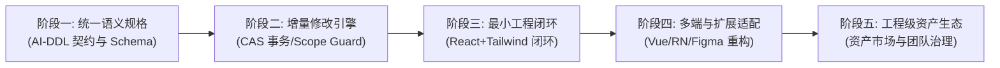
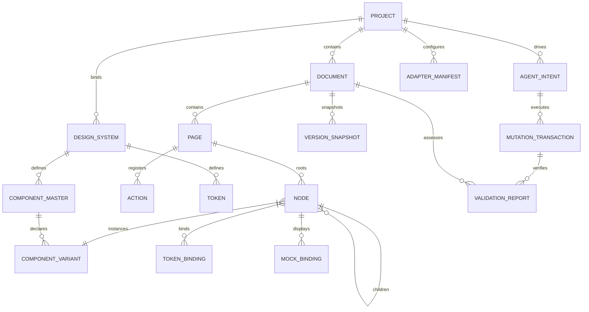
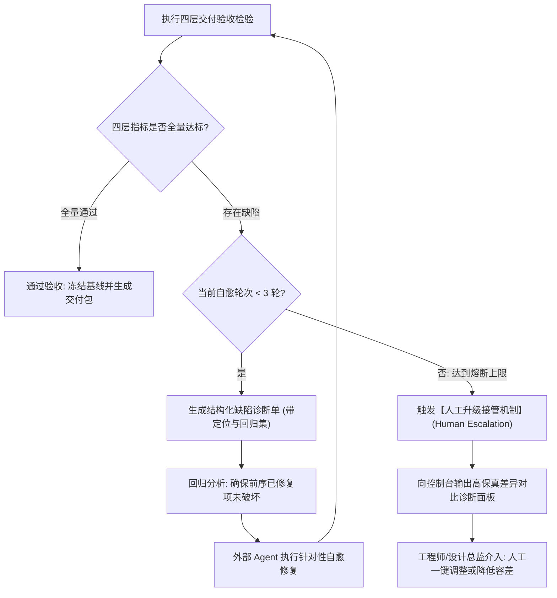

# iA-UI 产品设计说明书 (PRD: Intelligent Agentic UI Workbench)

- **产品名称**：iA-UI (Intelligent Agentic UI Workbench - 智能代理 UI 架构与设计工作台)
- **文档版本**：v0.0.4.merge (全功能深度融合与闭环增强版)
- **文档类型**：产品需求与功能规格说明书 (PRD / Product Requirements Document)
- **编制日期**：2026-10-12
- **当前状态**：`MERGED & FROZEN CANDIDATE` (两版本融合终版 / 待签署冻结)
- **产品负责人**：iA-UI 核心架构与产品体验团队
- **基线输入版本**：`design.opencode.v0.0.4.md` ⨁ `design.gemini.v0.0.4.md`
- **关联设计与评审规范**：`design.gemini.v0.0.3.analysis.md` / `design.opencode.v0.0.3.analysis.txt` / 根目录 `DESIGN.md`

> [!IMPORTANT]
> **版本融合与演进说明 (v0.0.4.merge)**：
> 本设计说明书将 `design.opencode.v0.0.4.md`（强调外部 Agent 解耦、标准 PRD 结构、治理与非设计转包闭环、量化验收指标）与 `design.gemini.v0.0.4.md`（强调工程化严密规范、CAS 事务修改流水线、四层验收体系与自愈熔断、目标适配器架构、受控自由画布、Click Wave 交互动效）进行**深度无缝融合**，并针对两版各自遗漏或薄弱之处进行系统性补齐：
> 1. **全功能单图交互总揽**：严格响应产品设计约束，**在 §3.1 中将全系统 15 项核心功能、3 大工作流路径、角色/Agent 交互流转、事务修改与闭环自愈熔断完整置于一张全景交互图展示**；
> 2. **外部 Agent 契约闭环补齐**：将 Gemini 偏向下游读取/测试的 MCP 接口，与 OpenCode 提出的双向生成、AST 补丁写入、结构化诊断、作用域锁定接口融合，形成完整的 MCP 双向生产级工具契约（§10 附录 A.4）；
> 3. **非设计功能转包与产品边界加固**：明确定义平台专注设计域确定性执行，将模型推理、代码落地、无头渲染、视频合成等非设计功能转包边界与降级策略彻底结构化（§1.4 / §1.5）；
> 4. **设计资产与多源导入容错治理**：融合 OpenCode 的字体版权合规、SVG 语义化清洗，以及 Gemini 的 L1~L3 逐级保真度损失报告机制，新增资产全生命周期合规规则（§4.10 / §4.12）；
> 5. **团队协作生命周期与基线冻结**：补充草稿、评审、冻结基线、发布、废弃的五阶段设计资产治理流，引入人工优先（Human Primacy）并发裁决机制（§4.13）；
> 6. **真实业务契约与受控可视化原语**：保留受控自由画布（`controlled_canvas`）、生产级表单校验契约、OpenAPI 异步状态映射与 RBAC 权限显隐守卫，使设计不仅具备视觉保真，更具备业务逻辑保真。

---

## 1. 产品概述与战略定位

### 1.1 业务背景与行业痛点

在数字化产品从“抽象构想”到“软件工程落地”的端到端交付流水线中，传统模式与新兴 AI 编程工具均存在显著断层：
1. **传统设计工具 (Figma / Sketch / Penpot) 的“语义鸿沟”**：
   - 核心数据模型建立在二维矢量图元与绝对像素坐标之上，缺乏对前端流式弹性盒模型（Flexbox）、组件状态机、响应式断点、动态 DTCG Token 以及业务逻辑的结构化表达；
   - 产研团队与 AI 编码工具（Cursor / Claude Code / Windsurf 等）必须依赖人类猜测布局意图，导致还原度低、样式溢出频繁、沟通成本与返工周期极高。
2. **新兴 AI 纯代码生成工具 (v0 / Lovable / Bolt) 的“治理黑盒”**：
   - 跳过系统化设计推演与视觉资产编排，直接从单次 Prompt 生成海量代码，导致设计系统缺乏统一沉淀，无法进行全局 Token 联动；
   - 专业设计师失去像素级与语义级的可视化干预抓手，生成的散乱代码难以直接并入企业级长周期维护的大型工程。
3. **评审沟通与直观体验的“媒介断层”**：
   - 研发、业务方与客户缺乏统一、可感知的直观沟通媒介；静态原型无法呈现真实的交互反馈与转场细节，文档、切图标注与演示视频脱节。

### 1.2 产品定位与一句话主张

> **产品定位**：**一个介于“自然语言产品想法”与“前后端工程实现”之间的 AI 原生可视化 UI 架构与设计工作台 (Intelligent Agentic UI Workbench)。**
> 
> 平台提供面向 AI 消费的语义设计语言、专业设计工作台与确定性执行能力，通过标准 MCP 协议供**外部 Agent** 调用设计能力，把脑中的产品构想转化为下游 Vibecoding 工具可 100% 确定性消费、人类可直观阅读审阅的高保真具体产品设计。

```
 [ 设计师 / 产品经理 / 领域专家脑中的产品构想 ]
              │  (多模态意图输入: 自然语言 / 草图 / 截图 / PRD / 存量设计)
              ▼
 ┌────────────────────────────────────────────────────────────────────────┐
 │ 外部智能协作 Agent (Cursor / Claude Code / Windsurf 等)                │
 │ 承担“推理与决策”：需求架构推演、任务拆解、方案比选、依据诊断闭环决策      │
 └───────────────────────────────────┬────────────────────────────────────┘
                                     │ (通过标准双向 MCP 协议调用设计能力)
                                     ▼
 ┌────────────────────────────────────────────────────────────────────────┐
 │       iA-UI 设计引擎 (确定性执行底座 · 专注设计域 · 拒绝业务运行黑盒)    │
 │  统一语义模型 (AI-DDL) · 活体语义画布 · CAS 事务修改流水线 · Scope 守卫 │
 └───────────────────────────────────┬────────────────────────────────────┘
                                     │
         ┌───────────────────────────┴───────────────────────────┐
         ▼ (机器可读通道)                                         ▼ (人类可视通道)
 ┌──────────────────────────────────────┐        ┌──────────────────────────────────────┐
 │ 面向 Vibecoding / 研发编码工具       │        │ 面向 产品 / 设计 / 客户 / 评审团队   │
 │ • 紧凑强类型 UI Spec (JSON Schema)   │        │ • 结构化 Markdown 规格与业务逻辑说明 │
 │ • DTCG 设计令牌字典 (CSS 变量)       │        │ • 1:1 矢量与切图标注图 (PNG/SVG)     │
 │ • 动作路由表与全场景 Mock 数据包     │        │ • 带 Click Wave 点击波纹交互演示视频 │
 │ • 组件库适配器能力声明清单           │        │ • 变更比对差异报告 (全要素 Diff)     │
 └──────────────────────────────────────┘        └──────────────────────────────────────┘
```

**一句话核心哲学**：
- **AI 是核心生产引擎，人类是领航者与艺术总监 (AI as Engine, Human as Director)**；
- **Agent 是外部协作方，平台是确定性执行引擎 (Agent as External Partner, Platform as Deterministic Engine)**；
- **直接操控即意图反馈 (Direct Manipulation as Intent Feedback)**；
- **单一事实来源与确定性契约 (Single Source of Truth & Deterministic Contracts)**。

### 1.3 核心业务价值

1. **构想到架构的分钟级推演**：从多模态输入（自然语言、PRD 文档、手绘草图、界面截图）出发，自动化推演业务拓扑、状态机，并快速装配全页面工程画板；
2. **面向 AI/Agent 消费的原生设计语言**：将设计抽象为四层语义模型（意图逻辑、规范约束、流式结构、语义表现），彻底消除盒模型二义性，下游编码 Agent 解析零歧义；
3. **全媒体直观可视化交付**：统一数据源驱动，一键同步产出高精度设计说明文档、高清标注切图以及真实呈现点击扩散波纹（Click Wave）与物理缓动的交互演示视频；
4. **事务级修改治理与防漂移保护**：依托作用域锁定（Scope Guard）、CAS 乐观并发控制与依赖扩散分析，确保局部微调不破坏全局布局，实现人机协同的平滑收敛；
5. **分层技术栈适配与验证自愈闭环**：解耦平台/样式/框架/组件库，配合受控无头浏览器渲染与四层量化验收体系（L1~L4），在交付前实现工程级自愈。

### 1.4 产品边界与明确非目标 (Non-Goals)

为确保工程实施的务实聚焦，本产品严格限定于**设计域**，杜绝无边界膨胀：

- 🚫 **不内置自研大模型推理集群**：模型推理、规划拆解与长文本思考一律来自外部 Agent（如 Cursor 等）或用户自备的 LLM API 网关，平台仅专注于设计规范、状态计算与确定性执行；
- 🚫 **不做真实前后端联动的生产应用运行环境**：交互原型定位为“类 PPT 的强保真演示交互”（支持状态切换、路由跳转、弹窗呼出），不连接真实生产数据库，不承担后端微服务编排；
- 🚫 **不做端到端代码托管与全功能 Web IDE**：代码生成与工程构建由下游 Vibecoding 工具及团队工程仓库承接，平台交付机器可读的精确 UI Spec 及组件映射参考，不替代 GitHub/GitLab 与 VS Code；
- 🚫 **不做庞大的低代码全包运行时**：不绑定私有前端运行时，不强迫用户采用特定专有前端框架；
- 🚫 **商业化资产交易市场阶段性后置**：在核心语义规格、修改引擎与主流 Web 技术栈闭环验证成熟前，不提前建设复杂的交易结算与撮合系统。

### 1.5 非设计功能外部转包矩阵 (Subcontracting Matrix)

平台将所有非设计核心的能力通过标准契约转包给专业的基础设施与外部生态，保证底座轻量稳定：

| 领域分类 | 转包功能项 | 外部承接方 / 服务形态 | 平台协同契约与降级保障 |
| :--- | :--- | :--- | :--- |
| **智能算力** | 自然语言理解、逻辑推演、方案比选 | 外部 Agent (Cursor / Claude Code) 或 LLM 网关 | 通过标准 MCP 协议驱动；支持会话中断恢复与超时保护 |
| **工程实现** | 前端生产代码生成、工程依赖安装 | 下游 Vibecoding 工具 / 开发者本地构建环境 | 输出无二义性 UI Spec 与组件适配器声明 |
| **渲染校验** | 受控无头浏览器渲染、像素比对 | 独立无头容器 (Playwright / Puppeteer 实例) | 隔离沙箱环境运行，设置 15s 渲染超时门槛与内存上限 |
| **动态媒体** | 交互演示视频录制、波纹合成、转码 | 后台轻量媒体合成服务 (FFmpeg / WebCodecs) | 采用异步作业队列；失败时提供交互式在线 HTML 预览保底 |
| **文件解析** | `.fig` 专有二进制格式解析提取 | 成熟开源/商用解析库或专用微服务 | 遵循 L1~L3 容错策略，无法解析的图元降级为原生矢量 |
| **数据基建** | 设计文件快照、切图、视频持久化 | S3 兼容对象存储 (MinIO / AWS S3) + CDN 加速 | 采用内容寻址（Content-Addressable Storage）防止篡改 |
| **矢量资源** | 开源标准图标库、通用字体源检索 | 开源生态 (Iconify / Google Fonts) | 强制本地元数据缓存与字体版权合规性静态检测 |

### 1.6 务实分阶段演进路线 (Pragmatic Phased Roadmap)

平台实施严格遵循“先证明确定性核心，再扩展生态矩阵”的五阶段演进路线：



| 阶段 | 阶段代号 | 核心目标与交付成果 | 验收准则与退出门槛 |
| :--- | :--- | :--- | :--- |
| **阶段一** | **统一语义规格** | 定义 UI Spec (AI-DDL) JSON Schema、稳定 ID 生成算法、DTCG Token 字典结构、容器流式计算法则（hug/fill/fixed）。 | 规范校验器对测试样本语法与引用校验通过率 100%，消除歧义。 |
| **阶段二** | **增量修改引擎** | 构建活体语义画布、Scope Guard 作用域硬锁定、CAS 乐观锁防脏写机制、直接操控逆向语义提炼引擎。 | 跨画板组件修改时，依赖传播范围预测准确率 100%，无全局未预期漂移。 |
| **阶段三** | **最小工程闭环** | 锁定单一主流技术栈（React + Tailwind + shadcn/ui），跑通 MCP 双向连接、代码生成、受控渲染与四层验收及熔断。 | 样板项目完成从意图输入到前端工程构建成功，自动化自愈闭环畅通。 |
| **阶段四** | **多端与扩展适配** | 扩展多前端框架适配器（Vue 3 / Svelte / React Native）、Figma 导入分级重构与保真度损失报告、一键跨端衍生。 | 支持 2 种以上主流框架适配；Figma L2 语义重构率 >= 90%。 |
| **阶段五** | **工程级资产生态** | 完善团队设计系统生命周期管控、设计资产包版本依赖、工程级资产市场与商业化结算授权机制。 | 资产市场支持标准规范检测与加密签名，资产包开箱即用率 >= 95%。 |

---

## 2. 目标用户角色、协作范式与使用场景

### 2.1 参与者角色矩阵

```
┌────────────────────────────────────────────────────────────────────────────────────────┐
│                              参与者角色与系统职责边界                                  │
├────────────────────┬──────────────────────────────────┬────────────────────────────────┤
│ 角色标识 / 名称    │ 核心职责与业务目标               │ 主要系统触点与权限             │
├────────────────────┼──────────────────────────────────┼────────────────────────────────┤
│ `ROLE_DESIGN_LEAD` │ 视觉调性、设计系统裁决、复杂精修 │ 设计系统工作台、方案澄清卡、   │
│ (设计负责人/总监)  │ 审批组件库上架、冻结发布版本基线 │ 属性面板、全局 Token 字典      │
├────────────────────┼──────────────────────────────────┼────────────────────────────────┤
│ `ROLE_PRODUCT_MGR` │ 业务需求输入、PRD 推演、原型走查 │ 需求推演编辑器、交互原型走查、 │
│ (产品经理 PM)      │ 确保功能实体、状态机与交互闭环   │ PRD-UI 双向联动器、演示视频播放│
├────────────────────┼──────────────────────────────────┼────────────────────────────────┤
│ `ROLE_ENGINEER`    │ 消费 Spec 规格、代码生成、闭环回归│ 标准 MCP 工具接口、只读规格树、│
│ (研发工程师/全栈)  │ 维护组件库适配器契约与验证诊断   │ 四层验收诊断单、本地 CLI 工具  │
├────────────────────┼──────────────────────────────────┼────────────────────────────────┤
│ `ROLE_ADMIN`       │ 组织席位、Agent 网关配额、计费   │ 组织管理后台、审计日志面板、   │
│ (企业系统管理员)   │ 安全凭证颁发、吊销与合规审计     │ MCP 密钥生命周期管理           │
├────────────────────┼──────────────────────────────────┼────────────────────────────────┤
│ `ROLE_SYS_AGENT`   │ 意图推理、多画板装配、缺陷自愈   │ 双向 MCP 总线、CAS 事务提交器、│
│ (外部智能协作 Agent)│ 依据诊断单执行针对性补丁修复     │ 临时受限 Scope 写入权限        │
├────────────────────┼──────────────────────────────────┼────────────────────────────────┤
│ `ROLE_REVIEWER`    │ 跨职能业务评审、客户验收确认     │ 只读在线评审视图、评论标注、   │
│ (业务方/客户评审)  │ 确认设计符合预期并打上评审签字   │ 全媒体交付物下载通道           │
└────────────────────┴──────────────────────────────────┴────────────────────────────────┘
```

### 2.2 外部 Agent 角色定位与人机分工契约

平台界定“智能推理”与“确定性执行”的人机分工边界（遵循 MCP 开放工具协议）：

| 职责范畴 | 责任承担方 | 具体职能与系统行为 |
| :--- | :--- | :--- |
| **推理与决策**<br/>(Intelligence & Reasoning) | **外部 Agent**<br/>(Cursor / Claude Code 等) | • 解析用户非结构化自然语言、推演业务场景与实体关系；<br/>• 规划设计拆解步骤、发起方案 A/B/C 主动澄清；<br/>• 依据受控渲染的四层验收诊断单，分析根因并编写修复 Patch。 |
| **确定性执行**<br/>(Deterministic Execution) | **iA-UI 核心引擎**<br/>(Workbench Runtime) | • UI Spec 静态 Schema 语法与引用完整性强校验；<br/>• 实时流式盒模型（Flexbox）约束求解与弹性计算；<br/>• 执行 Scope Guard 越权拦截与 CAS 乐观并发冲突检测；<br/>• 渲染动态活体画布、生成不可变快照与录制交互演示视频。 |

> [!CAUTION]
> 平台严禁向外部 Agent 暴露自由覆写全工程的非受限接口。外部 Agent 一律作为“受限协作者”，其对画布的修改必须通过带有语义作用域（Scope）和版本号签名的事务补丁（Patch）完成。

### 2.3 多尺度工作流矩阵与准入准出标准

为避免不同规模任务的流程过载，系统提供三条清晰的工作流入口：

| 工作流路径 | 适用场景与任务诉求 | 准入准则 (Entry Criteria) | 关键流转过程 | 准出准则 (Exit Criteria) |
| :--- | :--- | :--- | :--- | :--- |
| **路径 A：极速单页生成**<br/>(Quick Path) | 单页面、独立组件或局部交互探索 | 输入轻量自然语言 Prompt，无需完整前置 PRD | 跳过宏观拓扑推演，Agent 直接调用装配能力生成独立画板 | L1 规格校验 100% 通过，流式盒模型合规率 100% |
| **路径 B：存量设计迁移**<br/>(Import Path) | 既有 Figma 资产导入、竞品截图重构 | 上传合法 `.fig` 文件或产品高保真截图 | 解析原始图元，逆向推导流式盒模型，生成《保真度损失报告》 | 用户审阅并显式确认转换报告与降级项 |
| **路径 C：宏观架构推演**<br/>(Deep Reasoning Path) | 复杂大型系统从 0 到 1 孵化 | 提供宏观业务愿景，涉及多端、多状态与复杂路由 | 驱动 Agent 生成结构化 PRD，经人工确认冻结后批量并发装配全页面 | 通过 L1~L4 四层综合验收，生成命名不可变版本快照 |

### 2.4 典型端到端业务场景旅程

1. **场景一：从 0 到 1 极速业务孵化 (Inception)**：
   PM/设计师在控制台输入“跨境电商风控中台”愿景 → Agent 调用需求架构工具生成 PRD 与拓扑大纲 → 人工冻结业务逻辑 → 平台并发装配桌面端看板、交互抽屉与移动端画板（挂载全状态 Mock） → 导出 UI Spec 与带波纹演示视频。
2. **场景二：存量设计导入与语义重构 (Migration)**：
   团队上传历史 `.fig` 设计文件 → 平台执行绝对坐标逆向盒模型推导 → 弹出《保真度损失报告》（96% Auto-Layout 识别率，未解析特效安全降级为 SVG） → 设计师确认并对齐 Tailwind Token 字典。
3. **场景三：双轨协作与人机精细微调 (Refinement)**：
   设计师在画布框选表格区域启动 Scope Guard → 输入“增加批量导出功能” → Agent 仅针对选区生成 Patch（选区外背景绝对只读锁定） → 设计师手动微调列宽，系统逆向提炼 `gap` 参数并弹窗询问“是否一键广播至其余 8 个画板”。
4. **场景四：工程闭环验证与自动修复 (Verification & Healing)**：
   研发调用 MCP 工具拉取 UI Spec 生成代码 → 无头测试容器在 375px 断点下检测到文字溢出报错 → 系统生成结构化诊断单下发给 Agent → Agent 针对性提交样式补丁 → 复测全量通过打上发布基线。
5. **场景五：团队资产沉淀与跨工程复用 (Governance & Reuse)**：
   设计负责人将通过验收的“高级数据表格”主组件上架到团队资产库并打上 `v1.2.0` 标签 → 其他工程外部 Agent 直接检索复用该标准组件，杜绝重复造轮子。

---

## 3. 全功能交互全景图 (Master Interaction Architecture Diagram)

### 3.1 一图览全局：全功能交互与数据流向总图 (Master Mermaid Chart)

> [!IMPORTANT]
> **按产品设计核心约束要求**：以下单张全景交互图**完整覆盖 iA-UI 全系统 15 项核心功能模块 (FEAT-001 ~ FEAT-015)**、全角色参与触点、3 条工作流分支、事务级增量修改流水线、四层验收自愈熔断以及双通道交付出口：

```mermaid
flowchart TD
    %% ==========================================
    %% 参与者与外部生态接入层
    %% ==========================================
    subgraph S_ACTORS["【参与者与外部生态接入层】"]
        U_HUMAN["人类角色集群<br/>(设计总监 / PM / 研发 / 管理员)"]
        U_AGENT["外部智能协作 Agent<br/>(Cursor / Claude Code / Windsurf)"]
        U_CLIENT["下游消费终端<br/>(研发工程仓库 / CI 流水线 / 客户评审)"]
    end

    %% ==========================================
    %% 准备与配置中枢 (FEAT-001, FEAT-012, FEAT-013)
    %% ==========================================
    subgraph S_PREP["【模块 1: 项目准备与配置中枢】(FEAT-001 / FEAT-012 / FEAT-013)"]
        F01["FEAT-001: 项目环境与 Agent 配置<br/>• 品牌视觉基调 (Brand Vibe)<br/>• 目标终端 (Desktop/Tablet/Mobile)<br/>• 目标代码栈偏好 (React/Vue/RN)"]
        F01_MCP["Agent 凭证管理与 MCP 网关<br/>• 临时 Session 令牌生成<br/>• 500ms 即时吊销与权限白名单"]
        F12["FEAT-012: 设计资产与版权治理<br/>• WOFF2/TTF 字体合规检测<br/>• SVG 矢量规范化与语义别名检索"]
        F13["FEAT-013: 团队协同与生命周期<br/>• 草稿/评审/冻结/发布状态机<br/>• 团队私有资产库与基线锁定"]
    end

    %% ==========================================
    %% 意图输入与多尺度工作流分流 (FEAT-002, FEAT-010)
    %% ==========================================
    subgraph S_INPUT["【模块 2: 多模态输入与工作流分流】(FEAT-002 / FEAT-010)"]
        F02_IN["多模态意图输入源<br/>• 自然语言 Prompt<br/>• 手绘草图 / 界面截图<br/>• 既有 PRD 结构化文本"]
        F10["FEAT-010: 存量设计多级导入<br/>• .fig 二进制解析 (L1/L2/L3)<br/>• 绝对坐标逆向弹性盒模型<br/>• 保真度损失报告与降级提示"]
        GATE_PATH{"工作流决策路由<br/>(多尺度分流网关)"}
        
        PATH_A["【路径 A: 极速单页生成】<br/>(Quick Path: 轻量Prompt跳过PRD)"]
        PATH_B["【路径 B: 存量设计迁移】<br/>(Import Path: 损失审查与重构)"]
        PATH_C["FEAT-002: 宏观架构与 PRD-UI 联动<br/>(Deep Path: 需求推演/实体状态机/<br/>PRD-UI 双向实体绑定与反向告警)"]
    end

    %% ==========================================
    %% 核心设计装配与设计系统规范 (FEAT-003, FEAT-006, FEAT-007)
    %% ==========================================
    subgraph S_ASSEMBLY["【模块 3: AI 原生自主装配与规范中枢】(FEAT-003 / FEAT-006 / FEAT-007)"]
        F06["FEAT-006: 设计系统与组件注册表<br/>• W3C DTCG 标准设计令牌字典 (无裸数值)<br/>• 开源库/私有组件映射 (Props/Variants)<br/>• Storybook/TS 代码组件逆向注册"]
        F03["FEAT-003: AI 原生多画板自主装配<br/>• 动态上下文投影 (Context Projection)<br/>• 真实组件强制优先检索装配<br/>• 静态规格合法性即时拦截"]
        F07["FEAT-007: 受控自由画布原语<br/>• controlled_canvas (相对坐标系)<br/>• 复杂图表 / 大屏可视化安全沙箱"]
    end

    %% ==========================================
    %% 活体语义画布与人机协同层 (FEAT-004, FEAT-005, FEAT-009)
    %% ==========================================
    subgraph S_CANVAS["【模块 4: 活体语义画布与人机协同】(FEAT-004 / FEAT-005 / FEAT-009)"]
        F04["FEAT-004: 活体语义画布 (Living Canvas)<br/>• Flexbox 纯流式盒模型实时物理计算<br/>• hug / fill / fixed 尺寸与文本截断约束<br/>• 功能流拓扑视图 ⟷ 无限平面视图同构切换"]
        F04_MANIP["直接操控逆向意图提炼<br/>• 拖拽标尺吸附 DTCG Token 变量<br/>• 逆向语义参数提炼与全局一键广播"]
        F05_GUARD["FEAT-005: 作用域硬锁定 (Scope Guard)<br/>• 选区节点可写 / 外部背景只读锁定<br/>• 阻断越界修改 (ScopeViolationException)"]
        F09["FEAT-009: 多终端自适应衍生<br/>• 逻辑同构 / 布局独立 (Desktop/Tablet/Mobile)<br/>• 移动端一键衍生 (热区>=44pt/抽屉化导航)"]
    end

    %% ==========================================
    %% 原型交互、Mock 数据与业务契约 (FEAT-008)
    %% ==========================================
    subgraph S_PROTO["【模块 5: 交互原型、Mock与业务契约】(FEAT-008)"]
        F08_ACTION["声明式交互动作原语<br/>• Navigate (Push/Replace/Back)<br/>• OpenModal / CloseModal<br/>• ToggleState / MockSubmit"]
        F08_MOCK["全场景业务 Mock 数据契约<br/>• Normal (正常态) / Empty (友好空态)<br/>• Error (异常态) / Overflow (超长文本溢出)"]
        F08_BIZ["生产级业务契约验证<br/>• 表单正则校验与错误反馈节点联动<br/>• OpenAPI 异步请求态映射 (Loading/200/500)<br/>• RBAC 权限表达式显隐守卫"]
    end

    %% ==========================================
    %% 事务级增量修改与版本管理 (FEAT-005 事务引擎, FEAT-011)
    %% ==========================================
    subgraph S_TX["【模块 6: 事务级修改流水线与版本时光机】(FEAT-005 引擎 / FEAT-011)"]
        TX_PREDICT["1. 影响范围预测 (Direct Scope vs Blast Radius)"]
        TX_CAS["2. CAS 乐观锁版本校验 (防并发脏写)"]
        TX_STAGING["3. 隔离影子沙箱补丁试运行 (Shadow AST Apply)"]
        TX_GATE{"4. 规则合规与冲突裁决<br/>(人工操作绝对优先)"}
        TX_COMMIT["5. 原子提交 (Atomic Commit) / 整体回滚"]
        F11["FEAT-011: 不可变快照与决策时光机<br/>• 全要素语义 Diff (结构/样式/路由增量)<br/>• 分屏对比与洋葱皮高亮 (Onion Skin)<br/>• 历史任意节点一键回滚与无损分支"]
    end

    %% ==========================================
    %% 四层验收、自愈熔断与工程适配 (FEAT-014, 附录 A.3)
    %% ==========================================
    subgraph S_VERIFY["【模块 7: 四层验收与自愈熔断引擎】(FEAT-014 / 适配器矩阵)"]
        ADAPTER_RUN["分层目标技术栈适配器<br/>(平台/样式/框架/组件库 Binding 转换)"]
        V_RUN["受控无头浏览器渲染检验 (Playwright)"]
        
        V_L1["L1: 规格合法性 (Schema/稳定ID/无悬空引用)"]
        V_L2["L2: 视觉布局正确性 (像素匹配>=98%/零意外溢出)"]
        V_L3["L3: 交互与业务逻辑 (状态机用例/异常覆盖100%)"]
        V_L4["L4: 生产工程可用性 (构建0报错/Token合规100%)"]
        
        V_CHECK{"四层基准全量达标?"}
        HEAL_CHECK{"自愈重试轮次 < 3 轮?"}
        GEN_DIAG["生成结构化缺陷诊断单<br/>(含组件ID/报错行/基线回归集)"]
        ESCALATE["触发【人工升级接管机制】<br/>(高保真差异诊断面板/工程师介入)"]
    end

    %% ==========================================
    %% 双通道交付物产出 (FEAT-015)
    %% ==========================================
    subgraph S_DELIVERY["【模块 8: 双通道交付物输出中枢】(FEAT-015)"]
        CH_VIBE["【机器通道: 面向 Vibecoding】<br/>• 紧凑强类型 UI Spec (AI-DDL JSON Schema)<br/>• 语义 Token 字典 (CSS 变量) & 校验和签名<br/>• 动作路由表 & 全状态 Mock 包<br/>• MCP 读写接口 & 本地 CLI 导出"]
        CH_HUMAN["【人类通道: 面向评审与沟通】<br/>• Markdown 结构化设计说明书<br/>• 1:1 矢量与切图标注图 (PNG/SVG)<br/>• 演示视频 (Click Wave 波纹+物理缓动转场)<br/>• 变更对比差异审计报告"]
    end

    %% ==========================================
    %% 交互连线与全流向闭环关系
    %% ==========================================
    %% 角色触发
    U_HUMAN -->|1. 初始化配置与授权| F01
    U_HUMAN -->|2. 导入字体/图标资产| F12
    U_HUMAN -->|3. 维护设计系统基线| F13
    U_HUMAN -->|4. 提交多模态设计意图| F02_IN
    U_HUMAN -->|5. 上传存量设计文件| F10
    
    U_AGENT <-->|MCP 标准协议双向连接| F01_MCP
    F01_MCP --> F01

    %% 输入路由分流
    F02_IN --> GATE_PATH
    F10 --> GATE_PATH
    
    GATE_PATH -->|场景 A: 单页/局部探索| PATH_A
    GATE_PATH -->|场景 B: 存量迁移| PATH_B
    GATE_PATH -->|场景 C: 宏观孵化| PATH_C
    
    PATH_B -->|审阅损失报告并重构| F06
    PATH_C -->|PRD 实体/路由/验收冻结| F03
    PATH_A -->|快速生成指令| F03

    %% 装配与设计系统
    F06 -->|注入标准 Token 与组件契约| F03
    F12 -->|注入合法矢量图标与字体| F03
    F03 -->|调度受控图表沙箱| F07
    F07 --> F04
    F03 -->|输出结构化装配树| F04

    %% 画布交互与人机微调
    F04 <-->|直接拖拽/修改数值| F04_MANIP
    F04_MANIP -->|高阶参数广播| S_TX
    U_HUMAN -->|选中局部开启保护| F05_GUARD
    F05_GUARD -->|限定直接修改范围| S_TX
    U_AGENT -->|提交增量 Patch| S_TX
    F04 -->|跨端衍生触发| F09
    F09 --> F04

    %% 原型与业务状态
    F04 --> F08_ACTION
    F04 --> F08_MOCK
    F04 --> F08_BIZ
    F08_ACTION --> S_TX
    F08_MOCK --> S_TX
    F08_BIZ --> S_TX

    %% 事务执行流
    S_TX --> TX_PREDICT
    TX_PREDICT --> TX_CAS
    TX_CAS --> TX_STAGING
    TX_STAGING --> TX_GATE
    TX_GATE -->|冲突/不合规| F05_GUARD
    TX_GATE -->|通过/人工优先| TX_COMMIT
    TX_COMMIT --> F11
    TX_COMMIT -->|更新画布状态| F04
    F11 -->|拉取待验证基线| ADAPTER_RUN

    %% 验证与自愈流
    ADAPTER_RUN --> V_RUN
    V_RUN --> V_L1
    V_L1 --> V_L2
    V_L2 --> V_L3
    V_L3 --> V_L4
    V_L4 --> V_CHECK

    V_CHECK -->|未达标: 存在缺陷| HEAL_CHECK
    HEAL_CHECK -->|是 (轮次<3)| GEN_DIAG
    GEN_DIAG -->|推送缺陷定位| U_AGENT
    U_AGENT -->|生成自愈 Patch| S_TX
    HEAL_CHECK -->|否 (达到熔断)| ESCALATE
    ESCALATE -->|工程师/总监接管| U_HUMAN

    %% 最终交付
    V_CHECK -->|全量通过达标| F13
    F13 -->|冻结发布版本| S_DELIVERY
    S_DELIVERY --> CH_VIBE
    S_DELIVERY --> CH_HUMAN
    
    CH_VIBE -->|拉取 UI Spec 与组件清单| U_CLIENT
    CH_HUMAN -->|审阅说明书/高清切图/波纹视频| U_CLIENT
```

### 3.2 交互流向与核心状态跳转深度解读

从上图可以看出，整个产品交互紧密围绕**三大核心流向环**运行：
1. **意图输入与装配前馈环 (Feedforward Loop)**：从多模态输入经由分流网关（Quick/Import/Deep）调集组件库与设计系统规范，由外部 Agent 与装配引擎协同产出高合规的活体语义画布；
2. **画布人机协同与事务提交环 (Mutation & Transaction Loop)**：人类直接操控逆向提炼与外部 Agent 提交的修改 Patch，统一受控于 Scope Guard 作用域硬锁定与 CAS 乐观锁流水线，经过影子沙箱试运行与冲突裁决后原子落库；
3. **四层验收、自愈熔断与交付反馈环 (Feedback & Delivery Loop)**：任何提交产物经过分层适配器进入受控无头浏览器进行 L1~L4 全方位检验，合格即生成双通道交付物；未通过则在 3 次熔断上限内驱动 Agent 自愈，超出上限立即转入人工升级接管。

---

### 3.3 核心 UI 操作语言架构：双端指令同构与虚拟运行时系统

> [!IMPORTANT]
> **产品核心技术底座**：整个产品最核心的基础设施是一套**高内聚、无二义性的 UI 操作语言系统**。
> 该语言承担双重使命：既是声明式 UI 的**“数据定义模型 (DDL)”**，又是驱动增量构建与演进的**“数据操作协议 (DML)”**。
> **外部 Agent 的自然语言推演与人类设计师的鼠标画笔操控，本质上是这套语言系统的两个同构编译器 (Compilers / Writers)**；而 Web 画布则是这套语言的**“状态机、确定性虚拟机与渲染管线 (Runtime & Renderer)”**。

#### 3.3.1 核心哲学：双端指令同构 (Dual-Writer Equivalence)

在传统工具中，鼠标操作直接操作图形内存像素，而 AI 代码生成工具则直接输出散乱源码，两者处于完全割裂的世界。iA-UI 确立了**“双端指令等价性 (Human-Agent Parity)”**：

```
       [ 外部 Agent (Cursor / Claude) ]             [ 人类设计师 (鼠标 / 触控画笔) ]
                     │                                              │
                     │ (自然语言意图 ──▶ NL-to-DSL)                  │ (物理手势/位移 ──▶ Gesture-to-DSL)
                     ▼                                              ▼
        ┌─────────────────────────┐                    ┌─────────────────────────┐
        │  Agent 指令生成器 (MCP)  │                    │ 画笔事件逆向编译器 (Engine) │
        └────────────┬────────────┘                    └────────────┬────────────┘
                     │                                              │
                     │  提交标准操作指令 (DML Patch)                │  提交完全相同的操作指令 (DML Patch)
                     ▼                                              ▼
     ════════════════════════════════════════════════════════════════════════════════════════
                        【核心纽带：统一 UI 操作语言 (AI-DDL + UI-DML)】
     ════════════════════════════════════════════════════════════════════════════════════════
                                              │
                                              ▼ (CAS 事务通道 / Scope Guard 作用域校验)
                               ┌─────────────────────────────┐
                               │     单一事实源 (Document Store)│
                               │      稳定语义树 (AST State)   │
                               └──────────────┬──────────────┘
                                              │
                                              ▼ (布局求解 & 响应式计算)
                               ┌─────────────────────────────┐
                               │  Web 画布渲染器 (Canvas Engine)│
                               │  • 纯流式盒模型 (Flexbox)     │
                               │  • 60fps 活体渲染 + 弹性标尺  │
                               └─────────────────────────────┘
                                              │ (双向反馈)
                     ┌────────────────────────┴────────────────────────┐
                     ▼                                                 ▼
          向 Agent 返回诊断与状态                          向画笔呈现视觉标尺与吸附反馈
```

1. **写操作同构**：外部 Agent 接收自然语言输出的增删改指令，与设计师使用鼠标在画布上拖拽、拉伸、连线生成的指令，在数据结构上**100% 同构、格式一致**；
2. **读操作同构**：画布渲染器向人类展现的可视化图元，与通过 MCP 投喂给外部 Agent 的语义切片，来源于**同一棵 AST 语法树**；
3. **协作无缝录制**：因为所有交互均被标准化为结构化操作流，系统天然具备原子撤销/重做、时间轴审计以及将操作流转化为带 Click Wave 动效演示视频的能力。

#### 3.3.2 语言模型双轨设计：AI-DDL 规范与 UI-DML 指令集

语言体系严格区分为**静态结构表示**与**动态操作原语**两大部分：

##### 1. 静态数据定义规范 (AI-DDL / UI Spec AST)
- **稳定语义 ID 体系**：所有节点拥有跨多轮生成与会话保持不变的语义化 ID（如 `node.dashboard.metrics_card`），彻底消除图层打乱重建导致的引用断裂；
- **纯流式弹性盒模型 (Fluid Auto-Layout)**：全面推行 Flexbox 约束（`direction`, `padding`, `gap`, `alignItems`, `justifyContent`），淘汰无约束的自由 Group 与绝对坐标。尺寸行为显式声明为 `hug`（包裹内容）、`fill`（撑满可用空间）、`fixed`（固定尺寸），文本显式声明溢出截断策略；
- **DTCG 语义设计令牌绑定**：节点样式属性禁止硬编码裸数值（如禁止写死 `#1E40AF` 或 `16px`），必须强制引用设计系统 Token（如 `color.primary.main`、`spacing.4`）。

##### 2. 动态操作指令集规范 (UI-DML / Mutation Operations)
Agent 与画笔向系统发射的所有变更动作，必须封装为标准原子操作原语（遵循 RFC 6902 JSON Patch 扩展）：
```ts
// 核心 UI-DML 操作原语定义
type UIOperation =
  // 1. 结构与树节点操作
  | { op: "INSERT_NODE"; parentId: string; index: number; node: SemanticNode }
  | { op: "DELETE_NODE"; nodeId: string }
  | { op: "MOVE_NODE"; nodeId: string; targetParentId: string; targetIndex: number }
  | { op: "REPLACE_NODE"; nodeId: string; newNode: SemanticNode }
  // 2. 弹性盒模型与几何约束修改
  | { op: "UPDATE_LAYOUT"; nodeId: string; layoutPatch: Partial<LayoutConstraints> }
  // 3. 设计令牌绑定与样式修改
  | { op: "BIND_TOKEN"; nodeId: string; property: "color" | "spacing" | "radius" | "shadow"; tokenKey: string }
  | { op: "UNBIND_TOKEN"; nodeId: string; property: string; fallbackLiteralValue: string }
  // 4. 组件实例与变体切换
  | { op: "SET_VARIANT"; nodeId: string; variantKey: string; variantValue: string }
  | { op: "OVERRIDE_SLOT"; nodeId: string; slotName: string; contentNodeId: string }
  // 5. 交互动作与状态机挂载
  | { op: "ATTACH_ACTION"; nodeId: string; trigger: "onClick" | "onHover"; action: PrototypeAction }
  | { op: "DETACH_ACTION"; nodeId: string; actionId: string }
  // 6. 数据源与业务契约绑定
  | { op: "BIND_MOCK"; nodeId: string; datasetId: string; fieldPath: string }
  | { op: "SET_FORM_VALIDATION"; nodeId: string; rule: FormValidationRule };
```

#### 3.3.3 双端编译器运作机制：Agent 与 Web 画笔如何发射指令

##### 1. 外部 Agent 通道：自然语言 ──▶ UI 指令 (NL-to-DSL Compiler)
- **动态上下文投影 (Context Projection)**：外部 Agent 在修改局部组件时，平台不向其倾倒数万行全量工程树，而是根据任务意图投影**局部子树切片 + 只读约束 + 生效 Token 字典**；
- **结构化 Patch 发射**：外部 Agent 通过标准 MCP 工具 `ia_submit_patch` 提交事务补丁，声明携带的基础版本号与目标节点集：
  ```json
  {
    "baseSnapshotVersion": "v1.0.4",
    "scopeNodeId": "node.checkout.card",
    "operations": [
      { "op": "UPDATE_LAYOUT", "nodeId": "node.checkout.card", "layoutPatch": { "gap": "spacing.4" } },
      { "op": "BIND_TOKEN", "nodeId": "node.checkout.submit_btn", "property": "color", "tokenKey": "color.destructive" }
    ]
  }
  ```

##### 2. Web 画笔通道：物理鼠标事件 ──▶ UI 指令 (Gesture-to-DSL Compiler)
传统设计工具拖拽直接修改图元的绝对屏幕坐标 `(x, y)`，而在 iA-UI 中，**鼠标画笔是一个实时手势编译器**：
- **拖拽间距 / 尺寸 (Mouse Drag)**：
  - 鼠标在画布边缘拖动产生物理像素位移（如 `deltaX = +16px`）；
  - **吸附算法 (Snap-to-Token)**：画笔引擎在 16ms 内将位移量与当前设计系统的 Token 梯队比对，自动吸附至最近的语义令牌（如 16px 吸附至 `spacing.4`）；
  - **发射相同 DML**：画笔引擎直接组装并向核心提交 `{ op: "UPDATE_LAYOUT", nodeId: "...", layoutPatch: { gap: "spacing.4" } }`，与 Agent 产出的指令结构完全一致；
- **拖拽插入组件 (Drop Insert)**：
  - 设计师从资产面板将组件拖入某个弹性容器；
  - 引擎根据鼠标悬停的投影坐标，动态计算插入的子项索引（`index = 2`）；
  - 发射 `{ op: "INSERT_NODE", parentId: "container.main", index: 2, node: ButtonInstance }`；
- **逆向意图广播向导**：
  - 鼠标手动改动数值后，画布弹出提示胶囊：*“已调整为 16px，检测到该组件在 8 个画板中复用，是否广播为全局规则？”*，实现从人类直接操控向工程高阶规则的逆向沉淀。

#### 3.3.4 Web 画布虚拟机与确定性渲染管线 (Living Canvas Runtime)

Web 画布既不是简单的 SVG 预览器，也不是臃肿的无头浏览器，而是一个**确定性执行的高性能虚拟机**：

1. **CAS 乐观锁与并发事务管理**：
   - 接收到无论是来自 Agent 还是画笔的指令补丁时，引擎首先核对 `baseSnapshotVersion`；
   - 若发生人机并发冲突，引擎依据“人工操作绝对优先 (Human Primacy)”规则无损合并非冲突属性，冲突属性保留人工修改；
2. **Scope Guard 作用域硬拦截**：
   - 当设计师框选局部并开启锁定，选区外所有背景节点被标记为只读锁（`lockStatus = scope_locked`）；
   - 若 Agent 提交的 Patch 包含越界写操作，虚拟运行时在沙箱校验阶段直接抛出 `ScopeViolationException` 熔断回滚，杜绝全局飘移；
3. **Web Worker 隔离盒模型求解**：
   - 流式盒模型的约束求解（计算 `hug` 包裹尺寸与 `fill` 伸缩拉伸）在独立的后台 Web Worker 线程中高速运行；
   - 主线程专职负责 60fps 高帧率的 DOM / Canvas 绘制与弹性辅助标尺渲染，承载 10 万节点级大型工程不卡顿；
4. **同构双视图渲染**：
   - **业务功能流拓扑视图**：依据节点上的 Action 原语自动连线，展示产品全景逻辑链路；
   - **无限平面画板视图**：忠实渲染各视口（桌面端 1440px / 移动端 390px）下的真实界面形态。

#### 3.3.5 行业标杆技术演进对照：Figma vs OpenPencil vs iA-UI

为了更深刻地定位本产品的技术坐标，下表系统性对比三代设计语言架构的底层实现原理与取舍：

| 架构维度 | Figma (经典协同设计) | OpenPencil (AI 脚本设计 DSL) | iA-UI (双端同构与工程闭环) |
| :--- | :--- | :--- | :--- |
| **底层核心模型** | **C++ WebAssembly 场景图 (Scene Graph)**<br/>• 图元优先，以平面几何树组织<br/>• Auto-Layout 属于可选附加属性 | **PenNode 抽象语法树 (AST)**<br/>• 显式 `role` 语义角色（如 navbar, button）<br/>• 强制 `fill_container` / `hug_contents` | **统一语义 UI Spec (AI-DDL)**<br/>• 四层语义模型 (业务实体/规范/流式/图元)<br/>• 强制绑定 W3C DTCG 标准令牌字典 |
| **操作协议 (DML)** | **内部二进制 OT / CRDT 协作流**<br/>• 针对鼠标拖拽微变优化<br/>• 协议私有化，不向外部开放独立写通道 | **三层操作接口体系**：<br/>1. 原子 CLI (`op insert/update/delete`)<br/>2. Batch DSL (`I/U/D/M/C` 紧凑微语法)<br/>3. JS 沙箱 (`I(parent, node)` 数据驱动循环) | **事务级增量修改流水线 (UI-DML)**<br/>• 原子 JSON Patch 语义扩展<br/>• CAS 乐观锁防并发脏写<br/>• Scope Guard 作用域硬锁定防漂移 |
| **Agent 协作机制** | **弱（外挂式沙箱代理）**<br/>• 官方 REST API 仅支持只读（GET）<br/>• 写操作必须诱导用户在本地打开插件沙箱，无法脱离桌面界面独立运行 | **强（解耦式工具调用）**<br/>• 原生设计针对 MCP 开放 (`batch_design`)<br/>• Agent 可脱离客户端在无头 CLI/服务器上执行批量构建 | **原生双向总线闭环**<br/>• 双向 MCP 协议网关<br/>• 支持动态切片投影、Patch 提交、四层验证拉取与结构化诊断自愈 |
| **鼠标画笔机制** | 鼠标直接拖拽 C++ 内存图元，修改绝对像素坐标 `(x, y)`，不强制吸附代码变量 | 传统矢量编辑器鼠标交互，与 CLI/DSL 编译器相对分离独立 | **手势逆向编译器 (Gesture-to-DSL)**<br/>鼠标拖拽捕获为物理手势，自动吸附 Token 并发射完全相同的 DML 指令 |
| **业务与工程契约** | **无业务逻辑表达**<br/>只有静态图元与页面跳转连线，无数据状态模拟与表单校验 | **弱（偏向纯静态矢量 UI）**<br/>聚焦于矢量页面生成，缺乏全状态 Mock 与前后端接口契约 | **强业务与工程闭环**<br/>• 覆盖 Normal/Empty/Error/Overflow 全状态<br/>• 生产级表单正则校验与 OpenAPI 映射<br/>• 驱动受控无头浏览器 L1~L4 闭环自愈 |

**演进结论**：
- **Figma** 解决了人类视觉协同问题，但将 Auto-Layout 视为二等公民、REST API 只读，导致 AI 难以稳定消费与产出；
- **OpenPencil** 首次破局，用 PenNode 和 Batch DSL / JS 沙箱证明了“让 Agent 通过指令写设计”的巨大生产力，但偏重于静态图元生成，缺乏人机并发隔离与业务/测试闭环；
- **iA-UI** 在继承两者优势的基础上，**以双端指令同构实现了 Agent 与画笔平权，以 Scope Guard 与 CAS 攻克了人机协同防漂移难题，并将设计语言从纯视觉图元升维至具备业务契约与工程自愈能力的完整工业级工作台**。

---

## 4. 详细功能规格与业务规则

### 4.1 项目环境管理与外部 Agent MCP 安全接入 (`FEAT-001`)

- **功能概述**：创建并维护项目工作空间，配置品牌基调、目标终端与下游前端框架，管理外部 Agent 的标准 MCP 凭证与权限。
- **触发前置条件**：具备组织 `ROLE_ADMIN` 或 `ROLE_DESIGN_LEAD` 权限。
- **详细配置要素表**：
  | 配置字段 | 类型 | 必填 | 取值范围与约束 | 默认值 |
  | :--- | :--- | :---: | :--- | :--- |
  | `projectId` | 文本 | 是 | 唯一标识符，格式：`proj_[a-z0-9_]{6,20}` | 自动生成 |
  | `projectName` | 文本 | 是 | 1~50 个中英文字符、连字符与下划线 | 必填 |
  | `brandVibe` | 枚举/文本 | 是 | `Enterprise Clean` / `Modern Vibrant` / `Fintech Precise` / 自定义基调 | `Enterprise Clean` |
  | `targetPlatforms` | 多选 | 是 | `desktop` (1440px), `tablet` (768px), `mobile` (390px) | `["desktop", "mobile"]` |
  | `targetCodeStack` | 枚举 | 是 | `react_tailwind_shadcn`, `vue3_tailwind`, `react_native` | `react_tailwind_shadcn` |
  | `mcpAuthToken` | 密钥字符串 | 是 | UUIDv4 加密令牌，支持设置有效期（1h/24h/永久）与白名单 | 自动生成 |

- **业务规则与安全治理**：
  1. **代码偏好与适配器联动**：选择目标框架技术栈后，系统底层自动挂载对应的组件库适配器清单（附录 A.3）；
  2. **Agent 最小权限原则**：外部 Agent 凭证必须绑定明确的工程与会话，仅授予当前任务上下文内的临时写入权限；
  3. **500ms 凭证即时熔断**：管理员在控制台点击“吊销凭证”后，MCP 网关必须在 500ms 内对该凭证发起的一切读写请求返回 `401 Unauthorized`；
  4. **操作全量审计**：外部 Agent 的每一次 MCP 读写调用均记录时间戳、调用方 IP/客户端 ID、操作参数摘要与执行耗时。

### 4.2 多模态需求推演与 PRD-UI 双向实体绑定 (`FEAT-002`)

- **功能概述**：支持自然语言、草图、截图与 PRD 文本输入，驱动外部 Agent 梳理结构化需求，实现需求实体与画布组件的双向追踪与变更预警。
- **业务规则与联动契约**：
  1. **PRD 结构化规范契约**：Agent 推演产出的 PRD 必须包含产品目标、用户角色、功能清单、页面拓扑图、实体状态机与验收标准；
  2. **PRD-UI 双向实体锚定**：
     - PRD 中声明的业务实体字段（如 `transaction.amount`）自动与画布组件的 Data Binding 属性映射；
     - PRD 的操作分支（如“点击支付唤起收银台”）自动生成原型交互 Action 路由；
  3. **双向变更反向告警机制**：
     - **PRD 变更驱动 UI**：当用户在 PRD 工作台修改某功能点时，画布对应画板立即浮现黄色状态胶囊：“业务逻辑已变更，关联组件处于待同步状态”；
     - **UI 变更反哺 PRD**：当设计师在画布删除核心功能触发触点（如删除“立即申请”按钮），系统阻断并提示：“该操作将导致 PRD 功能点 `REQ-042` 缺少入口触发点，是否确认继续并同步更新需求说明？”；
  4. **安全清洗**：导入 Markdown PRD 时强制剥离恶意 HTML 标签与可执行脚本，防止 XSS 攻击。

### 4.3 AI 原生设计自主装配与动态上下文投影 (`FEAT-003`)

- **功能概述**：接收设计意图后，驱动外部 Agent 与平台装配引擎，并发完成从 Token 映射、流式盒模型装配、响应式排版到交互原型挂载的全链路生成。
- **业务规则矩阵**：
  1. **真实工程组件优先铁律**：外部 Agent 生成装配时，必须优先检索复用当前项目注册表中的真实组件（如 shadcn/ui 的 Button、Input）；严禁无约束生成“画得像但无法落地的野图元”；缺失真实组件时方可基于基础流式容器拼装，并打上 `[待沉淀新组件]` 标签；
  2. **动态上下文投影 (Context Projection)**：系统仅向外部 Agent 投喂当前任务所需的局部子树、已生效的 Token 字典与组件元数据摘要，杜绝全工程无差别喂入导致上下文溢出与幻觉；
  3. **结构合法性静态门禁**：生成结果在落屏前，必须通过 L1 模式校验（检查组件是否存在、Token 是否合法、路由是否闭环），非法补丁直接拒绝。

### 4.4 活体语义画布与直接操控逆向提炼 (`FEAT-004`)

- **功能概述**：提供始终处于流式盒模型（Flexbox）物理计算状态的专业设计空间，将设计师的可视化拖拽微调逆向转换为高阶语义规则。
- **界面模式**：支持“业务功能流拓扑视图”与“无限平面视图”无缝同构平滑切换。
- **业务规则矩阵**：
  1. **纯流式弹性盒模型约束**：画布中所有容器实时计算 `Padding`、`Gap`、`Direction` 与对齐方式，杜绝绝对像素叠加与自由打组（Group）；
  2. **直接操控逆向提炼引擎**：
     - 当设计师拖拽两个卡片间距时，标尺以 60fps 实时渲染蓝色边距辅助线与数值胶囊，松手时自动吸附至最邻近的 DTCG Token（如 16px 吸附至 `spacing.4`）；
     - 底部状态栏弹出提示胶囊：“已调整间距为 16px，检测到该组件在 8 个画板中复用，是否一键广播全局？”；
  3. **硬约束参数直达**：在右侧属性面板输入的具体数值具有绝对执行优先级，立即生效，不交由外部 Agent 二次猜测。

### 4.5 作用域硬锁定 (Scope Guard) 与 CAS 事务级修改引擎 (`FEAT-005`)

- **功能概述**：解决传统 AI 设计工具“改一处、乱整体”的核心顽疾，利用作用域硬锁定与 CAS 乐观并发控制，实现人机协同的修改收敛。
- **业务规则矩阵**：
  1. **作用域硬锁定 (Scope Guard)**：
     - 用户选中画板局部节点并发起修改任务时，选区外所有背景节点施加只读锁（`lockStatus = scope_locked`）；
     - 外部 Agent 提交的修改补丁若包含选区外节点的写操作，引擎直接抛出 `ScopeViolationException` 并阻断事务；
  2. **修改影响三层划分**：
     - **直接修改范围 (Direct Scope)**：选区内节点，直接应用属性变更；
     - **依赖传播范围 (Propagation Scope)**：涉及主组件修改时，自动分析波及的下游画板实例，提供“全局同步”或“脱离分叉”选择；
     - **全局扩散边界 (Global Blast Radius)**：修改涉及全局主题/全局 Token 时，必须弹出影响范围预警并经由人工二次确认；
  3. **人工优先并发裁决 (Human Primacy Rule)**：
     - 若人工手动微调与外部 Agent 异步 Patch 发生同一属性冲突，系统强制保留人工设定；
     - 非冲突字段（如人工修改尺寸，Agent 优化文案）执行无损合并；
     - 提交必须携带 `baseSnapshotVersion`，版本冲突时触发 CAS 乐观锁重试。

### 4.6 设计系统治理、DTCG 令牌字典与组件适配器契约 (`FEAT-006`)

- **功能概述**：管理 W3C DTCG 标准设计令牌字典与组件注册表，维护工程组件映射契约，杜绝硬编码裸数值。
- **业务规则矩阵**：
  1. **DTCG 设计令牌原子化**：全量颜色、字体、字号、圆角、间距、阴影统一以 Token 形式定义，支持多套主题轴（Light/Dark/High Contrast）一键切换；严禁在画布节点持久化裸 Hex 颜色（如 `#FFFFFF`）；
  2. **组件适配器统一契约 (Component Adapter Contract)**：
     - 必须声明组件身份（来源库、版本、导出路径）；
     - 属性 Schema（类型、默认值、枚举、必填与互斥约束）；
     - 插槽（Slots）与子组件层级约束；
     - 事件与动作映射规则（原型动作 ↔ 目标前端框架事件）；
     - 降级策略（遇到框架不支持的特性时的保底方案）；
  3. **前端代码组件逆向注册**：支持导入 Storybook `custom-elements.json` 或 TypeScript Interface 定义，自动在画布注册为可用主组件。

### 4.7 受控自由画布与数据可视化原语 (`FEAT-007`)

- **功能概述**：针对图表、大屏仪表盘、地图打点等非纯流式布局场景，提供受控相对坐标绘图原语。
- **业务规则矩阵**：
  1. **外部流式、内部自由**：`controlled_canvas` 节点对外作为标准的弹性盒模型容器（遵守外部 Padding、Gap 与尺寸拉伸规则）；
  2. **内部受控相对坐标**：其内部直接子节点允许使用相对坐标系 `(x, y, zIndex)` 进行精确定位与层级重叠；
  3. **外壁边界裁剪**：内部图元绝对坐标绝不允许超出容器外壁边界（强制执行 `overflow: hidden` 或受控裁剪）。

### 4.8 声明式交互原型、全状态 Mock 与生产级业务契约 (`FEAT-008`)

- **功能概述**：构建类 PPT 强保真演示交互原型，绑定全场景业务 Mock 数据，嵌入生产级表单校验与异步接口状态映射。
- **业务规则矩阵**：
  1. **声明式交互原语集**：
     - `Navigate`：支持页面跳转（Push, Replace, Back）；
     - `OpenModal / CloseModal`：抽屉/弹窗的打开与关闭；
     - `ToggleState`：组件状态变体切换（如展开/收起）；
     - `MockSubmit`：模拟表单异步提交；
  2. **全场景 Mock 覆盖契约**：任何列表或数据容器必须配置四种数据状态：
     - **Normal**：正常业务假数据；
     - **Empty**：零数据空状态（必须配备友好插画与操作引导）；
     - **Error**：网络或业务报错态；
     - **Overflow**：超长字段溢出测试态（自动填充 3 倍长度的多语言字符）；
  3. **生产级表单校验契约**：输入项支持配置 `required`、`pattern (Regex)`、`min/max`，校验失败时联动高亮错误提示节点（`errorFeedbackNodeId`）；
  4. **异步状态与权限守卫**：
     - 提交触点可绑定 OpenAPI 路径，模拟触发 `Loading` 骨架遮罩、`200` 成功跳转与 `500` 错误 Toast；
     - 节点支持绑定 RBAC 权限表达式（如 `auth.role == 'admin'`），画布支持一键切换视角走查。

### 4.9 响应式断点与一键跨端自适应衍生 (`FEAT-009`)

- **功能概述**：保持业务逻辑同构的前提下，实现桌面端、平板端与移动端的独立画板设计与一键跨端衍生。
- **业务规则矩阵**：
  1. **逻辑同构、布局独立**：多端画板共享相同的业务数据模型与 Action 路由，但拥有独立的流式盒模型树；
  2. **移动端自适应衍生规则**：
     - 基于桌面端画板，系统可一键衍生移动端画板（390px 视口）；
     - 衍生过程强制适配移动端规范：触控热区强制扩张为 `>= 44x44pt`，水平导航重构为抽屉菜单，复杂表格重构为移动端卡片流；
  3. **差异标尺比对**：支持多端画板并排排布，高亮标出尚未完成移动端适配的特殊组件。

### 4.10 存量设计多级导入与量化保真度损失报告 (`FEAT-010`)

- **功能概述**：解析外部设计文件（.fig 等）或界面截图，出具量化保真度损失报告，并实现安全的语义重构。
- **保真度分级与系统行为**：
  | 保真层级 | 达标定义 | 转换机制与容错保底 |
  | :--- | :--- | :--- |
  | **L1：结构保留** | 100% 还原所有页面、图层、文本、颜色值与矢量锚点。 | 原始二进制数据无损备份入库，无法解析的特效原样封存。 |
  | **L2：语义重构** | 绝对定位与 Group 转换为嵌套 Auto-Layout；散乱色值对齐 Token。 | 逆向盒模型算法计算弹性约束；色彩匹配度算法匹配 DTCG 字典。 |
  | **L3：工程映射** | 组件与样式完整映射到目标工程，并可在前端框架中稳定渲染。 | 校验组件适配器契约，生成工程代码并比对视觉渲染差异。 |

- **转换损失报告规格**：
  - 自动输出 Auto-Layout 容器转换率、Token 归一化匹配率、降级图元清单；
  - 允许设计师在报告抽屉中一键跳转定位未完美转换的节点。

### 4.11 不可变版本快照、全要素 Diff 与决策时光机 (`FEAT-011`)

- **功能概述**：提供不可变的设计历史版本存档，支持全要素可视增量对比与无损时光机回滚。
- **业务规则矩阵**：
  1. **快照不可变性**：每次冻结生成的快照包含全量语义 UI Spec 与对应缩略图，禁止后续篡改；
  2. **全要素 Diff 算法**：基于稳定语义 ID 递归对比树结构，精准识别节点增删、盒模型约束调整、Token 替换与 Action 变更；
  3. **双重对比呈现**：支持“左右分屏对比 (Side-by-Side)”与“洋葱皮叠加高亮 (Onion Skin)”；
  4. **决策时光机回滚**：支持一键回滚到任意历史快照，或以历史快照为基线创建新的设计分支。

### 4.12 设计资产管理、字体版权与矢量规范化治理 (`FEAT-012`)

- **功能概述**：集中管理字体、矢量图标与图片资产，执行版权检测与格式合规性治理。
- **业务规则矩阵**：
  1. **字体版权与格式审查**：支持上传 WOFF2/TTF/OTF 字体，强制标注版权授权声明；对于商业受限字体进行醒目预警；
  2. **SVG 图标规范化清洗**：上传的 SVG 强制剥离冗余内联样式与脚本，标准化视口 viewBox（默认 `24x24`），支持按语义别名检索；
  3. **资产断裂容错策略**：字体或图片资源缺失时，自动采用系统预置保底资源，并在画布标记黄色感叹号，禁止未决断裂流入交付物。

### 4.13 团队协同、资产生命周期与基线冻结治理 (`FEAT-013`)

- **功能概述**：建立规范的团队级设计系统治理流程，避免团队资产分叉失序。
- **资产生命周期状态机**：
  `Draft (草稿)` ──▶ `In Review (评审中)` ──▶ `Approved (已批准)` ──▶ `Baseline Frozen (基线冻结)` ──▶ `Deprecated (已废弃)`
- **业务规则矩阵**：
  1. **基线冻结硬门槛**：版本正式发布必须由 `ROLE_DESIGN_LEAD` 执行“冻结基线”动作，冻结后该版本 UI Spec 成为只读不可变对象；
  2. **破坏性修改二次确认**：删除主组件或重写全局基础 Token 时，系统强制列出受波及的页面清单并要求二次密码确认；
  3. **并发冲突人工裁决**：当多人或多 Agent 同时提交冲突修改时，严格遵循人工优先与显式差异裁决。

### 4.14 自动化受控渲染、四层交付验收与熔断自愈机制 (`FEAT-014`)

- **功能概述**：在受控无头浏览器中渲染生成产物，执行四层量化验收检验，驱动 Agent 自愈并设立 3 轮熔断保护。
- **业务规则矩阵**：
  1. **受控环境渲染**：基于 Playwright 无头浏览器实例，在固定视口（1440px / 768px / 390px）与标准系统字体下进行受控渲染；
  2. **四层量化验收体系 (L1~L4)**：详见第 8 章；
  3. **自愈熔断机制 (Circuit Breaker)**：
     - Agent 自动修复最大上限为 **3 轮**；
     - 每一轮自愈必须携带前序轮次的基线回归测试集，防止引入次生缺陷；
     - 达到 3 轮上限仍未达标时，自愈立即挂起，弹出人工升级接管面板（Human Escalation）。

### 4.15 双通道交付物自动化生成 (`FEAT-015`)

- **功能概述**：基于单一事实来源（UI Spec），自动化派生面向 Vibecoding 的机器规格与面向人类的全媒体交付物。
- **交付内容**：详见第 6 章。

---

## 5. 界面信息架构与高保真交互体验规格

### 5.1 工作台信息架构全景布局

工作台采用“全局领航-意图编排-动态画布-约束控制”四大支柱架构：

```
┌──────────────────────────────────────────────────────────────────────────────────────────────────┐
│ [顶部全局领航栏] 项目: 跨境风控中台 | 品牌: Enterprise Clean | 视口: 1440px | Agent: IDLE | 一键导出交付物 │
├─────────────────┬──────────────────────────────────────────────────────────────┬─────────────────┤
│ [意图与架构中枢]  │ [动态语义多维画布 (Living Semantic Canvas)]                    │ [约束与生成控制台]│
│                 │                                                              │                 │
│ ├─ 意图编排树   │                    多端与多状态动态画板区                    │ ├─ 意图领航输入 │
│ │  (Intent Tree)│   ┌──────────────┐   ┌──────────────┐   ┌──────────────┐   │ │  (Command     │
│ │  • 认证模块   │   │  桌面端画板  │ ──▶│  交互抽屉    │ ──▶│  移动端画板  │   │ │   Director)   │
│ │  • 看板流向   │   │  (1440x900)  │   │  (Drawer)    │   │  (390x844)   │   │ ├─ 方案主动澄清 │
│ │  • 团队设置   │   └──────────────┘   └──────────────┘   └──────────────┘   │ │  (A/B/C 选卡) │
│ ├─ 实体拓扑大纲 │       ▲                                                      │ ├─ 作用域锁定   │
│ ├─ 变更决策审计 │       │                                                      │ │  (Scope Guard)│
│ └─ 设计系统资产 │   [直接操控: 实时渲染弹性外边距标尺，操作逆向提炼提示胶囊]   │ ├─ DTCG Token 盘│
│                 │                                                              │ └─ 四层验收雷达 │
├─────────────────┴──────────────────────────────────────────────────────────────┴─────────────────┤
│ [底部状态流转栏] 视图切换 (功能流视图 / 平面画布) | 缩放比率 100% | 选区: summary_card | 帧率: 60fps      │
└──────────────────────────────────────────────────────────────────────────────────────────────────┘
```

### 5.2 核心交互原语与动效规范

1. **直接操控即时标尺反馈规范**：
   - 鼠标悬停图层边缘时，显示微像素手柄；
   - 拖拽调整尺寸或间距时，以 60fps 实时渲染蓝色外边距辅助线与弹性数值胶囊；
   - 松手时触发轻微触感弹性反馈（Snap-to-Grid），自动吸附对齐 Token。
2. **交互演示视频 Click Wave 动效规范**：
   - 自动化录制的演示视频中，**每次鼠标点击必须触发半透明扩散波纹动效 (Click Wave)**；
   - 波纹从点击坐标中心向外匀速扩散至半径 `24px`，伴随透明度从 `0.4` 衰减至 `0`，持续时间严格为 `250ms`；
   - 鼠标悬停 (Hover) 时触发目标组件高光边框；页面切换严格执行 `Ease-in-out (cubic-bezier(0.4, 0, 0.2, 1))` 物理缓动转场。
3. **模糊意图主动澄清交互规范 (Clarification Cards)**：
   - 当用户输入模糊主观诉求（如“让卡片更有高级感”）时，控制台禁止直接猜测执行；
   - 必须主动弹出 2~3 个具象化方案卡片（如方案 A：微质感毛玻璃 + 细边框；方案 B：深浅层次投影；方案 C：极简留白风格），由用户点选后执行。

---

## 6. 双通道交付物规格体系

系统严格贯彻“单一事实来源 (Single Source of Truth)”，以双通道形式输出：

```
                              ┌────────────────────────────────────────┐
                              │     统一语义 UI Spec (JSON Schema)     │
                              │          (唯一的系统语义事实源)        │
                              └───────────────────┬────────────────────┘
                                                  │ 派生
                         ┌────────────────────────┴────────────────────────┐
                         ▼                                                 ▼
        ┌──────────────────────────────────┐             ┌──────────────────────────────────┐
        │       面向机器: Vibecoding       │             │           面向人类: 评审         │
        ├──────────────────────────────────┤             ├──────────────────────────────────┤
        │ • 紧凑强类型 JSON Schema UI Spec │             │ • Markdown 结构化设计说明书      │
        │ • DTCG 标准设计令牌字典 (CSS 变量)│             │ • 1:1 高清切图标注图 (PNG/SVG)   │
        │ • 动作路由表与全状态 Mock 数据包 │             │ • 带 Click Wave 波纹演示视频     │
        │ • 标准 MCP 工具接口供编码 Agent 消费│             │ • 变更比对差异报告与审计日志     │
        └──────────────────────────────────┘             └──────────────────────────────────┘
```

### 6.1 面向 Vibecoding：机器可读 UI 规格
- **规格内容**：包含完整的流式盒模型树、DTCG Token 绑定、动作路由拓扑与全场景 Mock 数据集；
- **接口集成**：通过标准 MCP 接口供外部编码 Agent 读取，同时支持本地 CLI 导出；
- **确定性校验**：导出的 UI Spec 必须附带版本号签名与 SHA-256 校验和，确保解析零歧义。

### 6.2 面向人类：全媒体高保真交付物
- **文字说明**：导出完整的 Markdown 说明书，详述业务逻辑、实体定义与状态流转；
- **标注图**：导出矢量 SVG 及包含尺寸、间距、Token 标注的高清全景图；
- **交互演示视频**：自动录制关键业务闭环流程视频，忠实还原 Click Wave 点击波纹、组件悬停及页面切换转场。

---

## 7. 产品领域模型与数据契约

### 7.1 领域实体关系图 (Domain Entity ERD)



### 7.2 核心业务实体定义表

| 实体名称 | 业务含义与核心属性 | 关键关联关系 |
| :--- | :--- | :--- |
| **Project** | 设计项目根容器：名称、风格基调、目标终端列表、默认技术栈配置。 | 包含 Document、绑定 DesignSystem、驱动 AgentIntent、配置 AdapterManifest。 |
| **AgentIntent** | AI 意图演进上下文：核心业务诉求、当前推演阶段、候选决策分支列表。 | 隶属于 Project，触发并记录 MutationTransaction。 |
| **MutationTransaction**| 事务级修改记录：事务 ID、基础版本号（CAS）、直接影响节点集、依赖扩散节点集、状态。 | 隶属于 AgentIntent，关联具体的 AST Patch 与 ValidationReport。 |
| **ValidationReport** | 四层验收测试报告：报告 ID、L1~L4 检测项明细、像素差异分、重试轮次、最终判定结论。 | 关联 MutationTransaction 与 Document，作为版本发布硬门槛。 |
| **AdapterManifest** | 目标技术栈适配器清单：框架类型、样式系统、能力支持矩阵、降级规则。 | 属于 Project，控制代码生成器与验收器的行为。 |
| **Document** | 设计文档集合：页面清单、全局图层树索引、稳定 ID 映射字典。 | 隶属于 Project，包含多个 Page 与 VersionSnapshot。 |
| **Page** | 单一页面画板：页面名称、目标视口、路由路径、背景色。 | 包含根节点 Node Tree，承载页面级 Action。 |
| **Node** | 语义图元与容器：稳定 ID、类型（Container/Text/Vector/Canvas/Instance）、盒模型约束、锁定标志。 | 递归包含子 Node，绑定 Token 与 Component。 |
| **DesignSystem** | 设计系统规范：系统名称、版本号、W3C DTCG Token 字典集、组件注册表。 | 被 Project 引用，包含 Token 与 ComponentMaster。 |
| **Token** | 设计令牌原子：Token Key、类别（Color/Font/Spacing/Radius/Shadow）、当前值、主题轴。 | 隶属于 DesignSystem，被 Node 引用绑定。 |
| **ComponentMaster**| 主组件定义：组件名称、标签分类、Props 属性定义表、Slots 插槽定义。 | 包含多个 ComponentVariant。 |
| **ComponentVariant**| 组件变体与状态：变体属性组合（如 `size=sm, state=hover`）、重写样式规则。 | 属于 ComponentMaster，被 Node 实例引用。 |
| **Action** | 声明式交互动作：Trigger 类型、动作类型（Navigate/Modal/Toggle/Submit）、目标节点、动画缓动。 | 绑定在 Node 触发器，指向目标 Page/Node。 |
| **MockDataset** | 业务假数据源：数据集名称、类型、Normal/Empty/Error/Overflow JSON 数据。 | 绑定在 Node 进行列表渲染或内容填充。 |
| **VersionSnapshot**| 不可变历史版本：版本号、发布者、变更说明、全量规格快照、关联验证报告。 | 隶属于 Document，支持历史对比与时光机回滚。 |

### 7.3 引用生命周期与依赖完整性规则

1. **级联删除防护**：当删除主组件或全局 Token 时，系统必须递归扫描全局引用树。若存在正在使用的实例或绑定，禁止静默删除，强制弹出受影响清单，要求用户选择“解除绑定转为局部样式”或“阻断删除”；
2. **防悬空路由指针**：当删除页面画板时，所有指向该页面的 Action 路由自动标黄变为未决状态（Dangling Route），并阻断 L1 规格校验通过，杜绝 404 悬空跳转进入交付物。

---

## 8. 产品质量验收标准与闭环自愈治理

### 8.1 四层量化交付验收标准体系 (Four-Layer Acceptance Framework)

彻底消除“100% 绝对还原”等不可衡量的表述，建立可机检、可测量的四层验收标准：

| 验收层级 | 核心检测项与判定规则 | 通过阈值与合格门槛 |
| :--- | :--- | :--- |
| **L1：规格合法性**<br/>(Spec Validity) | • JSON Schema 语法与强类型校验；<br/>• 节点稳定 ID 唯一性与闭包完整性；<br/>• Action 动作路由无悬空 404 引用。 | **门禁级别：100% 强制通过**。<br/>存在任一错误立即阻断提交。 |
| **L2：视觉与布局正确性**<br/>(Visual & Layout) | • 无非预期容器外滚动条与意外截断；<br/>• 响应式断点弹性收缩合规性；<br/>• WCAG 2.1 AA 级色彩对比度检验。 | • 像素级视觉匹配度 `>= 98.0%`；<br/>• 零意外溢出 (Zero Overflow)；<br/>• 色彩对比度达标率 `>= 95%`。 |
| **L3：交互与业务逻辑**<br/>(Interaction & Logic) | • 声明式交互原语状态机触发正确性；<br/>• 表单校验边界与错误反馈节点呈现；<br/>• 全场景 Mock（正常/空态/错误/溢出）全覆盖。 | • 预设业务测试用例 100% 通过；<br/>• 异常态覆盖率 100%。 |
| **L4：工程可交付性**<br/>(Production Readiness) | • 前端生产代码无编译构建报错；<br/>• 无硬编码裸 Hex 与内联散乱数值；<br/>• 控制台零运行时未捕获异常。 | • `npm run build` 0 错误；<br/>• Token 合规率 100%；<br/>• Lighthouse 性能分 `>= 90`。 |

### 8.2 量化质量指标与度量阈值表

| 指标名称 | 计算口径与度量方式 | 目标阈值 |
| :--- | :--- | :--- |
| **规格校验通过率** | Agent 提交的修改 Patch 通过 Schema 与语义校验的比例 | `>= 99.5%` |
| **越界修改率** | 触发 Scope Guard 越权拦截被拒绝的比例 | `0.0%` (绝对零越界) |
| **并发冲突裁决率** | 人机并发编辑冲突被系统显式裁决并平滑收敛的比例 | `>= 98.0%` |
| **代码还原度** | 下游编码 Agent 依据 UI Spec 生成的代码与设计的结构一致率 | 结构一致率 `>= 95%` |
| **自愈成功率** | 首次检验未通过但经过 <= 3 轮自愈修复后达标的比例 | `>= 85.0%` |
| **交付完整度** | 交付物覆盖“规格 + 说明书 + 标注图 + 波纹视频”的比例 | `100.0%` |

### 8.3 自愈重试上限 (3 轮熔断) 与人工升级接管机制



1. **自愈上限与熔断保护**：
   - 默认设定最大自动重试上限为 **3 轮**；
   - 每一轮自愈必须携带前序轮次的基线回归测试集，严禁“修复了文字溢出，却破坏了按钮点击跳转”；
2. **人工升级接管 (Human Escalation)**：
   - 达到 3 轮未达标时，自愈循环立即挂起，系统生成**“异常诊断报告”**，在界面直观标出：
     - 具体未通过项（如“详情页侧边栏在 768px 宽度下出现 12px 横向溢出”）；
     - 生成产物的 DOM 结构与 UI Spec 的差异属性对比；
     - 推荐的人工修复方案，供研发工程师或设计师一键点选接管。

### 8.4 功能级产品交付验收清单 (Functional DoD)

- [ ] **DoD-01 (端到端主流程闭环)**：用户通过意图输入可从 0 到 1 成功生成完整多页面工程，且能自动化导出 UI Spec 与波纹演示视频；
- [ ] **DoD-02 (规格无二义性)**：导出的 UI Spec 100% 通过 L1 模式校验，所有容器显式声明 `hug`/`fill`/`fixed`，文本显式声明溢出截断规则；
- [ ] **DoD-03 (局部修改绝对不漂移)**：在 Scope Guard 锁定下修改局部组件，背景画板 AST 节点 100% 保持未修改状态；
- [ ] **DoD-04 (直接操控可逆向)**：在画布上直接拖拽边距与尺寸，系统能正确提炼数值并在 16ms 内渲染，且提供全局广播向导；
- [ ] **DoD-05 (状态覆盖完备)**：列表与表单组件必须完整配置 Normal、Empty、Error 与超长溢出态；
- [ ] **DoD-06 (自愈熔断生效)**：验证失败时准确下发结构化诊断单，重试达到 3 轮时平稳挂起并弹出人工接管面板；
- [ ] **DoD-07 (受控自由画布合规)**：`controlled_canvas` 内部支持相对坐标，图元绝对不超出外壁容器；
- [ ] **DoD-08 (多端衍生响应式)**：桌面端到移动端衍生一键完成，触控热区 `>= 44x44pt`；
- [ ] **DoD-09 (存量导入损失报告)**：`.fig` 导入自动生成包含 Auto-Layout 识别率与降级图元清单的损失报告；
- [ ] **DoD-10 (Click Wave 动效准确)**：演示视频每次点击均触发半径 24px、时长 250ms 的扩散波纹动效。

---

## 9. 非功能性需求与运行治理

### 9.1 性能预算与大工程治理 (Performance Budget)

为确保承载包含数十个画板、数万节点的企业级大型工程时界面保持极速流畅，系统设立严格的性能预算：

| 性能指标项 | 预算上限 | 测量与保障机制 |
| :--- | :--- | :--- |
| **本地直接操控渲染延迟** | `<= 16ms` (稳定 60fps) | 视口视锥剔除 (Viewport Culling) + 脏矩形增量重绘 |
| **Agent 首个交互 Token 响应** | `< 800ms` | 命令控制台流式响应，首字极速反馈 |
| **局部选区补丁应用 (Patch Apply)** | `< 3000ms` | 局部影子沙箱试运行，仅触达受影响节点 |
| **全量工程批量装配 (10 画板)** | `< 20s` | 模块化并发装配，后台 Web Worker 异步计算 |
| **内存占用上限** | `< 1.2GB` (10 万节点大工程) | 虚拟化图层加载，非视口画板轻量序列化缓存 |

- **Web Worker 隔离布局计算**：流式盒模型的约束求解与弹性伸缩算法运行在独立 Worker 线程中，主渲染线程专注于画面绘制，绝不卡死。

### 9.2 渲染确定性与容差契约 (Determinism & Tolerance)

在符合标准的渲染器中渲染 UI Spec 时，设定严密的物理容差约束：
- **布局盒模型计算误差**：`Delta <= 0.5px`（消除因高分屏亚像素渲染引起的抖动）；
- **色彩还原度**：sRGB 色彩空间下 `Delta E <= 1.0`（人眼无法感知的微小差异）；
- **跨浏览器基线渲染一致率**：在 Chromium、Gecko、WebKit 官方引擎中布局树匹配得分 `>= 99.5%`。

### 9.3 细粒度安全规范与 RBAC 权限控制

- **最小权限访问控制**：严格区分平台管理员、设计负责人、设计师、产品经理、研发工程师与外部 Agent 的读写权限；
- **外部 Agent 安全沙箱**：外部 Agent 一律以受限操作者身份运行，仅在授权 Session 内拥有指定节点的临时写入权，禁止读取项目无关配置；
- **越权与注入防护**：所有输入数据强制执行 Schema 白名单校验，防御 Prompt 注入与恶意代码越权写操作；
- **全量审计轨迹**：记录所有修改操作的操作者、时间、变更节点 ID 集合与前序快照引用，支持全生命周期责任回溯。

### 9.4 异常流与极端边界容错机制

1. **Agent 超时与流式中断**：首字超时 5s、总生成超时 30s 自动熔断，影子沙箱状态销毁，主画布原子回滚；
2. **Schema 校验失败与脏数据硬拦截**：任何包含语法错误或未注册 Token 的 Patch 在合并前直接丢弃，严禁脏数据污染画布；
3. **主组件连锁破坏阻断**：当修改可能导致超过 10 个页面的流式布局发生破坏性重排时，强制弹出预警确认抽屉；
4. **缺失字体与资源降级**：私有字体或网络图片断裂时，自动启用预置降级保底资源，并标黄提示一键全局替换。

---

## 10. 附录：核心技术契约与协议规范

### 附录 A.1: UI Spec (AI-DDL) JSON Schema 顶层契约与语义计算法则

UI Spec 是系统的单一语义事实来源，遵循 JSON Schema（Draft 2020-12）规范：

```json
{
  "$schema": "https://ia-ui.dev/schemas/v1/spec.json",
  "specVersion": "1.0.0",
  "projectId": "proj_prod_analytics_01",
  "designSystem": {
    "systemId": "ds_shadcn_tailwind_v1",
    "tokenVersion": "1.2.0",
    "tokens": {
      "color": {
        "primary": { "value": "hsl(var(--primary))", "type": "color" },
        "background": { "value": "hsl(var(--background))", "type": "color" }
      },
      "spacing": {
        "4": { "value": "1rem", "type": "dimension" }
      }
    }
  },
  "pages": [
    {
      "pageId": "page.dashboard.overview",
      "name": "数据看板概览",
      "viewport": { "target": "desktop", "width": 1440, "height": 900, "minWidth": 1280 },
      "route": "/dashboard/overview",
      "rootNodeId": "node.page.dashboard.overview.root"
    }
  ],
  "nodeTree": {
    "node.page.dashboard.overview.root": {
      "id": "node.page.dashboard.overview.root",
      "type": "container",
      "name": "页面根容器",
      "layout": {
        "direction": "vertical",
        "padding": { "top": "16", "right": "24", "bottom": "16", "left": "24" },
        "gap": "16",
        "alignItems": "stretch",
        "justifyContent": "start",
        "sizing": { "horizontal": "fill", "vertical": "hug" }
      },
      "children": ["node.header.main", "node.content.main"]
    }
  },
  "actions": [],
  "mockDatasets": []
}
```

#### 尺寸与文本语义计算法则
1. **尺寸策略 (Resizing Constraints)**：
   - `hug`（包裹内容）：尺寸等于直接子节点尺寸总和加上 Padding 与 Gap；
   - `fill`（撑满空间）：尺寸等于其父容器剩余可用尺寸（`Parent_Inner_Size - Sibling_Occupied_Sizes`）。若父容器为主轴滚动容器（`overflow=scroll`），`fill` 在滚动轴方向退化为 `hug`，防止无限拉伸死锁；
   - `fixed`（固定尺寸）：指定绝对数值，但在响应式断点触发时可被断点规则重写。
2. **文本排版与溢出策略 (Text Overflow Strategy)**：
   - 文本节点必须显式指定 `overflowStrategy` 为 `truncate_single_line`（单行截断省略号）、`truncate_multi_line(n)`（多行省略）、`auto_expand_vertical`（纵向自动换行撑高）之一，严禁未声明溢出行为的自由文本。

---

### 附录 A.2: 事务级增量修改流水线 (CAS 乐观锁与并发合并)

```
 [ Agent 输出局部修改 Patch / 人类直接操控触发调整 ]
                          │
                          ▼
 ┌────────────────────────────────────────────────────────────────────────────────────────┐
 │                      事务级增量修改引擎 (Transactional Engine)                         │
 │                                                                                        │
 │  1. 影响范围预测 (Scope Prediction)                                                    │
 │     - 明确标记直接修改节点集合 (Direct Scope)                                          │
 │                                                                                        │
 │  2. 依赖扩散分析 (Blast Radius Analysis)                                               │
 │     - 分析主组件、全局 Token、父级盒模型引发的依赖传播范围 (Propagation Scope)          │
 │                                                                                        │
 │  3. 乐观锁与版本一致性校验 (Compare-And-Swap / CAS)                                    │
 │     - 检查目标节点的 baseSnapshotVersion 是否与当前画布版本完全吻合                    │
 │                                                                                        │
 │  4. 临时沙箱补丁试运行 (Staging Sandbox Apply)                                         │
 │     - 在隔离的影子 AST (Shadow Tree) 中执行补丁，背景画板绝对不受影响                  │
 │                                                                                        │
 │  5. 规则与依赖合规校验 (Validation Gate)                                               │
 │     - 触发 L1 规格合法性与 L2 盒模型溢出预检                                           │
 │                                                                                        │
 │  6. 原子提交或回滚 (Atomic Commit or Rollback)                                          │
 │     - 校验全部通过 ──▶ CAS 提交合并至主画布主干                                        │
 │     - 出现越界或规则破坏 ──▶ 事务整体 Abort，抛弃影子补丁，回滚状态并报警              │
 │                                                                                        │
 │  7. 决策审计记录沉淀 (Decision Log)                                                    │
 │     - 生成携带作者、意图、变更前后的可追溯快照                                          │
 │ └──────────────────────────────────────────────────────────────────────────────────────┘
```

---

### 附录 A.3: 分层目标技术栈适配器架构与能力声明清单

解耦前端技术栈在框架、样式与组件库层面的抽象错位，建立分层适配器矩阵：

```
┌────────────────────────────────────────────────────────────────────────────────────────┐
│                        统一语义 UI Spec / AI-DDL 抽象语法树                            │
│           (业务实体、流式盒模型约束、语义图元、DTCG Token、声明式动作原语)             │
└───────────────────────────────────────────┬────────────────────────────────────────────┘
                                            │
                                            ▼
┌────────────────────────────────────────────────────────────────────────────────────────┐
│                   分层目标适配器矩阵 (Target Adapter Matrix)                           │
│                                                                                        │
│  ┌──────────────────────────┐  ┌──────────────────────────┐  ┌──────────────────────┐  │
│  │ 1. 目标平台抽象适配器   │  │ 2. 目标样式与主题适配器  │  │ 3. 目标前端框架适配  │  │
│  │ (Web / React Native)     │  │ (Tailwind / CSS Modules) │  │ (React / Vue 3 / ...)│  │
│  └──────────────────────────┘  └──────────────────────────┘  └──────────────────────┘  │
│                                           │                                            │
│                                           ▼                                            │
│  ┌──────────────────────────────────────────────────────────────────────────────────┐  │
│  │ 4. 目标组件库绑定适配器 (Component Library Bindings)                             │  │
│  │    - shadcn/ui Binding  (基于 Radix + Tailwind 风格组件映射)                     │  │
│  │    - Ant Design Binding (基于 AntD Props 与 ConfigProvider 主题映射)             │  │
│  │    - Material UI Binding (基于 MUI Theme 与 sx/styled 映射)                      │  │
│  └──────────────────────────────────────────────────────────────────────────────────┘  │
└───────────────────────────────────────────┬────────────────────────────────────────────┘
                                            │ 输出
                                            ▼
                             [ 结构化生产级工程代码包 ]
```

#### 组件库适配器能力声明样例 (Capability Manifest)
```json
{
  "adapterId": "adapter_shadcn_react_v1",
  "targetFramework": "react",
  "supportedStyling": ["tailwind_v3", "tailwind_v4"],
  "capabilities": {
    "autoLayoutSupport": "flexbox_native",
    "supportedVariants": ["default", "destructive", "outline", "secondary", "ghost", "link"],
    "supportedStates": ["hover", "focus", "disabled", "loading"],
    "slotSupport": true,
    "unsupportedFeatures": ["subpixel_letter_spacing", "complex_shader_backgrounds"]
  },
  "degradationStrategy": {
    "unsupported_vector": "render_as_inline_svg",
    "unsupported_state": "warn_and_render_fallback_default"
  }
}
```

---

### 附录 A.4: 外部 Agent MCP 全功能双向工具契约清单

系统通过标准模型上下文协议 (MCP) 暴露完整的双向工具集，赋能外部 Agent 参与全链路设计生产与自愈：

| 工具接口名称 | 类别 | 输入参数 Schema | 职责与返回值说明 |
| :--- | :--- | :--- | :--- |
| `ia_get_spec` | 读取 | `(pageId: string, scopeNodeId?: string)` | 获取指定页面或局部选区的标准强类型 UI Spec 树。 |
| `ia_get_component_schema` | 读取 | `(componentName: string)` | 获取指定组件的 Props 定义、状态变体与插槽契约。 |
| `ia_get_tokens` | 读取 | `(themeId?: string)` | 获取当前项目生效的 W3C DTCG 标准令牌字典。 |
| `ia_get_assets` | 读取 | `(assetIds: string[])` | 获取引用的 SVG 图标、字体与图片元数据及版权声明。 |
| `ia_acquire_scope_lock` | 治理 | `(nodeIds: string[], timeoutMs?: number)` | 申请对局部节点的 Scope Guard 锁定，返回锁定凭据。 |
| `ia_submit_patch` | 写入 | `(baseVersion: string, patch: ASTPatch)` | 携带 CAS 基础版本号提交增量修改，原子应用至影子沙箱。 |
| `ia_assemble_page` | 装配 | `(pageConfig: PageAssemblyConfig)` | 驱动装配新画板，返回生成的根节点稳定 ID 列表。 |
| `ia_submit_code_bundle` | 工程 | `(commitId: string, files: CodeFile[])` | 提交外部编码 Agent 生成的前端工程代码包。 |
| `ia_run_verification` | 验证 | `(commitId: string, suiteLevel: string)`| 触发受控环境四层交付验证流水线，执行多维比对。 |
| `ia_get_diagnostics` | 诊断 | `(commitId: string)` | 获取验证失败的结构化诊断清单（含定位建议与差异属性）。 |

---

### 附录 B: 业界参考与优秀实践总索引表

| 核心功能模块 | 业界参考/借鉴对象 | 核心借鉴思想与产品特征 |
| :--- | :--- | :--- |
| **AI 原生操作范式** | **Cursor / Claude Code** | 颠覆传统手工绘图，将 Agent 视为核心生成引擎，直接操控作为高阶意图反馈。 |
| **标准协议与工具解耦** | **MCP (Anthropic) / OpenPencil** | 基于 MCP 暴露设计查询与补丁写入工具，实现模型与平台彻底解耦。 |
| **盒模型与排版约束** | **CSS Flexbox / Figma Auto-Layout** | 严格贯彻流式排版、尺寸策略（hug/fill/fixed），彻底杜绝无语义绝对定位与自由打组。 |
| **设计系统与变量标准** | **W3C DTCG Specification** | 全量推行标准设计令牌，消除硬编码像素，支撑动态主题与工程自动化映射。 |
| **组件隔离与元数据规范** | **Storybook** | 提取 Props, Variants, Slots 元数据，组件隔离调试与状态穷举。 |
| **轻量业务状态模拟** | **MSW (Mock Service Worker)** | 纯视觉模拟正常、空态、错误、超长文本溢出等多样化业务场景。 |
| **自动化测试与四层验收** | **Playwright / Cypress** | 受控浏览器无头渲染、多层量化判定标准与回归测试，驱动代码生成闭环自愈。 |
| **宏观业务逻辑推演** | **Notion / Linear** | 沉浸式结构化大纲编辑、业务流向拓扑与系统化逻辑推演体验。 |
| **模糊意图人机澄清** | **Antigravity / Cursor** | 遇到非量化需求时主动发起选项卡、弥合人机理解分歧的人机交互范式。 |
| **工程级资产交易生态** | **Unreal Engine Marketplace** | 借鉴工业级数字资产分发模式，售卖自带生产规格、交互动作路由与测试套件的资产包。 |

---

*文档版本：v0.0.4.merge · 全功能深度融合与闭环增强版 · iA-UI (Intelligent Agentic UI Workbench)*
