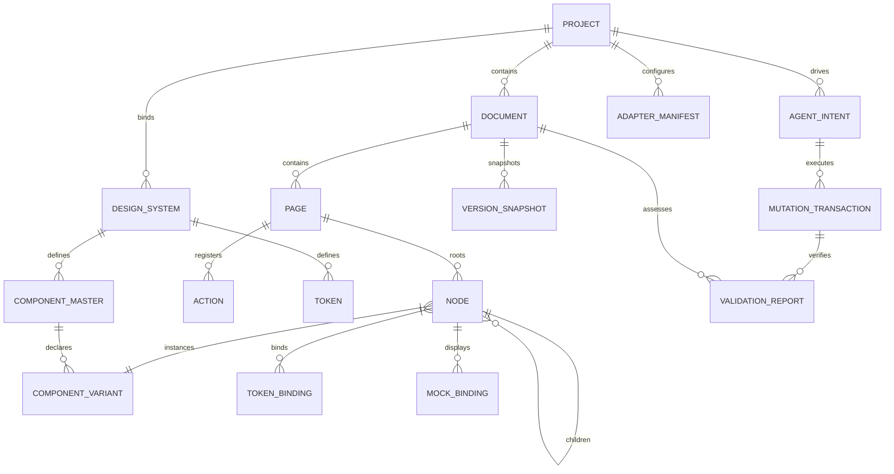
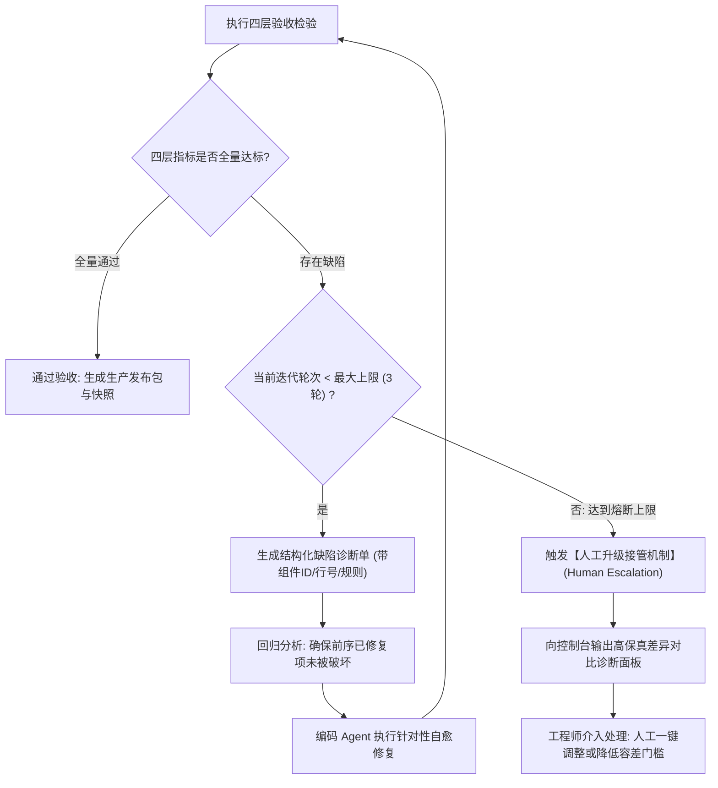
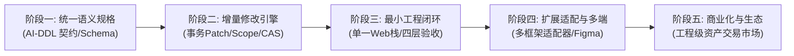

# iA-UI 产品设计书 (v0.0.4 · 融合版)

> **文档定位**:产品设计书(融合版),面向产品、设计、研发、Agent 生态与协作方,说明"产品是什么、为谁而做、解决什么问题、提供哪些能力、如何工作、交付什么、如何验收"。
>
> **融合来源**:
> - `design.opencode.v0.0.4.md` —— 提供**产品定位与结构骨架**(设计域聚焦、外部 Agent 协作、双通道交付、借鉴标注、附录 A 工程契约);
> - `design.gemini.v0.0.4.md` —— 提供**工程化规格细节**(FEAT 编号体系、四层验收、事务级增量修改流水线、分层目标适配器、UI Spec JSON Schema、领域模型 ER、性能预算、自愈熔断)。
>
> **版本演进(v0.0.4 融合版)**:在双方 v0.0.4 基础之上完成一次合并、对齐与补强:
> 1. **统一为一套产品设计书结构**:以 opencode 版的"产品定位 → 角色场景 → 功能 → 交付 → 安全 → 验收 → 路线"为主干,吸收 gemini 版的量化规格(FEAT 编号、四层验收、性能预算、领域模型);
> 2. **总交互图**:§3 以**一张交互图**覆盖全部功能模块及其流向、依赖与闭环(详见 §3.1),后续章节为总图的逐项展开;
> 3. **补全不足**:见下方《补全清单》,对双方均覆盖不足的部分进行了补齐。
>
> **借鉴标注**:凡借鉴现有产品的功能,正文以 **(借鉴:xx)** 标注,汇总见 §12。
> **阅读指引**:主文 1–11 章为产品设计正文;工程契约细节(数据模型、修改规则、接口契约、适配器)见附录 A,供实施参考。

---

## 融合与补全说明

### 融合策略

| 维度 | 主要采纳来源 | 说明 |
|------|--------------|------|
| 产品定位 / 边界 / 双通道交付 | opencode v0.0.4 | 作为整体骨架与立场 |
| 角色分工 / 外部 Agent 契约 | 双方 | 合并为统一的人机分工契约 |
| 功能规格(FEAT 编号、业务规则、异常流) | gemini v0.0.4 | 吸收量化规则与边界异常 |
| 设计语言四层模型 / 语义 ID | 双方(opencode 更完整) | 合并并补强 |
| UI Spec 数据契约 / 字段约束 | gemini v0.0.4 | 纳入附录 A.1 |
| 事务修改流水线 / 冲突治理 | 双方(gemini 更工程化) | 合并为附录 A.3 |
| 分层适配器矩阵 | gemini v0.0.4 | 纳入附录 A.4 |
| MCP 工具契约 | 双方 | 合并为附录 A.6 |
| 四层验收 / 自愈熔断 / DoD | gemini v0.0.4 | 纳入 §10 |
| 借鉴来源标注 | opencode v0.0.4 | 保留并补充 |
| 实施路线 | 双方 | 合并为五阶段 |

### 补全清单(本版新增 / 补强)

针对双方 v0.0.4 的共性薄弱点与评审结论,本版补全如下(正文中以 **(补全)** 标注):

1. **需求追踪全链路**:从"每一条需求"到"页面 / 组件 / 交互 / 验证规则 / 测试用例 / 交付结果"的端到端可追踪模型(§4.2、附录 A.9)。
2. **可访问性内建**:无障碍不是交付后检查项,而是设计令牌、画布校验与四层验收中的内建项(WCAG 2.1 AA、焦点顺序、阅读器语义、对比度守卫)(§4.4、§9.4、§10.1)。
3. **多语言与本地化**:设计内容支持 i18n(文案资源、日期数字格式、RTL 镜像),多语言溢出测试作为 Mock 内建场景(§4.8、§9.5)。
4. **度量与洞察**:内置产品度量(资产复用率、Agent 调用成功率、一次通过率、人工返工率),驱动产品与资产持续优化(§4.14、§10.3)。
5. **新手引导与模板起步**:新用户不必须走重型推演,提供模板起步、示例工程与渐进式引导(§4.1、§5.2)。
6. **成本与 Token 治理**:上下文投影预算、Agent 调用配额、费用预估与降级策略(§4.3、§9.3)。
7. **组件库更换迁移路径**:项目中途更换组件库 / 设计系统时的资产迁移、兼容映射与差异报告(§4.6、§4.10)。
8. **导入导出格式清单与双向往返**:明确支持格式、保真分级与 L3 双向往返保证(§4.10、附录 A.8)。
9. **统一异常流与降级策略**:将分散的"超时 / 失败 / 熔断 / 降级"整理为统一异常处理模型(§9.3)。
10. **全局导航与检索效率**:全局搜索、最近使用、收藏与跨画板定位(§4.4、§5.1)。

---

## 1. 产品概述与战略定位

### 1.1 背景与问题

在产品想法与产品落地之间,存在一条难以跨越的鸿沟:

- 设计师 / 产品经理脑海中的产品,很难被高效地转化成**具体、完整、无歧义的设计**;
- 即便画出了设计稿,研发团队与 vibecoding 工具仍要**猜测布局规律、组件关系与交互逻辑**,还原度低、返工多;
- 传统设计工具(Figma / Penpot)以"平面像素与矢量图元"为中心,缺乏对组件状态机、流式盒模型约束、动态令牌与业务逻辑的结构化表达;
- 纯代码生成工具(v0 / Lovable / Bolt)跳过系统化设计编排,设计系统缺乏长效治理沉淀,设计师无法进行像素级与语义级的直观干预;
- 设计成果缺少人类可直观阅读的完备形态(文字说明、图片、真实交互演示视频),评审与沟通成本高;
- 传统设计工具以"人手画图"为中心,AI 只能外挂式辅助,无法成为真正驱动设计的引擎。

### 1.2 产品定位与设计哲学

> **一个专注设计域的 AI 原生可视化 UI 设计平台,介于"自然语言产品意图"与"前后端工程实现"之间。**产品提供面向 AI 消费的语义设计语言、设计工作台与确定性执行能力,通过 MCP 让**外部 Agent** 调用设计能力,把设计师 / 产品经理脑中的产品转化为可指导 vibecoding 开发、可供人可视化阅读的具体产品设计。

```
 [ 设计师 / 产品经理脑中的产品 ]
              │  (意图输入:自然语言 / 草图 / 截图 / PRD / 既有设计)
              ▼
 ┌────────────────────────────────────────────┐
 │ 外部 Agent(Cursor / Claude Code 等)         │
 │ 推理与决策,通过 MCP 调用产品设计能力        │
 └───────────────────┬────────────────────────┘
                     ▼
 ┌────────────────────────────────────────────┐
 │   iA-UI 设计引擎(确定性执行,只专注设计域)   │
 │  语义模型 · 规格 · 画布 · 修改治理 · 验证    │
 └────────────────────────────────────────────┘
              │
              ├──▶ [ 面向 vibecoding ] 机器可读 UI 规格(布局/颜色/字体/动效/跳转逻辑)
              └──▶ [ 面向人类 ] 设计说明(文字)+ 标注图(图片)+ 演示视频(视频)
```

**四大设计哲学**:

1. **AI 是核心生产引擎,人类是领航者与艺术总监 (AI as Engine, Human as Director)**:Agent 负责架构推演、全状态装配、流式排版与跨端衍生;人类负责定义意图、把控风格基调、裁决方案分支与局部高精干预。
2. **直接操控即意图反馈 (Direct Manipulation as Feedback)**:人类在画布上的可视化拖拽与修正,不再是传统的绝对像素位移,而是向系统注入高阶约束与意图补丁,驱动系统动态自愈。
3. **单一事实来源与确定性契约 (Single Source of Truth & Deterministic Contracts)**:整个系统围绕严密、可机器验证的语义 UI Spec 运转,拒绝无二义性的中间状态。
4. **务实工程闭环与可量化验收 (Measurable Engineering Closed-Loop)**:不追求虚幻的"100% 无条件保真",而是建立覆盖规格、视觉、逻辑与工程的四层可测量验收基准,确保产出物真实可落地。

**设计思想一句话**:AI 是驱动设计流程的核心引擎;Agent 是外部协作方(通过 MCP 连接);产品只专注设计域,把设计能力做成可被 Agent 调用的确定性执行引擎。

### 1.3 核心价值

1. **将想法转化为设计**:从自然语言、草图、截图、PRD 出发,分钟级推演并装配完整多端、多状态工程级界面。
2. **设计适合 AI / Agent 消费**:设计语言与 UI 规格为 AI 消费而重构,编码 Agent 可 100% 理解、直接生成代码。
3. **人类可可视化阅读**:同时产出文字说明、图片与带点击动效(Click Wave)的演示视频。
4. **设计师可控**:人类通过工作台直接编辑,或通过外部 Agent 间接操作;作用域保护与修改治理确保局部修改不越界、不破坏整体。
5. **全生命周期可控治理**:通过 Scope Guard 作用域锁定、事务级增量修改流水线与 CAS 乐观锁,确保局部修改不越界、不破坏全局布局。
6. **开放生态与确定性闭环**:通过标准 MCP 协议供外部 Agent 调度,配合自动化受控渲染与四层验收体系,实现"设计 → 生成 → 验证 → 自愈"工程闭环。

### 1.4 产品边界(非目标 Non-Goals)

**平台只专注设计域**:语义设计语言、设计工作台、确定性执行引擎、UI 规格、设计验证、交付物。

**不做的事**:

- **不内置 Agent 能力**:不内置 Agent 集群、编排运行时、LLM 推理;智能一律来自外部连接(§2.2)。
- **不做真实前后端联动的应用运行**:交互原型是类 PPT 的演示交互(§4.8)。
- **不做代码生成 / 托管**:代码由 vibecoding 工具基于规格生成,平台提供规格与验证闭环。
- **不做完整低代码平台 / 全功能 Web IDE**:聚焦设计表达与交付,而非应用搭建。
- **不替代下游工程开发脚手架**:平台生成标准机器可读规格与参考工程代码包,最终代码由团队工程仓库与 vibecoding 流程承接。
- **设计市场后置**:作为生态能力,在核心工作流验证后建设(§11)。

---

## 2. 目标用户、角色与使用场景

### 2.1 人类角色

| 角色 | 目标 | 在平台中的行为 | 主要触点与权限 |
|------|------|----------------|----------------|
| 设计负责人 / 资深 UI | 艺术决策、全局规范裁决、复杂精修、维护企业级设计系统 | 定义意图与品牌基调、走查裁决、局部干预、审定组件库、版本冻结发布 | 架构控制台、方案澄清卡、精修画布、主组件审核 |
| 设计师 / 设计团队 | 高效产出高质量设计并交付研发 | 工作台编辑、直接操控、组件设计、导出;或通过外部 Agent 间接操作 | 语义画布、属性面板、组件 / 令牌工作台 |
| 产品经理 | 把需求讲清楚,产出可评审设计 | 输入想法、推敲 PRD、走查流程分支、播放演示视频、验证业务闭环 | 宏观深思工作台、PRD-UI 双向绑定器、演示播放 |
| 研发团队 / vibecoding 工具 | 拿到可直接开发的规格并验证 | 通过 MCP 读取 UI 规格、生成代码、运行验证、提交诊断回执 | MCP 接口、只读规格树、四层验收诊断单 |
| 平台管理员 | 团队席位、Agent 网关配额、计费、安全合规 | 组织 / 成员管理、外部 Agent 凭证、授权撤销、审计 | 全局管理后台、系统审计日志 |
| 评审者 | 只读查看、评论、审批 | 浏览设计、留言、审批版本 | 只读视图、评论流 |
| 市场发布者 / 购买者 | 上架 / 购买使用(后置) | 打包工程级资产、交易授权 | 市场(后置) |

### 2.2 外部 Agent(智能协作方)与人机分工契约

Agent 是**产品外部的智能协作方**,通过标准 MCP 协议连接(借鉴:MCP / OpenPencil MCP Server):

- **类型**:Cursor、Claude Code、Windsurf 等编码 Agent,或任意 MCP 兼容的通用 Agent。
- **职责**:推理与决策 —— 理解用户意图、规划任务、选择设计方案、依据诊断决定修复。
- **接入与边界**:通过 MCP 调用产品暴露的设计能力;以受限身份运行,只操作被授权的项目 / 页面 / 节点,行为全量审计,授权可撤销。

**产品与 Agent 的分工**:

| 职责 | 承担方 | 具体职能说明 |
|------|--------|--------------|
| 推理与决策(理解意图、规划、选方案、决定修复) | 外部 Agent | 理解模糊自然语言、规划设计步骤、推演方案 A/B/C 分支、依据诊断单决定修复策略 |
| 确定性执行(校验规格、渲染画布、执行受限修改、检测冲突、记录版本、输出验证) | 产品(iA-UI) | 规范合法性静态校验、盒模型约束求解、CAS 事务提交、并发冲突裁决、画布渲染、快照记录 |

> 若产品不定义好这些确定性执行能力,外部 Agent 将承担过多隐性逻辑,产品会退化为"依赖特定 Agent 才能工作的工具",而非通用的设计引擎。

### 2.3 典型使用场景

**场景 A:从 0 到 1 极速业务孵化**

产品经理 / 设计师在外部 Agent 中描述产品愿景与品牌基调(如"为跨境电商构建实时风控中台")→ Agent 通过 MCP 调用产品能力推演需求并生成结构化 PRD 与页面拓扑路由图 → 人工走查冻结业务逻辑 → Agent 并发合成桌面端看板、交互抽屉与移动端画板(全状态 Mock 绑定)→ 一键交付紧凑 UI Spec 与带 Click Wave 演示视频。

**场景 B:存量设计导入与标准化重构**

团队上传既有 `.fig` 设计文件或历史产品截图 → 系统逆向分析图元坐标,出具《导入保真度损失报告》→ 散乱图层重构为标准流式盒模型并对齐 DTCG / Tailwind 令牌 → 设计师确认降级项 → 进入工作台无损维护;在 iA-UI 修改后支持双向往返导出。

**场景 C:人机双向精细调优与作用域保护**

设计师框选复杂表格局部区域,开启 Scope Guard(作用域硬锁定)→ 设计师提出自然语言调整意图("增加批量导出功能,并优化操作列响应式展示")→ Agent 仅针对选区生成 Patch 补丁,背景画板绝对隔离 → 设计师同时直接拖拽微调列宽,系统逆向提炼约束参数并可一键广播全局衍生画板。

**场景 D:工程闭环验证与自动修复**

前端开发或 CI 调用 MCP 接口拉取 UI Spec 生成前端工程代码 → 受控渲染容器执行四层基准检验,发现移动端断点下 14px 文字溢出 → 系统生成结构化诊断单(带组件 ID / 行号 / 规则)→ 编码 Agent 依据定位精准修复 → 复测通过后打上发布快照 → 全程审计可回溯。

---

## 3. 产品功能架构全景与总交互图

### 3.1 总交互图(一张图展示全部功能)

> **本图是产品的功能全景交互总图**:自上而下为一次完整设计任务的"准备 → 输入 → 生成 → 编辑 → 治理 → 验证 → 交付"主流程;两侧与底部为被主流程消费的支撑能力域。**图中每个区域都对应 §4 中的 FEAT 编号(见 §3.2 映射表),全部功能均收敛于这一张图。**
>
> **贯穿全图的中枢是 §3.4 的"UI 操作语言 (UIOL)"**:Agent 与 Web 画笔产出**指令流**,画布与交付物消费**同一份文档树**——四个端点只通过这一套语言交互,这是"单一事实来源"的物理载体。

```
╔════════════════════════════════════════════════════════════════════════════════════════════════════════════╗
║                                iA-UI 全功能交互总图 · 一张图览尽所有能力                                    ║
╠════════════════════════════════════════════════════════════════════════════════════════════════════════════╣
║ ① 准备与入口层 (FEAT-001)                                                                                  ║
║   项目管理与配置:品牌基调 · 目标终端(桌面1440/平板768/移动390) · 代码偏好(React·Vue3·RN) · 外部Agent MCP  ║
║   连接与授权(凭证/作用域/有效期/撤销) · 模板起步与示例工程                                                 ║
║   任务规模三路径: [A] 极速单页 Quick ──┐  [B] 存量导入 Import ──┐  [C] 宏观推演 Deep ──┐                   ║
╠════════════════════════════════════════╪════════════════════════╪════════════════════════╪══════════════════╣
║ ② 意图与需求层 (FEAT-002)                 ▼                       ▼                       ▼                  ║
║   多模态输入:自然语言 / PRD 文本 / 草图·截图 / 既有设计(.fig)                                               ║
║   ──▶ 结构化 PRD 推演(目标·场景·功能·页面清单·交互·约束·验收) ──▶ 人工冻结业务逻辑                         ║
║   ──▶ PRD ⇄ 画板双向绑定(业务变更预警"是否更新UI?")                                                       ║
║   ──▶ 需求追踪链:需求 → 页面 → 组件 → 交互 → 验证规则 → 测试用例 → 交付结果(可双向定位)                    ║
╠════════════════════════════════════════════════════════════════════════════════════════════════════════════╣
║ ③ 生成与装配层 (FEAT-003 · 外部 Agent 经 MCP 调用 · 引擎确定性执行)                                       ║
║   动态上下文投影(目标子树+只读约束+生效令牌+可复用组件索引) · 真实组件优先复用 · 生成结构检查                ║
║   令牌绑定 → 盒模型装配(hug/fill/fixed) → 跨端衍生 → 原型挂载 → 全状态 Mock(Normal/Empty/Error/Overflow)   ║
║   表单校验契约(required/pattern/min/max) · OpenAPI 异步状态映射(Loading/200/500) · RBAC 权限守卫            ║
╠════════════════════════════════════════════════════════════════════════════════════════════════════════════╣
║ ④ 画布与人机协同层 (FEAT-004 / 005 / 007)                                                                  ║
║   活体语义画布:功能流视图 ⇄ 平面视图 双视图同构 · 实时盒模型计算                                          ║
║   直接操控逆向提炼(标尺吸附 Token / 全局广播向导) · 方案澄清卡片(2~3 选 1) · 确定性参数直达                 ║
║   受控自由画布原语(图表/大屏/复杂重叠:相对坐标+zIndex+溢出裁剪)                                            ║
║   Scope Guard 作用域锁定 ──▶ 影响范围三层划分(直接/传播/全局) ──▶ CAS 乐观锁 ──▶ 人工优先裁决 ──▶ 原子提交  ║
╠════════════════════════════════════════════════════════════════════════════════════════════════════════════╣
║ ⑤ 治理层 (FEAT-011 / 013)                                                                                  ║
║   版本快照(不可变) · 全要素 Diff(分屏/洋葱皮) · 决策时光机(回滚/分支) · 生命周期(草稿→评审→批准→发布→废弃)  ║
║   团队设计系统统一治理 · 并发冲突治理(字段级合并/显式裁决) · 全量审计追踪                                   ║
╠════════════════════════════════════════════════════════════════════════════════════════════════════════════╣
║ ⑥ 验证层 (四层验收 + 自愈闭环)                                                                              ║
║   L1 规格合法性 → L2 视觉与布局(含 WCAG 对比度) → L3 交互与业务 → L4 工程可交付                             ║
║   结构化诊断单(组件ID/行号/规则) ──▶ 编码 Agent 自愈(≤3 轮·携带回归测试) ──▶ 未达标 ──▶ 人工升级接管        ║
╠════════════════════════════════════════════════════════════════════════════════════════════════════════════╣
║ ⑦ 交付层 (双通道 · 同一份快照派生 · 单一事实来源)                                                           ║
║   ──机器── UI Spec(JSON Schema) + DTCG 令牌 + 动作路由 + Mock 契约 ──▶ MCP / CLI / 文件 ──▶ vibecoding     ║
║   ──人类── 设计说明(文字) + 标注图(图片) + Click Wave 演示视频(视频) ──▶ 评审 · 决策 · 归档                 ║
╠════════════════════════════════════════════════════════════════════════════════════════════════════════════╣
║ ⑧ 支撑与生态域(横切贯穿 ①–⑦)                                                                               ║
║   设计系统域: DTCG 令牌(主题切换) · 组件注册表与适配器契约 · 设计资产(字体/图标/图片·授权)                  ║
║   配置域:    交互动作原语(Navigate/Modal/Toggle/Submit) · 全状态 Mock 数据 · 多终端并排与一键跨端衍生       ║
║   治理域:    安全与权限 RBAC · Agent 凭证/授权撤销 · 性能预算 · 渲染确定性 · 度量洞察 · 设计市场(后置·工程级资产包) ║
╚════════════════════════════════════════════════════════════════════════════════════════════════════════════╝
```

### 3.2 图上区域 ↔ 功能编号映射

| 图上区域 | 覆盖功能 | 说明 |
|----------|----------|------|
| ① 准备与入口层 | FEAT-001 项目管理与 Agent 配置;三条工作流入口 | 项目 / 品牌 / 终端 / 代码偏好 / Agent 授权 |
| ② 意图与需求层 | FEAT-002 需求输入、PRD 推演、双向绑定与需求追踪 | 多模态输入 → 冻结业务逻辑 → 追踪链 |
| ③ 生成与装配层 | FEAT-003 AI 生成与装配;消费 FEAT-006/008/009 的资产与配置 | Agent 调用 + 引擎确定性执行 |
| ④ 画布与人机协同层 | FEAT-004 语义画布;FEAT-005 作用域与并发治理;FEAT-007 受控画布 | 人类直接操控 + Scope Guard 事务提交 |
| ⑤ 治理层 | FEAT-011 版本 / Diff / 时光机;FEAT-013 团队协作与生命周期 | 历史、审批、审计 |
| ⑥ 验证层 | 四层验收框架 + 自愈熔断(§10) | L1–L4 门禁 + 诊断自愈 + 人工接管 |
| ⑦ 交付层 | 双通道交付(§6) | UI Spec + 文字 / 图片 / 视频 |
| ⑧ 支撑与生态域 | FEAT-006/007/008/009/012 资产侧;安全权限;性能;度量;市场(后置) | 横切能力,供 ①–⑦ 消费 |

### 3.3 三条工作流入口与准入准出准则

为避免"单页微调也要启动重型推演流程"的高昂成本,系统设立三条明确的工作流入口:

| 路径 | 准入准则 | 执行策略 | 准出准则 |
|------|----------|----------|----------|
| **A. 极速单页生成 (Quick Path)** | 无需完整 PRD,输入具体页面场景(如"生成暗黑模式 API 密钥管理页") | 跳过宏观业务拓扑推演,UI Synthesis 直接在当前画布生成独立单画板 | L1 规格校验通过,盒模型合规率 100% |
| **B. 存量资产导入重构 (Import Path)** | 上传 `.fig` 文件或产品高清截图 | 执行绝对坐标逆向盒模型推导,出具《保真度损失报告》,原始未解析图元安全留存 | 用户审阅并确认转换损失与降级提示 |
| **C. 从 0 到 1 宏观架构推演 (Deep Reasoning Path)** | 大型复杂系统从零孵化 | 引导推敲业务实体、功能清单与状态路由,生成结构化 PRD,经评审冻结后批量并发装配 | 通过四层综合验收基准,生成不可变命名版本快照 |

> 三条路径最终合流至同一个活体语义画布与人机精修环节,共享同一套数据、治理与交付体系。

### 3.4 核心设计:UI 操作语言 (UIOL)—— 产品的中枢(补全)

> 用户洞察:整个产品最核心的是一套 **UI 操作语言 (UI Operation Language, 简称 UIOL)**——它既被用来**构建** UI / 元素,又被用来**展示** UI / 元素;Agent 依据自然语言生成构建指令,Web 画布依据语言渲染展示,Web 画笔(鼠标)依据手势生成构建指令。本节点明这一中枢的设计。

#### 3.4.1 设计立场:一套语言,四个端点

UIOL 同时扮演四种角色,四个端点**只通过这一套语言交互**:

| 端点 | 角色 | 语言形态 |
|---|---|---|
| 外部 Agent | 把自然语言"编译"为构建 / 修改 UI 的指令 | 指令流 (Command Stream) |
| Web 画笔(鼠标直接操控) | 把手势"编译"为构建 / 修改 UI 的指令 | 指令流 (Command Stream) |
| Web 画布 | 把语言"渲染"为可视 UI 与元素 | 文档树投影 (Document Projection) |
| 消费方(vibecoding / 人 / 验证) | 读取、导出、校验、回放 | 文档树序列化 (UI Spec) |

设计原则:**Agent 不直接触碰画布内部状态,画笔不产生绝对像素而是语义指令,画布只消费文档树,导出只序列化文档树。** 语言因此成为"单一事实来源"的物理载体。类比:如同 PostScript 之于打印机、SQL 之于数据库、Git 之于版本——"指令与状态由同一语言描述"。

#### 3.4.2 语言的二象性:指令流 ⇄ 文档树

```
   ┌────────────┐    ┌──────────────────────────┐    ┌────────────┐
   │ Agent      │──▶│                          │◀──│ Web 画笔   │
   │ (自然语言)  │    │    UIOL 指令流 (Ops)     │    │ (鼠标手势)  │
   └────────────┘    └──────────┬───────────────┘    └────────────┘
        NL → 指令                │ 事务引擎(校验/合并/审计)   手势 → 指令
                                 ▼
                      ┌──────────────────────┐
                      │  文档树 Document Tree │ ◀── 单一事实来源 (SSoT)
                      │  (可渲染 / 可序列化)  │
                      └──┬───────────────┬───┘
                         │               │
               [渲染器]   ▼               ▼   [序列化器]
              Web 画布画面        UI Spec / 参考代码 / 演示视频 / 验证
```

- **指令流 (Command Stream)**:有**时间顺序**的变更操作(`create_node` / `update_node` / `delete_node` / `move` / `bind_token` / `unbind` / `apply_style` / `add_action` / `set_mock` …)。它是 Agent 与画笔的**产出**,也是可审计、可回滚、可并发合并(CAS 补丁)的**输入**。
- **文档树 (Document Tree)**:指令流执行后的**最终状态**。它是可渲染的**状态**,是画布、导出、验证、交付共用的唯一事实来源。

两者关系:**指令流是"变更"(时间),文档树是"状态"(空间);同一语义、两种观察角度。** 语言不分裂:指令与文档共享同一套节点 / 盒模型 / 令牌 / 动作语义,只是"动词 + 宾语"与"名词结构"的差异。指令流经事务引擎(§4.5、附录 A.3)原子应用到文档树。

#### 3.4.3 一个语言族,三种语法(同一语义无损互译)

| 形态 | 使用者 | 说明 | 示例 |
|---|---|---|---|
| 文档形态 Document Form (JSON) | 存储 / 校验 / 导出 / 消费 | UI Spec 声明式文档树,强类型 JSON Schema(附录 A.1) | `{"type":"container","layout":{...}}` |
| 指令形态 Command Form | Agent / 画笔 / MCP 工具 | 动词化操作,工具入参 Schema(附录 A.6) | `create_node(page,{type,layout})` |
| 文本形态 DSL Text Form | 人工审阅 / Diff / 版本 | 类结构化文本的中间表达,可读可 diff | `container[row gap-4] > text[truncate]` |

三形态由**无损互译器 (Bijective Translator)** 保证同一语义在三种语法间往返一致——这是"确定性契约"的落地(附录 A.1、A.2)。

#### 3.4.4 原语集:四层模型的语言化

语言原语对应 §7.2 四层模型,全部"语义化、可校验":

| 层 | 语言原语 | 典型指令示例 | 校验规则 |
|---|---|---|---|
| 意图与逻辑层 | Entity / Route / State / Action / Mock | `bind_entity order.status`、`add_action click→navigate` | 路由无悬空引用 |
| 规范与约束层 | Token / ComponentContract / Breakpoint | `bind_token color.primary` | 禁止裸色值 |
| 结构与流式层 | Box(direction/padding/gap/align/sizing) | `set_sizing fill`、`set_gap 16→snap token` | `hug`/`fill`/`fixed` 显式声明 |
| 表现与图元层 | Text / Image / Vector / Container / ControlledCanvas | `set_text_overflow truncate` | 文本必声明截断策略 |

#### 3.4.5 三个编译器(闭环的翻译器)

- **[A] 自然语言编译器 (NL → 指令)**:外部 Agent 通过 MCP 写工具,把自然语言翻译为**受控指令序列**。产品不推理,只提供三样东西:工具 Schema(合法指令空间)、动态上下文投影(翻译所需的局部上下文,§4.3)、L1 结构校验(翻译结果的门禁)。Agent 的"自由"被约束在合法指令空间内,越界指令在事务引擎被拦截(§4.5)。
- **[B] 文档渲染器 (文档 → 画面)**:画布把文档树解析为流式盒模型并渲染(§4.4);同一文档树还可投影为导出 Spec、参考代码、演示视频(§6)——**展示只是文档树的不同投影**。
- **[C] 手势编译器 (手势 → 指令)**:Web 画笔把鼠标拖拽等操作**逆向提炼为语义指令**(§4.4 直接操控逆向提炼):拖拽间距→`set_gap(16)`→吸附 Token `gap-4`;拖拽尺寸→`set_sizing(fixed)`;删除组件→`delete_node`;并支持将一次手势广播为全局规则。**画笔因此不是"画像素",而是"发指令"**——人的操作天然成为机器可理解、可复用的指令。

#### 3.4.6 为什么这套语言解决了"AI 改一处、乱整体"

- **指令受控**:Agent / 画笔只能发合法指令,Scope Guard 在**指令层**拦截越界写(§4.5);
- **状态单一**:文档树是唯一状态,不存在"画布状态"与"数据状态"分叉;
- **变更可回放**:指令流可审计、可回滚、可 diff,决策时光机(§4.11)由此成立;
- **消费一致**:画布、Spec、参考代码、视频都由同一文档树派生,还原度由契约保证而非靠猜。

#### 3.4.7 语言的进化与扩展

- 语义化版本(Spec Version)与迁移路径、向前兼容(附录 A.1、A.8);
- 受控扩展点:自定义组件 / 自定义动作 / 自定义 Mock 通过适配器与插件契约接入,不破坏核心校验(附录 A.4、A.5)。

---

## 4. 详细功能规格与业务规则

> 功能按"准备 → 输入 → 生成 → 编辑 → 沉淀 → 配置 → 治理 → 验证 → 交付"旅程编号为 `FEAT-001 ~ FEAT-014`。每一项说明"是什么、如何工作、业务规则、界面反馈、边界与异常"。

### 4.1 项目管理与外部 Agent 配置 (`FEAT-001`)

- **功能概述**:创建、维护设计项目工程环境,配置品牌风格、目标终端、下游框架偏好及外部 Agent 的 MCP 安全接入。
- **触发前置条件**:具备组织 `ROLE_ADMIN` 或 `ROLE_DESIGN_LEAD` 权限。
- **输入要素与配置项**:

  | 配置项 | 类型 | 必填 | 取值范围与说明 | 默认值 |
  | :--- | :--- | :---: | :--- | :--- |
  | `projectName` | 文本 | 是 | 1–50 字符,支持中英文、连字符 | 必填 |
  | `brandVibe` | 枚举/文本 | 是 | `Enterprise Clean` / `Modern Vibrant` / `Fintech Precise` / 自定义提示词 | `Enterprise Clean` |
  | `targetPlatforms` | 多选 | 是 | `desktop`(1440px)、`tablet`(768px)、`mobile`(390px) | `["desktop", "mobile"]` |
  | `targetCodeStack` | 枚举 | 是 | `react_tailwind_shadcn`、`vue3_tailwind`、`react_native` | `react_tailwind_shadcn` |
  | `agentMcpKey` | 密钥字符串 | 是 | 自动生成的 UUIDv4 令牌,支持设定有效期与操作白名单 | 自动生成 |
  | 设计系统基石 | 枚举 | 是 | 预置 Tailwind CSS / shadcn/ui / Ant Design / Material UI,可绑定团队私有系统 | 按代码偏好联动 |

- **业务规则矩阵**:
  1. **代码偏好联动**:选择目标技术栈后,系统底层自动挂载对应的组件库适配器清单(附录 A.4);
  2. **Agent 最小权限原则**:外部 Agent 凭证必须指定授权项目及可写范围(默认仅授予当前选中 Session 的临时写入权);
  3. **凭证即时失效**:管理员在后台点击"吊销凭证"后,外部 MCP 调用必须在 500ms 内被网关硬拦截;
  4. **(补全)模板起步**:新项目可基于模板库 / 示例工程初始化,新用户无需从空白画布开始。

- **界面反馈与输出**:项目概览面板展示项目基本信息、已绑定设计系统、已连接 Agent 状态指示灯(在线 / 离线 / 调试中)。
- **边界与异常场景**:项目名称重复时自动追加数字后缀;网络断开时 MCP 服务端返回 `503 Service Unavailable` 明确错误码。

### 4.2 需求输入、PRD 推演与需求追踪 (`FEAT-002`)

- **功能概述**:支持多模态输入,驱动外部 Agent 生成高结构化 PRD,实现 PRD 实体与画布 UI 节点的双向可追踪绑定,并建立从需求到交付结果的完整追踪链。
- **触发前置条件**:项目已初始化,用户拥有编辑权限。
- **输入要素与格式**:自然语言文本、Markdown 格式 PRD 文档、PNG/JPG 产品草图或竞品截图、既有设计文件。
- **业务规则矩阵**:
  1. **PRD 结构化模板约束**:Agent 推演产出的 PRD 必须包含:产品目标、用户画像、功能清单、页面拓扑图、实体状态机与验收标准;
  2. **双向锚定绑定契约**:
     - PRD 中声明的业务实体字段(如 `order.status`)自动与画布组件的 Data Binding 属性映射;
     - PRD 状态流转操作自动生成原型 Action 路由;
     - 验收指标自动转换为验证规则(进入 L3 验收);
  3. **变更冲突检测与反向提醒**:
     - 用户在 PRD 工作台修改某功能业务逻辑时,画布对应区域自动悬浮黄色预警胶囊:"业务逻辑已变更,关联组件处于待同步状态";
     - 用户在画布删除某个核心业务按钮时,系统提示:"该操作将导致 PRD 功能点 `FEAT-xxx` 缺少触发触点,是否继续?";
  4. **(补全)需求追踪链**:每条需求建立 `需求 → PRD 章节 → 页面 → 组件 → 交互动作 → 验证规则 → 测试用例 → 交付结果` 的追踪关系,支持正向追溯与反向定位(附录 A.9);
  5. **PRD 编辑方式**:人工编辑、按章节重新生成、多轮补充;长思考模式下 PRD 作为规划产物被反复推敲,定稿后再转化为整套设计。
- **界面反馈**:沉浸式 Markdown 分栏编辑器,左侧为 PRD 章节树,右侧为关联画板预览缩略图;需求追踪面板提供双向链路视图。
- **边界与异常场景**:导入包含恶意脚本的 Markdown 时进行 HTML 转义清洗;超大 PRD(超过 5 万字)自动进行章节分块投影。

### 4.3 AI 原生设计生成与装配 (`FEAT-003`)

- **功能概述**:接收设计意图后,调度 UI Synthesis 能力,完成从 Token 映射、流式盒模型装配、响应式排版到交互原型挂载的全链路生成。
- **触发前置条件**:PRD 已确认,或用户直接发起 Quick Path 快捷生成命令。
- **输入要素**:任务意图 Prompt、选定风格基调、目标页面类型(Dashboard / List / Detail / Form / Settings)、参考附件。
- **业务规则矩阵**:
  1. **真实组件库优先铁律**:Agent 生成时强制检索复用当前项目注册的真实组件(如 shadcn/ui 的 Button、Input);严禁无约束生成"画得像但无法落地的野图元";缺失时才基于流式容器拼装并标记"待沉淀新组件";
  2. **动态上下文投影 (Context Projection)**:系统仅向 Agent 注入当前画板子树、已生效 Token 字典与可复用组件元数据索引,严禁将全工程数万节点无差别喂入 Prompt 上下文;
  3. **静态规则拦截**:生成完毕后,引擎自动执行 L1 规格校验,存在断裂组件或未定义 Token 的补丁禁止上屏;
  4. **(补全)Token / 成本治理**:每次生成任务记录上下文投影 Token 消耗与预估费用,超预算时给出精简建议或降级策略(§9.3)。
- **界面反馈**:中央画布展现生成骨架动效,右侧命令控制台流式输出设计推理日志(如"正在装配顶部指标卡""正在绑定 DTCG 语义颜色")。
- **边界与异常场景**:生成超时(单画板超过 20 秒)自动中断并回滚影子状态,提示用户精简需求或重试。

### 4.4 活体语义画布与直接操控 (`FEAT-004`)

- **功能概述**:提供无歧义、实时处于流式盒模型计算状态的专业设计空间,将人类在画布上的可视化拖拽与微调逆向转换为高阶语义规则。
- **界面模式**:支持"业务功能流拓扑视图"与"无限平面视图"双视图无缝平滑切换(借鉴:Figma / Penpot 画布语言)。
- **业务规则矩阵**:
  1. **实时盒模型计算**:画布中所有流式容器(Flexbox)实时计算内边距 (Padding)、外边距 (Margin)、子项间距 (Gap) 与对齐方式,消除绝对像素堆叠;
  2. **直接操控逆向提炼**:
     - 拖动两个卡片之间的间距时,标尺即时显示当前像素数值,松手时自动吸附至最近的系统 Token(如 `gap-4` 即 16px);
     - 底部状态栏弹出提示胶囊:"已将间距调整为 16px,检测到该组件在 8 个画板中被复用,是否一键广播全局?";
  3. **硬约束参数直达**:在右侧属性面板输入的具体数值具有绝对优先级,立即生效,不交由后台 Agent 二次猜测;
  4. **(补全)可访问性内建**:选中节点时属性面板实时提示无障碍状态(对比度是否达标、焦点顺序、ARIA 语义缺省),画布以图标标记不达标项;
  5. **(补全)全局检索**:顶部全局搜索支持跨画板定位节点 / 组件 / 令牌 / 需求,支持最近使用与收藏。
- **界面反馈**:选中图层时实时呈现弹性外边距虚线标尺,缩放视口时子节点按 `hug`/`fill`/`fixed` 物理规律平滑自适应拉伸。
- **边界与异常场景**:拖拽位置引发循环嵌套依赖时,画布出现红色碰撞提示并自动弹回原位。

### 4.5 作用域锁定与人机并发修改治理 (`FEAT-005`)

- **功能概述**:通过 Scope Guard 机制锁定编辑区域,利用 CAS 乐观锁防脏写,解决局部调整破坏全局及人机并发冲突痛点。
- **业务规则矩阵**:
  1. **作用域硬隔离 (Scope Guard)**:
     - 用户选中画板局部节点并发起修改时,系统自动对选区外所有节点施加只读锁(`lockStatus = scope_locked`);
     - 后台 Agent 提交的 Patch 若包含选区外节点的写操作,引擎直接抛出 `ScopeViolationException` 并阻断提交;
  2. **修改影响三层划分**:
     - **直接修改范围 (Direct Scope)**:选区内节点,直接覆写属性;
     - **依赖传播范围 (Propagation Scope)**:涉及主组件修改时,自动分析波及的下游实例,弹出清单供选择"全局同步 / 仅本次 / 拒绝并保留分叉";
     - **全局扩散边界 (Global Blast Radius)**:修改涉及全局主题 / Token 时,必须经过设计师二次显式确认;
  3. **并发冲突裁决 (Human Primacy Rule)**:
     - **人工操作绝对优先**:若人工手动微调与 Agent 异步 Patch 发生同一属性冲突,保留人工设置;
     - **非冲突属性无损合并**:人工修改几何尺寸,Agent 优化文案与图标,系统自动合并两项变更;
     - **版本号比对防覆盖**:提交 Patch 必须携带 `baseSnapshotVersion`,若版本滞后则强制触发三方合并;
  4. **事务语义**:每次 Agent 修改走完整流水线(声明范围 → 校验版本 / 权限 / 引用 → 影子沙箱试运行 → 规则校验 → 原子提交或整体回滚 → 决策审计记录)(附录 A.3)。
- **界面反馈**:选区外画板呈现轻度磨砂遮罩与半透明锁定锁孔图标,选区内高亮绿色光效。
- **边界与异常场景**:多人或多 Agent 同时提交时,后提交方收到差异合并面板,提示冲突详情。

### 4.6 设计系统、组件注册与令牌 (`FEAT-006`)

- **功能概述**:管理标准设计令牌 (W3C DTCG) 与组件注册表,支持开源库映射与私有组件逆向注册。
- **业务规则矩阵**:
  1. **设计令牌原子化**:全量颜色、字体、字号、圆角、间距、阴影统一以 Token 形式管理,支持多套主题轴(Light / Dark / High Contrast)一键切换;
  2. **工程组件库映射**:每个画布组件必须绑定具体的工程组件契约,包含组件名、Props 定义、状态变体 (Variants) 与插槽 (Slots);
  3. **代码组件逆向解析**:支持导入 Storybook `custom-elements.json` 或 TypeScript Interface 定义文件,自动在画布中注册为标准主组件;
  4. **裸数值严禁入库**:画布中严禁持久化硬编码裸 Hex 颜色(如 `#FFFFFF`),必须强制引用语义 Token(如 `color.background.card`);
  5. **(补全)组件库迁移**:支持项目中途更换组件库 / 设计系统,自动生成"迁移差异报告"(组件映射、令牌映射、不兼容项与降级建议),提供一键对齐与保留分叉两种策略;
  6. **映射维护**:设计样式组件 ↔ 用户工程组件 / 令牌的映射由产品记录、校验并维护;不匹配时给出降级与替代建议,而非静默生成"看起来像但不兼容"的结果。
- **界面反馈**:右侧面板提供 Token 调色盘与组件属性变体选择器(下拉切换 `size`, `variant`)。
- **边界与异常场景**:导入旧工程中包含无法识别的内联样式时,自动归类至"待清洗样式池",提供一键对齐建议。

### 4.7 受控自由画布与数据可视化原语 (`FEAT-007`)

- **功能概述**:为图表、地理大屏、复杂图形重叠等非标准流式排版场景提供受控相对坐标绘图原语。
- **业务规则矩阵**:
  1. **隔离边界保证**:`controlled_canvas` 节点自身对外表现为标准的流式弹性盒模型容器(遵守外部的 Padding、Margin 与尺寸拉伸);
  2. **内部受控自由定位**:其内部直接子节点允许使用相对坐标系 `(x, y, zIndex)` 进行精确定位与层级重叠;
  3. **溢出约束**:内部图元绝对坐标绝不允许超出外壁容器边界(强制执行 `overflow: hidden` 或受控裁剪)。
- **界面反馈**:进入受控画布内部时,网格标尺切换为相对像素坐标系,支持自由拖动锚点与图表控制点。
- **边界与异常场景**:内部子节点坐标超出外壁时,超出部分呈现半透明红色斑马纹告警。

### 4.8 交互原型与全状态 Mock 数据契约 (`FEAT-008`)

- **功能概述**:提供类 PPT 的高保真轻量交互原型连接,并为组件绑定多维度业务 Mock 数据(借鉴:Penpot / Figma 原型连接、MSW)。
- **业务规则矩阵**:
  1. **声明式交互原语**:
     - `Navigate`:页面跳转(Push, Replace, Back);
     - `OpenModal / CloseModal`:抽屉 / 弹窗的打开与关闭;
     - `ToggleState`:组件局部变体切换(如展开 / 收起);
     - `SwitchTab`:标签页 / 分段控制器切换;
     - `MockSubmit`:模拟表单提交过程;
  2. **触发器与转场**:点击 / 悬停 / 聚焦 / 定时;转场支持即时 / 渐隐 / 推入推出,可配时长与缓动;
  3. **全场景 Mock 覆盖标准**:任何列表或数据展示组件必须同时配置四种数据状态:
     - **Normal**:正常业务假数据;
     - **Empty**:零数据空状态(必须配备友好插画与操作引导);
     - **Error**:网络或业务报错态;
     - **Overflow**:超长字段溢出测试态(自动填充 3 倍长度的多语言字符);
  4. **生产级表单校验契约**:输入项支持配置 `required`、`pattern (Regex)`、`min/max` 与自定义校验规则;校验失败时联动高亮错误提示文本节点(`errorFeedbackNodeId`);
  5. **异步接口与权限映射**:提交按钮可关联 OpenAPI 路径,模拟触发 `Loading` 骨架遮罩、`200` 成功跳转与 `500` 错误 Toast;节点支持绑定 RBAC 权限表达式(如 `auth.role == 'admin'`),画布支持一键切换视角走查;
  6. **(补全)多语言 / 本地化**:Mock 数据集支持多语言文案资源、日期数字格式与 RTL 镜像切换,Overflow 测试自动注入多语言超长文本。
- **界面反馈**:画布顶部提供"Mock 场景切换器",可一键在"正常态 / 空数据态 / 错误态"之间无缝切换。
- **边界与异常场景**:未配置跳转目标的悬空路由在连线时呈现黄色虚线断裂告警。

### 4.9 多终端自适应与一键跨端衍生 (`FEAT-009`)

- **功能概述**:保持业务逻辑同构的前提下,实现桌面端、平板端与移动端的独立画板设计与一键智能衍生。
- **业务规则矩阵**:
  1. **逻辑同构、布局独立**:多端画板共享相同的业务实体路由与 Mock 数据源,但拥有完全独立的流式盒模型树;
  2. **一键跨端衍生规则**:
     - 基于桌面端画板,系统可一键衍生移动端画板(390px 视口);
     - 衍生过程强制适配移动端规范:触控热区强制扩张为 `>= 44x44pt`,水平导航重构为抽屉菜单,表格重构为卡片流;
  3. **差异标尺比对**:系统并排展示多端画板,并高亮标记尚未完成移动端适配的特殊组件;
  4. **(补全)平台语义差异**:覆盖鼠标 / 键盘 / 触控输入差异、安全区、软键盘、系统字体、返回手势、无障碍焦点顺序等平台差异;
  5. **(补全)极端最小屏守卫**:移动端宽度小于 320px 时强制给出极端最小屏警告。
- **界面反馈**:多画板并排排布,支持视口手柄实时推拉预览断点自适应效果。
- **边界与异常场景**:并排比较时自动生成"未适配清单",标记每个未完成适配项的可操作入口。

### 4.10 存量设计导入与保真度损失报告 (`FEAT-010`)

- **功能概述**:解析外部设计文件或界面截图,出具量化保真度损失报告,并实现安全的语义重构(借鉴:Figma / OpenPencil `.fig`)。
- **保真度等级与转换规则**:

  | 保真层级 | 达标定义 | 系统行为与转换保障 |
  | :--- | :--- | :--- |
  | **L1:读取提取** | 完整还原所有图层树、文本、颜色值与矢量锚点 | 100% 原始数据无损读取,存入私有原始备份 |
  | **L2:语义转换** | 绝对定位与 Group 转换为嵌套 Auto-Layout;散乱色值转换为 Token | 逆向盒模型算法计算弹性约束;色彩匹配度算法对齐 DTCG 字典 |
  | **L3:双向往返** | 在 iA-UI 修改后重新导出至目标生态,语义与引用不丢失 | 维持稳定图层 ID 与第三方插件元数据保留 |

- **转换损失报告规格**:
  - **转换统计**:成功识别并转换为 Auto-Layout 的容器占比(如 96%);
  - **Token 归一化率**:自动匹配至项目 Tailwind 变量的颜色比例;
  - **安全降级清单**:未知着色器特效或特殊字体的图层,安全降级为 SVG 矢量图元,并精准标注图层 ID;
- **(补全)导入容忍策略**:外部项目合法的字面量颜色先检测、归一化或报告,而非直接拒绝整个项目;
- **(补全)支持格式清单**:明确支持 `.fig`、SVG、PNG/JPG/WEBP 截图、Storybook `custom-elements.json`、TS Props 定义等;不支持的格式给出明确提示与转换建议。
- **界面反馈**:导入完成后自动弹出《转换损失报告》抽屉,用户可点击问题项直接在画布中定位。
- **边界与异常场景**:文件解析严重损坏时,提供"回退至原始绝对布局草稿"保底选项。

### 4.11 版本快照、全要素 Diff 与决策时光机 (`FEAT-011`)

- **功能概述**:提供不可变的设计历史版本存档,支持全要素可视增量对比与无损时光机回滚(借鉴:Git / 企业设计系统治理)。
- **业务规则矩阵**:
  1. **快照不可变性**:每次冻结生成的快照包含全量语义 UI Spec 与对应缩略图,禁止篡改;
  2. **全要素 Diff 算法**:基于稳定语义 ID 递归对比树结构差异,精准识别节点新增 / 删除、盒模型约束调整、Token 绑定替换、交互路由变更;
  3. **双重对比呈现**:支持"左右分屏对比 (Side-by-Side)"与"洋葱皮叠加高亮 (Onion Skin)";
  4. **决策时光机回滚**:支持一键回滚到任意历史快照,或以历史快照为基线创建新的设计分支;
  5. **生命周期**:草稿 → 评审 → 批准 → 发布 → 废弃;发布需冻结基线,删除与发布需二次确认。
- **界面反馈**:历史版本列表按时间轴清晰呈现提交人(人或外部 Agent)、修改意图、变更节点数与关联 PRD 节点。
- **边界与异常场景**:回滚操作本身生成一条新的回滚提交记录,确保历史审计轨迹绝对连贯。

### 4.12 设计资产与资源治理 (`FEAT-012`)

- **功能概述**:上传字体、图标、图片、SVG 等设计素材并治理授权与引用。
- **业务规则矩阵**:
  1. **资产类型**:字体(woff2 / ttf / otf,需版权声明)、图标(SVG 规范化 + 语义别名检索)、图片、SVG 等;
  2. **资产元数据**:名称、用途、授权、版本;支持分类、搜索、预览、重命名、删除;
  3. **AI 优先私有资产**:AI 生成时优先使用用户指定的私有资产;
  4. **引用与缺失检查**:支持资源引用、替换与缺失检查;格式与安全校验(防畸形文件、SVG 注入等);
  5. **引用生命周期**:资产被删除 / 重命名时,产品检测引用并给出处理策略(阻断、级联或改挂),不允许悬空引用进入交付物。
- **界面反馈**:资源面板提供拖拽上传、批量导入与授权状态标记。
- **边界与异常场景**:私有字体或网络图片断裂时,自动启用预置降级保底资源,并标黄提示一键全局替换。

### 4.13 团队协作、生命周期与发布治理 (`FEAT-013`)

- **功能概述**:多成员 / 多 Agent 并发协作下的团队级设计系统治理、审批流与发布控制。
- **业务规则矩阵**:
  1. **团队资产治理**:团队级设计系统统一管理,避免各项目分叉失序;
  2. **生命周期与审批**:草稿 → 评审 → 批准 → 发布 → 废弃;设计负责人审批主组件上架与版本发布,发布需冻结基线;
  3. **并发修改治理**:设计师与外部 Agent 并发编辑时,遵循"人工优先"、字段级合并与显式冲突裁决(附录 A.3);
  4. **全量审计**:记录操作者(人或 Agent)、时间、操作范围、结果,支持回溯;
  5. **(补全)变更广播与通知**:版本发布 / 规格更新后自动通知研发侧关联的消费方(通过 MCP 订阅或 webhook)。
- **界面反馈**:项目 / 设计系统工作台提供成员在线状态、待审批队列与发布流水线视图。
- **边界与异常场景**:删除与发布需二次确认;批量操作限界。

### 4.14 度量与洞察 (`FEAT-014`)(补全)

- **功能概述**:内建产品度量体系,量化设计资产复用、Agent 协作效率与交付质量,驱动产品与资产生态持续优化。
- **业务规则矩阵**:
  1. **资产度量**:组件 / 令牌 / 模板复用率、跨画板使用次数、待沉淀组件数量;
  2. **协作度量**:Agent 调用成功率、首轮采纳率、一次通过率、平均生成耗时、上下文 Token 消耗;
  3. **质量度量**:人工返工率、验证诊断 TOP 问题分布(溢出 / 裸色值 / 状态缺失等)、自愈修复成功率;
  4. **洞察输出**:控制台"度量面板"与周期性报告;度量数据脱敏后用于改进生成模型与组件库排序。
- **界面反馈**:度量面板支持按时间 / 项目 / 团队维度筛选,关键指标趋势图与异常项下钻。
- **边界与异常场景**:度量数据仅聚合展示,不暴露单个用户 / 单个 Agent 的敏感操作明细(审计明细仅管理员可见)。

---

## 5. 界面信息架构与交互体验规范

### 5.1 工作台信息架构(三支柱架构)

工作台摒弃传统的"设计画布外挂浮动聊天窗"模式,采用"意图 – 多维语义画布 – 约束控制"三大支柱架构:

```
┌──────────────────────────────────────────────────────────────────────────────────────────────────┐
│ [顶部全局领航栏] 项目名 | 品牌基调: Enterprise Clean | 视口: 1440px | 全局搜索 | Agent状态: IDLE | 一键导出交付物 │
├─────────────────┬──────────────────────────────────────────────────────────────┬─────────────────┤
│ [意图与架构中枢]  │ [动态语义多维画布 (Living Semantic Canvas)]                    │ [约束与生成控制台]│
│                 │                                                              │                 │
│ ├─ 意图编排树   │                    多端与多状态动态画板区                    │ ├─ 意图领航输入 │
│ │  (Intent Tree)│   ┌──────────────┐   ┌──────────────┐   ┌──────────────┐   │ │  (Command     │
│ │  • 认证模块   │   │  桌面端画板  │ ──▶│  交互抽屉    │ ──▶│  移动端画板  │   │ │   Director)   │
│ │  • 看板流向   │   │  (1440x900)  │   │  (Drawer)    │   │  (390x844)   │   │ ├─ 方案主动澄清 │
│ │  • 团队设置   │   └──────────────┘   └──────────────┘   └──────────────┘   │ │  (A/B/C 选卡) │
│ ├─ 实体拓扑大纲 │       ▲                                                      │ ├─ 作用域锁定   │
│ ├─ 需求追踪链   │       │                                                      │ │  (Scope Guard)│
│ ├─ 变更决策审计 │   [直接操控: 实时渲染弹性外边距标尺,操作逆向提炼提示胶囊]   │ ├─ DTCG Token 盘│
│ └─ 设计系统资产 │                                                              │ ├─ 无障碍检查   │
│                 │                                                              │ └─ 四层验收雷达 │
├─────────────────┴──────────────────────────────────────────────────────────────┴─────────────────┤
│ [底部状态流转栏] 视图切换 (功能流视图 / 平面画布) | 缩放比率 100% | 选区: summary_card | 帧率: 60fps      │
└──────────────────────────────────────────────────────────────────────────────────────────────────┘
```

### 5.2 核心交互原语与动效规范

1. **直接操控反馈规范**:
   - 鼠标悬停图层边缘时,显示微像素手柄;
   - 拖拽调整尺寸或间距时,以 60fps 实时渲染蓝色外边距辅助线与弹性数值胶囊;
   - 松手时触发轻微触感弹性反馈(Snap-to-Grid),自动对齐 Token。
2. **交互演示视频 Click Wave 动效规范**(借鉴:原型工具录屏演示思路):
   - 自动化录制的交付视频中,**每次鼠标点击必须触发半透明扩散波纹动效 (Click Wave)**;
   - 波纹从点击坐标中心向外匀速扩散至半径 24px,伴随透明度从 0.4 衰减至 0,持续时间严格为 `250ms`;
   - 鼠标悬停 (Hover) 时触发目标组件高光边框,页面切换严格执行 `Ease-in-out (cubic-bezier(0.4, 0, 0.2, 1))` 缓动转场。
3. **模糊意图主动澄清交互规范 (Clarification Cards)**:
   - 当用户输入模糊主观诉求(如"让卡片更有高级感")时,控制台禁止直接猜测执行;
   - 必须主动弹出 2~3 个具象化方案卡片(如方案 A:微质感毛玻璃 + 细边框;方案 B:深浅层次投影;方案 C:极简留白风格),由用户点选后执行。
4. **(补全)新手引导与模板起步**:
   - 首次进入提供"模板起步 / 空白画布 / 导入既有设计"三选一引导;
   - 提供示例工程(登录、看板、表格 CRUD 等)与步骤化教程,新用户 10 分钟内跑通"输入 → 生成 → 交付"最小闭环。
5. **(补全)操作转 Prompt**:记录设计师的拖拽、缩放、样式调整等操作,自动生成自然语言修改说明,供其编辑后再执行 AI 修改(借鉴:tldraw 画布事件思路)。

---

## 6. 交付物设计(双通道)

设计成果以**双通道交付**,覆盖"机器开发"与"人类阅读"两类需求;UI 规格为**单一事实来源**,人类交付物(文字 / 图片 / 视频)由同一份数据派生。

```
                              ┌────────────────────────────────────────┐
                              │     统一语义 UI Spec (JSON Schema)     │
                              │          (唯一的系统语义事实源)        │
                              └───────────────────┬────────────────────┘
                                                  │ 派生
                         ┌────────────────────────┴────────────────────────┐
                         ▼                                                 ▼
        ┌──────────────────────────────────┐             ┌──────────────────────────────────┐
        │       面向机器: Vibecoding       │             │           面向人类: 评审         │
        ├──────────────────────────────────┤             ├──────────────────────────────────┤
        │ • 紧凑强类型 JSON Schema UI Spec │             │ • Markdown 结构化设计说明书      │
        │ • DTCG 标准设计令牌字典 (CSS 变量)│             │ • 1:1 高清切图标注图 (PNG/SVG)   │
        │ • 动作路由表与全状态 Mock 数据包 │             │ • 带 Click Wave 波纹演示视频     │
        │ • 标准 MCP 工具接口供编码 Agent 消费│             │ • 变更比对差异报告与审计日志     │
        └──────────────────────────────────┘             └──────────────────────────────────┘
```

### 6.1 面向 vibecoding:机器可读 UI 规格

机器可读、无二义性的 UI 规格(借鉴:JSON Schema、OpenPencil `.op`、MCP):

- **流式盒模型树**:流向、内边距、间距、对齐、尺寸策略(hug / fill / fixed);
- **DTCG 令牌字典**:全量视觉属性映射为语义令牌(CSS 变量),严禁裸色值;
- **动作路由表**:触发器、动作类型、目标页面、动画时长;
- **状态枚举**:Default / Hover / Pressed / Loading / Disabled / Empty;
- **Mock 数据契约**:全状态(Normal / Empty / Error / Overflow)数据结构;
- **规格校验**:结构符合 JSON Schema,编码 Agent 可稳定解析;含规格版本与兼容规则(附录 A.1、A.8)。

**接入方式**(借鉴:MCP / OpenPencil MCP Server):

- 标准 MCP 接口按需读取项目 / 页面 / 组件 / 令牌 / 交互,避免一次性加载全部设计;
- 支持文件导出与 CLI,便于本地工具与 CI 集成;
- 导出的 UI Spec 附带版本号签名与 SHA-256 校验和,确保编码 Agent 解析时无格式分歧。

### 6.2 面向人类:文字 / 图片 / 视频

- **文字 · 设计说明**:Markdown 结构化文档(页面拓扑、业务逻辑、用户旅程、异常处理、验收标准)。
- **图片 · 标注图**:高清全景图与带标注的设计图(PNG / SVG)。
- **视频 · 演示视频**:关键用户路径的交互演示视频 —— **鼠标点击显示半透明扩散波纹 (Click Wave)、悬停高亮、页面切换真实缓动转场**,用于动态呈现产品形态、动效与点击效果。

### 6.3 交付触发与版本一致性(补全)

- **单一快照派生**:任何交付物都从某个冻结的版本快照派生,保证文字 / 图片 / 视频与 UI Spec 内容严格一致;
- **增量交付**:交付物支持按变更范围增量生成(Diff 报告 + 增量规格),避免每次全量导出;
- **交付物校验**:交付前自动执行"交付完整度"检查(规格 + 文字 + 图片 + 视频四要素齐备,演示视频含点击动效),未达标则提示补齐。

---

## 7. 核心概念与领域模型

### 7.1 核心概念(产品管理什么)

| 对象 | 说明 |
|------|------|
| 项目 Project | 一个产品设计工作的根容器:风格基调、目标终端、代码偏好、团队成员 |
| 页面 Page | 单一界面画板:视口尺寸、路由路径 |
| 节点 Node | 页面内可编辑的语义元素(容器、文本、图元、组件实例),拥有稳定 ID |
| 组件 / 变体 | 可复用的样式组件及状态变体(默认 / 悬停 / 禁用 / 加载等) |
| 设计令牌 Token | 颜色、字体、字号、间距、圆角、阴影等语义化设计变量,支持主题切换 |
| 交互动作 Action | 声明式的页面 / 组件交互(跳转、弹窗、状态切换等) |
| Mock 数据 | 为页面 / 组件配置的展示用假数据 |
| PRD 文档 | 结构化需求(目标、场景、功能、页面清单、约束、验收) |
| 版本快照 | 设计在某时间点的不可变存档,支持对比与回滚 |
| 资源 Asset | 字体、图标、图片、SVG 等设计素材 |

### 7.2 设计语言(产品如何表达设计)

产品使用**面向 AI 消费的语义设计语言**,将设计抽象为四层模型(借鉴:W3C DTCG、Figma Auto-Layout、OpenPencil `.op`):

```
┌────────────────────────────────────────────────────────────┐
│ 1. 意图与逻辑层  业务实体、功能路由、交互原语、状态机、Mock   │
│ 2. 规范与约束层  DTCG 设计令牌、组件属性契约(Props/Variants) │
│ 3. 结构与流式层  纯流式盒模型(方向/间距/对齐/尺寸策略)       │
│ 4. 表现与图元层  语义化图元(文本/图片/容器/矢量/受控画布)    │
└────────────────────────────────────────────────────────────┘
```

**两大特性(附录 A.2 详述)**:

- **确定性、无二义性**:容器尺寸显式声明 `hug` / `fill` / `fixed`,文本声明截断策略,杜绝下游溢出与歧义;
- **稳定语义 ID**:每个元素有全局唯一、跨轮生成稳定的 ID,供外部 Agent 精确定位修改,避免整树重绘。

### 7.3 领域实体关系(ER)



**关键业务实体定义**:

| 实体 | 业务含义与核心属性 | 关键关联关系 |
| :--- | :--- | :--- |
| **Project** | 设计项目根容器:名称、风格基调、目标终端列表、默认技术栈、创建时间 | 包含 Document、绑定 DesignSystem、驱动 AgentIntent、配置 AdapterManifest |
| **AgentIntent** | AI 意图演进上下文:核心业务诉求、当前推演阶段、候选决策分支列表 | 隶属于 Project,触发并记录 MutationTransaction |
| **MutationTransaction** | 事务级修改记录:事务 ID、基础版本号(CAS)、直接影响节点集、依赖扩散节点集、状态(Staged / Committed / Aborted) | 隶属于 AgentIntent,关联 AST Patch 与 ValidationReport |
| **ValidationReport** | 四层验收测试报告:报告 ID、L1~L4 检测项明细、像素差异分、重试轮次、最终判定(Pass / Fail / Escalated) | 关联 MutationTransaction 与 Document,作为版本发布硬门槛 |
| **AdapterManifest** | 目标技术栈适配器清单:框架类型、样式系统、能力支持矩阵、降级规则 | 属于 Project,控制代码生成器与验收器行为 |
| **Document** | 设计文档集合:页面清单、全局图层树索引、稳定 ID 映射字典 | 隶属于 Project,包含多个 Page 与 VersionSnapshot |
| **Page** | 单一页面画板:页面名称、目标视口、路由路径、背景色 | 包含根节点 Node Tree,承载页面级 Action |
| **Node** | 语义图元与容器:稳定 ID、类型(Container/Text/Vector/Canvas/Instance)、盒模型约束、锁定标志 | 递归包含子 Node,绑定 Token 与 Component |
| **DesignSystem** | 设计系统规范:系统名称、版本号、DTCG Token 字典、组件注册表 | 被 Project 引用,包含 Token 与 ComponentMaster |
| **Token** | 设计令牌原子:Token Key、类别(Color/Font/Spacing/Radius/Shadow)、当前值、主题轴 | 隶属于 DesignSystem,被 Node 引用绑定 |
| **ComponentMaster** | 主组件定义:组件名称、标签分类、Props 属性定义表、Slots 插槽定义 | 包含多个 ComponentVariant |
| **ComponentVariant** | 组件变体与状态:变体属性组合(size=sm, state=hover)、重写样式规则 | 属于 ComponentMaster,被 Node 实例引用 |
| **Action** | 声明式交互动作:Trigger 类型、动作类型(Navigate/Modal/Toggle/Submit)、目标节点、动画缓动 | 绑定在 Node 触发器,指向目标 Page/Node |
| **MockDataset** | 业务假数据源:数据集名称、类型、正常态/空态/错误态/长文本态 JSON | 绑定在 Node 进行列表渲染或内容填充 |
| **VersionSnapshot** | 不可变历史版本:版本号、发布者、变更说明、全量规格快照、关联验证报告 | 隶属于 Document,支持历史对比与时光机回滚 |

---

## 8. 安全、权限与合规

### 8.1 角色与权限

| 角色 | 权限 |
|------|------|
| 平台管理员 | 组织、成员、外部 Agent 连接凭证、授权撤销、计费、审计 |
| 设计负责人 | 设计系统管理、组件上架审核、版本发布审批、冻结基线 |
| 设计师 | 工作台编辑、走查裁决、导出 |
| 产品经理 | 输入想法、编辑 PRD、评审、播放演示 |
| 评审者 | 只读查看、评论、审批 |
| 开发者 / 编码 Agent | 读取规格、MCP 查询、提交验证报告 |
| 市场发布者 / 购买者 | 上架 / 购买使用(后置) |
| **外部 Agent(协作身份)** | 按授权作用域调用设计能力、读写设计数据,行为全量审计,可撤销 |

权限粒度:组织 → 项目 → 文件 / 页面 → 节点 / 资源;外部 Agent 一律以受限身份运行。

### 8.2 授权与凭证

- **授权要素**:授权范围、操作类型、资源范围、有效期、审批条件;凭证过期处理;授权可撤销且立即生效(吊销后 500ms 内网关硬拦截);
- **最小权限访问**:严格区分平台管理员、设计负责人、设计师、产品经理、研发工程师与外部 Agent 的读写权限;
- **凭证保护**:模型 / Agent 相关密钥不写入设计文件、不落日志、不进版本库。

### 8.3 安全规则与威胁防护

- **越权防护**:恶意设计文件或外部 Agent 输入不得诱导越权操作;所有修改经补丁校验(附录 A.3);
- **注入与脏数据拦截**:所有输入数据强制执行 Schema 白名单校验,防御 Prompt 注入与恶意代码越权写操作;含语法错误或未注册 Token 的 Patch 在合并前直接丢弃;
- **上传安全**:字体 / SVG / 图片 / 设计文件进行格式、内容与安全校验(SVG 注入防护);生成的 HTML/JS 原型进行沙箱隔离;
- **操作安全**:批量操作限界;删除与发布需二次审批;关键操作(修改、导出、Agent 操作、市场交易)全量审计;
- **审计记录**:操作者(人或 Agent)、时间、操作范围、结果,支持全生命周期责任回溯。

### 8.4 非设计功能转包

| 非设计功能 | 转包方式 |
|------------|----------|
| 模型推理 / 算力 | 外部 Agent 自身(或 Agent 网关 → 模型服务商) |
| 代码生成 | 下游 vibecoding 工具 |
| 渲染 / 截图 / 视觉比对 | 受控浏览器服务(Playwright 等) |
| 视频录制 / 合成 | 录屏 / 合成服务 |
| 文件解析(.fig 等) | 成熟解析库 |
| 存储 / CDN | 对象存储服务 |
| 支付结算 | 支付服务商 |
| 字体 / 图标源 | 开源图标库(Iconify 等) |

---

## 9. 非功能性需求

### 9.1 性能预算与大工程治理

| 性能指标项 | 预算上限 | 测量与保障机制 |
| :--- | :--- | :--- |
| 本地直接操控渲染延迟 | `<= 16ms`(保证 60fps) | 视口视锥剔除 + 脏矩形增量重绘 |
| Agent 首个交互 Token 响应 | `< 800ms` | 命令控制台流式响应,首字极速反馈 |
| 局部选区补丁应用 (Patch Apply) | `< 3000ms` | 局部影子沙箱试运行,仅触达受影响节点 |
| 全量工程批量装配(10 画板) | `< 20s` | 模块化并发装配,后台 Web Worker 异步计算 |
| 内存占用治理 | `< 1.2GB`(10 万节点) | 虚拟化图层加载,非视口画板轻量序列化缓存 |

- **Web Worker 隔离布局计算**:流式盒模型的约束求解与弹性伸缩算法运行在独立 Worker 线程中,主渲染线程专注于画面绘制,绝不卡死。
- **(补全)成本治理**:上下文投影 Token 消耗与费用预估入仪表盘,支持按 Agent 配额与预算预警。

### 9.2 渲染确定性与容差契约

在符合标准的渲染器中渲染 UI Spec 时,设定严密的物理容差约束:

- **布局盒模型计算误差**:`Delta <= 0.5px`(消除高分屏亚像素渲染引起的抖动);
- **色彩还原度**:sRGB 色彩空间下 `Delta E <= 1.0`(人眼无法感知的微小差异);
- **跨浏览器基线渲染一致率**:在 Chromium、Gecko、WebKit 官方引擎中布局树匹配得分 `>= 99.5%`;
- **确定性契约**:相同输入在不同渲染环境、不同时间下,保证关键属性一致。

### 9.3 异常流与极端边界容错机制

1. **Agent 超时与流式中断**:首字超时 5s、总生成超时 30s 自动熔断,影子沙箱状态销毁,主画布原子回滚;
2. **Schema 校验失败与脏数据硬拦截**:任何包含语法错误或未注册 Token 的 Patch 在合并前直接丢弃,严禁脏数据污染画布;
3. **主组件连锁破坏阻断**:当修改可能导致超过 10 个页面的流式布局发生破坏性重排时,强制弹出预警确认抽屉;
4. **缺失字体与资源降级**:私有字体或网络图片断裂时,自动启用预置降级保底资源,并标黄提示一键全局替换;
5. **(补全)统一降级策略**:所有外部依赖(模型服务、渲染服务、解析库)失败时,遵循"可离线编辑 → 降级资源 → 明确错误提示 → 重试"的统一降级模型,不阻塞本地画布操作。

### 9.4 可访问性(补全)

- **内建无障碍基线**:设计令牌层内置对比度守卫(默认满足 WCAG 2.1 AA);画布属性面板实时提示焦点顺序、ARIA 语义缺省与触控目标尺寸;
- **验收内建**:L2 视觉层包含对比度达标率门槛(>= 95%),L4 工程层要求屏幕阅读器语义完整;
- **渲染可访问**:生成的参考工程默认包含语义化 HTML、焦点管理与键盘操作支持。

### 9.5 多语言与本地化(补全)

- **产品界面 i18n**:工作台支持多语言界面;
- **设计内容 i18n**:Mock 数据支持多语言文案资源、日期数字格式、货币符号与 RTL 镜像切换;
- **多语言溢出测试**:Overflow 场景自动注入多语言超长文本(中文 / 英文 / 阿拉伯文 / 德文等),验证极端长度下的布局稳定性。

---

## 10. 验收标准与质量闭环

### 10.1 四层量化交付验收标准体系

系统彻底摒弃"100% 绝对还原"等不可衡量的模糊表述,建立可机检、可测量的四层验收标准:

| 验收层级 | 核心检测项与判定规则 | 通过阈值与合格门槛 |
| :--- | :--- | :--- |
| **L1:规格合法性** | JSON Schema 语法与强类型校验;节点稳定 ID 唯一性与闭包完整性;Action 路由无 404 悬空引用 | 门禁级别:100% 强制通过,存在任一错误立即阻断提交 |
| **L2:视觉与布局正确性** | 无非预期容器外滚动条与文字截断;响应式断点弹性收缩合规性;WCAG 2.1 AA 级色彩对比度检验 | 像素级视觉匹配度 >= 98.0%;零意外溢出;对比度达标率 >= 95% |
| **L3:交互与业务逻辑** | 动作原语状态机触发正确性;表单校验边界与错误反馈呈现;正常态/空态/错误态组件状态全覆盖 | 预设业务测试用例 100% 通过;异常态覆盖率 100% |
| **L4:工程可交付性** | 前端生产代码无编译构建报错;无硬编码裸 Hex 与内联散乱数值;控制台零运行时未捕获异常 | `npm run build` 0 错误;Token 合规率 100%;Lighthouse 性能分 >= 90 |

> 视觉一致不等于业务正确:避免仅凭视觉闭环推断已覆盖业务逻辑,L3 必须有真实业务测试用例支撑。

### 10.2 自愈循环上限与人工升级退出机制

为防止编码 Agent 在自动修复过程中陷入死循环或反复引发回归缺陷,系统设立严格的熔断与接管机制:



1. **自愈上限与熔断保护**:默认最大自动重试上限为 **3 轮**;每一轮自愈必须携带前序轮次的基线回归测试集,严禁"修复了文字溢出,却破坏了按钮点击跳转";
2. **人工升级接管 (Human Escalation)**:达到 3 轮未达标时,自愈循环立即挂起,系统生成"异常诊断报告",在界面直观标出具体未通过项、生成产物的 DOM 结构与 UI Spec 的差异属性对比、推荐的人工修复方案,供研发工程师或设计师一键点选接管。

### 10.3 关键指标与达标阈值

| 指标 | 口径 | 目标阈值 |
|------|------|----------|
| 规格校验通过率 | Agent 提交补丁通过 Schema / 语义校验的比例 | ≥ 99% |
| 越界修改率 | 违反作用域保护被拒绝的比例 | 0(越界率 0) |
| 冲突裁决成功率 | 并发冲突可被显式裁决并收敛的比例 | ≥ 95% |
| 代码还原度 | 编码 Agent 依据 UI 规格生成的代码与设计视觉 / 结构差异 | 结构一致率 ≥ 95%;视觉差异 ≤ 阈值(固定视口 / 字体 / 数据环境) |
| 一次通过率 | 首次生成即通过验证闭环的比例 | ≥ 70%(首版目标) |
| 交付完整度 | 交付物覆盖"规格 + 文字 + 图片 + 视频"且演示视频含点击动效 | 100% |
| 兼容性测试通过率 | 多 MCP 客户端读、写、校验、失败重试、越权测试 | 全部通过 |
| 人工返工率 | 因规格歧义导致的人工修正占比 | 逐版本下降 |
| 资产复用率(补全) | 生成结果中对注册组件 / 令牌的复用占比 | ≥ 80%(成熟期目标) |
| 自愈修复成功率(补全) | 3 轮内自愈修复闭环的比例 | ≥ 80% |

### 10.4 功能级产品交付验收清单 (Functional DoD)

- [ ] **DoD-01 (主流程闭环)**:用户通过意图输入可从 0 到 1 成功生成完整多页面工程,且能导出 UI Spec 与演示视频;
- [ ] **DoD-02 (规格无二义性)**:导出的 UI Spec 100% 通过 L1 模式校验,所有容器显式声明 `hug`/`fill`/`fixed`,文本显式声明截断规则;
- [ ] **DoD-03 (局部修改不漂移)**:在 Scope Guard 锁定下修改局部组件,背景画板 AST 节点 100% 保持未修改状态;
- [ ] **DoD-04 (直接操控可逆向)**:在画布上直接拖拽边距与尺寸,系统能正确提取数值并在 16ms 内渲染,且提供全局广播向导;
- [ ] **DoD-05 (状态覆盖完备)**:列表与表单组件必须完整配置正常态、空态、错误态与超长溢出态;
- [ ] **DoD-06 (自愈熔断生效)**:验证失败时准确下发结构化诊断单,重试超过 3 轮时平稳挂起并弹出人工接管面板;
- [ ] **DoD-07 (需求可追踪)(补全)**:任一需求点可正向追溯至页面 / 组件 / 验证规则 / 交付结果,且反向可定位回需求;
- [ ] **DoD-08 (无障碍内建)(补全)**:代表性页面通过 WCAG 2.1 AA 对比度与语义检查。

### 10.5 测试基准

规定代表性页面样本集、固定浏览器 / 视口 / 字体 / 数据 / 组件版本,形成可重复运行的验收基准;四层验收(§10.1)与关键指标(§10.3)均在该基准上执行,支撑回归测试。

---

## 11. 实施路线

> 先证明核心设计引擎可稳定工作,再扩展生态;收敛初期系统复杂度,将商业化资产市场合理后置。



| 阶段 | 核心目标与交付物 | 退出 / 验收准则 |
| :--- | :--- | :--- |
| **阶段一 · 统一语义规格** | 确立强类型 JSON Schema (UI Spec),定义节点、Token、交互与 Mock 的数据字典与引用校验;实现规格校验、画布渲染与最基础授权范围控制 | 规格解析器 100% 通过语法校验与边界用例测试 |
| **阶段二 · 增量修改引擎** | 实现稳定语义 ID、AST 补丁计算、事务提交(CAS 乐观锁)、依赖扩散隔离、快照回滚;提供 MCP 读写接口 | 跨画板组件修改时依赖传播预测准确率 100%,无全局意外漂移 |
| **阶段三 · 最小工程闭环** | 基于单一主流 Web 栈(React + Tailwind + shadcn/ui)实现 UI Spec 到生产代码的自动生成、受控渲染、四层验证与有限自愈 | 样板项目完成从意图输入到前端代码编译运行通过,自愈闭环跑通 |
| **阶段四 · 扩展适配与多端** | 扩展 Figma 语义转换(保真度损失报告)、跨前端框架适配器(Vue/Svelte/RN)、多端自适应布局、团队协作与并发冲突处理 | 支持 2 种以上主流框架适配与 Figma L2 语义重构 |
| **阶段五 · 工程级资产生态** | 上架经工程验证、自带 UI Spec 与测试套件的生产级资产包,开启商业化授权结算 | 资产市场支持标准规范检测、加密签名与授权分发 |

---

## 12. 借鉴来源标注

| 能力 | 借鉴来源 | 借鉴内容 |
|------|----------|----------|
| AI 驱动操作范式 | Cursor / Claude Code | Agent 为核心驱动,直接操控作为高阶意图反馈 |
| 标准协议与工具暴露 | MCP / OpenPencil | 基于 MCP 暴露设计查询与补丁写入工具,实现 Agent 解耦 |
| 流式盒模型与组件规范 | Figma Auto-Layout / CSS Flexbox | 流式排版、组件变体、实例覆盖,杜绝绝对定位 |
| 设计系统与变量标准 | W3C DTCG / Style Dictionary | 标准设计令牌,消除硬编码像素 |
| 组件元数据 / 隔离预览 | Storybook | Props / Variants / Slots 元数据与状态穷举 |
| 主流组件库规范 | shadcn/ui、Ant Design、Tailwind CSS 等 | 真实组件复用与 AI 组装约束 |
| 截图 / 草图转 UI | v0 / OpenPencil | 以图片为参考生成设计 |
| 即时生成体验 | v0 / Lovable | 画布上逐轮增量生成与即时反馈 |
| 长思考宏观推演 | Notion / Linear | 沉浸式大纲编辑与系统化逻辑推演 |
| 模糊意图人机澄清 | Antigravity / Cursor | 主动发起方案选项卡弥合理解分歧 |
| 画布事件处理思路 | tldraw | 操作转 Prompt 的编辑事件语义化 |
| 轻量业务状态模拟 | MSW | 纯视觉模拟正常 / 空态 / 错误 / 溢出 |
| 自动化走查验证闭环 | Playwright / Cypress | 无头渲染、像素比对、回归报告 |
| 设计文件导入 | Figma / OpenPencil | `.fig` 解析与 AI 语义重构 |
| 版本化编辑与差异 | OpenPencil / Yjs / Git | 版本快照、语义 Diff、冲突治理与回滚 |
| 规格校验 | JSON Schema | 机器可读数据结构校验 |
| 工程级资产交易生态 | UE Marketplace / Figma Community | 售卖自带生产规格的工业级设计资产 |

---

## 附录 A:产品规则补充(实施参考)

> 主文为产品设计正文;以下为支撑产品闭环的工程契约要点,由实施规范细化。

### A.1 UI Spec (AI-DDL) 顶层契约与字段约束

UI Spec 是系统的单一语义事实来源,遵循 JSON Schema(Draft 2020-12)规范:

```json
{
  "$schema": "https://ia-ui.dev/schemas/v1/spec.json",
  "specVersion": "1.0.0",
  "projectId": "proj_prod_analytics_01",
  "designSystem": {
    "systemId": "ds_shadcn_tailwind_v1",
    "tokenVersion": "1.2.0",
    "tokens": {
      "color": {
        "primary": { "value": "hsl(var(--primary))", "type": "color" },
        "background": { "value": "hsl(var(--background))", "type": "color" }
      },
      "spacing": {
        "4": { "value": "1rem", "type": "dimension" }
      }
    }
  },
  "pages": [
    {
      "pageId": "page.dashboard.overview",
      "name": "数据看板概览",
      "viewport": { "target": "desktop", "width": 1440, "height": 900, "minWidth": 1280 },
      "route": "/dashboard/overview",
      "rootNodeId": "node.page.dashboard.overview.root"
    }
  ],
  "nodeTree": {
    "node.page.dashboard.overview.root": {
      "id": "node.page.dashboard.overview.root",
      "type": "container",
      "name": "页面根容器",
      "layout": {
        "direction": "vertical",
        "padding": { "top": "16", "right": "24", "bottom": "16", "left": "24" },
        "gap": "16",
        "alignItems": "stretch",
        "justifyContent": "start",
        "sizing": { "horizontal": "fill", "vertical": "hug" }
      },
      "children": ["node.header.main", "node.content.main"]
    }
  },
  "actions": [],
  "mockDatasets": []
}
```

**核心节点必填与可选字段约束**:

| 字段名 | 类型 | 必填 | 语义与合法取值说明 |
| :--- | :--- | :---: | :--- |
| `id` | `String` | 是 | 全局稳定语义 ID,格式:`^[a-z0-9]+(\\.[a-z0-9_-]+)+$` |
| `type` | `Enum` | 是 | `container` / `text` / `image` / `vector` / `component_instance` / `controlled_canvas` |
| `name` | `String` | 是 | 人类可读名称,如 `Hero Section` |
| `layout` | `Object` | 条件必填 | `type=container` 时必填,声明流式盒模型约束 |
| `style` | `Object` | 是 | 视觉属性集合,强制优先绑定 Token 引用 |
| `componentRef` | `Object` | 条件必填 | `type=component_instance` 时必填,含 `masterId`, `variantProps`, `slots` |
| `canvasMeta` | `Object` | 条件必填 | `type=controlled_canvas` 时必填,声明相对坐标与受控内容 |
| `children` | `Array<ID>` | 条件必填 | 容器类型的子节点稳定 ID 列表,严格保持渲染顺序 |
| `lockStatus` | `Enum` | 否 | `unlocked`(默认)、`scope_locked`(被当前修改任务锁定)、`readonly`(环境锁定) |

**尺寸与文本语义计算法则**:

1. **尺寸策略 (Resizing Constraints)**:
   - `hug`(包裹内容):尺寸等于直接子节点尺寸总和加上 Padding 与 Gap;
   - `fill`(撑满空间):尺寸等于其父容器剩余可用尺寸(`Parent_Inner_Size - Sibling_Occupied_Sizes`)。若父容器为主轴滚动容器(`overflow=scroll`),`fill` 在滚动轴方向退化为 `hug`,防止无限拉伸死锁;
   - `fixed`(固定尺寸):指定绝对数值,但在响应式断点触发时可被断点规则重写。
2. **文本排版与溢出策略 (Text Overflow Strategy)**:文本节点必须显式指定 `overflowStrategy` 为 `truncate_single_line`(单行截断省略号)、`truncate_multi_line(n)`(多行省略)、`auto_expand_vertical`(纵向自动换行撑高)之一,严禁未声明溢出行为的自由文本。

**引用生命周期与规格版本化**(补全):

- **引用生命周期**:组件 / Token / 路由被删除或重命名时,产品必须检测引用并给出处理策略(阻断、级联或改挂),不允许悬空引用进入交付物;
- **规格版本化**:UI Spec 使用语义化版本;旧项目提供迁移路径,旧编码 Agent 可识别新字段(向前兼容新增字段,破坏性变更显式声明);
- **扩展契约**:第三方组件与自定义动作通过受控扩展点接入,不破坏核心校验;
- **确定性契约**:相同输入在不同渲染环境、不同时间下,保证关键属性一致。

### A.2 语义设计语言特性

- **无二义性**:容器尺寸行为显式声明 `hug` / `fill` / `fixed`,严禁非对齐像素;文本声明 `truncate` / `wrap` / `auto-expand`,杜绝下游溢出;
- **稳定语义 ID**:全局唯一、跨轮生成稳定;局部生成返回相同 ID 的补丁而非整体替换;产品拒绝无法解析的节点 ID。

### A.3 事务级增量修改流水线与依赖一致性机制

为解决传统 AI 工具局部修改导致全局意外漂移的核心痛点,系统构建**事务级增量修改流水线 (Transactional Mutation Pipeline)**:

```
 [ Agent 输出局部修改 Patch / 人类直接操控触发调整 ]
                         │
                         ▼
 ┌────────────────────────────────────────────────────────────────────────────────────────┐
 │                      事务级增量修改引擎 (Transactional Engine)                         │
 │                                                                                        │
 │  1. 影响范围预测 (Scope Prediction)                                                    │
 │     - 明确标记直接修改节点集合 (Direct Scope)                                          │
 │                                                                                        │
 │  2. 依赖扩散分析 (Blast Radius Analysis)                                               │
 │     - 分析主组件、全局 Token、父级盒模型引发的依赖传播范围 (Propagation Scope)          │
 │                                                                                        │
 │  3. 乐观锁与版本一致性校验 (Compare-And-Swap / CAS)                                    │
 │     - 检查目标节点的 baseSnapshotVersion 是否与当前画布版本完全吻合                    │
 │                                                                                        │
 │  4. 临时沙箱补丁试运行 (Staging Sandbox Apply)                                         │
 │     - 在隔离的影子 AST (Shadow Tree) 中执行补丁,背景画板绝对不受影响                  │
 │                                                                                        │
 │  5. 规则与依赖合规校验 (Validation Gate)                                               │
 │     - 触发 L1 规格合法性与 L2 盒模型溢出预检                                           │
 │                                                                                        │
 │  6. 原子提交或回滚 (Atomic Commit or Rollback)                                         │
 │     - 校验全部通过 ──▶ CAS 提交合并至主画布主干                                        │
 │     - 出现越界或规则破坏 ──▶ 事务整体 Abort,抛弃影子补丁,回滚状态并报警              │
 │                                                                                        │
 │  7. 决策审计记录沉淀 (Decision Log)                                                    │
 │     - 生成携带作者、意图、变更前后的可追溯快照                                          │
 └────────────────────────────────────────────────────────────────────────────────────────┘
```

- **补丁语义与版本前置**:Agent 提交的修改声明预期范围(目标节点子树);补丁必须基于最新版本,过期则拒绝并提示重新提交;提交前校验权限、引用、依赖、作用域边界;
- **依赖传播**:区分直接修改范围(锁定子树)、依赖传播范围(共享组件 / 全局令牌的间接影响)、最终影响范围;主组件修改识别全部受影响页面,列出范围供用户选择"全局同步 / 仅本次 / 拒绝并保留分叉";禁止静默修改锁定子树之外的无关节点。

### A.4 分层目标技术栈适配器矩阵

解耦前端技术栈在框架、样式与组件库层面的抽象错位,建立分层适配器矩阵:

```
┌────────────────────────────────────────────────────────────────────────────────────────┐
│                        统一语义 UI Spec / AI-DDL 抽象语法树                            │
│           (业务实体、流式盒模型约束、语义图元、DTCG Token、声明式动作原语)             │
└───────────────────────────────────────────┬────────────────────────────────────────────┘
                                            │
                                            ▼
┌────────────────────────────────────────────────────────────────────────────────────────┐
│                   分层目标适配器矩阵 (Target Adapter Matrix)                           │
│                                                                                        │
│  ┌──────────────────────────┐  ┌──────────────────────────┐  ┌──────────────────────┐  │
│  │ 1. 目标平台抽象适配器   │  │ 2. 目标样式与主题适配器  │  │ 3. 目标前端框架适配  │  │
│  │ (Web / React Native)     │  │ (Tailwind / CSS Modules) │  │ (React / Vue 3 / ...)│  │
│  └──────────────────────────┘  └──────────────────────────┘  └──────────────────────┘  │
│                                           │                                            │
│                                           ▼                                            │
│  ┌──────────────────────────────────────────────────────────────────────────────────┐  │
│  │ 4. 目标组件库绑定适配器 (Component Library Bindings)                             │  │
│  │    - shadcn/ui Binding  (基于 Radix + Tailwind 风格组件映射)                     │  │
│  │    - Ant Design Binding (基于 AntD Props 与 ConfigProvider 主题映射)             │  │
│  │    - Material UI Binding (基于 MUI Theme 与 sx/styled 映射)                      │  │
│  └──────────────────────────────────────────────────────────────────────────────────┘  │
└───────────────────────────────────────────┬────────────────────────────────────────────┘
                                            │ 输出
                                            ▼
                             [ 结构化生产级工程代码包 ]
```

**组件库适配器能力声明样例 (Capability Manifest)**:

```json
{
  "adapterId": "adapter_shadcn_react_v1",
  "targetFramework": "react",
  "supportedStyling": ["tailwind_v3", "tailwind_v4"],
  "capabilities": {
    "autoLayoutSupport": "flexbox_native",
    "supportedVariants": ["default", "destructive", "outline", "secondary", "ghost", "link"],
    "supportedStates": ["hover", "focus", "disabled", "loading"],
    "slotSupport": true,
    "unsupportedFeatures": ["subpixel_letter_spacing", "complex_shader_backgrounds"]
  },
  "degradationStrategy": {
    "unsupported_vector": "render_as_inline_svg",
    "unsupported_state": "warn_and_render_fallback_default"
  }
}
```

### A.5 组件适配器契约

组件不能只按名字和外观映射,须定义统一契约:

| 契约字段 | 用途 |
|----------|------|
| 组件身份 | 来源库、版本、导出路径、唯一标识 |
| 属性 Schema | 类型、默认值、枚举、必填与互斥规则 |
| 插槽与子组件 | 组合方式与层级约束 |
| 事件与动作映射 | 设计原型动作 → 目标框架事件 |
| 主题映射 | 令牌、CSS 变量、样式依赖 |
| 能力与限制 | 支持的状态、交互、布局及已知缺陷 |
| 版本兼容策略 | 升级、弃用、迁移、替代组件规则 |

### A.6 MCP 能力与工具契约

- **产品暴露的设计能力**:规格读取、规格写入、生成与装配、结构检查、验证走查、版本管理。

**读取与验证侧工具**:

| 工具接口名称 | 输入参数 | 职责与返回值说明 |
| :--- | :--- | :--- |
| `ia_get_spec` | `(pageId: string, scopeNodeId?: string)` | 获取指定页面或选区局部的标准强类型 UI Spec 树 |
| `ia_get_component_schema` | `(componentName: string)` | 获取指定主组件的 Props 定义、状态变体与插槽契约 |
| `ia_get_assets` | `(assetIds: string[])` | 获取工程中引用的 SVG 图标、字体与图片元数据清单 |
| `ia_submit_code_bundle` | `(commitId: string, files: CodeFile[])` | 提交外部编码 Agent 生成的前端工程代码包 |
| `ia_run_verification` | `(commitId: string, suiteLevel: string)` | 触发受控环境四层交付验证流水线,执行多维比对 |
| `ia_get_diagnostics` | `(commitId: string)` | 获取验证失败的结构化诊断清单(含定位建议与差异属性) |

**写入侧指令工具集(UIOL 指令形态的 MCP 载体)**:所有写入工具返回"指令已入事务流"确认,实际生效经事务引擎(§4.5、附录 A.3)校验后原子提交,拒绝返回结构化错误码:

| 工具接口名称 | 输入参数 | 职责与返回值说明 |
| :--- | :--- | :--- |
| `ia_create_node` | `(pageId, parentId, node: NodeSpec, baseVersion)` | 在指定父节点下创建语义节点(受作用域约束) |
| `ia_update_node` | `(nodeId, patch: Partial<NodeSpec>, baseVersion)` | 对节点做受限属性更新(CAS 乐观锁) |
| `ia_delete_node` | `(nodeId, baseVersion)` | 删除节点(受作用域约束,引用检测) |
| `ia_move_node` | `(nodeId, newParentId, index, baseVersion)` | 调整节点层级 / 顺序 |
| `ia_bind_token` | `(nodeId, tokenKey)` | 绑定语义令牌(禁止裸色值) |
| `ia_add_action` | `(nodeId, action: ActionSpec)` | 添加声明式交互动作(路由防悬空) |
| `ia_set_mock` | `(nodeId, mockDatasetId, state)` | 绑定全状态 Mock(Normal/Empty/Error/Overflow) |
| `ia_commit_batch` | `(ops: Command[], intent: string)` | 批量指令一次提交(统一范围声明、审计与回滚单元) |

- **工具契约**:声明协议版本与能力发现;定义每个工具的入参 Schema、返回结构、错误码、分页与超时;长任务提供进度查询与恢复;用多个实际 MCP 客户端做读、写、校验、失败重试、权限越界测试;
- **边界声明**:MCP 只约定交互协议,不统一不同 Agent 的推理能力、上下文管理与错误恢复;产品通过契约与测试证明互操作,而非宣称"任意 Agent 可完整使用全部能力"。

### A.7 验证分层

- **L1 规格合法性** → **L2 视觉与布局** → **L3 交互与业务正确性** → **L4 工程可交付性**;
- 视觉一致不等于业务正确,须避免仅凭视觉闭环推断已覆盖业务逻辑。

### A.8 导入导出与互操作契约(补全)

- **导入格式**:`.fig`、SVG、PNG/JPG/WEBP 截图、Storybook `custom-elements.json`、TS Props 定义等;
- **导出格式**:UI Spec(JSON Schema)、DTCG 令牌(CSS 变量 / Style Dictionary 格式)、SVG / PNG 标注图、Markdown 说明、演示视频、参考工程代码包;
- **双向往返保证**:L3 双向往返下维持稳定图层 ID 与第三方插件元数据,修改后重导出语义与引用不丢失;每次导入导出生成《保真度损失报告》与不可逆操作提示。

### A.9 需求追踪模型(补全)

```
 需求项(REQ) → PRD 章节(FEAT) → 页面(Page) → 组件/节点(Node) → 交互动作(Action)
      ↑                                                            │
      └──────────── 双向定位 ───────────── 验证规则(L3) ← 测试用例(TC) ──┘
                                                          │
                                                          ▼
                                                    交付结果(UI Spec / 验证报告 / 视频)
```

- **追踪粒度**:以"需求 ID"为锚点,PRD 章节、页面、组件、交互、验证规则、测试用例与交付物均携带可关联的需求 ID;
- **完整性守卫**:任一需求必须闭环(有页面落点、有交互或验证规则、有交付物),存在未闭环需求时在"需求追踪面板"标记为未完成;
- **变更传播**:修改任一环节时,系统沿追踪链高亮受影响节点并提示"是否同步更新关联项"。

---

## 附录 B:业界参考与优秀实践总索引

| 核心功能模块 | 业界参考 / 借鉴对象 | 核心借鉴思想与产品特征 |
| :--- | :--- | :--- |
| AI 原生操作范式 | Cursor / Claude Code | 将 Agent 视为核心生成引擎,直接操控作为高阶意图反馈 |
| 统一语义中间表示 | Penpot / OpenPencil | 基于标准工具协议向 Agent 暴露紧凑查询与补丁写入工具,实现模型无关性 |
| 盒模型与排版约束 | CSS Flexbox / Figma Auto-Layout | 流式排版、尺寸策略(hug/fill/fixed),杜绝无语义绝对定位与自由打组 |
| 设计系统与变量标准 | W3C DTCG Specification | 全量推行标准设计令牌,消除硬编码像素,支撑动态主题与工程自动化映射 |
| 组件隔离与元数据规范 | Storybook | 提取 Props / Variants / Slots 元数据,组件隔离调试与状态穷举 |
| 轻量业务状态模拟 | MSW (Mock Service Worker) | 纯视觉模拟正常、空态、错误、超长文本溢出等多样化业务场景 |
| 自动化测试与四层验收 | Playwright / Cypress | 受控浏览器无头渲染、多层量化判定标准与回归测试,驱动代码生成闭环自愈 |
| 宏观业务逻辑推演 | Notion / Linear | 沉浸式结构化大纲编辑、业务流向拓扑与系统化逻辑推演体验 |
| 模糊意图人机澄清 | Antigravity / Cursor | 遇到非量化需求时主动发起选项卡,弥合人机理解分歧 |
| 工程级资产交易生态 | Unreal Engine Marketplace | 借鉴工业级数字资产分发模式,售卖自带生产规格、交互动作路由与测试套件的资产包 |

---

*文档版本:v0.0.4 · 融合版 · 融合 `design.opencode.v0.0.4.md` 与 `design.gemini.v0.0.4.md`,补全需求追踪、可访问性、多语言本地化、度量洞察、成本治理等缺口;全功能收敛于 §3.1 单张交互总图;并按"UI 操作语言 (UIOL)"洞察新增 §3.4 核心机制章节与附录 A.6 写入侧指令工具集*
